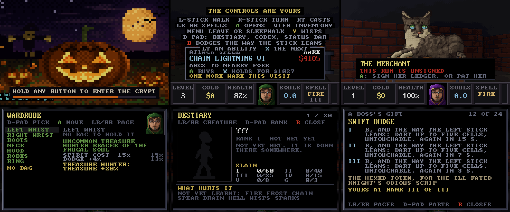
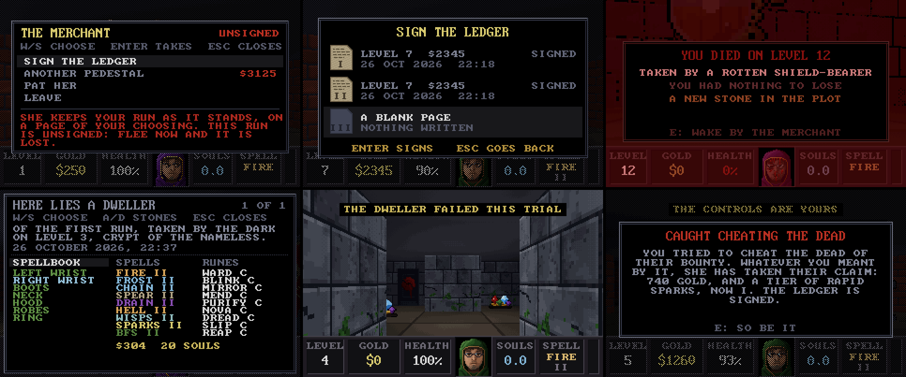
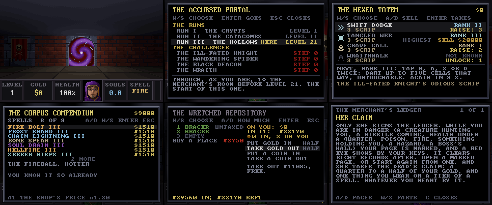

# HAUNTED.EXE

[](https://github.com/ASPDesignLabs/HAUNTED.EXE/actions/workflows/build.yml)
[](https://github.com/ASPDesignLabs/HAUNTED.EXE/releases)

A retro Halloween screensaver for Windows, built for OLED screens, with a crypt you can take over
and play, with the keyboard and mouse or a game controller. It renders in genuine VGA modes, scales them by a whole number to fit a 4K display, and
makes its own sound with an FM synthesiser, so there are no audio files. It's one program of about 1.4 MB
with no installer and no runtime to install.

**[The project page](https://aspdesignlabs.github.io/HAUNTED.EXE/)** &middot;
**[Download the latest release](https://github.com/ASPDesignLabs/HAUNTED.EXE/releases)**

## Download

Every release on the [Releases page](https://github.com/ASPDesignLabs/HAUNTED.EXE/releases) is built
from this repository by GitHub Actions and carries three files:

| File | What it is |
|---|---|
| `HAUNTED.EXE` | The program on its own. Double-click it and it opens in a window: hold H (or any button on a controller) for three seconds to play, F11 for full screen, Esc to quit. |
| `HAUNTED.scr` | The same program named as a screensaver. Right-click it and choose **Install**. |
| `HAUNTED-<version>-win64.zip` | Both of the above with the helper scripts below, this README, the previews and the full source. |

`SHA256SUMS.txt` beside them lists their checksums. The files aren't code-signed, so Windows may show a
SmartScreen warning the first time; choose *More info -> Run anyway*.

## The scenes

Two scenes are included. They alternate every few minutes (configurable) with a fade to black and a fade of the sound.

| Scene | VGA mode | What it is |
|---|---|---|
| **HAUNT.EXE** | 80x25 text mode, 720x400 | A possessed 486 PC: BIOS POST, a DOS prompt, and a ghost that types back. Between the gags it runs DOS programs that have been got at: EDIT rewriting AUTOEXEC.BAT for a seance, DEFRAG consuming souls and moving the remains to the front of the disk, a modem call to a BBS on the other side, a virus scan that cannot clean a dead host, MSD finding GHOST.SYS on IRQ 13, a thirteen-disk SETUP, a QBasic program that writes itself, and a file manager moving the dead from GRAVES to SOULS, until a file with your name turns up. Art materialises in between, seven full-screen half-block ANSI scenes with their own stories: the jack-o'-lantern in the pumpkin patch, the talking skull in the ossuary, the manor in a thunderstorm, the spider in the candle-lit corner, zombies digging out of a graveyard, skeletons dancing out of their coffins, and a ghost that rushes down a hallway to say boo. It ends in a fatal error and a CRT power-off, then reboots. |
| **CATACOMB** | mode 13h, 320x200, 256 colours | A Catacomb 3-D / Wolfenstein 3-D style crypt crawl on autopilot. Forty levels in four runs of ten, the Crypts, the Catacombs, the Hollows and the Deep, each rotting further towards its tenth level, where a boss waits in an arena of its own: the Ill-Fated Skeleton Knight, the Wandering Hunting Spider, the Black Deacon and the Wraith Unbound; then the runs come round again. Before each level the caster visits the merchant, the owner's cat, draped over a treasure chest, purring, and chooses among the wares on her pedestals for the gold it carries: spells, and things to wear that are rolled like loot, each in its quality's colour. Her room has grown into a hall: a back room with the Hexed Totem, where a beaten boss's scrip buys its ability, the Corpus Compendium and the Wretched Repository, and a grave plot with the Accursed Portal in its far wall. Runes come from the Rune Shrine across her room, for Cursed Coins. She sells a map that fills in as you walk, and turns what you have slain and found into Levels of Atonement: points to spend on the caster, and at every tenth a cornerstone. Each level is generated anew: main halls two and three cells wide, big chambers, colonnades and narrow side passages, walked with quick 90-degree turns. Each run is a place of its own, built in its own stone with its own rooms, doors, keys, light and treasure: the Order's burial vaults in dressed ashlar and bone, the drowned catacombs in wet slate under a climbing flood line, a mine the dead were tipped into, and black glass and magma at the bottom. The crypt is dressed: chains and meat hooks swaying from the ceiling, gibbet cages (some still occupied), candle chandeliers, roots and cobweb curtains, bone piles, graveyards of tombstones, fire pits and lit totems. Every level hides three to six secrets behind cracked walls, some of them chains whose deeper links lead out of the crypt altogether: into the Backrooms in the first two runs, and Severance in the next two. Locked vaults are colour-coded (gold from level 1, silver from 3, crimson from 5), each with its own key and a richer hoard, and the deeper ones are guarded. From level 6 a Black Altar stands deep in each level: for souls it sends its wisp to a secret, one at a time, or blesses your wisps against the dead, and once every secret is found it anoints something you wear. Will-o'-wisps, a soul each, fly ahead through the halls to the way out or a key and leave a trail of light to follow. The autopilot remembers treasure it has seen and goes back for it, and leaves through a rune-sealed exit for a Wolfenstein-style tally. Twenty kinds of creature come in over the first two runs, about one new kind a level, each in ranks you can tell by its colour, and on the last levels of each run its boss's hazards come into the halls as omens. Your face, Wolfenstein-style, pops up when you are hurt. Hold H, or any button on a game controller, for three seconds to play it yourself: then death costs, and only the merchant's ledger keeps what you have (see below). |








*The strips of menus, creatures, wisps and pockets were made before 1.0.0b10, and show the crypt's old
walls behind them. The map and the target's health in the Levels of Atonement strip are as they were
before 1.0.0b11, and the status bars in the older strips show a spell's old tier where it now has a rank.*

### CATACOMB: four runs, four places

Each run of ten is built in its own stone, and the generator lays it as a mason would: every straight
stretch of wall gets a material by the room it faces, whole stretches agree, and where one material gives
way to another the cell between is a blend, blocks falling away or a skin fraying, never a hard edge. What
stands on a wall (niches, banners, saints, timber sets, geodes) is placed by rule along it, and floors and
ceilings come from the room. Each run has its own doors, keys, torches and treasure, and its own way of
rotting from its first level to its tenth; a fresh run starts clean.

* **Run I, the Crypts.** The burial vaults of a forgotten order: dressed ashlar, coursed rubble in pale
  lime, lime plaster with a painted dado, the bedrock, and bone walls in the ossuaries only. Burial vaults
  with niches in rows, chapter houses with banners, tablets and a lozenge floor, knights' vaults with their
  slabs, undercrofts cut from the rock. Torches in iron sconces, oak doors under iron, vaults strapped in
  their key's metal with the Order's cross, keys with a trefoil bow. Kept at first, then damp, then falling
  in: moss, plaster coming away in sheets, the flags broken through. The knight fights in a knights' vault.
* **Run II, the Catacombs.** Tunnels cut into wet slate beneath them, flooded and drained: bedded slate,
  slate lining, silt and river stones, flowstone, the dead the floods brought down set in the silt. Saints'
  catacombs, cisterns with standing water, silted naves, canals and spinners' galleries. Lanterns on hooks,
  candles at the saints' feet, sluice doors gone to rust, corroded keys on a ring, coin gone black in the
  silt, reliquaries and pearls. A flood line climbs the walls as the run goes on, and webs come onto them
  from its sixth level. The water is walked through as any floor, but every step on it splashes. The
  spider's gallery is a spinners' gallery, its bile coming out of culverts.
* **Run III, the Hollows.** Caverns and an abandoned mine where the dead were tipped: rough granite, the
  pick-cut face, timber shoring, basalt columns, and backfill with the dead in it. Timbered galleries with
  rails and carts, stopes, charnel pits, fossil halls, and a cult's chapel at the end. Oil lamps on spikes,
  rough mine doors and chained vaults, heavy keys with a tally tag, nuggets, raw gems and a strongbox. Worked,
  then abandoned: scree banks up the walls, boards split and fall, and late in the run something has
  dragged its claws down the stone. The Deacon keeps his rites in the chapel.
* **Run IV, the Deep.** Black glass at the bottom: obsidian, basalt, ash-crusted rock, amethyst, and the dead
  fused into the glass. Geodes, glass halls, cinder fields, magma vents and a throne room. The walls are the
  light: magma fissures in the torches' place, geodes alight. Black iron doors with the fire behind their
  grilles, keys of glass, coin run molten, glowing crystal and an idol of black glass. It glitters on its
  first levels, burns through its middle, runs molten, and goes dark at the end, which suits the Wraith; its
  arena is the throne.

The merchant's hall is rebuilt once in the Crypts' ashlar under the Order's banners, the same before every
run; the red brick has gone. The pockets keep their own looks. Building from source, `make sheets` draws each
run's materials, blends, wall pieces, floors, ceilings, doors, keys and treasure, and a stretch of each room.

### CATACOMB: who lives down there

New kinds come in a level or two after their sign (a broken shield, a collar among gnawed bones, an
armour stand), and on its first level a new kind comes alone. They keep the levels they had when there
were twenty, so every kind is met in the first two runs; the Hollows and the Deep bring none of their
own yet, only higher ranks, the omens and the last two bosses.

* **Run I, the Crypts** (levels 1 to 10): skeletons that throw their own bones, bats, and spectres that
  only want you to know they are there. From level 2 a grave's earth is sometimes turned over from below,
  and a shambler climbs out as you pass and takes hold of you. Skulls set in the walls wake from level 3
  and gather a fireball; shield-bearing skeletons close in with swords from level 4. Spiders wait in
  corner webs from level 6, only their eyes showing, and their bite poisons and slows; the Drowned rise
  from a stirring puddle from 7 and burst into a foul pool; bone hounds hunt in pairs from 8; and from
  level 9 the Wraith comes once a level, down the halls from the far end while the torches gutter.
  Nothing kills it: fire, the wisp's light and Dread drive it back for a while. It never comes on a boss
  level. The spectres are gone after level 10.
* **Run II, the Catacombs** (11 to 20): hunting spiders that walk the ceiling and drop on you; ghouls
  that leap the last of the way and stop to feed on bones, mending as they eat; skeleton knights in plate
  that comes off as you hurt them, quicker as it goes; brood mothers laying egg sacs that split into
  spiderlings; shades that show only in light, whose touch takes your souls (from 16); ember imps that
  live by the magma and lob embers that set the floor burning; deacons that walk with their skeletons
  and raise more from the bones (kill them first); and gargoyles that are statues on their plinths until
  you pass (from 19).
* **Runs III and IV, the Hollows and the Deep** (21 to 40): all of them, deeper, darker and higher in
  rank.

**Ranks.** Every creature takes a rank as it comes: its own colour, then green, blue, red and black,
each tougher, harder hitting, quicker, a little bigger and worth more souls. The mix climbs over each
run's ten levels, a set's newest rank coming in on its fifth, and each time round the runs it climbs a
rung. From level 7 one level in three has a gilded one, which runs when it is hurt and carries
treasure; higher ranks now and then drop coin, gems or a potion. A caption names each kind and rank the
first time you see it on a level.

**Hunting.** A creature that sees you, is hit, or hears a spell nearby follows you round corners, and
the dead pull doors open; the nearest three hunt at once. The dead in ossuaries and crypts keep to
their rooms until they know you are there. Each kind has its weaknesses (fire for the shambler, frost
for hounds and spiders, lightning and Bone Spear through armour), which the autopilot plays to.

### CATACOMB: the bosses

The tenth level of each run is an ordinary level with an arena set into its far end in place of the
exit room: a small antechamber with a candle and a bench, an arch, and the boss's own ground beyond it,
the same every time. Step through the arch and it seals behind you, the boss's card shows with a line of
lore, its waltz begins, and its health runs along the top of the view. At 75, 50, 25 and 10% of its
health it stops, however hard the blow, turns untouchable in a pale shell, and calls a wave of adds out
of its gates, burrows or heaps of bone, at the highest rank of each kind you have met since you last
died; when they are down it rises and fights on. Three fonts in the walls hold a draught of a third of
your health each: one full as the fight begins, one more after the first wave and one after the third.
When it falls it drops its Named Odious Scrip, the exit opens, the tally gains a BOSS row, and the run
is complete: on you go to the merchant's before the next run's first level.

* **The Ill-Fated Skeleton Knight** (level 10). *He rode down to fetch the order's dead, and never rode
  back up.* Polished plate with a glint sliding across it, shed at the first and third waves, quicker
  each time. Swift Dodge carries it two to five cells in half a second, untouchable: to close on you, to
  get away when hurt or burning, or aside from a shot, leaving after-images. Its Mirror Rune turns about
  one missile in seven back at you at half strength, with a silver ring and a struck bell. It plants its
  sword to bring the ceiling down round you (Rockfall), and raises it for the Sundering Arc, a pale
  quarter-circle on the floor before it that it sweeps a moment later. Its adds are skeletons of every
  kind.
* **The Wandering Hunting Spider** (level 20). Up to the ceiling every few seconds, out of reach, across
  it and down two cells short of you with a leap. Its Mend Rune knits back an eighth of its health,
  glowing green, after it has lost a fifth. It rears and spits a web that holds you until your spells have
  torn a third of your health out of it (fire tears twice as fast); fires an egg sac onto a wall that
  hatches four small spiders five seconds later; and opens outlets in the cistern's floor, two at a time
  and the open ones changing, that flood their patch with bile which poisons and slows. A small spider
  comes out of a burrow every fifteen seconds.
* **The Black Deacon** (level 30). Black robes at twice a deacon's size, his Bone Ward wheeling about him
  as six shards; it takes the blows first, and grows back. He chants skeletons up from the chapel's heaps
  of bone, one at a time and three at most, unless a tenth of his health in damage breaks the chant. His
  Litany is two seconds of green light and then a fifth of your health if he can see you: the timber
  props hide you, the pews don't. Cracks run across the floor, in a line at you, a ring round him or a
  cross through the aisle, glowing until fire bursts from them.
* **The Wraith Unbound** (level 40). Eight braziers light its hall, and it gutters any it passes. It can
  be hurt only near one that burns, or near a wisp; in the dark your spells pass through it. E kindles a
  brazier again in a second, and a wisp at once. Time Slip slows a missile about to strike it, and it
  steps aside; Wraithwalk takes it into the stone and out of a wall beside you. Its touch chills and
  slows. Rings of void open where you stand and across your ways out, and become purple columns: inside
  one you are slowed, sapped and silenced, with no spells, runes or abilities (E still works); a void
  over a brazier puts it out. Away from the light, hands reach up out of the floor.

**Hazards** warn before they harm, never for less than about a second: grit and a hardening shadow
before a rock, cracks glowing before the fire, a sheen creeping out before the bile turns foul, a ring
and a thin column before the void. They harm only you, never the boss or its adds, by a share of your
health. **Omens**: on the last three levels before a boss and in its own level's halls, its hazard comes
now and then near you, ahead of you where it can, at half the harm: every 90, 60 and 40 seconds, then
every 30. In the Crypts the ceiling drops a stone, in the Catacombs bile spills from a grate low in a
wall, in the Hollows the floor splits and burns, and in the Deep the void opens. Never in a pocket. The
first of each kind is named, and written in the Codex.

**The waltzes.** Each boss has a slow waltz in a minor key, over a five-note figure that drifts against
the bar, with a bell on the first beat: the knight's in D minor on brass, the spider's in B-flat minor,
plucked, with a skittering hi-hat, the Deacon's in G minor on an organ with a choir, and the Wraith's
in A minor, a drone with a voice that comes and goes. While the adds are out it turns up (drums, the
bass doubled, a semitone higher, a little quicker) and settles when they fall. When the boss falls the
waltz fades under three tolls, and the march comes back.

**Challenges.** A beaten boss can be fought again from the Accursed Portal (below), as you are, from
its antechamber, with the way back up fallen in. Each win takes it a step higher, to five: a quarter
more health and a tenth more in its blows a step, its hazards and casts a fifth more often and more of
them, its adds a rank higher from step 2 and two from step 4; from step 3 a win gives two scrip. A win
takes you back to the merchant's room you left.

The bestiary has no pages for the bosses yet.

### CATACOMB: achievements and the bestiary

Each run keeps a record of what it has killed, by kind, rank and spell, the secrets it has found, the
levels it has cleared and the bosses it has slain, and it is kept on the run's page in the ledger, so
each page has its own. Achievements come for 60 kills of a creature's lowest rank, then 40, 25, 15 and
8 up the ranks and 3 gilded; for 1, 5, 10, 20, 30, 40 and 50 secrets; for each of the forty levels; for
each boss slain, and slain again at each challenge's step; and for each time down past level 40 again.
Everything counts, the autopilot's kills too, and each one slides in at the upper right with a chime.
Death doesn't take the record.

Press **B** while you play for the bestiary: a page for each creature (a dark shape until you meet it),
walking on the spot and turning about, drawn in each rank you have seen, with your kills against each achievement and what
hurts it, learnt after three kills with each spell. A and D turn the pages, W and S choose a rank, and
the last page lists the achievements.

What the autopilot earns in an ordinary screensaver session shows, but isn't kept.

### CATACOMB: the merchant and the wardrobe

Each level begins in the merchant's room. The caster greets the cat (a slow blink back) and looks over
the pedestals standing in an arc round the back wall: two for a fresh run, and more bought from her, up to
seven (below). Since 1.0.0b11 she sells no spells (they are the Alignment's now, below): every pedestal
holds a thing to **wear**, with now and then a bag among them, and the first, very rarely, the
**BFS9000**, which burns 40 to 100 souls to collapse everything in sight into a point of light. Runes come
from the Rune Shrine (below). The caster may buy one ware a visit in the first run, two in the second and
three from the third, and level 1's first is free. A thing to wear costs by its quality, from part of a
level's gold for something common to several levels' for something exquisite. The cat trills when you
buy, and a rest while it purrs mends some of your wounds.

* **Bones.** Every Bone Spear throws a bone, and the spear costs no spirit. Skeletons, shield-bearers,
  knights and bone hounds drop them now and then (about one in eight, more at higher ranks), opening the
  Physical line brings six, and you can carry thirty (more with the line's Efficiency, or as the Headsman).
  With none, the spear fizzles.
* **Defensive runes**, tattooed on the back of the hand and glowing when they fire, each on its own
  cooldown and triggered by the situation, with a human's reaction time (sometimes slow, sometimes
  missed, now and then wasted): Bone Ward (soaks blows), Blink (steps out of trouble), Mirror Veil
  (sends missiles back), Mend, Purify (cures poison and slow), Frost Nova (freezes what is close),
  Dread (the dead flee), Time Slip (slows everything near) and Soul Reaping (triple souls). Runes cost
  no spirit. Each is held in one quality at most, the best you have, Common to Exquisite, stronger and
  quicker to come round as it goes up. At **Exquisite** each does a second thing: the Ward bursts into
  shards when it breaks; Blink leaves a double that creatures go for; the Veil sends missiles home at
  twice the strength; Mend past full becomes a small ward; Purify mends a little each second; the frozen
  take double; Dread reaches the living too; what Time Slip slows takes a quarter more; and Soul Reaping
  heals a little each kill.
* **To wear**, in seven places: a bracer on each wrist, boots, an amulet, a hood, robes and a ring. Every
  piece is rolled. Its quality, Common (white), Uncommon (green), Rare (blue), Ultra-Rare (purple) or
  Exquisite (gold), sets how many stats it has and how strong they are, and the deeper it was sold, the
  stronger it is. The stats: Armor, Dodge, Health, Restores (health back each second), wards against
  poison, burning and slowing, Movement, Quiet (creatures hear your footsteps less), Spell Haste, Spirit
  Cost, Damage, Fire, Frost or Lightning (that much again of the element on every spell, biting hardest
  on what it hurts), and Spell Effect (Soul Drain's healing, Frost's slow, the burning and the runes'
  strength). Since 1.0.0b11 pieces roll the elements too: an element's **Power** (more of its damage;
  rings and robes, 50% at most), **Efficiency** (less spirit, and for Physical a spear that spends no bone;
  hoods, 40%) and **Insight** (a shorter wind-up; bracers, 30%), a third of them leaning to the lines you
  feed; **Resist Spirit** (amulets and robes) and **Vessel** (more spirit carried; amulets and hoods). The
  totals are capped (Dodge at 35%, each ward at 75%, and so on), and no piece promises more than a cap
  allows. A piece is named for its strongest stat: *Rare Boots of Shadows*, *Uncommon Robes of the
  Bulwark*, *Ring of the Pyre*, *Hood of the Thin Dose*.
* **Abilities.** A hood always carries one, other pieces sometimes, graded by quality: **Swift** (more
  Movement), **Arcane** (more Spirit Cost reduction), **Treasure Hunter** (treasure worth more, and a
  whisper from a secret wall within three cells), **Keymaker** (keys within its reach shine through the
  stone, and the L list offers a wisp to each key still lying), **Communing** (every 15 seconds, creatures
  near you show as red shapes through the walls), **Thorned** (hurts what strikes you) and **Mirrored**
  (sends some missiles back at whoever threw them).
* **Anointed** pieces, about one in ten, have their stats raised by 10% (Common) to 25% (Exquisite).
  The Black Altars anoint too (below).
* **Bags.** You start without one. A bag holds two to five spare pieces by its quality (a Burlap Sack,
  a Gravedigger's Satchel, a Pilgrim's Scrip, a Bone Reliquary), turns up now and then among the things
  to wear, only ever bigger than the one you carry, and takes over its contents. Without a bag, whatever
  a new piece replaces is lost.

The robes colour the sleeve, the right bracer shows as an iron cuff inlaid in its quality's colour, the
ring's stone takes its colour, and the hood frames the portrait. The autopilot shops by what helps it
(an element's stats by how much it casts that element), never buys a bag, and loses whatever a new piece
replaces.

### CATACOMB: the Rune Shrine and Cursed Coins

Across the merchant's room from the wares stands the Rune Shrine, pale and sanctified, giving nothing.
A **Cursed Coin** curses it: it darkens, its carving glows, and it gives runes. Coins are found at the
end of each chain of secrets, and one more comes when every secret on a level is found; each pops up
FOR THE SHRINE, and they show under the keys on the status bar and on the caster's page.

Press E at the shrine for its screen: nine slots, and what it will do. **Pull** with one to three coins:
more coins, more runes come into the slots (one or two, two or three, three to five). Its rank sets the
best quality that can come, Common at first, and each quality is two thirds as likely as the one below.
Three alike in the slots become one of the next quality, past the shrine's rank and up to Exquisite.
**Raise** it with coins (6 to Uncommon, 12 to Rare, 24 to Ultra-Rare, 32 to Exquisite). **Favour** a
kind it is attuned to (you have held it at Rare or better) with one to three coins more, each making it
a third likelier. Each pull earns one **take**: a rune from the slots to keep, the better if you have
that kind already. Takes not used are lost when you leave the room, and it says so first; the slots
keep the rest for next time. The autopilot plays the shrine too, with the coins it finds.

### CATACOMB: the merchant's hall

Her room has grown. Press E at the cat for her menu: **sign the ledger** (below), **ascend** (below),
**offer souls** (ten for experience), **another past** (below), **another pedestal**, **offer a coin**
(for Second Wind, below), **pat her**, or leave. Pedestals cost 500 gold for the third, then 1,250, 3,125, 7,815 and 19,530 for the
seventh, and each is set out at once with a ware on it. An arch beside her leads to a back room, another
past the shrine to the grave plot, and one in her north wall to the room of the Lampstand, the Dead Bell
and the Weeping Font (below). Nothing in the hall is lost to death.

* **The Hexed Totem**, in the back room. Each boss's scrip hangs on its hooks, and once a boss has fallen
  its row on the Totem's screen teaches you its ability, raised to rank III for one, two and three of its
  scrip. Scrip beyond what an ability still needs sells for 20,000 gold a piece (it asks twice). The
  abilities: **Swift Dodge**, the knight's: tap W, A, S or D twice and dart two to five cells that way,
  untouchable while it lasts, missiles passing through you (every 15, 7 or 3 seconds by rank).
  **Tangled Web**, the spider's: a glob of web at what is before you holds it, halves its blows and sets
  it clawing at the web, until it has done a third of your health a rank in damage to it; a rank holds
  that many webs at once, and a miss costs only two seconds. Not bosses, spirits or shades. **Grave
  Call**, the Deacon's: what you slew lately gets up again as yours for 12, 16 or 20 seconds, strikes
  the nearest foe, and draws their blows. **Wraithwalk**, the Wraith's: for 1.5 to 2.5 seconds the
  creatures lose you, missiles pass, and you walk through them, the view grey and the hand thin. The
  right mouse uses the one readied and Q readies the next; Swift Dodge is always on the double tap. Their
  sockets sit at the bottom left, filling as they come round; in a void, none of them works.
* **The Corpus Compendium**, a tome on a lectern in the back room. Every piece you wear is written in it
  as you first wear it (once, if it is alike in everything; twelve to a kind and quality, the cheapest
  going for a better one), and every spell at the highest tier you have had it. Its pages, A and D
  through them, list them Common first with their prices: the shop's times 1.2, five hundredths less for
  each run completed, never under half. Enter buys a thing and wears it at once, outside the visit's
  wares. The autopilot looks once a visit and buys the best thing it finds well worth its price.
* **The Wretched Repository**, iron doors in niches in the back room's west wall. Two places at first,
  one of them untaxed, and ten more to buy, from 2,500 gold, half as much again each. A piece you wear,
  a spare or an empty bag goes in for a tenth of its price (the first place free) and comes out free, into
  its place if that is bare, else the bag. Gold goes in less a quarter (all, a half, a quarter or a tenth
  at a time) and comes out free. A Cursed Coin goes in free and comes out for 2,500 gold. Neither death
  nor her claim touches any of it. The autopilot leaves it alone.
* **The grave plot**, south of her room: the last ten deaths, a stone each, the newest freshly cut with
  the earth turned. E at a stone opens its page: the epitaph (*HERE LIES A DWELLER OF THE FIRST RUN, TAKEN
  BY THE DARK ON LEVEL 3, CRYPT OF THE NAMELESS*), when, and what was carried: what the dweller was, each
  line's rank and path, the runes, the gold, souls and coins, and each worn piece's card. A and D go to the
  next stone.
* **The Accursed Portal**, a red-violet swirl turning in a stone arch in the plot's far wall. Its screen
  lists the runs opened, each by beating its boss on the way down, and takes you to the merchant's room
  before any of them, forward or back, as you are. Below them, the challenges: each boss slain, at its
  step, with what the step brings; and the levels cleared, A and D through them, each replayed for five
  souls and its number (below).

Press **C**, in the crypt or here, for **the Codex of Affixations**: a page for each ability you have
worn, each rune you have held (and its Exquisite effect once held so), each boss's gift once it has
fallen, each stat you have worn, with its cap and the pieces that roll it, each hazard met, the elements,
each line open with its nodes, what you were, the souls (the vessel, the bell and the font once cursed,
replays, Soul Sap once met), and her claim, there from the start. What it does, its numbers by quality or rank, where it comes from, and what
you have of it now. A and D turn the pages, W and S go between the parts. It is kept through death.

### CATACOMB: the Alignment and what you were

**Six elements.** Fire, Frost, Lightning, Poison, Spirit and Physical. Each creature takes more or less from
each, and does its harm in one or two of them; the target's readout and the bestiary show it in glyphs
(below). **Spells are lines**, one an element, bought with **Alignment Points**, one a Level of Atonement,
at **the Lampstand** in the room north of hers, whose six bowls burn as lines open and grow as they rank.
Three points open a line (Fire comes open), and every point in it after that is a rank. A spell's strength
follows your Level of Atonement and its rank adds to that. The spells: **Fire Bolt** (the fireball, free at
rank 1), **Frost Shard** (slows), **the bolt** (strikes at once), **the Blight Flask** (lobbed over what is
in the way, a splash and poison after), **Soul Drain** (heals you as it hurts, the healing paid in spirit)
and **the Bone Spear** (through all in a line, a bone a spear, no spirit). 1 to 6 choose them, 7 the BFS9000.

Each line goes: the opening; Efficiency (less spirit) and Insight (a shorter wind-up), a point at a time;
an ability (Firestarter's flames along the fireball's flight, Deep Chill's freezing third shard, Ionization's
trail behind lightning, Seep's pool of venom, Harvest's extra souls, Impale's pinned target); then one of
two paths, the other closing for good, each ending in an **ultimate**:

| Line | Path A | Path B |
|---|---|---|
| Fire | Flamewalker: Firestarter's flames lend you half your armour again | Firewall: hold to call three flame spirits that circle you, burning what they touch |
| Frost | Winter's Lance: hold to charge a lance through all in its line, freezing each and riming the floor | Shatter: a frozen creature struck breaks for double, its shards cutting what stands near |
| Lightning | Arc: the bolt leaps on, four times | Amperage: hold to charge a slow orb through all it meets, each arcing to one more, all of them dazed |
| Poison | Plague Pit: hold to charge, and the pool grows to two and a half cells, slowing | Contagion: what dies poisoned passes its poison on |
| Spirit | Soul Tether: hold to keep the beam on, draining and slowing; it leaps on when its hold dies | Wisp Host: every drain looses three wisps that hunt round corners |
| Physical | Phalanx: hold to charge a fan of three spears, five at full | Ballista: hold to charge a heavy spear that knocks back and stuns all it passes |

A **charge** builds over a second in a gathering by your hand, in the element's colour, that quickens as
it fills and lights the crypt round you; a tap casts the ordinary spell. Every spell has a **wind-up** (a
third of a second at rank 1, more as it ranks and for the ultimates), and you can walk while it gathers;
a blow that lands then may break it, less often the better your Dodge, Armour, resistance and Luck. The
Masteries of Lightning, Frost, Poison and Spirit add a share of their element to every other spell (and
Spirit's lets it harm spectres). Unbinding a
line costs two Cursed Coins and gives back half its points. Tab's fourth page shows the tree and its fifth
each element's Power, Efficiency and Insight, the line's and what you wear together. A death that costs
takes the lines, all but Fire and your class's.

**What you were.** At a fresh start, and after every death that costs, she asks *WHAT WERE YOU?* The
caster is set to the labour of clearing the crypts, and what it was decides how:

| Class | Line | What it gives |
|---|---|---|
| The Witchfinder | Fire | Fire a fifth cheaper and a tenth stronger; three points for Fire |
| The Anatomist | Frost | Frost open, a fifth cheaper; slowing and freezing a fifth longer |
| The Galvanist | Lightning | Lightning open, a fifth cheaper and a tenth quicker to gather |
| The Plague Doctor | Poison | Poison open, a fifth cheaper; poison a fifth longer |
| The Sin-Eater | Spirit | Spirit open, a fifth cheaper; twenty more souls carried |
| The Headsman | Physical | Physical open; a fifth more spears spend no bone, ten more bones, a tenth more armour |

Each has a story on her question's screen. A life keeps one; from Level of Atonement 20 she hears another
past for five Cursed Coins, and the old line keeps what was bought in it. The screensaver takes one at
random, so every line shows in time. The class's mark is on the Alignment screen, the caster's page and the
grave's stone.

### CATACOMB: souls

Souls are your spirit, and spells spend them by rank: about a fifth of a soul at rank 1, one at rank 10,
two and a half at rank 20, less Efficiency and Spirit Cost; a full charge two and a half casts. With too
little, a spell goes out at rank 1, free, and weak. **The vessel** holds twenty and two a Level of
Atonement, more from the Sin-Eater, the Vessel worn, Communion and Spirit Mastery; what comes in over it
slips away in a pale wisp off your hand, and the souls on the status bar turn gold, a line under them
showing how full. **Motes**: the dead leave about half the souls they used to, where they fell, a pale
flame hanging six seconds; walk through it. Urns, the visportals and her offering are as before.

* **Her offering.** Ten souls, and she gives you experience for them, more the deeper you are.
* **The Dead Bell**, a cracked bronze bell in the new room. A Cursed Coin turns it black for good; then
  souls (three times ten and the level) toll it for the **next level attempt**: two fifths more of the dead
  and of their gold, half the experience, a boss's waves a third larger and a scrip more, a green cast to
  the fog, *CORRUPTED* under the level's name. One attempt. On a level you have cleared before, half as many
  souls again **show its secrets**: a violet wisp at each cracked wall from the start, and a mark on the map.
* **The Weeping Font**, a stone face over a basin. A coin and it weeps red for good; then once a visit,
  ten souls and the level for a tenth more experience on the next level.
* **Replays.** The Accursed Portal lists the levels cleared; five souls and the level's number take you to
  her room before it, then the level (new walls, creatures and treasure: the crypt builds each visit
  afresh), then back to the room you came from. Gold, souls and experience as ever, no Cursed Coins.
* **Soul Sap.** Bats of rank II and above, on your face long enough, latch on instead of biting: across
  the lower view, wings beating, the edges of sight violet. It feeds on your health and souls and slows you;
  turn hard one way and back, or strafe left and right, again and again, and it slips and lets go. Blink
  and Swift Dodge throw it off, and it lets go by itself after ten seconds. Resist Spirit, a new stat and a
  line of points, takes its share off the feeding and off all harm of Spirit.
* **Spectres** come on every level now, by your Luck, and with Spirit Mastery your Soul Drain and wisps
  slay them for their souls.

### CATACOMB: the map, Levels of Atonement and the cornerstones

**The map.** The merchant sells one, once, for 1,000 gold: a small scroll floating at her left. It outlasts
death and her claim. **M** (up on a controller's D-pad) unrolls it across the middle of the view, and since
1.0.0b11 the crypt goes on while it is open: you walk, turn and cast with it up. The level from above, north
up, in ink on a parchment torn, stained and burnt through in places, where the ink goes on over the holes in
a ghostly violet. What lies within a cell and a half of you is drawn, through the stone, and what you see out
to sixteen cells; where you have walked is washed darker. Doors are bars, a vault's in its key's colour once
you have been near it; the exit, the keys you have seen, the Black Altar, opened secrets' doorways and a
visportal or a cooler have marks of their own, and you are the red arrow. A secret is stone on the map until
it is opened. Across its foot the level's numbers: the dead, the gold, the secrets found and the keys. The
arrow keys (the D-pad) pan it, and it drifts back to you three seconds after; Space brings it back at once;
M, Esc, Tab or the pad's B rolls it up. A pocket has a map of its own while you are in it.

**The target's health.** Look at a creature within twelve cells and its name and rank show at the top of
the view with its health as a bar and in figures, for a moment after you look away, and for longer when you
have hit it. Beside the bar, the elements as glyphs: on the left what it takes worst (with ++ or +), on the
right what it shrugs off (- or --, struck through when nothing gets through), and under it the elements of
its harm, as far as you have learnt them: an element from five of the kind slain by it or twelve hits, its
harm from three hurts. Bosses keep their own bar, and of a spirit it says only that nothing you carry
touches it. **The runes' sockets**: when a rune fires, its mark comes up in a socket at the lower right, its
edge in the rune's quality's colour, a line along its foot coming round until it is ready again.

**Experience.** Everything you do down there counts, and each gain is written at the lower left as it
comes, with what it was for: a kill, by its kind, its rank and the level (a pocket's creatures by the rank
they had before the pocket raised them, a quarter more on a chain's first link and a tenth more for each
link after, never more than 1.6 times); a secret, 25; a chain's end, 60 for each link; a boss, a great
deal; a level cleared, 30; each room first entered, 3; and all of it more the deeper the level. A line along
the top of the status bar fills towards the next Level of Atonement and turns gold when one is waiting. The
moment one is banked, a choir, a deep bell and a whisper sound and *LEVEL OF ATONEMENT 12* crosses the view.
The tally has an EXPERIENCE row.

**Ascending.** Experience becomes levels only with the merchant: her menu's **ascend** takes every level it
reaches at once, ten points each, to the fiftieth. Level *n* needs 42 x (n-1)² in all: 42 for the second,
3,402 for the tenth, 15,162 for the twentieth and 100,842 for the fiftieth. Without dying, the screensaver's
caster reaches about Level of Atonement 15 by the end of the first run of the crypt and 28 by the end of the
second, and 50 at about level 35; someone who clears every chain, at about level 29. Everyone starts alike, at 100
health and 2% Luck, and the points buy:

| Points | Line | A step | Cap on the total |
|---|---|---|---|
| 1 | Health | +5 | none |
| 3 | Damage | +1% | 100% |
| 3 | Resist all | +5% to poison, burning, slowing and Spirit | 75% each |
| 3 | Resist poison, burn, slow or Spirit | +15% to the one | 75% |
| 3 | Spell Haste | +1% | 50% |
| 3 | Dodge | +1% | 35% |
| 2 | Treasure | +1% | 100% |
| 2 | Movement | +1% | 40% |
| 1 | Luck | +0.1% | 25% |
| 1 | Attunement (spirit cost) | +1% | 60% |

On the caster's screen W and S choose a line, D or Enter buys a step and A takes back one bought since the
screen opened; points not spent wait for next time. What the caster has of its own is added to what it
wears, under the same caps, and a step that would go past one asks twice. **Luck** is new: each kill rolls
it for a purse of gold, bigger by the creature's rank, and half the time a bone, a potion or an urn besides,
none of it counted in the level's treasure. Nothing you wear has Luck; only points buy it. **Treasure** is the
stat Treasure Hunter raises, and makes everything picked up worth more. The screensaver's caster ascends at
each visit and spends by a fixed order (spell haste, damage, health, dodge, resistance, attunement, luck),
but never on a run that is yours.

**Cornerstones.** At each tenth Level of Atonement you choose one of five, free, on a screen of their own
that opens before the points (and is Tab's third page). A death takes them.

* **Second Wind.** A blow that would kill you leaves you at half your health instead, untouchable for two
  seconds. Once a run of ten levels; a Cursed Coin offered to the merchant (**offer a coin**) restores it
  sooner.
* **Premonition.** A dashed purple edge on the floor a second before the place does harm there: falling
  stone, fire, bile, the void, the Wraith's hands (the knight's arc keeps its own time). It also marks
  where an imp's ember will land, a drowned one about to burst, and what the Deacon's Litany can see.
* **Cartographer** (once you have the map). Each level's map comes already drawn, all but its secrets and
  keys; a vault's door takes its key's colour, and a secret's wall shows dotted, once you have passed near.
* **Lantern of the Dead.** A pale light about you, about two and a half cells, that shows the shades; the
  ordinary Wraith won't come within two cells of it.
* **Grave Sense.** Creatures within ten cells show on the map as red marks.

**Overlevels.** Past the fiftieth, each level costs 4,074, and at 55, 60 and every fifth after you have an
overlevel to give: Space (Y on a controller) on a line of the caster's screen, asked twice, puts that line
5% past its cap, the cap with it (Luck 1%; not health or resist all). An overlevelled number is drawn pale
violet, breathing and now and then slipping, with the dead's eye beside it, wherever it is shown. The
Codex has a part of its own for all of this, THE CASTER'S OWN.

### CATACOMB: death, the ledger and her claim

**The dream.** While it plays itself, the screensaver dreams: it plays on from your last page, keeps
nothing, and dies as it always has, the level beginning again and its creatures hitting a little softer
each time (by up to 45%, until it is cleared). Hold H and the run is yours, and stays yours until the
program closes, even if you sleepwalk: from then on the rules below apply.

**Death costs.** When you fall, the gold you carry, every piece you wear, the bag and what is in it,
every spell but the Fire Bolt (which goes back to the fireball), your souls and bones, your Cursed Coins,
the ware held at the merchant's, and your experience, Levels of Atonement, points, overlevels and
cornerstones all go. A stone is cut in the grave plot with what you carried and
what took you, a card says so, and you wake in the merchant's room before level 1. What stays: the
runes and the Rune Shrine, the pedestals, the map, the Totem's abilities and scrip, the Compendium, the
Repository, the Portal's runs and challenges, the record and the Codex. The death is written to your page
the moment you fall, so closing the window during the fall undoes nothing. A death in a pocket is
different: you come back whole at the entrance of the chain's first room, and its doorway is sealed for
the rest of the level, *THE DWELLER FAILED THIS TRIAL*.

**The ledger.** The merchant keeps three pages, I to III, and only she writes them. Her menu's **sign the
ledger** writes the run as it stands onto a page, the page you came from picked first; signing over
another run's page asks twice. A page signed in her room keeps her visit too: opened again, the same
wares are set out, with what was bought gone. **Open the ledger**, from Esc, loads a page anywhere, asking
twice. A page is written by a signature, a death and her claim, and by nothing else: fleeing keeps only
what was signed, and the next start opens your last page. A run never signed is kept as the unsigned run
until you sign it somewhere.

**Her claim.** While you are in danger (a hunting creature within eight cells, a missile on its way,
health under a quarter, poisoned, slowed, held in a web, a foe's fire underfoot, a hazard's warning or
harm, or inside a boss's arena while it fights), your page is marked, and the mark clears eight seconds
after the danger has passed. It is written the moment the danger begins. Open a marked page, by the
ledger or the next start, and she takes the dead's claim at once, whatever you meant by it: a quarter to a
half of your gold, and one piece you wear or a tier of one spell (lost at tier I; the Fire Bolt never
goes below the fireball), all alike likely. Then she signs the page herself. She leaves your Levels of
Atonement alone. While a page is marked a red
eye shows under your keys and in the readout, and FLEE and OPEN THE LEDGER say *THE DEAD ARE WATCHING*.
This catches a closed window, a crash or a power cut as well. Nothing in a pocket or her room counts as
danger.

### Playing CATACOMB yourself

Hold **H** for three seconds, in either scene, or any button on a game controller. A bar fills at the
bottom of the screen; let go early and nothing happens (any other key still ends the screensaver as
usual; a controller's buttons never do). When it fills, the crypt is yours, and the scenes stop
switching until you hand it back. HAUNT.EXE cuts straight to the crypt.

| Key | What it does |
|---|---|
| W A S D, or the arrow keys | Walk and strafe (the left and right arrows turn instead). Shift runs |
| Mouse | Turn, Doom-style; there is no looking up or down |
| Left click, or Ctrl | Cast the spell in hand where you are looking (lightning and Soul Drain pick the nearest creature near the middle of the view). Hold it to charge a line's ultimate, or to keep Soul Tether on; a tap casts the spell |
| 1 to 7, or the wheel | Choose a line's spell: 1 Fire, 2 Frost, 3 Lightning, 4 Poison (the Blight Flask), 5 Spirit (Soul Drain), 6 Physical (the Bone Spear), 7 the BFS9000; the wheel skips lines not open |
| E or Space | Open the door ahead, unlock a vault with its key, press a cracked wall, step through the exit runes, drink from a boss's font, kindle a brazier, or use the merchant (her menu), the Rune Shrine, the Hexed Totem, the Compendium, the Repository, a gravestone, the Accursed Portal, the Lampstand, the Dead Bell, the Weeping Font, a Black Altar or its wisp, a visportal or a water cooler. Walking into a door opens it too, and walking into a chain's doorway takes you through |
| Tab | The wardrobe: W and S choose a place, worn or in the bag, and Enter moves a piece between them. A and D turn to the caster's page: every total, what abilities add (in gold) and what is at its cap (in blue), and the lines' ranks; then the cornerstones, the Alignment's tree and the elements |
| B | The bestiary and the achievements. A and D turn the pages, W and S choose a rank or scroll |
| L | The wisps: a list of what can be summoned now and at what price (see below). W and S choose, Enter casts, Space sets L to cast that one at a tap; then holding L brings the list back |
| C | The Codex of Affixations. A and D turn the pages, W and S go between its parts |
| M | The map, once bought from the merchant, while you walk on. The arrow keys pan it, Space brings it back to you, M, Esc or Tab rolls it up |
| Turn or strafe hard, back and forth | Shake off a bat that has latched on to your face |
| Right mouse | Use the boss ability readied (once the Hexed Totem has taught you one) |
| Q | Ready the next boss ability; at a ware in the merchant's room, hold it |
| W, A, S or D twice | Swift Dodge, once the Totem has taught it: a dart two to five cells that way |
| H | A look at the status bar while it is tucked away |
| Esc | Asks whether you want to leave, with a different argument each time for staying; also where you open the ledger |

**With a game controller.** An Xbox controller, or any pad that speaks XInput (most PC pads do, some
in an Xbox mode), plays it as well as the keys do, in the screensaver and in the window; the window
reads it only while it is in front. A PlayStation or Switch pad needs a translator such as DS4Windows
for now. When the pad was the last thing you touched, the hints in every menu name its buttons, A in
green, B in red, X in blue, Y in gold; touch a key and they go back. It rumbles when you are hurt (by how
much), when a rock lands near, a secret wall grinds, a boss falls, or the BFS9000 goes off. While you play
with it the game keeps the display awake, since Windows doesn't count a controller as activity. The
settings can turn it off.

| Controller | In the crypt and the merchant's room | In a menu |
|---|---|---|
| Left stick | Walk and strafe, slower as it leans less; click it to run until you let go | Up, down, left, right |
| Right stick | Turn, faster the further it leans | |
| RT / LT | Cast (hold to charge) / use the boss ability readied | |
| RB / LB | Next / previous spell | Next / previous page |
| A | Open, use, buy (E) | Choose (Enter) |
| B | Swift Dodge, the way the left stick leans, else back | Back, close (Esc) |
| X | Ready the next ability; at a ware, hold it (Q) | |
| Y | The wisps (L) | Space |
| D-pad | Up the map (then it pans the map), left the bestiary, right the Codex, down the status bar | Up, down, left, right |
| View / Menu | The wardrobe / the question at Esc | |

Your defensive runes still fire on their own, as quickly (and as fallibly) as they do for the
autopilot. In the merchant's room you shop yourself: walk up to a pedestal to see its card, and press
E, Space or click to buy it, as many times as the visit allows. A piece is worn at once. If it takes
the place of one you wear and you have no bag, the card warns in red that the old one will be lost,
and a second E buys; if your bag is full, you are asked which spare to let go (Esc thinks better of
it). **Q** holds a ware for the next visit, for a quarter of its price: it comes back on its pedestal
at the price it showed, and the hold ends when you leave the room the next time, bought or not. One
ware is held at a time. E at the cat herself opens her menu, where you sign the ledger, ascend and buy
pedestals. Then leave by the east door.

The Wolfenstein status bar shows the level, gold, health, your face, your spirit (the souls, to a
tenth), the spell in hand, with the bones above it when the spear is in hand, and your keys. Five seconds
after anything it has to show, it slides away to give you the whole view, and comes back when you are
hurt, choose a spell, tap H, or open the wardrobe or the bestiary. It stays up in the merchant's room.
While it is away, the small readout the autopilot uses appears when gold, a key or souls come and go.
Your hand, likewise, rises only to cast or to reach for something, stays ready a moment, and sinks out
of sight.

**Secrets.** Every level hides walls that give: three secrets on a set's first level, rising to six on
its last, counting every link of every chain. Such a wall looks like any other plain stone until you are
within a couple of steps of it, when a set of cracks shows in it. Face it and press E (or Space) and it
grinds back through a room carved behind it, one to four blocks of the plan, with a chime and "A SECRET!
1 OF 5" on screen. A secret room only ever holds treasure and, often, a potion: never a key, and its
treasure isn't counted in the level's total. The tally at the end of a level counts every secret found.
The autopilot presses every one it passes while it has time, a third of them after.

**Chains.** Some secret rooms have a doorway at the back, and through it a place of its own: walk into the
doorway and you are elsewhere, and each link of the chain is a secret found. The level waits while you
are away, its clock and its creatures with it. On the first ten levels the chains lead into **the
Backrooms**: yellow wallpaper, damp carpet, tube lights humming, some failing, some dead, things from the
crypt hung from the ceiling or sunk in the floor, and the level's own creatures glitching, a quarter
stronger and more of them. There is no music, only the hum and an echo. On levels 11 to 20 they lead into
**Severance**: white halls and corners, green carpet, offices of four desks, every panel lit, and the
creatures there lit too brightly, 30% stronger and quicker to strike, to a muzak that is slightly too
calm. Each link deeper is bigger and its creatures a rank higher. At the end of a chain the Backrooms
keep a **visportal**, a doorway onto doorways without end, and Severance a **water cooler**: E there
restores your health, or gives fifty souls if you are whole, with the chain's Cursed Coin, once. What you
take and kill in a pocket stays taken and killed; die there and you are thrown back to the chain's first
room, whole, and its creatures are back. The autopilot goes into chains while it has two thirds of its
health and the time, and turns back when it hasn't.

**Wisps.** Press L for the list of wisps. A wisp to the way out costs a soul: it kindles before you and
flies off down the halls the way you would walk, fetching the key first if the exit is in a locked
vault, and hovers at the doorstep until you come. It lights about four cells round itself as it goes,
shows the shades, and drives the Wraith back, and it leaves motes of light hanging behind it for twelve
seconds, so you can follow it round corners or after a fight. With a Keymaker piece on, the list offers
a wisp to each key still lying in the level as well, in that key's colour. Casting another sends the
first out. Choose one and press Space to have L cast it at a tap from then on; holding L brings the list
back. The choice is kept in your saves.

**Black Altars.** From level 6, a level with secrets has a Black Altar, in a corner of the exit room or
else in the room farthest from the start. Press E at it for what it offers, each with its price and a
note on why it can't be had yet:

* **Wake its wisp**, for ten spirit: a violet flame lights in its bowl and a violet wisp rises from it,
  free, and goes to the nearest secret wall you haven't opened (through the key of any vault it lies
  in). It waits at the wall while you are inside, and once you have been in and come out again, E at the
  wisp sends it home to the altar. There, **send it on** to the next secret for ten spirit and five more
  for every secret already found on the level. While it is out, the L list calls it back if you lose it.
* **Bless your exit wisps**, for twenty-five, once a level: every wisp to the way out you cast on that
  level wears a pale gold halo, and the undead within about four cells of it flee from it, as from Dread,
  for three seconds after it has gone by; the Wraith is driven back. The altar's fire burns with a white
  edge while it lasts. It ends with the level, or a death on it.
* **Anoint what you wear**, once every secret on the level is found, every link of every chain, and the
  flame has turned gold: one thing you wear, at random, one not anointed already. Then the altar is spent.

The autopilot uses them too: it wakes an altar it passes with 25 spirit or more and follows the violet
wisp while it has time, calls it home and sends it on when that leaves it 15 spirit, blesses with 40 or
more when the level has undead, and anoints. It casts an exit wisp as it sets off for the way out.

Esc offers four answers:

* **Flee to the surface** ends the screensaver. Nothing is written: the next start, autopilot or not,
  opens the page you last signed (or the unsigned run as it was last written), at the merchant's. If
  the dead are watching, she takes her claim when it opens.
* **Stay in the dark** closes the question.
* **Sleepwalk** hands the crypt back to the autopilot, which settles into its walk from where you stood
  (from a pocket, it first walks straight back out to the chain's room). The run stays yours: a death
  while it sleepwalks costs as yours would. The mouse then ends the screensaver again (after a second
  and a half).
* **Open the ledger** shows the three pages, with each one's level, gold and when it was signed, and
  opens one, asking twice, because whatever you haven't signed is lost.

In the ledger, W and S (or 1 to 3) choose, Enter signs or opens, and Esc goes back.

If the window loses focus while you play, the game pauses on that question. The ledger's pages are
`Slot1` to `Slot3` under `HKEY_CURRENT_USER\Software\HalloweenVGASaver` (the project's name before it
became HAUNTED.EXE, kept so that settings and saves carry over), `Progress` beside them names the page to
start from or holds the unsigned run, and `Mark` is the dead's watch; `uninstall.cmd` removes them with
the settings. They are written the moment the game changes them, and never on quitting.

**1.0.0b11 changes saves one way.** It writes save version 7, which 1.0.0b10 and earlier can't read, and
the first time it opens a page from before it, that page's spells are forgotten (you are given an Alignment
Point for each Level of Atonement past the first instead, and told so as she greets you) and you are asked what you were. It
keeps everything else. **Back up before you upgrade**, from a command prompt:
`reg export HKCU\Software\HalloweenVGASaver haunted-backup.reg` (double-click the file to restore it).

1.0.0b9 adds a part to each page for the caster's own: the map, the experience, the Level of Atonement,
the points and what they bought, the overlevels and the cornerstones. 1.0.0b8 and 1.0.0b7 step over it,
so they still read its pages, without those; a page they wrote opens here at Level of Atonement 1, without
the map. 1.0.0b8 changed nothing in the save. 1.0.0b7 wrote a new kind of save, up to
16 KB a page. A 1.0.0b6 grave opens as a page, shown CARVED,
and 1.0.0b6's last fled progress becomes the unsigned run, so nothing is lost; saves from 1.0.0b5 and
earlier load as they did in 1.0.0b6 (runes by tier become qualities, an old robe, hood and ring become
Common pieces). An old save keeps its level's number, though the runs now lie differently (level 15 is
the Catacombs' fifth), and the five to seven pedestals its level gave it. But an earlier beta can't read a save made by a later one: it starts again from level 1, and
fleeing there overwrites it. If you might go back, keep a copy first:
`reg export HKCU\Software\HalloweenVGASaver haunted-backup.reg` (double-click the file to restore it).

## Install

1. Run `install.cmd` from the zip, or right-click `HAUNTED.scr` and choose **Install**. Windows asks for
   administrator rights, copies it to System32 and opens *Screen Saver Settings*.
2. Choose **HAUNTED.EXE** and press **Settings...** to adjust it.

If you installed it before 1.0.0b1, when it was called *Halloween VGA* (`HalloweenSaver.scr`), the old
entry stays in the list until you remove it; `uninstall.cmd` removes both.

Other ways to run it:

* `HAUNTED.EXE`, or `test-windowed.cmd`, runs it in a resizable window without installing anything. Esc quits (while you
  play, Esc asks first); F11 or Alt+Enter switches to borderless full screen and back.
* `capture.cmd` runs it as an ordinary borderless full-screen window for recording (see below).
* `settings.cmd` opens the settings dialog directly.
* `uninstall.cmd` (as administrator) removes it and its saved settings.

## Recording video

A real screensaver is hard to record: it quits the moment you touch the mouse, and Windows runs it
apart from your normal apps. `capture.cmd` (or `HAUNTED.scr /f`) runs it as an ordinary
window instead. The window covers the monitor without a border, ignores the mouse and keeps
running. Esc quits, and F11 switches between full screen and a window. The picture drift is off in
this mode, so the video holds steady.

* **OBS Studio**: add a *Window Capture* (or *Game Capture*) source and choose
  "HAUNTED.EXE (capture ...)". Set the canvas to your monitor's size to keep the pixels sharp.
* **Xbox Game Bar**: click the window, then press Win+Alt+R to start and stop recording.

The window is one pixel taller than the monitor on purpose. That keeps Windows compositing it rather
than switching to exclusive full screen, which some capture methods show as a black picture.

The HAUNT.EXE file manager shows your Windows user name, spelled the way DOS would (upper case,
eight characters), and today's date. Keep that in mind before you share a recording.

## Settings

* **Sound** on/off and **volume**. The default is 60%.
* **Brightness** cap, 30-100%. The default is 85%.
* **Scenes**: enable either or both, and how often they switch (1-15 minutes).
* **Slowly drift the picture**: moves the whole image by up to a few source pixels along a very slow
  path (about one pixel every 8 s) so no pixel stays lit in the same place for hours.
* **Show on**: the primary monitor, or the largest monitor (the default). All other monitors stay
  black, which suits an OLED beside an ordinary screen.
* **Game controller**: hold any button to play, and play with it (on by default).

Settings are stored in `HKEY_CURRENT_USER\Software\HalloweenVGASaver`.

## How the display works

* The scenes render into an 8-bit indexed frame with a 6-bit VGA palette, as a real VGA card does.
  The colours are quantised to the VGA DAC and fades are palette fades.
* The frame is scaled by a **whole-number factor** with nearest-neighbour filtering, so pixels
  stay square and sharp: 10x for 320x200 (3200x2000) and 5x for 720x400
  (3600x2000) on a 3840x2160 screen, centred in true black. On a 1440p screen the factors are
  7x and 3x, and on 1080p they are 5x and 2x.
* The saver uses OpenGL 1.1 for scaling and vsync, and falls back to GDI if OpenGL isn't available.
  It is DPI-aware, so it gets the real 3840x2160 and not a scaled-up 1080p.
* Backgrounds are true black, which keeps those OLED pixels off. Average picture level, measured over
  50 minutes of HAUNT.EXE and 25 of CATACOMB: **HAUNT.EXE about 9%** (25% or less 95% of the time; the
  brightest moment is a flash as the ghost scene opens, about 55% for under a second), **CATACOMB about
  13%** (26% or less 95% of the time, 38% at the brightest instants). While it plays itself, HP, gold
  and souls never sit on screen: the readout and your face slide in for a few seconds and leave, and the
  status bar shows only in the merchant's antechamber, for about 15 seconds a level (it stays up while
  you play). The brightness cap and the
  pixel drift reduce wear further, but they can't guarantee anything. If you leave it running for many
  hours, use your display's own panel-care features as well.

## Sound

Everything is generated at run time: an OPL2-style two-operator FM synth (sine, half-sine,
abs-sine and quarter-pulse waveforms, ADSR, feedback, vibrato), noise percussion, PC-speaker
square-wave beeps, a Freeverb-style reverb and a ping-pong delay.

* **HAUNT.EXE**: slow generative ambience in D harmonic minor (a drone, a tritone swell, sparse
  bells, a rare music-box lullaby, wind, and a heartbeat when the scene gets tense), plus the
  machine's own sounds: POST beep, floppy seek, hard-disk crunch, key clicks, a ghost whisper,
  creaks and thunder. The programs add a modem dialling and handshaking,
  knocks on the seance table and the souls going into DEFRAG. The art scenes add a match striking,
  wind through the pumpkin patch, a cackle, chattering teeth, zombie groans, earth breaking, crows, a
  bone xylophone for the dancing skeletons, collapsing bones, and a wail with a stab of brass for the
  ghost's boo.
* **CATACOMB**: an early-90s AdLib-style adventure tune: a slow 92 BPM, 32-bar march in D minor with
  bass, arpeggios, a flute and then a brass melody, a timpani-only crypt section and a snare roll back
  into the loop. Under it are footsteps, grinding doors, spell casts, fireball impacts, collapsing
  bones, ghost wails, bat squeaks, drips and distant moans, all in a cave reverb. On top of those come
  the game sounds: coin chimes, the key's jingle, the vault's lock, thrown bones, the caster grunting
  when hit, a heartbeat at low HP, a potion, a death groan, the wraiths' shriek, and a brass fanfare
  for each level cleared. A secret wall grinds and thuds back with a pair of knocks and a peal of bells,
  and the wisp arrives with a rising shimmer. Each boss has its own waltz (above), which the march gives
  way to and comes back after, and in the Backrooms and Severance the music fades for a mains hum and an
  echo, or a muzak of major sevenths.

## Building from source

Needs `x86_64-w64-mingw32-gcc` (on Ubuntu/Debian: `apt install gcc-mingw-w64-x86-64`).

```
make scr          # -> dist/HAUNTED.scr
make zip          # -> dist/HAUNTED-<version>-win64.zip and dist/HAUNTED.EXE
make host         # Linux test harness (needs zlib): renders PNG frames and WAV audio
make smoke        # a short headless run of both scenes, a scripted player and a CPU benchmark
make cards        # the project page's five title cards, from real frames (needs Pillow)
make sheets       # CATACOMB's creatures and dressing, rank by rank, in build/sheets
```

Layout:

```
src/core.h  gfx.[ch]  app.[ch]      shared types, drawing, scene rotation / fades / palette conversion
src/snd.[ch]                        FM synth, effects, the two music programs
src/scene_haunt.c  haunt_art.[ch]   HAUNT.EXE: text engine, script runner, acts, art pieces
src/scene_crawl.c                   CATACOMB: level generator, autopilot, raycaster, sprites, light map
src/crawl_art.c  crawl.h            CATACOMB palette, light colormap, procedural textures and sprites
src/crawl_gear.[ch]                 CATACOMB's wares: spells, runes by quality, things to wear, bags, prices
src/hand_img.c  face_img.c  cat_img.c   the hand, the face and the merchant, converted once from photographs
src/win_main.c                      Win32 shell: /s /c /p /w /f, OpenGL+GDI, waveOut, settings dialog
src/font_vga.c                      generated by tools/gen_font.py from third_party/font
tools/host.c                        host harness
tools/sheet.c                       sprite sheets: every creature in every rank, side views, the dressing
site/                               the project page, published to GitHub Pages
site/cards/  site/card.txt          its link-preview cards for X and others (make cards), and which one is shown
.github/workflows/                  build.yml (build, smoke test, release on v* tags), pages.yml
```

The version lives in `VERSION`. To release, change it and push to `main`: when the build passes,
the workflow tags the commit `v<VERSION>` and publishes the files above as a GitHub release, with their
checksums. Pushing a tag `v<VERSION>` yourself does the same (the workflow checks that the two match).
A version with `a`, `b` or `rc` in it becomes a pre-release.

A scene is a `Scene` struct (video mode, sound program, `enter` / `update` / `render`), so adding a third
scene means writing one file and adding it to the list in `app.c`.

Test-harness examples:

```
build/host shot crawl 8,36,64 out/crawl 2       # PNG frames at those seconds, 2x
build/host wav haunt 120 out/haunt.wav          # 2 minutes of audio
BOTH=1 STAY=45 build/host dump crawl 200 out/run 10  # frames + audio across scene switches
build/host bench crawl 300 x                    # CPU time per frame
```

`build/host apl haunt 600` prints the average picture level of a scene.

Debug builds (`-DHAUNT_DEBUG`) also accept `HAUNT_PLAN=10,11,15` to force specific acts of HAUNT.EXE:
2-9 the prompt gags, 10 the pumpkin patch, 11 the skull, 12 the manor, 13 the spider, 14 the ghost, 15 the
zombies, 16 the skeletons, 17 the crash, and 18-25 the programs (EDIT, DEFRAG, the BBS, the virus scan, MSD,
SETUP, QBasic, the file manager). `-DCRAWL_DEBUG` prints the CATACOMB autopilot's state
once a second, logs every throw, hit, shriek, key pickup, cast, rune, purchase and exit, and takes
`CRAWL_SEED=n`, `CRAWL_LEVEL=n` to start deeper, `CRAWL_GEAR=n` to own everything at tier n,
`CRAWL_GOLD=n` and `CRAWL_SOULS=n`. `CRAWL_MAP=1` prints each level's map and plan (and checks every lane
can be reached), `CRAWL_MAPAT=t` prints it again at t seconds with what has been explored,
`CRAWL_TPSECRET=n`, `CRAWL_TPEXIT=1` and `CRAWL_TPALTAR=1` stand you in front of a secret wall, the exit
or the Black Altar, `CRAWL_WISP=1` casts a free exit wisp as each level opens (2 to 4: to the gold, silver
or crimson key), `CRAWL_BLESS=1` blesses every level, and `CRAWL_FOLLOWWISP=1` makes a person at the keys
walk the way the wisp went (a test that it really leads out). `CRAWL_RANK=r` puts every creature in rank r (0 to 5),
`CRAWL_WRAITH=s` sends the Wraith at s seconds, and `CRAWL_MEET=k` puts one creature of kind k (0 the
skeleton to 19 the gargoyle, in the order of `MOB_*` in `scene_crawl.c`) a few cells ahead five seconds
into each level. `CRAWL_TPBOSS=1` stands you in a boss level's antechamber (2: the autopilot, already
leaving), `CRAWL_BOSSHP=f` multiplies a boss's health, `CRAWL_OMEN=s` brings the level's omens on any level
every s seconds, and `CRAWL_TPCAT=1`, `CRAWL_TPTOTEM=1`, `CRAWL_TPLECTERN=1`, `CRAWL_TPREPO=1`,
`CRAWL_TPSTONE=1` and `CRAWL_TPPORTAL=1` stand you before the merchant and each of her hall's fixtures.
`CRAWL_HASMAP=1` gives you the map, `CRAWL_LEARNT=1` learns every spell on every kind for the target's
readout, `CRAWL_XP=n` banks n experience as you take over, `CRAWL_LUCK=x` sets Luck at x%, and
`CRAWL_CORNER=b` gives the cornerstones by bits (1 Second Wind, 2 Premonition, 4 Cartographer, 8 Lantern of
the Dead, 16 Grave Sense).
The harness plays a person at the keys with `HOST_INPUT`, for
example `HOST_INPUT="1:+H;4.2:-H;5:m300,0;6:+W;8:-W;9:+MOUSE1;9.2:-MOUSE1"` (press, release, mouse
counts), a controller's buttons as `+PAD_A` ... `+PAD_RT` and its sticks as `aLX0.8`, `aLY1`, `aRX-0.5`,
and `HOST_SAVE=file` / `HOST_LOAD=file` and `HOST_SLOTS=dir` stand in for the registry. It reports the
controller's motors as `RUMBLE` lines.
The Windows build honours `HVS_NOGL=1` (force the GDI path) and `HVS_DUMP=file.ppm` (write one frame and exit).

## What has been verified

**New in 1.0.0b11** (the map at a walk, the target's glyphs and the runes' sockets; the Alignment, the
classes, gear's elements, souls and Soul Sap). Tested in the harness only, by the autopilot and scripted
players: none of it has been played by hand, run on Windows or under Wine, or seen on a real screen.
The Windows build was compiled without warnings (`-Wall -Wextra`) and smoke-tested by CI on the work
branch; this session had no cross-compiler, so it wasn't compiled here.

* **The art.** The glyphs, the classes' marks, the charging and the ultimates' sprites, the Lampstand, the
  Dead Bell and the Weeping Font were drawn on sheets first (`elements.png`, `spells.png`, `hall2.png` from
  `make sheets`) and then seen in frames from the game. They wait for the owner's eye; none has been
  approved yet.
* **Scripted sessions:** the map open while walking, turning and casting, panned by the keys and the
  D-pad and drifting back; the target's glyphs with every element learnt and with none; a rune's socket
  coming up as it fires; the Lampstand, a line opened, ranked, a path taken and the other closed, a line
  unbound for two coins; every ultimate charged and let go (the frames are the evidence for each one's
  look); her question, a vow taken and another past heard; the vessel filling and souls slipping; motes
  gathered; her offering; the bell cursed and tolled, with and without the secrets shown; the font; a
  level replayed through the Portal and back; a bat latched on and shaken off by the mouse, by strafing
  and by Blink; the Codex's new parts; an old page opening with its spells forgotten for points.
* **The autopilot, against 1.0.0b10** on the same eight seeds (seeds 1 to 15 odd). From level 1, over
  100 minutes: a median of 9 levels cleared (11), 21 deaths (17; 19 of them on the knight's level, against
  13), the knight beaten in 3 runs of 8 (5) in 22 tries (19). **The knight is harder for it now**: the
  fights run short of souls, and a heavy blow can break a spell as it gathers. From level 11 (gear of tier
  3, and the experience it would have by then, so that it ascends and aligns at its first greeting), over
  50 minutes: a median of level 16 reached (16.5); from level 21, 26.5 (27); from level 31, 36 (36.5); no
  deaths in any of them (one from 21 before).
* **Souls**, a level, from levels 1, 11, 21 and 31: about 27, 56, 76 and 105 come in (65, 132, 169 and 244
  for 1.0.0b10) and nearly as many go out, so it ends a level with a median of 26, 51, 71 and 96 (112, 257,
  391 and 609). A spell went out weak for want of souls in 16% of its casts from level 1, and 6%, 4% and 4%
  from 11, 21 and 31 (under 1% in 1.0.0b10). It tolled the bell once in the 32 runs and drank at the font
  24 times. A blow broke a spell's wind-up 130 times.
* **Stalls.** The first of these runs found the dream standing in one place for a minute or more 58 times
  in 32 runs (11 for 1.0.0b10): a key in a block's corner a hair past its reach, and a Wraith it kept
  firing at in a dead end. Both are fixed (the first was older than this beta); the runs above had one
  such stretch. A change that sent it after motes in the middle of fights did worse, and was taken out.
* **Each class**, a 50-minute run from level 1 on one seed: all six reached level 7 without a death. The
  Witchfinder, whose three points go into Fire so that even its fireball costs souls, cast weak in 129 of
  its 419 casts; the other five hardly ever (none to six).
* **Corrupted levels** from 10, 20 and 30 (two seeds each, 25 minutes, every level corrupted): the toll
  heard, the larger waves and a scrip more from each boss that fell. The knight, corrupted, beat the
  autopilot in both runs (two deaths each); the spider fell in both (in 154 and 247 seconds) and the Deacon
  in both (249 and 253), and those runs went on into the next levels, corrupted too.
* **A person's page.** As the program starts it opens the page the progress names, and the dream plays it
  until someone takes over. It used to choose for that run first: a class at random (so a page from
  before the classes never heard her question), its Alignment Points, the bell and the font with its
  coins, and its Levels of Atonement. Now a run read from the ledger at the start is left as it is, and
  the person who takes over is asked what they were. Seen on a save of the oldest kind: no class taken by the
  dream, her question on taking over, then *THE OLD SPELLS ARE FORGOTTEN*.
* **Not tested at all:** how a person's souls hold out against the autopilot's; charging with a real
  controller's trigger; how the eerie ink and the latched bat look on a real screen; the new sounds
  through real speakers.
* **AddressSanitizer and UBSan**, clean, after every step and once more over the finished build: the autopilot
  from level 1 for 40 minutes with everything new at work; from level 21 with every level corrupted, its
  secrets shown, bats latching and spectres coming; from level 31 with the Wraith early and driven back 29
  times; every ultimate charged by hand; the Lampstand bought from and a line unbound; and a level replayed
  through the Portal.

**New in 1.0.0b10** (a look of its own for each run). Tested in the harness only, by the autopilot and
scripted players: none of it has been played by hand, run on Windows or under Wine, or seen on a real
screen. The Windows build was compiled here without warnings, and by CI.

* **The art.** Each run's materials, blends, wall pieces, floors, ceilings, doors, keys and treasure were
  drawn on sheets first. The owner approved runs I and II on their sheets, and run I again in frames from the
  game; runs III and IV went in without a review first, at the owner's word.
* **The autopilot, against 1.0.0b9** on the same eight seeds (seeds 1 to 15 odd): from level 1, over 100
  minutes, a median of 11 levels cleared (9.5), 17 deaths (17), the knight beaten in 5 runs of 8 (4); from
  level 11, over 50 minutes with gear of tier 3, a median of level 16.5 reached (16) and no deaths in
  either; from level 21 at tier 5, level 27 (27), one death (none), the same number slain a level; from level
  31 at tier 8, level 36.5 (37), no deaths (one). **The Deep holds more:** about a tenth more creatures a
  level (39 against 35.5), since more of its rooms keep their dead. The room types decide which rooms keep
  resident dead, so the counts moved a little everywhere; the runs show no harm, but a person will meet a
  few more in the Deep.
* **Light.** The average brightness of a level in the Hollows and the Deep, as the harness measures it,
  matches 1.0.0b9's on the same seeds; run III's stone was lifted after its first frames read dark. The last two levels of the Deep are
  dark on purpose.
* **Speed.** The floor and ceiling now find their textures in fixed point along each row; the benchmark runs
  at 3.6-3.8 ms a frame on the Crypts (3.3-3.9 for 1.0.0b9) and 2.2-2.5 ms on the Hollows and the Deep, as
  1.0.0b9.
* **The splash** was checked by its loudness against a footstep, in the harness's audio.
* **Not tested at all:** any of it on a real screen at full size, the splash through speakers, and how dark
  the Deep's last levels look on an OLED.
* **AddressSanitizer and UBSan**, clean: the autopilot in every run, all four boss fights, pockets, her hall,
  a challenge from the Portal, rooms walked into, and the crossings from each run into the next (levels 9 to
  11, 19 to 21, 28 to 31, and 40 into 41, where the Crypts come round again).

**New in 1.0.0b9** (the map, the target's health, experience and Levels of Atonement, Luck, the
cornerstones and overlevels). Tested in the harness only, by the autopilot and scripted players: none of it
has been played by hand, run on Windows or under Wine. The Windows build was compiled here without warnings,
and by CI.

* **Scripted sessions:** buying the map from the merchant and unrolling it, moving it and bringing it back;
  the target's readout on a shield-bearer with every spell learnt and with none; experience shown as it
  comes and a Level of Atonement banked mid-fight, banner and all; ascending, buying and taking back steps,
  a step past a cap asked twice, an overlevel given; choosing cornerstones; Second Wind catching a killing
  blow; Premonition's marks before omens and in the Deacon's fight; Cartographer in the crypt and in a pocket;
  the Lantern and Grave Sense. A person's death writes the page with the map kept and Level of Atonement 1,
  no experience and no cornerstones.
* **The curve.** Over levels the screensaver's caster cleared without dying (eight 100-minute runs from
  level 1, and four 40-minute runs each from levels 11, 21 and 31), it earned about 250 to 1,000 experience
  a level on levels 1-9, 3,700 on level 10 with the knight, 1,000-2,200 on 11-15, 3,400-4,200 on 22-25 and
  4,200-7,500 on 31-36. At a first guess the fiftieth Level of Atonement came at about level 30; the curve
  was steepened so that it comes at about 35, as asked.
* **The autopilot, against 1.0.0b8** on the same eight seeds (100-minute runs from level 1, seeds 1 to 15
  odd): it dies less, 17 times against 27 (16 of them on the knight's level, against 21), but gets no
  further: a median of 9.5 levels cleared (9.5), the knight beaten in 4 runs of 8 (4), in 21 tries (23).
  Second Wind saved it once in each of seven runs, and Luck dropped 68 purses. With the first, gentler
  curve it had cleared a median 12.5 levels and beaten the knight in 6 runs of 8: the knight is still the
  wall, and the steeper curve gives the caster fewer levels to meet it with.
* **Not tested at all:** how a person's pace through the fifty levels compares with the autopilot's;
  overlevels in a real run (no run has reached 50); the fanfare through real speakers.
* **AddressSanitizer and UBSan**, clean: a long autopilot run with everything on, a scripted session
  through every new screen, a pocket with Cartographer, and the Deacon's fight with Premonition.

**New in 1.0.0b8** (a game controller). Tested in the harness only, with a pretend controller scripted
into it: no real controller has touched it yet, and it hasn't been run on Windows or under Wine. The
Windows build was compiled here without warnings, and by CI.

* **Taking over.** A button held three seconds takes the dweller, or cuts from HAUNT.EXE's pumpkin patch
  into the crypt, with its own plate; a shorter hold does nothing. The button that took over counts only
  once it has been let go, so a trigger held to take over doesn't cast.
* **Playing by the pad alone**, in scripted sessions: walking and turning by the sticks, running, casting
  on RT, the spellbook on the bumpers, Swift Dodge on B in four directions, a web spat on LT; the wardrobe, the
  bestiary, the Codex and the question at Esc; her menu and a page of the ledger signed; the Totem
  raising two abilities; a run started at the Portal; a piece bought from the Compendium and one put in
  the Repository; a wisp cast from the list; a death, its cost and its card. A menu opened from the D-pad
  doesn't take the press as a turn of its page (it did, at first).
* **The hints.** Every menu's hint line, every card's prompt, the controls card and the bosses' gifts in
  the Codex drawn in the pad's words, and back in the keys' when a key is touched. Played with the keys,
  the smoke test's frames are identical to 1.0.0b7's, pixel for pixel.
* **The rumble**, as the harness reports the motors starting and stopping: a hurt, a death, the BFS9000.
* **Not tested at all:** XInput itself, which only Windows has; the dead zones and how the sticks' speeds
  feel; how strong the rumble is; the display kept awake and the screensaver refused while a pad plays;
  a pad unplugged mid-game; two pads at once.
* **AddressSanitizer and UBSan**, clean, over all of those sessions.

**New in 1.0.0b7** (runs of ten and four bosses, their hazards, omens and waltzes; death that costs, the
merchant's ledger and her claim; her hall, with the Hexed Totem and the bosses' abilities, the Accursed
Portal, the Corpus Compendium, the Wretched Repository and the grave plot; the Codex). All of it has been
tested in the harness only; none of it has been played by hand yet, and this round wasn't run under
Wine. The Windows build was compiled here without warnings, and by CI.

* **The bosses**, fought by the autopilot as each was built, with every spell at tier 4 to 8: the knight
  beaten in 189 to 221 seconds, the spider in 173 to 232 (four deaths on two seeds of four), the Deacon
  in 160 to 210, and the Wraith in eight fights of eight, but in 332 to 593 seconds, about twice what was
  planned: it can be hurt only in the light, and most of the time goes between its waves. With every boss
  ability at rank III, the knight fell in 215 seconds, the spider in 175 and the Deacon in 198. A knight
  challenged from level 2 fell in 196 seconds and a spider in 292, each giving its scrip and the way back
  to the room it was begun from.
* **The dream gets less far than it did.** Eight 100-minute runs from level 1, against a build from
  before the ledger and the hall on the same seeds: they cleared up to level 9 to 13 (median 9.5, against
  11.5) and died 27 times (11), 21 of them on the knight's level (10 to the knight, 10 to its adds and one
  to its mirror). Every run reached the knight. It fell in 4 runs of 8 (6 of 8), in 141 to 217 seconds,
  after 23 tries (13); the other four were still trying when their time ran out. The cause is the
  merchant: a fresh run has two pedestals and buys one ware a visit in the first run, so it bought 78
  wares where it had bought 101. A variant that kept back half a level's gold when buying a pedestal
  bought fewer still, and wasn't kept. It never died to a hazard, though rocks struck it 33 times; the
  median level took 5.7 minutes, and it took 85% of the treasure (84% before).
* **Found and fixed on the way:** a boss's arena could not be reached at all. The room above its
  doorway could be made a vault, and making a vault walls up a room's other ways in, this one included.
  Of 800 boss levels generated before the fix (200 seeds, each boss's level), 116 had the arena cut off,
  and so did three of the eight runs above the first time they were made: the autopilot wandered level 10
  until its time ran out, or until a boss level's twenty-five minutes of patience moved it on (a person
  couldn't have reached it either). The comparison build had the fault too, in one of its runs. Now a
  vault is never made of that room, and none of 800 is cut off. Also found: the autopilot never aimed at
  a boss that doesn't strike, kept away from slow adds instead of going after them, and dithered near a
  key while leaving; a Wraithwalk could read past the map's edge (found by AddressSanitizer); and a
  scene switch during a costly death's haze brought back the level it died on.
* **Played in the harness:** a person's death (the card, the stone and its page, the page written at
  once, 1,505 bytes with one stone, waking before level 1 with the runes and the hall kept); a death in a
  pocket and its sealed doorway; signing and opening pages, signing over another run's page, a page
  keeping the merchant's visit; the sixth beta's graves and progress opening as pages; her claim (a run
  marked as it met a black skeleton, the program closed while marked, and the next start paying 740 gold
  and a tier of Rapid Sparks, then nothing on the start after); all seven pedestals; the Totem teaching
  and raising each ability and selling scrip; Swift Dodge, a web, the dead raised, Wraithwalk; the
  Portal's run starts and challenges; the Compendium's purchases, and the autopilot buying back a tier
  her claim took; the Repository's places, gold and coins kept through a death; all 24 of the Codex's
  pages with the debug gear. The four waltzes were measured: none clips, each within two decibels of the
  march.
* **Saves.** A page is up to 16 KB: 1,145 bytes of the run, then sections for the merchant's visit, the
  stones, the pedestals, the Compendium, the Repository and the Codex, which a reader steps over when it
  doesn't know them. The harness stands in for the registry; the Windows side, which writes a value the
  moment the game changes it, compiles but hasn't been run.
* **AddressSanitizer and UBSan**, clean, after each step and once more over the whole beta: the autopilot
  for 50 minutes from level 1 and 30 from level 21, each boss's level for 20 minutes, 40 minutes of scene
  switches, and scripted sessions of a death and its stone, signing, the claim, the Totem, the
  Compendium, the Portal's run start and a challenge.

**New in 1.0.0b6** (secrets in chains through the Backrooms and Severance, Cursed Coins and the Rune
Shrine, runes by quality, the altar's wisp to one secret and back, the autopilot in all of it, and the
hand that rises once to cast). All of it has been tested in the harness only; none of it has been played
by hand yet, and this round wasn't run under Wine. The Windows build was compiled here without warnings,
and by CI.

* **The autopilot does about as well as in 1.0.0b5**, run again here on the same seeds. Dying in a chain
  only sends you back to its first room, whole, so those deaths are counted apart. Eight 50-minute runs
  from level 1 died 4 times in the crypt against 5, and twice in chains; they reached levels 6 to 9
  (median 8, against 8.5), took 76% of the treasure in both, and bought 60 things against 50. Eight
  50-minute runs from level 11 with every spell at tier 1 died 7 times in the crypt against 11, and twice
  in chains. Eight 30-minute runs from level 16 at tier 2 died 30 times in the crypt against 28, and 5
  times in chains: the Deep is as deadly as it was.
* **Where it went.** From level 1 it opened 89 secret rooms (40 in 1.0.0b5, with fewer to find), went
  into chains 37 times, reached the end of one 20 times (15 times hurt enough to be healed, 5 times
  given the souls) and came away with 29 Cursed Coins: 20 from chains' ends and 9 for finding every
  secret on a level. From level 11 it went into 28 chains and reached 4 ends; from level 16, 13 chains
  and no ends. It turns back when it is hurt, and the pockets' creatures, a rank up for each link and
  stronger again in their theme, hurt it most times.
* **The shrine.** It cursed the shrine in 18 of the 24 runs, but with three or four coins a run it pulled
  three times and took three runes, all in runs from level 1, and never had the six coins to raise it. In
  1.0.0b5 it bought 20 runes from the merchant in the same runs. It died no more for want of them.
* **Exquisite runes are strong.** With every rune at Exquisite (through the debug switches) the
  autopilot didn't die at level 18, even with every creature at the top rank. In play they are a long way
  off, and they haven't been tuned.
* **Played in the harness:** each Exquisite rune's second effect (the Bone Ward's burst only in a scratch
  build with a weaker ward, since a full ward never broke); the shrine by a scripted person: the curse,
  pulls, three Mends combining into one better, a take, letting one go, both questions and leaving; going
  into a chain and out, the level waiting, dying in a pocket and waking in the chain's room, sleepwalking
  out; a test player following the altar's wisp to a secret, in and out, home, and sent on to the next;
  the Backrooms and Severance at every link of their chains, their sound (the silence, the echo and hum,
  the muzak), the visportal's and the cooler's gift once a chain, the things out of place, the glitch,
  and creatures killed in a chain staying dead until you die in it (spectres, which can't be killed, come
  back); the hand rising once to cast while the bar is away; the coins on the status bar, the
  readout and the caster's page; the menus inside a pocket.
* **Saves.** The new save (975 bytes) fled from inside a chain and loaded with the shrine and its coins
  kept, and a chain's coin, once taken, wasn't given again at its end after loading; a save in 1.0.0b5's
  format loaded with its runes turned to qualities and a held rune's fee paid back.
* **Found and fixed on the way:** in Severance a desk could stand across the autopilot's lane and leave
  the cooler out of its reach; and the autopilot, once in a chain, came straight back out, taken for a
  sleepwalker.
* **AddressSanitizer and UBSan**, clean, after each step and once more over the whole beta:
  nine sessions, about 75 minutes of game time: the autopilot from levels 1, 11 and 16 through chains of
  both themes; the shrine with forty coins (cursed, raised twice, pulled, attuned, taken from); a person
  in the Backrooms (the visportal, casting, walking) and in Severance (dying in a chain, and in the crypt);
  the things out of place; the wardrobe, the bestiary and the wisps list inside a pocket, then
  sleepwalking out; and fleeing from inside a chain and loading the save.

**New in 1.0.0b5** (the status bar that steps aside, wisps in the crypt and the L list, the Black Altar's
menu and blessing, the autopilot's wisps and altars, the hand that rises only to cast, and a few secrets).
All of it has been tested in the harness only; none of it has been played by hand yet, and this round
wasn't run under Wine. The Windows build was compiled here without warnings, and by CI.

* **The autopilot does about as well as in 1.0.0b4**, on the same seeds. Eight 50-minute runs from level 1
  died 4 times against 3 (five runs never died), reached levels 7 to 9 (median 8.5, against 8), took about
  77% of the treasure (75% before) and found 43 secrets (34). Eight 50-minute runs from level 11 with every
  spell at tier 1 died 11 times against 12. Eight 30-minute runs from level 16 at tier 2 died 28 times
  against 25.
* **The Wraith now comes once a level, as it was meant to.** Since 1.0.0b3 it had come only once a session.
  In the runs from level 11 it came 56 times (8 before) and from level 16, 33 times (8): most of the Deep's
  extra deaths came late in a level, when it is about (7 after four minutes, against 5). The share of the
  treasure taken fell in the Hollows (67%, from 71%) and the Deep (63%, from 68%), where the autopilot also
  spends time at the altars.
* **What the autopilot did with the new things.** In those 24 runs it cast 146 exit wisps, woke 39 altars,
  bought 54 blessings, whose wisps turned the undead 72 times, and was anointed once: it seldom finds every
  secret on a level before it is time to go. It lost the light of the hand's wisp, and no more of its deaths
  came early in a level than before.
* **Played in the harness:** the status bar sliding away and coming back for a hurt, a spell, H, Tab and B,
  and the small readout meanwhile; the L list with and without Keymaker, a hold of L, the setting for a tap,
  a cast with too few souls; wisps to the way out and to each key, with a test player following them to
  the keys and out (18 of 18 levels); the altar's menu, waking, the blessing and its gold halo and white
  edge; a test player that only follows a blessed exit wisp through level 9 took 2 blows on four seeds,
  against 11 without the blessing.
* **Saves.** The new save (943 bytes) fled and loaded with the L setting kept, and a save in 1.0.0b4's
  format loaded in this beta and in 1.0.0b4.
* **Found and fixed on the way:** the Wraith (above); a level's wisps could leave their motes drawn in the
  merchant's room; a click that closed a menu cast a spell as well; and the first try at holding the game's
  sounds for a pause also held the music's drums, which then all played at once.
* **AddressSanitizer and UBSan**, clean, after each step: the menus, the altar, the autopilot at the altars,
  long scripted sessions and autopilot runs.

**New in 1.0.0b4** (things to wear rolled like loot, spirit and bones, the abilities, the merchant's
wider room and the Black Altars). All of it has been tested in the harness only. None of it had been
played by hand when this beta went out, and this round wasn't run under Wine; the Windows build is
compiled and smoke-tested by CI.

* **The first ten levels are a little kinder to the autopilot.** Eight 50-minute runs from level 1, on
  the same seeds as 1.0.0b3: 3 deaths against 7, six runs that never died in both, levels 8 and 9
  reached (median 8, against 8.5), levels a median of about 5.6 minutes as before, about 75% of the
  treasure taken (79% before), four to nine purchases and two to seven secrets a run.
* **The Hollows are easier and the Deep a little harder.** Eight 50-minute runs from level 11 with every
  spell at tier 1 died 12 times, against 18 at 1.0.0b3. Eight 30-minute runs from level 16 with everything
  at tier 2 died 25 times, against 22. These runs begin with seven Uncommon pieces where 1.0.0b3's began
  with a robe, a hood and rings, so they compare only roughly. In the Deep the autopilot can seldom afford
  much: seven of those eight runs bought one thing or nothing.
* **Spirit is enough for the autopilot.** In all those runs it cast about 10,700 spells, and 51 of them
  went out weak for want of spirit.
* **Its shopping was mended twice on the way.** Runs that skipped attack spells were the ones that died,
  so it now takes three before anything else. And in the Deep it would fix on a rare spell costing four or
  five levels' gold and save for it for half an hour, buying nothing; now it saves only for a spell that
  two levels' gold might bring (deaths from level 16 went from 28 to 25).
* **Played in the harness:** buying a piece for a worn place with no bag (the red warning, then a second
  E) and with a full bag (letting a spare go); holding a ware and finding it back on the next visit at
  the price it showed; moving pieces between the wardrobe and the bag; the caster's page; Keymaker's L
  sending the wisp to each key in turn, with a test player following it to the keys and out; Commune's
  red shapes; Mirrored sending missiles home; Treasure Hunter's whisper; waking a Black Altar, with a test
  player following its violet wisp to all three secrets on a level, through two vault keys. The gold flame
  and the anointing were seen in a scratch build that marks the secrets found, since finding every one by
  script takes a while. Anointing was checked on 72,000 rolled pieces: no stat ever passes its cap.
* **Saves.** Fleeing and loading the new save (939 bytes) with what was worn and abilities intact, and
  loading a 1.0.0b3 save, whose robe, hood and ring came across as Common pieces, with no bag.
* **Found and fixed on the way:** taking control in the merchant's room cast a stray Fire Bolt (in
  1.0.0b3 too, where it cost nothing); clicking a ware bought it and cast a Fire Bolt as well; a long name
  ran under the price on the merchant's card, and a number could be parted from its unit at the end of a
  line; the altar's wisp stalled at a vault door when the secret it sought lay inside the vault.
* **AddressSanitizer and UBSan**, clean: about 40 minutes of scripted sessions (the shop, the wardrobe
  and the caster's page, holding and the next visit, the altar and its wisp, Keymaker and Mirrored,
  fleeing and loading new and old saves), on top of rounds after each step of the work.

**In 1.0.0b3** (the creatures, their ranks, the sets, achievements and the bestiary):

* **The owner ran a build of this beta on their own Windows PC**, from just before the two bestiary fixes
  below, and found it looks and runs well. Not every creature, achievement and bestiary page has been gone
  through by hand, and this round wasn't run under Wine.
* **The first ten levels play about as before.** Eight 50-minute autopilot runs from level 1, on the same
  seeds as 1.0.0b2: 7 deaths against 9, six runs that never died against four, levels 6 to 9 reached in
  both (median 8.5), levels a median of about 5.6 minutes, about 80% of the treasure taken (77% before),
  five to eight purchases and one to six secrets a run.
* **The Hollows and the Deep are a good deal harder.** Eight 50-minute runs from level 11 with every spell
  at tier 1 died 18 times, against 9 before the Hollows' newcomers came (the first try died 33 times,
  nearly all from the hunting spider poisoning on every leap, so now only one leap in three does). Eight
  30-minute runs from level 16 with everything at tier 2 died 22 times, against 25 before the Deep's
  newcomers: the old creatures in the Deep's high ranks were already that deadly. These levels will be
  tuned as they are played by hand.
* **Each newcomer was seen doing its work** in the harness, in those runs: hunting spiders and ghouls
  leaping (over 300 times), knights' blows, sacs laid and hatched, the Wraith driven back by fire and the
  wisp, imps throwing 162 embers (56 hit), deacons raising 21 skeletons, 9 gargoyles waking, shades
  touching the caster 6 times. Each was also rendered in the crypt for the previews above.
* **The record and the bestiary.** Saving and loading the new save, loading an old one (with an empty
  record), carving a grave and rising from it with its own counts, the pop-up on a first secret, and
  every bestiary page drawn from a full record. Drawing every page that way found two bugs before release,
  both fixed: the shade's page called it a spirit that can't be killed, and the achievements' count ran
  into the page number.
* **AddressSanitizer and UBSan**, clean: about an hour and a half more of the autopilot on levels 11 to
  19, with every newcomer in play (drawing two frames a second), on top of the earlier rounds below.

**From the earlier betas:**

* The synth output was analysed offline: no clipping (peak 0.85 across the new programs and art scenes),
  no DC offset, and every new effect's level measured against the existing ones.
* The CATACOMB autopilot was simulated for 50 minutes on each of eight seeds, merchant visits included,
  in the wider crypt with its secrets. Runs reached level 6 to 9 (the earlier, narrower crypt reached 9 on
  every seed under the same test). Levels took a median of about 5.6 minutes, every one ended through its
  exit, the median level ended with 83% of its treasure (87% before), and the caster bought four to eight
  things per run and found two to six secrets. The wider halls make it a little harder: four runs never
  died, two died once, one twice and one five times (the earlier crypt: none or once). That is after
  bones thrown from far across a hall were made to fly wider, and the crypt was made to ease off after each
  death on a level, which ended runs that died again and again on the same level.
* Every generated level was checked for reach: each walkable lane connected, on 15 seeds and levels. A
  test player that does nothing but walk where the wisp leans cleared 24 of 24 levels (levels 1 to 9,
  six seeds) in 25 to 115 seconds, fetching vault keys on the way where the exit needed them, including
  a key locked inside another vault.
* The core was run under AddressSanitizer and UBSan: earlier rounds for about an hour (every HAUNT.EXE
  act and art scene, scene switches and CATACOMB, with the merchant, levels 1 to 7, every spell, rune,
  robe, hood and ring, and the BFS9000), and this round for about 30 more minutes of the new crypt with
  every frame drawn: the autopilot (finding and opening secrets, with the wisp lit), a person following
  the wisp out, and pressing a secret wall, walking into its closet and taking the loot. All clean. The per-frame CPU cost (simulation plus drawing, without the synth) is about
  0.8 ms for HAUNT.EXE and about 2 ms for CATACOMB, deep levels with every spell included (2.3 ms while
  you play it).
* Playing it was tested two ways. The harness played scripted sessions: taking control from either
  scene, shopping, walking, every spell, the inventory, the Esc question, sleepwalking and taking over
  again, dying, the exit, and saving and loading, including 170 seconds under AddressSanitizer and UBSan
  (clean). The Windows build was driven under Wine with real key presses and mouse movement: holding H,
  turning with the raw mouse, the inventory, fleeing (the progress landed in the registry), the next run
  starting from it, and the mouse ending the saver again after sleepwalking. The autopilot's simulated
  runs came out exactly as before. With the wider crypt, the Windows build went under Wine again: taking
  over, the merchant, walking and turning, and the Esc question.
* The Windows build was run under Wine on a virtual 3840x2160 display (the OpenGL path was checked by
  reading back the frame: 10x scale, centred, pixel drift applied), in a window, with the GDI fallback,
  the settings dialog, and the `/p` preview. The `/f` capture window came up borderless at 3840x2161.
  Whether it really ignores the mouse is untested, because nothing here could send mouse input.
* **Played by hand on real Windows.** The author has run it on their own Windows PC in a few different
  configurations. The sound plays as intended, the mouse speed (0.0015 radians per count) feels right,
  and holding H, the keys and the mouse capture all work. Other PCs and graphics cards haven't been
  tried yet; if you get no sound or something misbehaves, please open an issue.

## Credits and licences

HAUNTED.EXE is licensed under the GNU General Public License v3.0 (see `LICENSE`).

The VGA glyph bitmaps come from the Px437 IBM VGA 8x16 and IBM BIOS fonts in *The Ultimate Oldschool
PC Font Pack* by VileR, licensed CC BY-SA 4.0. See `third_party/font/`. The caster's hand, the
caster's face and the merchant were traced from the owner's photographs of their hand, their face and
their cat; the package holds only the converted sprites, not the photos. Everything else (code, art,
music and effects) is original and procedural.
