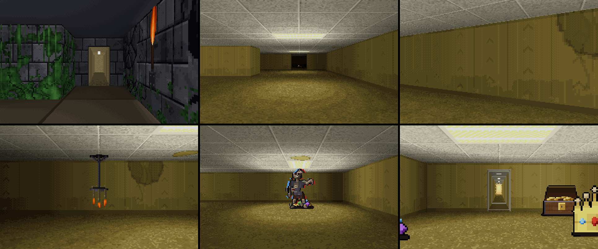
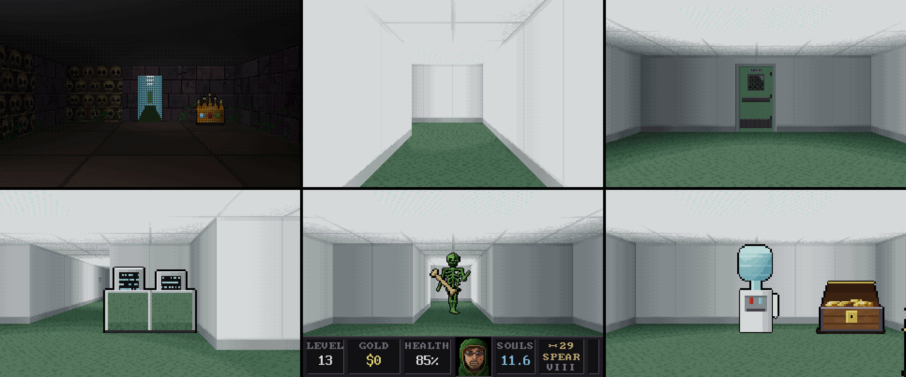
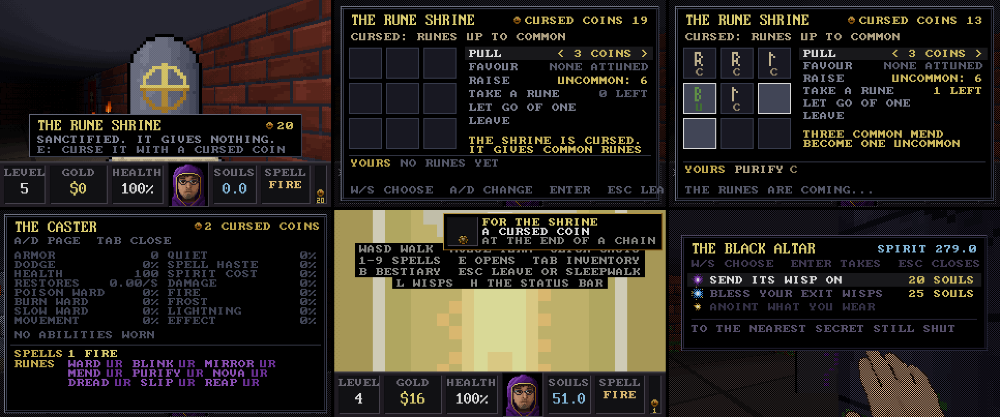
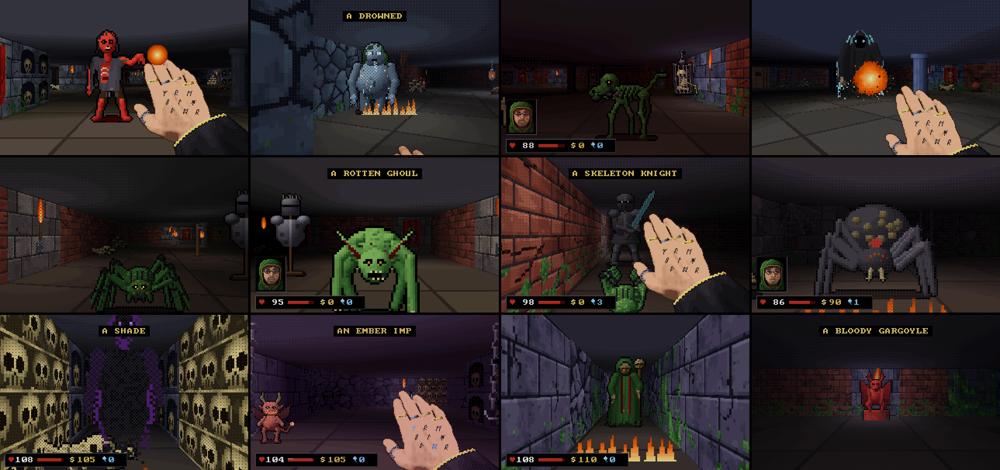
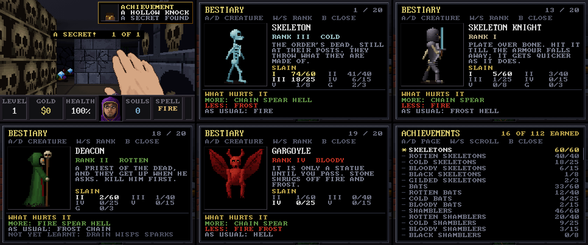
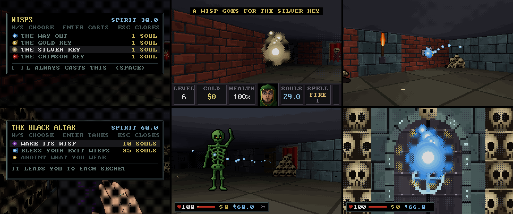
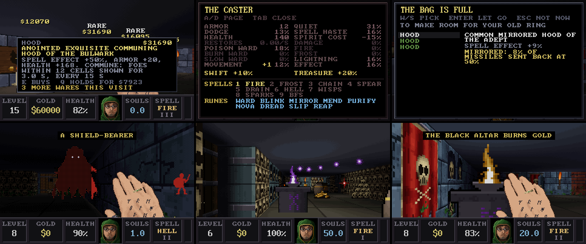

# HAUNTED.EXE

[](https://github.com/ASPDesignLabs/HAUNTED.EXE/actions/workflows/build.yml)
[](https://github.com/ASPDesignLabs/HAUNTED.EXE/releases)

A retro Halloween screensaver for Windows, built for OLED screens, with a crypt you can take over
and play. It renders in genuine VGA modes, scales them by a whole number to fit a 4K display, and
makes its own sound with an FM synthesiser, so there are no audio files. It's one 600 KB program
with no installer and no runtime to install.

**[The project page](https://aspdesignlabs.github.io/HAUNTED.EXE/)** &middot;
**[Download the latest release](https://github.com/ASPDesignLabs/HAUNTED.EXE/releases)**

## Download

Every release on the [Releases page](https://github.com/ASPDesignLabs/HAUNTED.EXE/releases) is built
from this repository by GitHub Actions and carries three files:

| File | What it is |
|---|---|
| `HAUNTED.EXE` | The program on its own. Double-click it and it opens in a window: hold H for three seconds to play, F11 for full screen, Esc to quit. |
| `HAUNTED.scr` | The same program named as a screensaver. Right-click it and choose **Install**. |
| `HAUNTED-<version>-win64.zip` | Both of the above with the helper scripts below, this README, the previews and the full source. |

`SHA256SUMS.txt` beside them lists their checksums. The files aren't code-signed, so Windows may show a
SmartScreen warning the first time; choose *More info -> Run anyway*.

## The scenes

Two scenes are included. They alternate every few minutes (configurable) with a fade to black and a fade of the sound.

| Scene | VGA mode | What it is |
|---|---|---|
| **HAUNT.EXE** | 80x25 text mode, 720x400 | A possessed 486 PC: BIOS POST, a DOS prompt, and a ghost that types back. Between the gags it runs DOS programs that have been got at: EDIT rewriting AUTOEXEC.BAT for a seance, DEFRAG consuming souls and moving the remains to the front of the disk, a modem call to a BBS on the other side, a virus scan that cannot clean a dead host, MSD finding GHOST.SYS on IRQ 13, a thirteen-disk SETUP, a QBasic program that writes itself, and a file manager moving the dead from GRAVES to SOULS, until a file with your name turns up. Art materialises in between, seven full-screen half-block ANSI scenes with their own stories: the jack-o'-lantern in the pumpkin patch, the talking skull in the ossuary, the manor in a thunderstorm, the spider in the candle-lit corner, zombies digging out of a graveyard, skeletons dancing out of their coffins, and a ghost that rushes down a hallway to say boo. It ends in a fatal error and a CRT power-off, then reboots. |
| **CATACOMB** | mode 13h, 320x200, 256 colours | A Catacomb 3-D / Wolfenstein 3-D style crypt crawl on autopilot. Before each level the caster visits the merchant, the owner's cat, draped over a treasure chest, purring, and chooses among five to seven wares for the gold it carries: spells, and things to wear that are rolled like loot, each in its quality's colour (see below). Runes come from the Rune Shrine across the room, for Cursed Coins. Each level is generated anew: main halls two and three cells wide, big chambers, colonnades and narrow side passages, with skull walls, niches, banners, moss and sliding doors, walked with quick 90-degree turns. The crypt is dressed: chains and meat hooks swaying from the ceiling, gibbet cages (some still occupied), candle chandeliers, roots and cobweb curtains, bone piles, graveyards of tombstones, fire pits and lit totems. Every level hides three to six secrets behind cracked walls, some of them chains whose deeper links lead out of the crypt altogether: into the Backrooms on the first ten levels, and Severance on the next ten (see below). Locked vaults are colour-coded (gold from level 1, silver from 3, crimson from 5), each with its own key and a richer hoard, and the deeper ones are guarded. From level 6 a Black Altar stands deep in each level: for souls it sends its wisp to a secret, one at a time, or blesses your wisps against the dead, and once every secret is found it anoints something you wear. Will-o'-wisps, a soul each, fly ahead through the halls to the way out or a key and leave a trail of light to follow. The autopilot remembers treasure it has seen and goes back for it, and leaves through a rune-sealed exit for a Wolfenstein-style tally. The twenty levels have names and come in four sets of five, the Crypts, the Catacombs, the Hollows and the Deep, each rotting further towards its last level; then the sets come round again. Twenty kinds of creature come in as you go down, about one new kind a level, each in ranks you can tell by its colour (see below). Every level is older and harder than the one before, though each death on a level makes its creatures hit a little softer on the next try (by up to 45%, until it is cleared). Your face, Wolfenstein-style, pops up when you are hurt. Hold H for three seconds to play it yourself (see below). |













### CATACOMB: who lives down there

New kinds come in a level or two after their sign (a broken shield, a collar among gnawed bones, an
armour stand), and on its first level a new kind comes alone.

* **The Crypts** (levels 1 to 5): skeletons that throw their own bones, bats, and spectres that only
  want you to know they are there. From level 2 a grave's earth is sometimes turned over from below, and
  a shambler climbs out as you pass and takes hold of you. Skulls set in the walls wake from level 3 and
  gather a fireball; shield-bearing skeletons close in with swords from level 4.
* **The Catacombs** (6 to 10): spiders in corner webs, only their eyes showing, whose bite poisons and
  slows; the Drowned, rising from a stirring puddle and bursting into a foul pool; bone hounds hunting in
  pairs; and from level 9 the Wraith, once a level, coming down the halls from the far end while the
  torches gutter. Nothing kills it: fire, the wisp's light and Dread drive it back for a while. The
  spectres are gone after level 10.
* **The Hollows** (11 to 15): hunting spiders that walk the ceiling and drop on you; ghouls that leap the
  last of the way and stop to feed on bones, mending as they eat; skeleton knights in plate that comes off
  as you hurt them, quicker as it goes; brood mothers laying egg sacs that split into spiderlings.
* **The Deep** (16 to 20): shades that show only in light, whose touch takes your souls; ember imps that
  live by the magma and lob embers that set the floor burning; deacons that walk with their skeletons
  and raise more from the bones (kill them first); gargoyles that are statues on their plinths until you
  pass.

**Ranks.** Every creature takes a rank as it comes: its own colour, then green, blue, red and black,
each tougher, harder hitting, quicker, a little bigger and worth more souls. The deeper the set, the
higher the mix, and each time round the sets it climbs a rung. From level 7 one level in three has a
gilded one, which runs when it is hurt and carries treasure; higher ranks now and then drop coin, gems
or a potion. A caption names each kind and rank the first time you see it on a level.

**Hunting.** A creature that sees you, is hit, or hears a spell nearby follows you round corners, and
the dead pull doors open; the nearest three hunt at once. The dead in ossuaries and crypts keep to
their rooms until they know you are there. Each kind has its weaknesses (fire for the shambler, frost
for hounds and spiders, lightning and Bone Spear through armour), which the autopilot plays to.

### CATACOMB: achievements and the bestiary

Each run keeps a record of what it has killed, by kind, rank and spell, the secrets it has found and
the levels it has cleared, and it is saved with the run, so each grave has its own. Achievements come
for 60 kills of a creature's lowest rank, then 40, 25, 15 and 8 up the ranks and 3 gilded; for 1, 5,
10, 20, 30, 40 and 50 secrets; for each of the first twenty levels; and for each time down past level 20
again. Everything counts, the autopilot's kills too, and each one slides in at the upper right with a
chime.

Press **B** while you play for the bestiary: a page for each creature (a dark shape until you meet it),
walking on the spot and turning about, drawn in each rank you have seen, with your kills against each achievement and what
hurts it, learnt after three kills with each spell. A and D turn the pages, W and S choose a rank, and
the last page lists the achievements.

The record is kept when your progress is: when you flee to the surface or carve a grave. What the
autopilot earns in an ordinary screensaver session shows, but isn't kept.

### CATACOMB: the merchant, the spellbook and the wardrobe

Each level begins in the merchant's room. The caster greets the cat (a slow blink back) and looks over
the pedestals standing in an arc round the back wall: five to level 9, six to level 14, seven from 15.
One holds an **attack spell** and the rest things to **wear**, with now and then a bag among them;
runes come from the Rune Shrine (below). The caster may buy one ware a visit to level 9, two to level 14 and three from
15, and the first visit's is free. Prices and strength rise with depth: a spell is usually a tier near
the level, now and then (about 1 in 12) a rare one well ahead of its time, and costs about two levels'
gold; a thing to wear costs by its quality, from part of a level's gold for something common to several
levels' for something exquisite. The caster sometimes saves up for a spell it can nearly afford, and
sometimes splurges. Whatever you own is kept, even through death. The cat trills when you buy,
and a rest while it purrs mends some of your wounds.

* **Attack spells** (the caster chooses per target): Fire Bolt (the fireball, splashing from tier II),
  Frost Shard (slows), Chain Lightning (arcs to others, around shields), Bone Spear (pierces a whole
  line and shields), Soul Drain (heals you), Hellfire (a big blast that leaves the floor burning),
  Seeker Wisps (home in around corners), Rapid Sparks (quick and light), and the **BFS9000**:
  incredibly rare and very dear, it burns 100 souls (fewer at higher tiers) to collapse everything in
  sight into a point of light.
* **Spirit.** The souls you take (one to six a kill, by the creature's rank, three times as many under
  Soul Reaping) are also your spirit, and spells spend it, to the tenth. The Fire Bolt you start with,
  and any spell cast at its tier-I strength, costs nothing. A stronger cast costs by its damage, from a
  tenth of a soul to a whole one (Seeker Wisps a soul a wisp), and Soul Drain's healing costs half a soul
  a point at tier I, down to a quarter. With too little spirit a spell goes out at tier-I strength and
  heals nothing, and a caption says so. The BFS9000 keeps its own price. Ten souls taken on a level still
  bring the wisp, however many you spend.
* **Bones.** Every Bone Spear throws a bone. Skeletons, shield-bearers, knights and bone hounds drop them
  now and then (about one in eight, more at higher ranks), buying or improving the spear brings six, and
  you can carry thirty. With none, the spear fizzles.
* **Defensive runes**, tattooed on the back of the hand and glowing when they fire, each on its own
  cooldown and triggered by the situation, with a human's reaction time (sometimes slow, sometimes
  missed, now and then wasted): Bone Ward (soaks blows), Blink (steps out of trouble), Mirror Veil
  (sends missiles back), Mend, Purify (cures poison and slow), Frost Nova (freezes what is close),
  Dread (the dead flee), Time Slip (slows everything near) and Soul Reaping (triple souls). Runes cost
  no spirit. Each is held in one quality at most, the best you have, Common to Exquisite, stronger and
  quicker to come round as it goes up. At **Exquisite** each does a second thing: the Ward bursts into
  shards when it breaks; Blink leaves a double that creatures go for; the Veil sends missiles home at
  twice the strength; Mend past full becomes a small ward; Purify mends a little each second; the frozen
  take double; Dread reaches the living too; what Time Slip slows takes a quarter more; and Soul Reaping
  heals a little each kill.
* **To wear**, in seven places: a bracer on each wrist, boots, an amulet, a hood, robes and a ring. Every
  piece is rolled. Its quality, Common (white), Uncommon (green), Rare (blue), Ultra-Rare (purple) or
  Exquisite (gold), sets how many stats it has and how strong they are, and the deeper it was sold, the
  stronger it is. The stats: Armor, Dodge, Health, Restores (health back each second), wards against
  poison, burning and slowing, Movement, Quiet (creatures hear your footsteps less), Spell Haste, Spirit
  Cost, Damage, Fire, Frost or Lightning (that much again of the element on every spell, biting hardest
  on what it hurts), and Spell Effect (Soul Drain's healing, Frost's slow, Hellfire's burning and the
  runes' strength). The totals are capped (Dodge at 35%, each ward at 75%, and so on), and no piece
  promises more than a cap allows. A piece is named for its strongest stat: *Rare Boots of Shadows*,
  *Uncommon Robes of the Bulwark*.
* **Abilities.** A hood always carries one, other pieces sometimes, graded by quality: **Swift** (more
  Movement), **Arcane** (more Spirit Cost reduction), **Treasure Hunter** (treasure worth more, and a
  whisper from a secret wall within three cells), **Keymaker** (keys shine through the stone while the
  wisp is lit, and **L** sends the wisp to each key in turn), **Communing** (every 15 seconds, creatures
  near you show as red shapes through the walls), **Thorned** (hurts what strikes you) and **Mirrored**
  (sends some missiles back at whoever threw them).
* **Anointed** pieces, about one in ten, have their stats raised by 10% (Common) to 25% (Exquisite).
  The Black Altars anoint too (below).
* **Bags.** You start without one. A bag holds two to five spare pieces by its quality (a Burlap Sack,
  a Gravedigger's Satchel, a Pilgrim's Scrip, a Bone Reliquary), turns up now and then among the things
  to wear, only ever bigger than the one you carry, and takes over its contents. Without a bag, whatever
  a new piece replaces is lost.

The robes colour the sleeve, the right bracer shows as an iron cuff inlaid in its quality's colour, the
ring's stone takes its colour, and the hood frames the portrait. The autopilot shops by what helps it,
never buys a bag, and loses whatever a new piece replaces.

### CATACOMB: the Rune Shrine and Cursed Coins

Across the merchant's room from the wares stands the Rune Shrine, pale and sanctified, giving nothing.
A **Cursed Coin** curses it: it darkens, its carving glows, and it gives runes. Coins are found at the
end of each chain of secrets, and one more comes when every secret on a level is found; each pops up
FOR THE SHRINE, and they show under the keys on the status bar and on the caster's page.

Press E at the shrine for its screen: nine slots, and what it will do. **Pull** with one to three coins:
more coins, more runes come into the slots (one or two, two or three, three to five). Its rank sets the
best quality that can come, Common at first, and each quality is two thirds as likely as the one below.
Three alike in the slots become one of the next quality, past the shrine's rank and up to Exquisite.
**Raise** it with coins (6 to Uncommon, 12 to Rare, 24 to Ultra-Rare, 32 to Exquisite). **Favour** a
kind it is attuned to (you have held it at Rare or better) with one to three coins more, each making it
a third likelier. Each pull earns one **take**: a rune from the slots to keep, the better if you have
that kind already. Takes not used are lost when you leave the room, and it says so first; the slots
keep the rest for next time. The autopilot plays the shrine too, with the coins it finds.

### Playing CATACOMB yourself

Hold **H** for three seconds, in either scene. A bar fills at the bottom of the screen; let go early
and nothing happens (any other key still ends the screensaver as usual). When it fills, the crypt is
yours, and the scenes stop switching until you hand it back. HAUNT.EXE cuts straight to the crypt.

| Key | What it does |
|---|---|
| W A S D, or the arrow keys | Walk and strafe (the left and right arrows turn instead). Shift runs |
| Mouse | Turn, Doom-style; there is no looking up or down |
| Left click, or Ctrl | Cast the spell in hand where you are looking (lightning and Soul Drain pick the nearest creature near the middle of the view) |
| 1 to 9, or the wheel | Choose an attack spell from your book: 1 Fire Bolt, 2 Frost Shard, 3 Chain Lightning, 4 Bone Spear, 5 Soul Drain, 6 Hellfire, 7 Seeker Wisps, 8 Rapid Sparks, 9 BFS9000 |
| E or Space | Open the door ahead, unlock a vault with its key, press a cracked wall, step through the exit runes, or use the Rune Shrine, a Black Altar or its wisp, a visportal or a water cooler. Walking into a door opens it too, and walking into a chain's doorway takes you through |
| Tab | The wardrobe: W and S choose a place, worn or in the bag, and Enter moves a piece between them. A and D turn to the caster's page: every total, what abilities add (in gold) and what is at its cap (in blue), and the spellbook |
| B | The bestiary and the achievements. A and D turn the pages, W and S choose a rank or scroll |
| L | The wisps: a list of what can be summoned now and at what price (see below). W and S choose, Enter casts, Space sets L to cast that one at a tap; then holding L brings the list back |
| H | A look at the status bar while it is tucked away |
| Esc | Asks whether you want to leave, with a different argument each time for staying; also where you save and load |

Your defensive runes still fire on their own, as quickly (and as fallibly) as they do for the
autopilot. In the merchant's room you shop yourself: walk up to a pedestal to see its card, and press
E, Space or click to buy it, as many times as the visit allows. A piece is worn at once. If it takes
the place of one you wear and you have no bag, the card warns in red that the old one will be lost,
and a second E buys; if your bag is full, you are asked which spare to let go (Esc thinks better of
it). **Q** holds a ware for the next visit, for a quarter of its price: it comes back on its pedestal
at the price it showed, and the hold ends when you leave the room the next time, bought or not. One
ware is held at a time. Then leave by the east door.

The Wolfenstein status bar shows the level, gold, health, your face, your spirit (the souls, to a
tenth), the spell in hand, with the bones above it when the spear is in hand, and your keys. Five seconds
after anything it has to show, it slides away to give you the whole view, and comes back when you are
hurt, choose a spell, tap H, or open the wardrobe or the bestiary. It stays up in the merchant's room.
While it is away, the small readout the autopilot uses appears when gold, a key or souls come and go.
Your hand, likewise, rises only to cast or to reach for something, stays ready a moment, and sinks out
of sight.

**Secrets.** Every level hides walls that give: three secrets on a set's first level, rising to six on
its last, counting every link of every chain. Such a wall looks like any other plain stone until you are
within a couple of steps of it, when a set of cracks shows in it. Face it and press E (or Space) and it
grinds back through a room carved behind it, one to four blocks of the plan, with a chime and "A SECRET!
1 OF 5" on screen. A secret room only ever holds treasure and, often, a potion: never a key, and its
treasure isn't counted in the level's total. The tally at the end of a level counts every secret found.
The autopilot presses every one it passes while it has time, a third of them after.

**Chains.** Some secret rooms have a doorway at the back, and through it a place of its own: walk into the
doorway and you are elsewhere, and each link of the chain is a secret found. The level waits while you
are away, its clock and its creatures with it. On the first ten levels the chains lead into **the
Backrooms**: yellow wallpaper, damp carpet, tube lights humming, some failing, some dead, things from the
crypt hung from the ceiling or sunk in the floor, and the level's own creatures glitching, a quarter
stronger and more of them. There is no music, only the hum and an echo. On levels 11 to 20 they lead into
**Severance**: white halls and corners, green carpet, offices of four desks, every panel lit, and the
creatures there lit too brightly, 30% stronger and quicker to strike, to a muzak that is slightly too
calm. Each link deeper is bigger and its creatures a rank higher. At the end of a chain the Backrooms
keep a **visportal**, a doorway onto doorways without end, and Severance a **water cooler**: E there
restores your health, or gives fifty souls if you are whole, with the chain's Cursed Coin, once. What you
take and kill in a pocket stays taken and killed; die there and you are thrown back to the chain's first
room, whole, and its creatures are back. The autopilot goes into chains while it has two thirds of its
health and the time, and turns back when it hasn't.

**Wisps.** Press L for the list of wisps. A wisp to the way out costs a soul: it kindles before you and
flies off down the halls the way you would walk, fetching the key first if the exit is in a locked
vault, and hovers at the doorstep until you come. It lights about four cells round itself as it goes,
shows the shades, and drives the Wraith back, and it leaves motes of light hanging behind it for twelve
seconds, so you can follow it round corners or after a fight. With a Keymaker piece on, the list offers
a wisp to each key still lying in the level as well, in that key's colour. Casting another sends the
first out. Choose one and press Space to have L cast it at a tap from then on; holding L brings the list
back. The choice is kept in your saves.

**Black Altars.** From level 6, a level with secrets has a Black Altar, in a corner of the exit room or
else in the room farthest from the start. Press E at it for what it offers, each with its price and a
note on why it can't be had yet:

* **Wake its wisp**, for ten spirit: a violet flame lights in its bowl and a violet wisp rises from it,
  free, and goes to the nearest secret wall you haven't opened (through the key of any vault it lies
  in). It waits at the wall while you are inside, and once you have been in and come out again, E at the
  wisp sends it home to the altar. There, **send it on** to the next secret for ten spirit and five more
  for every secret already found on the level. While it is out, the L list calls it back if you lose it.
* **Bless your exit wisps**, for twenty-five, once a level: every wisp to the way out you cast on that
  level wears a pale gold halo, and the undead within about four cells of it flee from it, as from Dread,
  for three seconds after it has gone by; the Wraith is driven back. The altar's fire burns with a white
  edge while it lasts. It ends with the level, or a death on it.
* **Anoint what you wear**, once every secret on the level is found, every link of every chain, and the
  flame has turned gold: one thing you wear, at random, one not anointed already. Then the altar is spent.

The autopilot uses them too: it wakes an altar it passes with 25 spirit or more and follows the violet
wisp while it has time, calls it home and sends it on when that leaves it 15 spirit, blesses with 40 or
more when the level has undead, and anoints. It casts an exit wisp as it sets off for the way out.

*Secrets were added.*

Esc offers five answers:

* **Flee to the surface** ends the screensaver and saves your progress: the level you were on, your
  health, gold, souls and gear. Not where you stood: next time you start at the beginning of that level
  (or at the merchant, if you hadn't bought anything yet), and the gold and souls picked up on the
  unfinished level are taken back out. The next screensaver session, autopilot or not, starts from it.
* **Stay in the dark** closes the question.
* **Sleepwalk** hands the crypt back to the autopilot, which settles into its walk from where you stood
  (from a pocket, it first walks straight back out to the chain's room).
  The mouse then ends the screensaver again (after a second and a half).
* **Carve a gravestone** saves the run in one of three slots, graves I to III. A grave keeps the same
  things fleeing does, plus when it was carved. Carving over a used grave asks for a second Enter.
* **Rise from a grave** loads one: its run starts again at the beginning of that level (or at the
  merchant), and the controls stay yours. It asks for a second Enter, because the run you're in is lost.

In the graves, W and S (or 1 to 3) choose, Enter carves or rises, and Esc goes back to the question.

If the window loses focus while you play, the game pauses on that question. The saved progress is a
`Progress` value under `HKEY_CURRENT_USER\Software\HalloweenVGASaver` (the project's name before it
became HAUNTED.EXE, kept so that settings and progress carry over), and the graves are `Slot1` to `Slot3`
beside it; `uninstall.cmd` removes them with the settings.

1.0.0b6 keeps runes by quality and adds 32 bytes to the save for the Rune Shrine: your coins, its rank,
its slots and attunements, and which of the level's coins you have taken. Progress and graves from
1.0.0b5 and 1.0.0b4 load: their runes become qualities by tier (tiers 1 to 3 Common, 4 to 6 Uncommon, 7
to 10 Rare, 11 and up Ultra-Rare), and a rune held at the merchant's is let go and its fee given back.
From earlier betas their spells, runes, gold and souls come across, their robe, hood and best ring become
Common pieces of about the same strength, and there is no bag. But an
earlier beta can't read a save made by a later one: it starts again from level 1, and fleeing there
overwrites it. If you might go back, keep a copy first:
`reg export HKCU\Software\HalloweenVGASaver haunted-backup.reg` (double-click the file to restore it).

## Install

1. Run `install.cmd` from the zip, or right-click `HAUNTED.scr` and choose **Install**. Windows asks for
   administrator rights, copies it to System32 and opens *Screen Saver Settings*.
2. Choose **HAUNTED.EXE** and press **Settings...** to adjust it.

If you installed it before 1.0.0b1, when it was called *Halloween VGA* (`HalloweenSaver.scr`), the old
entry stays in the list until you remove it; `uninstall.cmd` removes both.

Other ways to run it:

* `HAUNTED.EXE`, or `test-windowed.cmd`, runs it in a resizable window without installing anything. Esc quits (while you
  play, Esc asks first); F11 or Alt+Enter switches to borderless full screen and back.
* `capture.cmd` runs it as an ordinary borderless full-screen window for recording (see below).
* `settings.cmd` opens the settings dialog directly.
* `uninstall.cmd` (as administrator) removes it and its saved settings.

## Recording video

A real screensaver is hard to record: it quits the moment you touch the mouse, and Windows runs it
apart from your normal apps. `capture.cmd` (or `HAUNTED.scr /f`) runs it as an ordinary
window instead. The window covers the monitor without a border, ignores the mouse and keeps
running. Esc quits, and F11 switches between full screen and a window. The picture drift is off in
this mode, so the video holds steady.

* **OBS Studio**: add a *Window Capture* (or *Game Capture*) source and choose
  "HAUNTED.EXE (capture ...)". Set the canvas to your monitor's size to keep the pixels sharp.
* **Xbox Game Bar**: click the window, then press Win+Alt+R to start and stop recording.

The window is one pixel taller than the monitor on purpose. That keeps Windows compositing it rather
than switching to exclusive full screen, which some capture methods show as a black picture.

The HAUNT.EXE file manager shows your Windows user name, spelled the way DOS would (upper case,
eight characters), and today's date. Keep that in mind before you share a recording.

## Settings

* **Sound** on/off and **volume**. The default is 60%.
* **Brightness** cap, 30-100%. The default is 85%.
* **Scenes**: enable either or both, and how often they switch (1-15 minutes).
* **Slowly drift the picture**: moves the whole image by up to a few source pixels along a very slow
  path (about one pixel every 8 s) so no pixel stays lit in the same place for hours.
* **Show on**: the primary monitor, or the largest monitor (the default). All other monitors stay
  black, which suits an OLED beside an ordinary screen.

Settings are stored in `HKEY_CURRENT_USER\Software\HalloweenVGASaver`.

## How the display works

* The scenes render into an 8-bit indexed frame with a 6-bit VGA palette, as a real VGA card does.
  The colours are quantised to the VGA DAC and fades are palette fades.
* The frame is scaled by a **whole-number factor** with nearest-neighbour filtering, so pixels
  stay square and sharp: 10x for 320x200 (3200x2000) and 5x for 720x400
  (3600x2000) on a 3840x2160 screen, centred in true black. On a 1440p screen the factors are
  7x and 3x, and on 1080p they are 5x and 2x.
* The saver uses OpenGL 1.1 for scaling and vsync, and falls back to GDI if OpenGL isn't available.
  It is DPI-aware, so it gets the real 3840x2160 and not a scaled-up 1080p.
* Backgrounds are true black, which keeps those OLED pixels off. Average picture level, measured over
  50 minutes of HAUNT.EXE and 25 of CATACOMB: **HAUNT.EXE about 9%** (25% or less 95% of the time; the
  brightest moment is a flash as the ghost scene opens, about 55% for under a second), **CATACOMB about
  13%** (26% or less 95% of the time, 38% at the brightest instants). While it plays itself, HP, gold
  and souls never sit on screen: the readout and your face slide in for a few seconds and leave, and the
  status bar shows only in the merchant's antechamber, for about 15 seconds a level (it stays up while
  you play). The brightness cap and the
  pixel drift reduce wear further, but they can't guarantee anything. If you leave it running for many
  hours, use your display's own panel-care features as well.

## Sound

Everything is generated at run time: an OPL2-style two-operator FM synth (sine, half-sine,
abs-sine and quarter-pulse waveforms, ADSR, feedback, vibrato), noise percussion, PC-speaker
square-wave beeps, a Freeverb-style reverb and a ping-pong delay.

* **HAUNT.EXE**: slow generative ambience in D harmonic minor (a drone, a tritone swell, sparse
  bells, a rare music-box lullaby, wind, and a heartbeat when the scene gets tense), plus the
  machine's own sounds: POST beep, floppy seek, hard-disk crunch, key clicks, a ghost whisper,
  creaks and thunder. The programs add a modem dialling and handshaking,
  knocks on the seance table and the souls going into DEFRAG. The art scenes add a match striking,
  wind through the pumpkin patch, a cackle, chattering teeth, zombie groans, earth breaking, crows, a
  bone xylophone for the dancing skeletons, collapsing bones, and a wail with a stab of brass for the
  ghost's boo.
* **CATACOMB**: an early-90s AdLib-style adventure tune: a slow 92 BPM, 32-bar march in D minor with
  bass, arpeggios, a flute and then a brass melody, a timpani-only crypt section and a snare roll back
  into the loop. Under it are footsteps, grinding doors, spell casts, fireball impacts, collapsing
  bones, ghost wails, bat squeaks, drips and distant moans, all in a cave reverb. On top of those come
  the game sounds: coin chimes, the key's jingle, the vault's lock, thrown bones, the caster grunting
  when hit, a heartbeat at low HP, a potion, a death groan, the wraiths' shriek, and a brass fanfare
  for each level cleared. A secret wall grinds and thuds back with a pair of knocks and a peal of bells,
  and the wisp arrives with a rising shimmer.

## Building from source

Needs `x86_64-w64-mingw32-gcc` (on Ubuntu/Debian: `apt install gcc-mingw-w64-x86-64`).

```
make scr          # -> dist/HAUNTED.scr
make zip          # -> dist/HAUNTED-<version>-win64.zip and dist/HAUNTED.EXE
make host         # Linux test harness (needs zlib): renders PNG frames and WAV audio
make smoke        # a short headless run of both scenes, a scripted player and a CPU benchmark
make cards        # the project page's five title cards, from real frames (needs Pillow)
make sheets       # CATACOMB's creatures and dressing, rank by rank, in build/sheets
```

Layout:

```
src/core.h  gfx.[ch]  app.[ch]      shared types, drawing, scene rotation / fades / palette conversion
src/snd.[ch]                        FM synth, effects, the two music programs
src/scene_haunt.c  haunt_art.[ch]   HAUNT.EXE: text engine, script runner, acts, art pieces
src/scene_crawl.c                   CATACOMB: level generator, autopilot, raycaster, sprites, light map
src/crawl_art.c  crawl.h            CATACOMB palette, light colormap, procedural textures and sprites
src/crawl_gear.[ch]                 CATACOMB's wares: spells, runes, robes, hoods, rings, prices and worth
src/hand_img.c  face_img.c  cat_img.c   the hand, the face and the merchant, converted once from photographs
src/win_main.c                      Win32 shell: /s /c /p /w /f, OpenGL+GDI, waveOut, settings dialog
src/font_vga.c                      generated by tools/gen_font.py from third_party/font
tools/host.c                        host harness
tools/sheet.c                       sprite sheets: every creature in every rank, side views, the dressing
site/                               the project page, published to GitHub Pages
site/cards/  site/card.txt          its link-preview cards for X and others (make cards), and which one is shown
.github/workflows/                  build.yml (build, smoke test, release on v* tags), pages.yml
```

The version lives in `VERSION`. To release, change it and push to `main`: when the build passes,
the workflow tags the commit `v<VERSION>` and publishes the files above as a GitHub release, with their
checksums. Pushing a tag `v<VERSION>` yourself does the same (the workflow checks that the two match).
A version with `a`, `b` or `rc` in it becomes a pre-release.

A scene is a `Scene` struct (video mode, sound program, `enter` / `update` / `render`), so adding a third
scene means writing one file and adding it to the list in `app.c`.

Test-harness examples:

```
build/host shot crawl 8,36,64 out/crawl 2       # PNG frames at those seconds, 2x
build/host wav haunt 120 out/haunt.wav          # 2 minutes of audio
BOTH=1 STAY=45 build/host dump crawl 200 out/run 10  # frames + audio across scene switches
build/host bench crawl 300 x                    # CPU time per frame
```

`build/host apl haunt 600` prints the average picture level of a scene.

Debug builds (`-DHAUNT_DEBUG`) also accept `HAUNT_PLAN=10,11,15` to force specific acts of HAUNT.EXE:
2-9 the prompt gags, 10 the pumpkin patch, 11 the skull, 12 the manor, 13 the spider, 14 the ghost, 15 the
zombies, 16 the skeletons, 17 the crash, and 18-25 the programs (EDIT, DEFRAG, the BBS, the virus scan, MSD,
SETUP, QBasic, the file manager). `-DCRAWL_DEBUG` prints the CATACOMB autopilot's state
once a second, logs every throw, hit, shriek, key pickup, cast, rune, purchase and exit, and takes
`CRAWL_SEED=n`, `CRAWL_LEVEL=n` to start deeper, `CRAWL_GEAR=n` to own everything at tier n,
`CRAWL_GOLD=n` and `CRAWL_SOULS=n`. `CRAWL_MAP=1` prints each level's map and plan (and checks every lane
can be reached), `CRAWL_MAPAT=t` prints it again at t seconds with what has been explored,
`CRAWL_TPSECRET=n`, `CRAWL_TPEXIT=1` and `CRAWL_TPALTAR=1` stand you in front of a secret wall, the exit
or the Black Altar, `CRAWL_WISP=1` casts a free exit wisp as each level opens (2 to 4: to the gold, silver
or crimson key), `CRAWL_BLESS=1` blesses every level, and `CRAWL_FOLLOWWISP=1` makes a person at the keys
walk the way the wisp went (a test that it really leads out). `CRAWL_RANK=r` puts every creature in rank r (0 to 5),
`CRAWL_WRAITH=s` sends the Wraith at s seconds, and `CRAWL_MEET=k` puts one creature of kind k (0 the
skeleton to 19 the gargoyle, in the order of `MOB_*` in `scene_crawl.c`) a few cells ahead five seconds
into each level. The harness plays a person at the keys with `HOST_INPUT`, for
example `HOST_INPUT="1:+H;4.2:-H;5:m300,0;6:+W;8:-W;9:+MOUSE1;9.2:-MOUSE1"` (press, release, mouse
counts), and `HOST_SAVE=file` / `HOST_LOAD=file` and `HOST_SLOTS=dir` stand in for the registry.
The Windows build honours `HVS_NOGL=1` (force the GDI path) and `HVS_DUMP=file.ppm` (write one frame and exit).

## What has been verified

**New in 1.0.0b5** (the status bar that steps aside, wisps in the crypt and the L list, the Black Altar's
menu and blessing, the autopilot's wisps and altars, the hand that rises only to cast, and a few secrets).
All of it has been tested in the harness only; none of it has been played by hand yet, and this round
wasn't run under Wine. The Windows build was compiled here without warnings, and by CI.

* **The autopilot does about as well as in 1.0.0b4**, on the same seeds. Eight 50-minute runs from level 1
  died 4 times against 3 (five runs never died), reached levels 7 to 9 (median 8.5, against 8), took about
  77% of the treasure (75% before) and found 43 secrets (34). Eight 50-minute runs from level 11 with every
  spell at tier 1 died 11 times against 12. Eight 30-minute runs from level 16 at tier 2 died 28 times
  against 25.
* **The Wraith now comes once a level, as it was meant to.** Since 1.0.0b3 it had come only once a session.
  In the runs from level 11 it came 56 times (8 before) and from level 16, 33 times (8): most of the Deep's
  extra deaths came late in a level, when it is about (7 after four minutes, against 5). The share of the
  treasure taken fell in the Hollows (67%, from 71%) and the Deep (63%, from 68%), where the autopilot also
  spends time at the altars.
* **What the autopilot did with the new things.** In those 24 runs it cast 146 exit wisps, woke 39 altars,
  bought 54 blessings, whose wisps turned the undead 72 times, and was anointed once: it seldom finds every
  secret on a level before it is time to go. It lost the light of the hand's wisp, and no more of its deaths
  came early in a level than before.
* **Played in the harness:** the status bar sliding away and coming back for a hurt, a spell, H, Tab and B,
  and the small readout meanwhile; the L list with and without Keymaker, a hold of L, the setting for a tap,
  a cast with too few souls; wisps to the way out and to each key, with a test player following them to
  the keys and out (18 of 18 levels); the altar's menu, waking, the blessing and its gold halo and white
  edge; a test player that only follows a blessed exit wisp through level 9 took 2 blows on four seeds,
  against 11 without the blessing.
* **Saves.** The new save (943 bytes) fled and loaded with the L setting kept, and a save in 1.0.0b4's
  format loaded in this beta and in 1.0.0b4.
* **Found and fixed on the way:** the Wraith (above); a level's wisps could leave their motes drawn in the
  merchant's room; a click that closed a menu cast a spell as well; and the first try at holding the game's
  sounds for a pause also held the music's drums, which then all played at once.
* **AddressSanitizer and UBSan**, clean, after each step: the menus, the altar, the autopilot at the altars,
  long scripted sessions and autopilot runs.

**New in 1.0.0b4** (things to wear rolled like loot, spirit and bones, the abilities, the merchant's
wider room and the Black Altars). All of it has been tested in the harness only. None of it had been
played by hand when this beta went out, and this round wasn't run under Wine; the Windows build is
compiled and smoke-tested by CI.

* **The first ten levels are a little kinder to the autopilot.** Eight 50-minute runs from level 1, on
  the same seeds as 1.0.0b3: 3 deaths against 7, six runs that never died in both, levels 8 and 9
  reached (median 8, against 8.5), levels a median of about 5.6 minutes as before, about 75% of the
  treasure taken (79% before), four to nine purchases and two to seven secrets a run.
* **The Hollows are easier and the Deep a little harder.** Eight 50-minute runs from level 11 with every
  spell at tier 1 died 12 times, against 18 at 1.0.0b3. Eight 30-minute runs from level 16 with everything
  at tier 2 died 25 times, against 22. These runs begin with seven Uncommon pieces where 1.0.0b3's began
  with a robe, a hood and rings, so they compare only roughly. In the Deep the autopilot can seldom afford
  much: seven of those eight runs bought one thing or nothing.
* **Spirit is enough for the autopilot.** In all those runs it cast about 10,700 spells, and 51 of them
  went out weak for want of spirit.
* **Its shopping was mended twice on the way.** Runs that skipped attack spells were the ones that died,
  so it now takes three before anything else. And in the Deep it would fix on a rare spell costing four or
  five levels' gold and save for it for half an hour, buying nothing; now it saves only for a spell that
  two levels' gold might bring (deaths from level 16 went from 28 to 25).
* **Played in the harness:** buying a piece for a worn place with no bag (the red warning, then a second
  E) and with a full bag (letting a spare go); holding a ware and finding it back on the next visit at
  the price it showed; moving pieces between the wardrobe and the bag; the caster's page; Keymaker's L
  sending the wisp to each key in turn, with a test player following it to the keys and out; Commune's
  red shapes; Mirrored sending missiles home; Treasure Hunter's whisper; waking a Black Altar, with a test
  player following its violet wisp to all three secrets on a level, through two vault keys. The gold flame
  and the anointing were seen in a scratch build that marks the secrets found, since finding every one by
  script takes a while. Anointing was checked on 72,000 rolled pieces: no stat ever passes its cap.
* **Saves.** Fleeing and loading the new save (939 bytes) with what was worn and abilities intact, and
  loading a 1.0.0b3 save, whose robe, hood and ring came across as Common pieces, with no bag.
* **Found and fixed on the way:** taking control in the merchant's room cast a stray Fire Bolt (in
  1.0.0b3 too, where it cost nothing); clicking a ware bought it and cast a Fire Bolt as well; a long name
  ran under the price on the merchant's card, and a number could be parted from its unit at the end of a
  line; the altar's wisp stalled at a vault door when the secret it sought lay inside the vault.
* **AddressSanitizer and UBSan**, clean: about 40 minutes of scripted sessions (the shop, the wardrobe
  and the caster's page, holding and the next visit, the altar and its wisp, Keymaker and Mirrored,
  fleeing and loading new and old saves), on top of rounds after each step of the work.

**In 1.0.0b3** (the creatures, their ranks, the sets, achievements and the bestiary):

* **The owner ran a build of this beta on their own Windows PC**, from just before the two bestiary fixes
  below, and found it looks and runs well. Not every creature, achievement and bestiary page has been gone
  through by hand, and this round wasn't run under Wine.
* **The first ten levels play about as before.** Eight 50-minute autopilot runs from level 1, on the same
  seeds as 1.0.0b2: 7 deaths against 9, six runs that never died against four, levels 6 to 9 reached in
  both (median 8.5), levels a median of about 5.6 minutes, about 80% of the treasure taken (77% before),
  five to eight purchases and one to six secrets a run.
* **The Hollows and the Deep are a good deal harder.** Eight 50-minute runs from level 11 with every spell
  at tier 1 died 18 times, against 9 before the Hollows' newcomers came (the first try died 33 times,
  nearly all from the hunting spider poisoning on every leap, so now only one leap in three does). Eight
  30-minute runs from level 16 with everything at tier 2 died 22 times, against 25 before the Deep's
  newcomers: the old creatures in the Deep's high ranks were already that deadly. These levels will be
  tuned as they are played by hand.
* **Each newcomer was seen doing its work** in the harness, in those runs: hunting spiders and ghouls
  leaping (over 300 times), knights' blows, sacs laid and hatched, the Wraith driven back by fire and the
  wisp, imps throwing 162 embers (56 hit), deacons raising 21 skeletons, 9 gargoyles waking, shades
  touching the caster 6 times. Each was also rendered in the crypt for the previews above.
* **The record and the bestiary.** Saving and loading the new save, loading an old one (with an empty
  record), carving a grave and rising from it with its own counts, the pop-up on a first secret, and
  every bestiary page drawn from a full record. Drawing every page that way found two bugs before release,
  both fixed: the shade's page called it a spirit that can't be killed, and the achievements' count ran
  into the page number.
* **AddressSanitizer and UBSan**, clean: about an hour and a half more of the autopilot on levels 11 to
  19, with every newcomer in play (drawing two frames a second), on top of the earlier rounds below.

**From the earlier betas:**

* The synth output was analysed offline: no clipping (peak 0.85 across the new programs and art scenes),
  no DC offset, and every new effect's level measured against the existing ones.
* The CATACOMB autopilot was simulated for 50 minutes on each of eight seeds, merchant visits included,
  in the wider crypt with its secrets. Runs reached level 6 to 9 (the earlier, narrower crypt reached 9 on
  every seed under the same test). Levels took a median of about 5.6 minutes, every one ended through its
  exit, the median level ended with 83% of its treasure (87% before), and the caster bought four to eight
  things per run and found two to six secrets. The wider halls make it a little harder: four runs never
  died, two died once, one twice and one five times (the earlier crypt: none or once). That is after
  bones thrown from far across a hall were made to fly wider, and the crypt was made to ease off after each
  death on a level, which ended runs that died again and again on the same level.
* Every generated level was checked for reach: each walkable lane connected, on 15 seeds and levels. A
  test player that does nothing but walk where the wisp leans cleared 24 of 24 levels (levels 1 to 9,
  six seeds) in 25 to 115 seconds, fetching vault keys on the way where the exit needed them, including
  a key locked inside another vault.
* The core was run under AddressSanitizer and UBSan: earlier rounds for about an hour (every HAUNT.EXE
  act and art scene, scene switches and CATACOMB, with the merchant, levels 1 to 7, every spell, rune,
  robe, hood and ring, and the BFS9000), and this round for about 30 more minutes of the new crypt with
  every frame drawn: the autopilot (finding and opening secrets, with the wisp lit), a person following
  the wisp out, and pressing a secret wall, walking into its closet and taking the loot. All clean. The per-frame CPU cost (simulation plus drawing, without the synth) is about
  0.8 ms for HAUNT.EXE and about 2 ms for CATACOMB, deep levels with every spell included (2.3 ms while
  you play it).
* Playing it was tested two ways. The harness played scripted sessions: taking control from either
  scene, shopping, walking, every spell, the inventory, the Esc question, sleepwalking and taking over
  again, dying, the exit, and saving and loading, including 170 seconds under AddressSanitizer and UBSan
  (clean). The Windows build was driven under Wine with real key presses and mouse movement: holding H,
  turning with the raw mouse, the inventory, fleeing (the progress landed in the registry), the next run
  starting from it, and the mouse ending the saver again after sleepwalking. The autopilot's simulated
  runs came out exactly as before. With the wider crypt, the Windows build went under Wine again: taking
  over, the merchant, walking and turning, and the Esc question.
* The Windows build was run under Wine on a virtual 3840x2160 display (the OpenGL path was checked by
  reading back the frame: 10x scale, centred, pixel drift applied), in a window, with the GDI fallback,
  the settings dialog, and the `/p` preview. The `/f` capture window came up borderless at 3840x2161.
  Whether it really ignores the mouse is untested, because nothing here could send mouse input.
* **Played by hand on real Windows.** The author has run it on their own Windows PC in a few different
  configurations. The sound plays as intended, the mouse speed (0.0015 radians per count) feels right,
  and holding H, the keys and the mouse capture all work. Other PCs and graphics cards haven't been
  tried yet; if you get no sound or something misbehaves, please open an issue.

## Credits and licences

HAUNTED.EXE is licensed under the GNU General Public License v3.0 (see `LICENSE`).

The VGA glyph bitmaps come from the Px437 IBM VGA 8x16 and IBM BIOS fonts in *The Ultimate Oldschool
PC Font Pack* by VileR, licensed CC BY-SA 4.0. See `third_party/font/`. The caster's hand, the
caster's face and the merchant were traced from the owner's photographs of their hand, their face and
their cat; the package holds only the converted sprites, not the photos. Everything else (code, art,
music and effects) is original and procedural.
