# HAUNTED.EXE

[](https://github.com/ASPDesignLabs/HAUNTED.EXE/actions/workflows/build.yml)
[](https://github.com/ASPDesignLabs/HAUNTED.EXE/releases)

A retro Halloween screensaver for Windows, built for OLED screens, with a crypt you can take over
and play, with the keyboard and mouse or a game controller (or, in the browser, by touch). It renders in genuine VGA modes, scales them by a whole number to fit a 4K display, and
makes its own sound with an FM synthesiser, so there are no audio files. It's one program of about 1.4 MB
with no installer and no runtime to install.

**[The project page](https://aspdesignlabs.github.io/HAUNTED.EXE/)** &middot;
**[Download the latest release](https://github.com/ASPDesignLabs/HAUNTED.EXE/releases)**

## Download

Every release on the [Releases page](https://github.com/ASPDesignLabs/HAUNTED.EXE/releases) is built
from this repository by GitHub Actions and carries three files:

| File | What it is |
|---|---|
| `HAUNTED.EXE` | The program on its own. Double-click it and it opens in a window: hold H (or any button on a controller) for three seconds to play, F11 for full screen, Esc to quit. |
| `HAUNTED.scr` | The same program named as a screensaver. Right-click it and choose **Install**. |
| `HAUNTED-<version>-win64.zip` | Both of the above with the helper scripts below, this README, the previews and the full source. |

`SHA256SUMS.txt` beside them lists their checksums. The files aren't code-signed, so Windows may show a
SmartScreen warning the first time; choose *More info -> Run anyway*.

### In the browser

The same game plays on [its own page](https://aspdesignlabs.github.io/HAUNTED.EXE/play/), with nothing to
download: both scenes take turns as they do on Windows, and holding H (or a controller's button) for three seconds
takes the crypt. It is the same code compiled to WebAssembly, and a browser keeps a few keys for itself, so:

* **Space casts**, as a click does, and **Ctrl does nothing**: Ctrl+W and Ctrl+1-9 are the browser's. E alone opens
  and takes things.
* **Esc** opens the question in play and goes back in a menu, as on Windows. In full screen on Chrome and Edge it is
  the game's; elsewhere the first press gives you the mouse back, which counts as Esc, and a click takes it again.
* **The ledger is kept in the browser**, not the registry, and is lost if the site's data is cleared (Safari clears
  it after a week without a visit). Settings writes it to a file and reads it back. Pages don't cross between the
  browser and Windows.
* **Phones and tablets can play**, held sideways (since 1.0.0b21.4). The page asks first how you will play:
  *Keyboard and mouse*, *Controller* or *Touch*, and remembers it (*Change* on the page, or Settings). By touch:
  * **A finger held anywhere** for three seconds takes the crypt, as H does. On Android, Touch asks for full screen,
    held sideways.
  * **The controls are headstones** in the margins either side of the picture, cut in the run's own stone, broken,
    weathered and grown over, with places carved in them for what the game has to say: the spell in hand, its time and
    its price, the rune readied and its quality, what a tap would do (OPEN, TAKE, DRINK ...), the souls held, the secrets
    found, the bag's places.
  * **The left thumb walks**: a stick wherever it lands on the left; pushed past its ring, it sprints; touched twice
    and pushed, it dodges (once the knight's gift is yours). **A tap on the left stone** uses what is before you, or
    takes what is chosen in a menu.
  * **The right thumb turns**: slide a finger on the right half of the picture and the view follows it. **The right
    stone casts** from the moment it is touched, again as the spell comes round while held, or charges; slid, it turns
    as well, so you aim as you cast. In a menu it goes back.
  * **The corners**: the top left readies the rune (the Mirror is raised by it), held it pauses; the top right uses the
    gift or rune readied, held it opens the wheels, which stay up until a slot is tapped. Below them: **WISPS** (a tap
    the exit wisp, held the list), **MAP** once bought, and **WARDROBE**.
  * **Esc's question** (the top left held) has two rows of touch's own: *TURNING*, how far a slide turns, and
    *SMOOTHING*, how steady the view keeps under a slow finger.
  * Not yet by touch: the bestiary and the Codex, the map dragged to pan, a pointer in the menus, and the title's
    controls page, which lists the keys.
* Fleeing to the surface goes back to the dream. One tab at a time keeps the ledger.

Releases from 1.0.0b14 carry the page as `HAUNTED-<version>-web.zip`, to serve yourself from any web server.

## The scenes

Two scenes are included. They alternate every few minutes (configurable) with a fade to black and a fade of the sound.

| Scene | VGA mode | What it is |
|---|---|---|
| **HAUNT.EXE** | 80x25 text mode, 720x400 | A possessed 486 PC: BIOS POST, a DOS prompt, and a ghost that types back. Between the gags it runs DOS programs that have been got at: EDIT rewriting AUTOEXEC.BAT for a seance, DEFRAG consuming souls and moving the remains to the front of the disk, a modem call to a BBS on the other side, a virus scan that cannot clean a dead host, MSD finding GHOST.SYS on IRQ 13, a thirteen-disk SETUP, a QBasic program that writes itself, and a file manager moving the dead from GRAVES to SOULS, until a file with your name turns up. Art materialises in between, seven full-screen half-block ANSI scenes with their own stories: the jack-o'-lantern in the pumpkin patch, the talking skull in the ossuary, the manor in a thunderstorm, the spider in the candle-lit corner, zombies digging out of a graveyard, skeletons dancing out of their coffins, and a ghost that rushes down a hallway to say boo. It ends in a fatal error and a CRT power-off, then reboots. |
| **CATACOMB** | mode 13h, 320x200, 256 colours | A Catacomb 3-D / Wolfenstein 3-D style crypt crawl on autopilot. Forty levels in four runs of ten, the Crypts, the Catacombs, the Hollows and the Deep, each rotting further towards its tenth level, where a boss waits in an arena of its own: the Ill-Fated Skeleton Knight, the Wandering Hunting Spider, the Black Deacon and the Wraith Unbound; then the runs come round again. Before each level the caster visits the merchant, the owner's cat, draped over a treasure chest, purring, and chooses among the wares on her pedestals for the gold it carries: spells, and things to wear that are rolled like loot, each in its quality's colour. Her room has grown into a hall: a back room with the Hexed Totem, where a beaten boss's scrip buys its ability, the Corpus Compendium and the Wretched Repository, and a grave plot with the Accursed Portal in its far wall. Runes come from the Rune Shrine across her room, for Cursed Coins. She sells a map that fills in as you walk, and turns what you have slain and found into Levels of Atonement: points to spend on the caster, and at every tenth a cornerstone. Each level is generated anew: main halls two and three cells wide, big chambers, colonnades and narrow side passages, walked with quick 90-degree turns. Each run is a place of its own, built in its own stone with its own rooms, doors, keys, light and treasure: the Order's burial vaults in dressed ashlar and bone, the drowned catacombs in wet slate under a climbing flood line, a mine the dead were tipped into, and black glass and magma at the bottom. The crypt is dressed: chains and meat hooks swaying from the ceiling, gibbet cages (some still occupied), candle chandeliers, roots and cobweb curtains, bone piles, graveyards of tombstones, fire pits and lit totems. Every level hides three to six secrets behind cracked walls, some of them chains whose deeper links lead out of the crypt altogether: into the Backrooms in the first two runs, and Severance in the next two. Locked vaults are colour-coded (gold from level 1, silver from 3, crimson from 5), each with its own key and a richer hoard, and the deeper ones are guarded. From level 6 a Black Altar stands deep in each level: for souls it sends its wisp to a secret, one at a time, or blesses your wisps against the dead, and once every secret is found it anoints something you wear. Will-o'-wisps, a soul each, fly ahead through the halls to the way out or a key and leave a trail of light to follow. The autopilot remembers treasure it has seen and goes back for it, and leaves through a rune-sealed exit for a Wolfenstein-style tally. Twenty kinds of creature come in over the first two runs, about one new kind a level, and three more in the last two, all drawn by hand, each in ranks you can tell by its colour and its marks; they see and hear, remember and forget, keep posts and walk rounds, hunt in packs, follow your trail and lie in wait, and on the last levels of each run its boss's hazards come into the halls as omens. Each run has hazards of its own besides, in its walls and rooms; on its even levels a sealed wing opens only to a puzzle worked out with things in the world, its answer hidden somewhere on the level; and from the third level a door marked with skull and bones holds a trial against an hourglass. Your face, Wolfenstein-style, pops up when you are hurt. Hold H, or any button on a game controller, for three seconds to play it yourself: then death costs, and only the merchant's ledger keeps what you have (see below). |


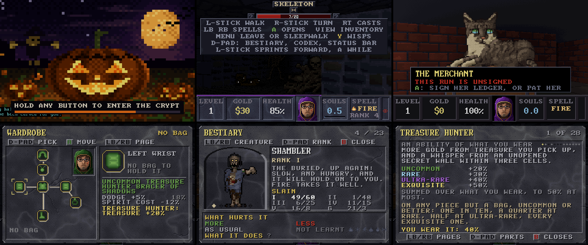

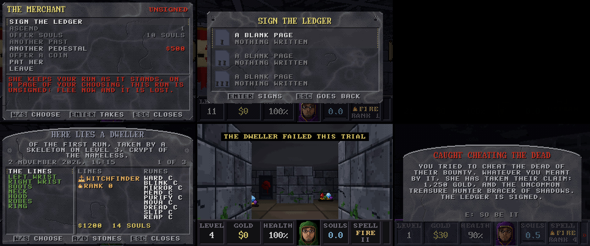
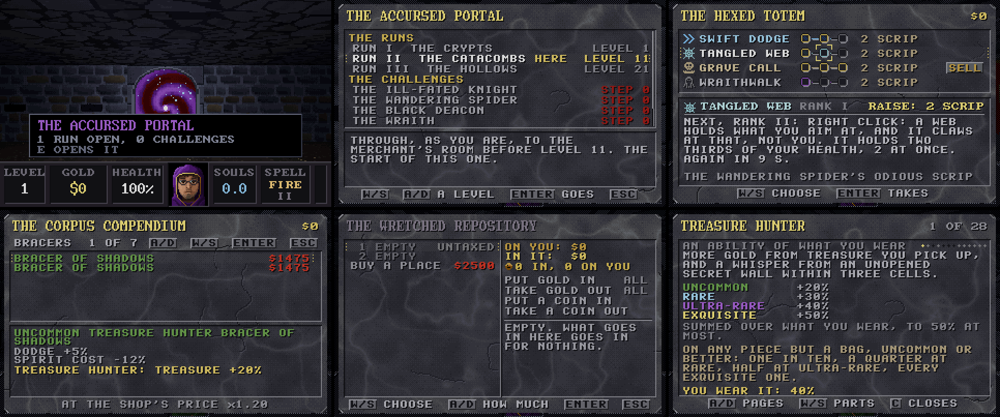
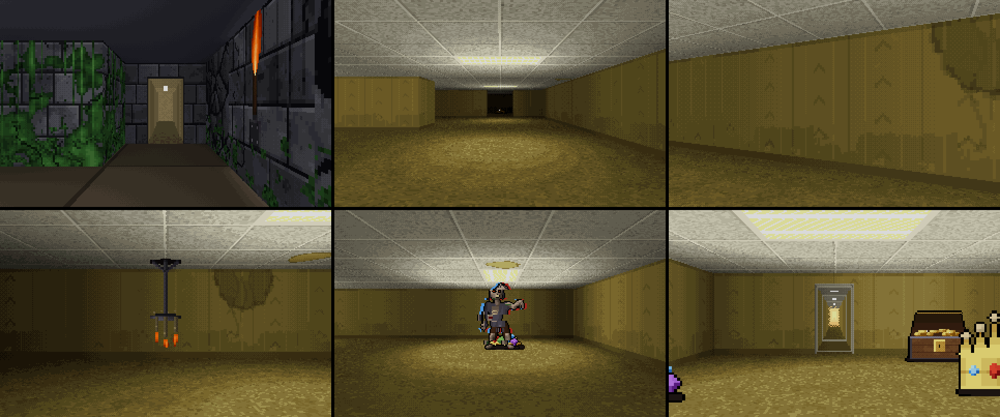
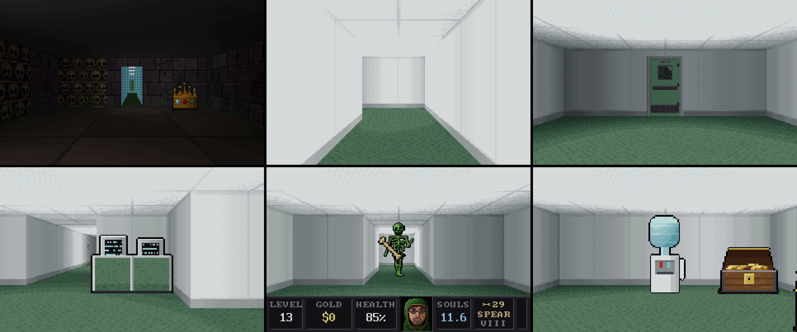
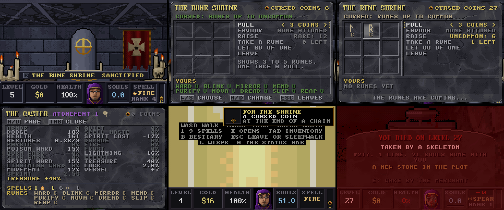
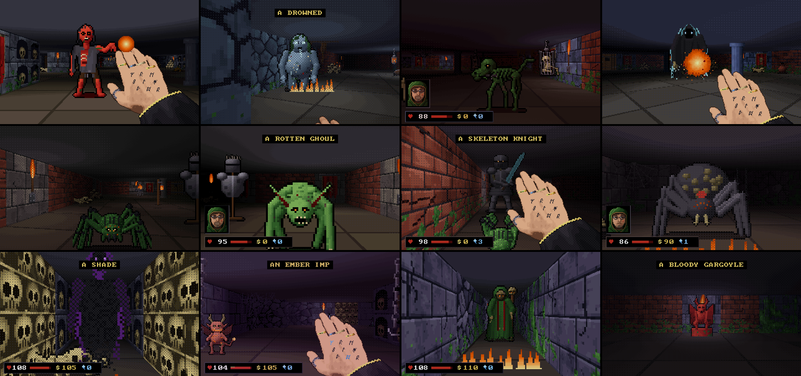
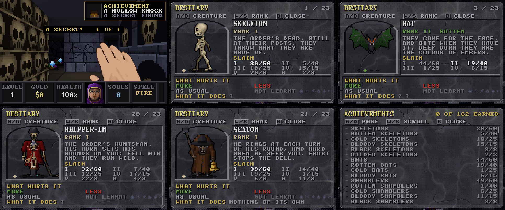
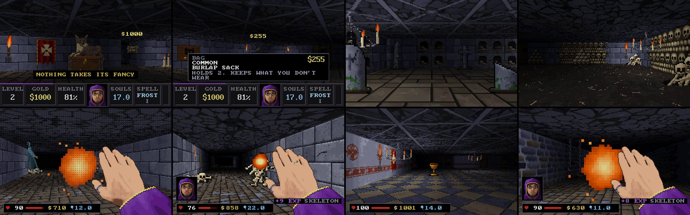
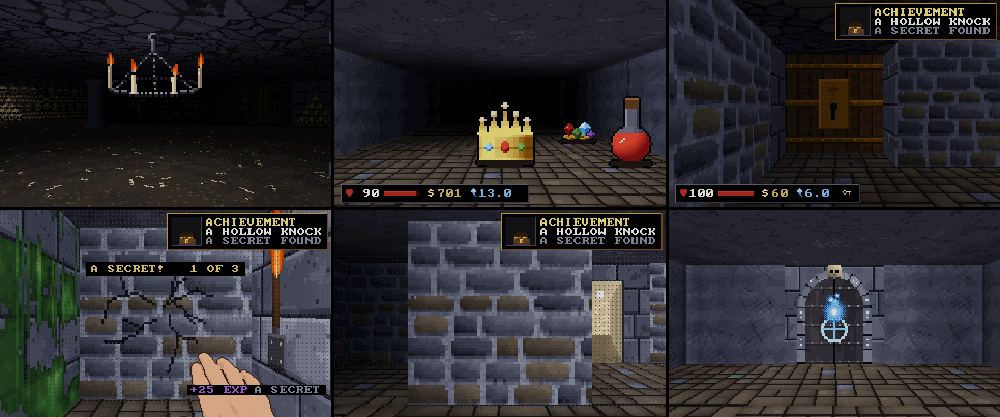
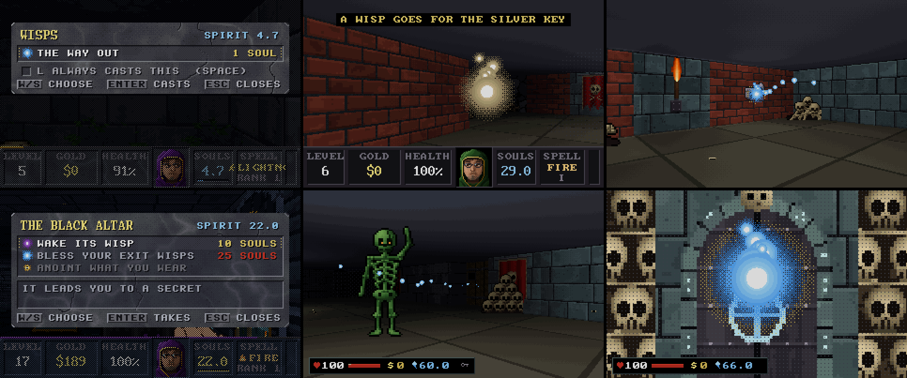
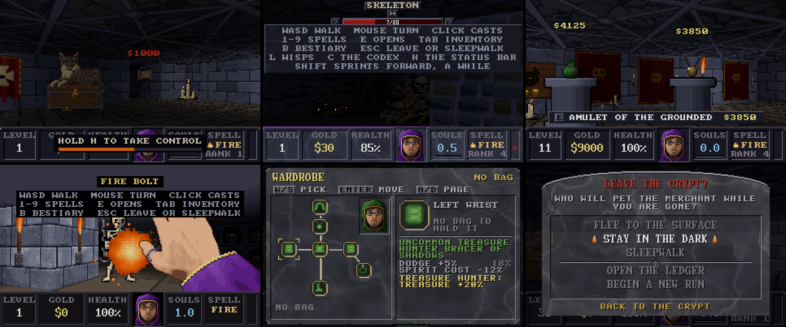
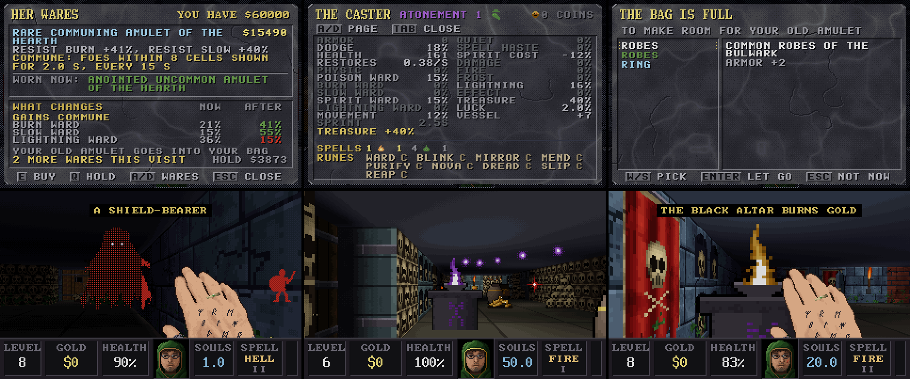
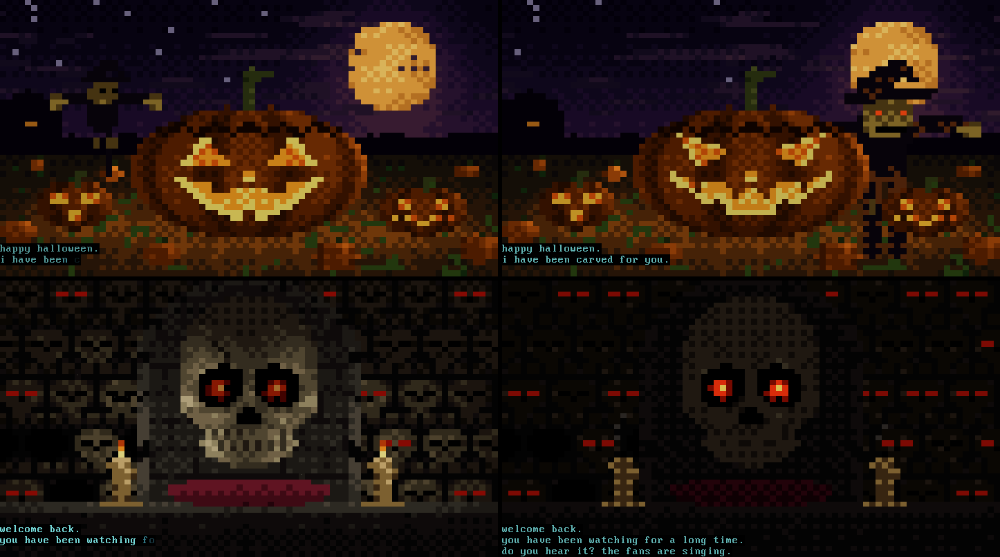
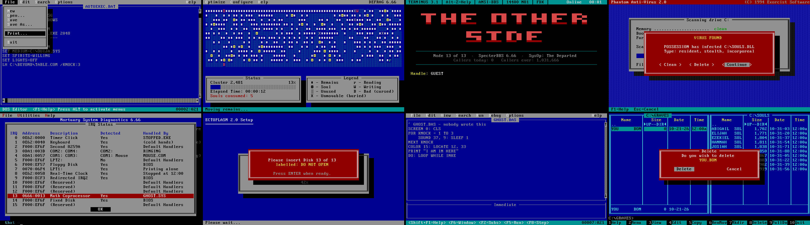
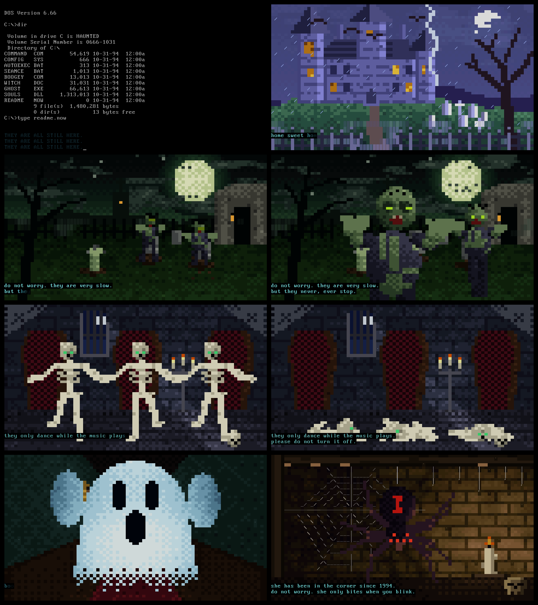

*The menus in the strips were taken again for 1.0.0b14, cut in the stone; the frames of the crypt beside
them are older, and the creatures in them are as they were drawn before 1.0.0b14's art. The strips of
creatures and pockets were made before 1.0.0b10, and show the crypt's old walls.*

### CATACOMB: four runs, four places

Each run of ten is built in its own stone, and the generator lays it as a mason would: every straight
stretch of wall gets a material by the room it faces, whole stretches agree, and where one material gives
way to another the cell between is a blend, blocks falling away or a skin fraying, never a hard edge. What
stands on a wall (niches, banners, saints, timber sets, geodes) is placed by rule along it, and floors and
ceilings come from the room. Each run has its own doors, keys, torches and treasure, and its own way of
rotting from its first level to its tenth; a fresh run starts clean.

* **Run I, the Crypts.** The burial vaults of a forgotten order: dressed ashlar, coursed rubble in pale
  lime, lime plaster with a painted dado, the bedrock, and bone walls in the ossuaries only. Burial vaults
  with niches in rows, chapter houses with banners, tablets and a lozenge floor, knights' vaults with their
  slabs, undercrofts cut from the rock. Torches in iron sconces, oak doors under iron, vaults strapped in
  their key's metal with the Order's cross, keys with a trefoil bow. Kept at first, then damp, then falling
  in: moss, plaster coming away in sheets, the flags broken through. The knight fights in a knights' vault.
* **Run II, the Catacombs.** Tunnels cut into wet slate beneath them, flooded and drained: bedded slate,
  slate lining, silt and river stones, flowstone, the dead the floods brought down set in the silt. Saints'
  catacombs, cisterns with standing water, silted naves, canals and spinners' galleries. Lanterns on hooks,
  candles at the saints' feet, sluice doors gone to rust, corroded keys on a ring, coin gone black in the
  silt, reliquaries and pearls. A flood line climbs the walls as the run goes on, and webs come onto them
  from its sixth level. The water is walked through as any floor, but every step on it splashes. The
  spider's gallery is a spinners' gallery, its bile coming out of culverts.
* **Run III, the Hollows.** Caverns and an abandoned mine where the dead were tipped: rough granite, the
  pick-cut face, timber shoring, basalt columns, and backfill with the dead in it. Timbered galleries with
  rails and carts, stopes, charnel pits, fossil halls, and a cult's chapel at the end. Oil lamps on spikes,
  rough mine doors and chained vaults, heavy keys with a tally tag, nuggets, raw gems and a strongbox. Worked,
  then abandoned: scree banks up the walls, boards split and fall, and late in the run something has
  dragged its claws down the stone. The Deacon keeps his rites in the chapel.
* **Run IV, the Deep.** Black glass at the bottom: obsidian, basalt, ash-crusted rock, amethyst, and the dead
  fused into the glass. Geodes, glass halls, cinder fields, magma vents and a throne room. The walls are the
  light: magma fissures in the torches' place, geodes alight. Black iron doors with the fire behind their
  grilles, keys of glass, coin run molten, glowing crystal and an idol of black glass. It glitters on its
  first levels, burns through its middle, runs molten, and goes dark at the end, which suits the Wraith; its
  arena is the throne.

The merchant's hall is rebuilt once in the Crypts' ashlar under the Order's banners, the same before every
run; the red brick has gone. The pockets keep their own looks. Building from source, `make sheets` draws each
run's materials, blends, wall pieces, floors, ceilings, doors, keys and treasure, and a stretch of each room.

### CATACOMB: who lives down there

New kinds come in a level or two after their sign (a broken shield, a collar among gnawed bones, an
armour stand), and on its first level a new kind comes alone. They keep the levels they had when there
were twenty, so every kind is met in the first two runs; the Hollows and the Deep bring three of their
own (1.0.0b14), higher ranks, the omens and the last two bosses.

* **Run I, the Crypts** (levels 1 to 10): skeletons that throw their own bones, bats, and spectres that
  only want you to know they are there. From level 2 a grave's earth is sometimes turned over from below,
  and a shambler climbs out as you pass and takes hold of you. Skulls set in the walls wake from level 3
  and gather a fireball; shield-bearing skeletons close in with swords from level 4. Spiders wait in
  corner webs from level 6, only their eyes showing, and their bite poisons and slows; the Drowned rise
  from a stirring puddle from 7 and burst into a foul pool; bone hounds hunt in pairs from 8; and from
  level 9 the Wraith comes once a level, down the halls from the far end while the torches gutter.
  Nothing kills it: fire, the wisp's light and Dread drive it back for a while. It never comes on a boss
  level. The spectres are gone after level 10.
* **Run II, the Catacombs** (11 to 20): hunting spiders that walk the ceiling and drop on you; ghouls
  that leap the last of the way and stop to feed on bones, mending as they eat; skeleton knights in plate
  that comes off as you hurt them, quicker as it goes; brood mothers laying egg sacs that split into
  spiderlings; shades that show only in light, whose touch takes your souls (from 16); ember imps that
  live by the magma and lob embers that set the floor burning; deacons that walk with their skeletons
  and raise more from the bones (kill them first); and gargoyles that are statues on their plinths until
  you pass (from 19).
* **Runs III and IV, the Hollows and the Deep** (21 to 40): all of them, deeper, darker and higher in
  rank, and three of their own. From 22 the **Whipper-In**, the Order's huntsman, never without three
  hounds (four in the Deep): his horn is the pack's call, his whip cracks as he sends each one in, and he
  keeps off and lashes what comes close; fell him and his hounds run wild. From 26 the **Sexton**, who
  never hunts: he walks his round ringing his handbell at each turn of it, and seeing you raises it and
  rings it hard, and everything within earshot comes to him (kill him with the bell raised, catch him
  unaware or freeze him, and it isn't rung). From 32 the **Lightless**, black glass with no eyes, which
  feels light instead: your lantern or a cast's flare is as good as sight to it, a wisp or a fire
  somewhere to go, and it puts out the wisps it reaches.

**Drawn by hand** (1.0.0b14). Every creature was drawn again, face first: one skull for every skull in
the game, eyes bright from anywhere in any light and the thickest fog (the shade alone shows only in
light), a head no more than a quarter of the body, and a side view for walking across your line. The
Drowned, the imps and the gargoyles are new from the ground up. The knight, the spider and the Deacon were
redrawn as bosses of their own (the Wraith Unbound is still the old one), the caster's hand moves as it
casts, and the props and pickups of the Crypts and the Catacombs were made again.

**Ranks.** Every creature takes a rank as it comes: its own colour, then green, blue, red and black,
each tougher, harder hitting, quicker, a little bigger and worth more souls. Since 1.0.0b14 the rank shows on
the body too: rags and mould, then frost and a notch, old blood and an arrow, char, an iron crown and a
shackle; gold leaf and a death-mask on the gilded; and from the third rank a spirit's vapour rising off it. The mix climbs over each
run's ten levels, a set's newest rank coming in on its fifth, and each time round the runs it climbs a
rung. From level 7 one level in three has a gilded one, which runs when it is hurt and carries
treasure; higher ranks now and then drop coin, gems or a potion. A caption names each kind and rank the
first time you see it on a level.

**How they think** (1.0.0b14). Sight has a facing, so a creature can be passed behind, and in the dark
the living see less; one caught unaware takes half again and staggers. Footsteps, spells, doors, blows
and deaths carry along the halls, not through the walls, and a sprint or a splash carries further. A
creature that notices something grows wary and goes to look; once it has you it hunts, then tracks you to
where you were, searches the rooms about, and gives up, so you can lose them. Calm, the dead keep posts
facing a room's way in, walk rounds, or roam. Many come in packs (the Order's file, shields first and
throwers behind; hounds in twos to fours; a roost of bats asleep on a dim room's ceiling; the buried
rising one after another): one that sees you calls, and all of it comes; its fighters take turns while
the rest circle, only so many fight you at once, and with its leader or half of it down it breaks. The
wall skull screams as it wakes, the gargoyle shrieks, the deacon calls, the roost cries, and whatever
hears comes to look; ghouls come to a death to feed. You leave a trail that goes cold in two minutes and
is lost in water: on some levels a band waits at the far end and is let loose after a while, the watch
going to your last loud noise, hounds and spiders following the trail. The shade stalks you from behind
and strikes when you stand still. From level 7 a kill room may wait, its teeth along the wall either side
of the door, often with a bait that shows itself and backs away towards it, and signs outside for the
careful. The higher the rank, the more it knows: green ones fall back to their pack and duck behind
corners, blue ones step aside from slow spells and wait beside a doorway you hold, red packs come round
another way and spread out against a splash, black ones feint and read a charge; throwers lob over
corners, and from the Deep hazards hurt the dead too. New company comes about every two levels: the watch
and its dead, the nest, the knight and his hounds, the deacon's congregation, the brood mother's guard,
sentinels that wake each other, bands of two kinds and three, and near the bottom what you passed by
gathering at the exit. Each level spends one budget on all of it, so it holds about as many as it did.
Each kind still has its weaknesses (fire for the shambler, frost for hounds and spiders, lightning and
Bone Spear through armour), which the autopilot plays to, and each run's doors have their own sound.

**Their ways shown** (1.0.0b18). Every creature that can turn its back on you now shows it (and, from behind,
no eyes: a creature looking away is one that hasn't seen you). A roost hangs asleep wrapped in its wings
and stirs as you come near. Each run marks its ambushes with a sign of its own by the door: raked bones in
the Crypts, a wet drag in the Catacombs, fresh scree in the Hollows, warm cinders in the Deep; a run's
first, its torch snuffed, has eyes in the dark just inside. Each tactic is named the first time it shows
itself on each run of ten (THE FILE OF THE ORDER IS ON YOU, THE NEST STIRS ABOVE YOU, SOMETHING IS SET ON
YOUR TRAIL ...), and once met has a page in the Codex, *THE WAYS OF THE DEAD*: what it does, how you hear
it coming, and how it is answered. The bestiary's pages turn on **Space** from a creature's lore to its
ways. New sounds: a scavenger at its meal, a bait's yelp, a web thrumming as the nest drops, the dead's
bones settling as they turn wary, a hound scenting the air. The record keeps what you did about them, for
eleven new achievements: ambushes come through without a death (1, 5, 20), hunts shaken off (1, 10), packs
broken by their leader's fall (1, 10, 50), callers killed before they called (1, 10), and a file of the
Order beaten without a hurt.

### CATACOMB: the bosses

The tenth level of each run is an ordinary level with an arena set into its far end in place of the
exit room: a small antechamber with a candle and a bench, an arch, and the boss's own ground beyond it,
the same every time. Step through the arch and it seals behind you, the boss's card shows with a line of
lore, its waltz begins, and its health runs along the top of the view. At 75, 50, 25 and 10% of its
health it stops, however hard the blow, turns untouchable in a pale shell, and calls a wave of adds out
of its gates, burrows or heaps of bone, at the highest rank of each kind you have met since you last
died; when they are down it rises and fights on. Three fonts in the walls hold a draught of a third of
your health each: one full as the fight begins, one more after the first wave and one after the third.
When it falls it drops its Named Odious Scrip, the exit opens, the tally gains a BOSS row, and the run
is complete: on you go to the merchant's before the next run's first level.

* **The Ill-Fated Skeleton Knight** (level 10). *He rode down to fetch the order's dead, and never rode
  back up.* Polished plate with a glint sliding across it, shed at the first and third waves, quicker
  each time. Swift Dodge carries it two to five cells in half a second, untouchable: to close on you, to
  get away when hurt or burning, or aside from a shot, leaving after-images. Its Mirror Rune turns about
  one missile in seven back at you at half strength, with a silver ring and a struck bell. It plants its
  sword to bring the ceiling down round you (Rockfall), and raises it for the Sundering Arc, a pale
  quarter-circle on the floor before it that it sweeps a moment later. Its adds are skeletons of every
  kind.
* **The Wandering Hunting Spider** (level 20). Up to the ceiling every few seconds, out of reach, across
  it and down two cells short of you with a leap. Its Mend Rune knits back an eighth of its health,
  glowing green, after it has lost a fifth. It rears and spits a web that holds you until your spells have
  torn a third of your health out of it (fire tears twice as fast); fires an egg sac onto a wall that
  hatches four small spiders five seconds later; and opens outlets in the cistern's floor, two at a time
  and the open ones changing, that flood their patch with bile which poisons and slows. A small spider
  comes out of a burrow every fifteen seconds.
* **The Black Deacon** (level 30). Black robes at twice a deacon's size, his Bone Ward wheeling about him
  as six shards; it takes the blows first, and grows back. He chants skeletons up from the chapel's heaps
  of bone, one at a time and three at most, unless a tenth of his health in damage breaks the chant. His
  Litany is two seconds of green light and then a fifth of your health if he can see you: the timber
  props hide you, the pews don't. Cracks run across the floor, in a line at you, a ring round him or a
  cross through the aisle, glowing until fire bursts from them.
* **The Wraith Unbound** (level 40). Eight braziers light its hall, and it gutters any it passes. It can
  be hurt only near one that burns, or near a wisp; in the dark your spells pass through it. E kindles a
  brazier again in a second, and a wisp at once. Time Slip slows a missile about to strike it, and it
  steps aside; Wraithwalk takes it into the stone and out of a wall beside you. Its touch chills and
  slows. Rings of void open where you stand and across your ways out, and become purple columns: inside
  one you are slowed, sapped and silenced, with no spells, runes or abilities (E still works); a void
  over a brazier puts it out. Away from the light, hands reach up out of the floor.

**Hazards** warn before they harm, never for less than about a second: grit and a hardening shadow
before a rock, cracks glowing before the fire, a sheen creeping out before the bile turns foul, a ring
and a thin column before the void. They harm only you, never the boss or its adds, by a share of your
health. **Omens**: on the last three levels before a boss and in its own level's halls, its hazard comes
now and then near you, ahead of you where it can, at half the harm: every 90, 60 and 40 seconds, then
every 30. In the Crypts the ceiling drops a stone, in the Catacombs bile spills from a grate low in a
wall, in the Hollows the floor splits and burns, and in the Deep the void opens. Never in a pocket. The
first of each kind is named, and written in the Codex.

**The waltzes.** Each boss has a slow waltz in a minor key, over a five-note figure that drifts against
the bar, with a bell on the first beat: the knight's in D minor on brass, the spider's in B-flat minor,
plucked, with a skittering hi-hat, the Deacon's in G minor on an organ with a choir, and the Wraith's
in A minor, a drone with a voice that comes and goes. While the adds are out it turns up (drums, the
bass doubled, a semitone higher, a little quicker) and settles when they fall. When the boss falls the
waltz fades under three tolls, and the run's own music comes back.

**Challenges.** A beaten boss can be fought again from the Accursed Portal (below), as you are, from
its antechamber, with the way back up fallen in. Each win takes it a step higher, to five: a quarter
more health and a tenth more in its blows a step, its hazards and casts a fifth more often and more of
them, its adds a rank higher from step 2 and two from step 4; from step 3 a win gives two scrip. A win
takes you back to the merchant's room you left.

The bestiary has no pages for the bosses yet.

### CATACOMB: achievements and the bestiary

Each run keeps a record of what it has killed, by kind, rank and spell, the secrets it has found, the
levels it has cleared and the bosses it has slain, and it is kept on the run's page in the ledger, so
each page has its own. Achievements come for 20 kills of a creature's lowest rank, then 25, 20, 15 and
10 up the ranks and 5 gilded (since 1.0.0b21.2; 60, 40, 25, 15, 8 and 3 before, and a record already past the new counts
earns them as it is read); for laying the Spectre to rest and driving the Wraith back; for a feat of each creature's (below);
for 1, 5, 10, 20, 30, 40 and 50 secrets; for each of the forty levels; for
each boss slain, and slain again at each challenge's step; and for each time down past level 40 again.
Everything counts, the autopilot's kills too, and each one slides in at the upper right with a chime.
Death doesn't take the record.

Press **B** while you play for the bestiary: a page for each creature (a dark shape until you meet it),
walking on the spot and turning about, drawn in each rank you have seen, with your kills against each achievement and what
hurts it, learnt after three kills with each spell. A and D turn the pages, W and S choose a rank, and
the last page lists the achievements.

What the autopilot earns in an ordinary screensaver session shows, but isn't kept.

### CATACOMB: the merchant and the wardrobe

Each level begins in the merchant's room. The caster greets the cat (a slow blink back) and looks over
the pedestals standing in an arc round the back wall: two for a fresh run, and more bought from her, up to
seven (below). Since 1.0.0b11 she sells no spells (they are the Alignment's now, below): every pedestal
holds a thing to **wear**, with now and then a bag among them, and the first, very rarely, the
**BFS9000**, which burns 40 to 100 souls to collapse everything in sight into a point of light. Runes come
from the Rune Shrine (below). The caster may buy one ware a visit in the first run, two in the second and
three from the third, and level 1's first is free. A thing to wear costs by its quality, from part of a
level's gold for something common to several levels' for something exquisite. The cat trills when you
buy, and a rest while it purrs mends some of your wounds.

* **Bones.** Every Bone Spear throws a bone, and the spear costs no spirit. Skeletons, shield-bearers,
  knights and bone hounds drop them now and then (about one in eight, more at higher ranks), opening the
  Physical line brings six, and you can carry thirty (more with the line's Efficiency, or as the Headsman).
  With none, the spear fizzles.
* **Defensive runes**, tattooed on the back of the hand and glowing when they fire, each on its own
  cooldown and triggered by the situation, with a human's reaction time (sometimes slow, sometimes
  missed, now and then wasted): Bone Ward (soaks blows), Blink (steps out of trouble), Mirror Veil
  (sends missiles back), Mend, Purify (cures poison and slow), Frost Nova (freezes what is close),
  Dread (the dead flee), Time Slip (slows everything near) and Soul Reaping (triple souls). Runes cost
  no spirit. Each is held in one quality at most, the best you have, Common to Exquisite, stronger and
  quicker to come round as it goes up. At **Exquisite** each does a second thing: the Ward bursts into
  shards when it breaks; Blink leaves a double that creatures go for; the Veil sends missiles home at
  twice the strength; Mend past full becomes a small ward; Purify mends a little each second; the frozen
  take double; Dread reaches the living too; what Time Slip slows takes a quarter more; and Soul Reaping
  heals a little each kill.
* **To wear**, in seven places: a bracer on each wrist, boots, an amulet, a hood, robes and a ring. Every
  piece is rolled. Its quality, Common (white), Uncommon (green), Rare (blue), Ultra-Rare (purple) or
  Exquisite (gold), sets how many stats it has and how strong they are, and the deeper it was sold, the
  stronger it is. The stats: Armor, Dodge, Health, Restores (health back each second), wards against
  poison, burning and slowing, Movement, Quiet (creatures hear your footsteps less), Spell Haste, Spirit
  Cost, Damage, Fire, Frost or Lightning (that much again of the element on every spell, biting hardest
  on what it hurts), and Spell Effect (Soul Drain's healing, Frost's slow, the burning and the runes'
  strength). Since 1.0.0b11 pieces roll the elements too: an element's **Power** (more of its damage;
  rings and robes, 50% at most), **Efficiency** (less spirit, and for Physical a spear that spends no bone;
  hoods, 40%) and **Insight** (a shorter wind-up; bracers, 30%), a third of them leaning to the lines you
  feed; **Resist Spirit** (amulets and robes) and **Vessel** (more spirit carried; amulets and hoods). Since
  1.0.0b14, **Sprint** (a longer run; boots) and **Physic** (what a potion restores, multiplied, up to five
  times; robes and amulets), each with a line of its own in the points. The
  totals are capped (Dodge at 35%, each ward at 75%, and so on), and no piece promises more than a cap
  allows. A piece is named for its strongest stat: *Rare Boots of Shadows*, *Uncommon Robes of the
  Bulwark*, *Ring of the Pyre*, *Hood of the Thin Dose*.
* **Abilities.** A hood always carries one, other pieces sometimes, graded by quality: **Swift** (more
  Movement), **Arcane** (more Spirit Cost reduction), **Treasure Hunter** (treasure worth more, and a
  whisper from a secret wall within three cells), **Keymaker** (keys within its reach shine through the
  stone, and the L list offers a wisp to each key still lying), **Communing** (every 15 seconds, creatures
  near you show as red shapes through the walls), **Thorned** (hurts what strikes you) and **Mirrored**
  (sends some missiles back at whoever threw them).
* **By what you hold** (1.0.0b21). An element's stats roll for the lines you hold, more often for those ranked
  higher; only one piece in six carries one for a line you don't hold, and never two, and anything Rare or better
  carries at least one for a line you hold. New stats: a chance of each element's mark on the dead (*Ignition*,
  *Rime*, *Static*, *Blight*, *Hush*), on rings and bracers; and *Steadiness* (Knocked Down, Stunned and Frozen shorter
  and rarer), on boots and amulets. The element added to every spell now rolls among all six lines you hold, under one
  cap. From Uncommon up, an ability a piece rolls is your class's own one time in three: **Pyrebrand** (the Witchfinder's:
  ignites more often, and a second longer), **the Slab** (the Anatomist's: the frozen take more, and chills last
  longer), **Live Wire** (the Galvanist's: stuns more often, and a fifth arcs on), **Fever** (the Plague Doctor's: the
  poisoned take more), **Swallowed Sin** (the Sin-Eater's: unbinds more often, and a soul more from what dies Unbound) and **the Block**
  (the Headsman's: knocked down less, and bones kept). Another class's says *for the ...* and does nothing for you.
* **Anointed** pieces, about one in ten, have their stats raised by 10% (Common) to 25% (Exquisite).
  The Black Altars anoint too (below).
* **Bags.** You start without one. A bag holds two to five spare pieces by its quality (a Burlap Sack,
  a Gravedigger's Satchel, a Pilgrim's Scrip, a Bone Reliquary), turns up now and then among the things
  to wear, only ever bigger than the one you carry, and takes over its contents. Without a bag, whatever
  a new piece replaces is lost.

The robes colour the sleeve, the right bracer shows as an iron cuff inlaid in its quality's colour, the
ring's stone takes its colour, and the hood frames the portrait. The autopilot shops by what helps it
(an element's stats by how much it casts that element), never buys a bag, and loses whatever a new piece
replaces.

### CATACOMB: the Rune Shrine and Cursed Coins

Across the merchant's room from the wares stands the Rune Shrine, pale and sanctified, giving nothing.
A **Cursed Coin** curses it: it darkens, its carving glows, and it gives runes. Coins are found at the
end of each chain of secrets, and one more comes when every secret on a level is found; each pops up
FOR THE SHRINE, and they show under the keys on the status bar and on the caster's page.

Press E at the shrine for its screen: nine slots, and what it will do. **Pull** with one to three coins:
more coins, more runes come into the slots (one or two, two or three, three to five). Its rank sets the
best quality that can come, Common at first, and each quality is two thirds as likely as the one below.
Three alike in the slots become one of the next quality, past the shrine's rank and up to Exquisite.
**Raise** it with coins (6 to Uncommon, 12 to Rare, 24 to Ultra-Rare, 32 to Exquisite). **Favour** a
kind it is attuned to (you have held it at Rare or better) with one to three coins more, each making it
a third likelier. Each pull earns one **take**: a rune from the slots to keep, the better if you have
that kind already. Takes not used are lost when you leave the room, and it says so first; the slots
keep the rest for next time. The autopilot plays the shrine too, with the coins it finds.

### CATACOMB: the merchant's hall

Her room has grown. Press E at the cat for her menu: **sign the ledger** (below), **ascend** (below),
**offer souls** (ten for experience), **another past** (below), **another pedestal**, **offer a coin**
(for Second Wind, below), **pat her**, or leave. Pedestals cost 500 gold for the third, then 1,250, 3,125, 7,815 and 19,530 for the
seventh, and each is set out at once with a ware on it. An arch beside her leads to a back room, another
past the shrine to the grave plot, and one in her north wall to the room of the Lampstand, the Dead Bell
and the Weeping Font (below). Nothing in the hall is lost to death.

* **The Hexed Totem**, in the back room. Each boss's scrip hangs on its hooks, and once a boss has fallen
  its row on the Totem's screen teaches you its ability, raised to rank III for one, two and three of its
  scrip. Scrip beyond what an ability still needs sells for 20,000 gold a piece (it asks twice). The
  abilities: **Swift Dodge**, the knight's: tap W, A, S or D twice and dart two to five cells that way,
  untouchable while it lasts, missiles passing through you (every 15, 7 or 3 seconds by rank).
  **Tangled Web**, the spider's: a glob of web at what is before you holds it, halves its blows and sets
  it clawing at the web, until it has done a third of your health a rank in damage to it; a rank holds
  that many webs at once, and a miss costs only two seconds. Not bosses, spirits or shades. **Grave
  Call**, the Deacon's: what you slew lately gets up again as yours for 12, 16 or 20 seconds, strikes
  the nearest foe, and draws their blows. **Wraithwalk**, the Wraith's: for 1.5 to 2.5 seconds the
  creatures lose you, missiles pass, and you walk through them, the view grey and the hand thin. The
  right mouse uses the one readied and Q readies the next; Swift Dodge is always on the double tap. Their
  sockets sit at the bottom left, filling as they come round; in a void, none of them works.
* **The Corpus Compendium**, a tome on a lectern in the back room. Every piece you wear is written in it
  as you first wear it (once, if it is alike in everything; twelve to a kind and quality, the cheapest
  going for a better one), and every spell at the highest tier you have had it. Its pages, A and D
  through them, list them Common first with their prices: the shop's times 1.2, five hundredths less for
  each run completed, never under half. Enter buys a thing and wears it at once, outside the visit's
  wares. The autopilot looks once a visit and buys the best thing it finds well worth its price.
* **The Wretched Repository**, iron doors in niches in the back room's west wall. Two places at first,
  one of them untaxed, and ten more to buy, from 2,500 gold, half as much again each. A piece you wear,
  a spare or an empty bag goes in for a tenth of its price (the first place free) and comes out free, into
  its place if that is bare, else the bag. Gold goes in less a quarter (all, a half, a quarter or a tenth
  at a time) and comes out free. A Cursed Coin goes in free and comes out for 2,500 gold. Neither death
  nor her claim touches any of it. The autopilot leaves it alone.
* **The grave plot**, south of her room: the last ten deaths, a stone each, the newest freshly cut with
  the earth turned. E at a stone opens its page: the epitaph (*HERE LIES A DWELLER OF THE FIRST RUN, TAKEN
  BY THE DARK ON LEVEL 3, CRYPT OF THE NAMELESS*), when, and what was carried: what the dweller was, each
  line's rank and path, the runes, the gold, souls and coins, and each worn piece's card. A and D go to the
  next stone.
* **The Accursed Portal**, a red-violet swirl turning in a stone arch in the plot's far wall. Its screen
  lists the runs opened, each by beating its boss on the way down, and takes you to the merchant's room
  before any of them, forward or back, as you are. Below them, the challenges: each boss slain, at its
  step, with what the step brings; and the levels cleared, A and D through them, each replayed for five
  souls and its number (below).

Press **C**, in the crypt or here, for **the Codex of Affixations**: a page for each ability you have
worn, each rune you have held (and its Exquisite effect once held so), each boss's gift once it has
fallen, each stat you have worn, with its cap and the pieces that roll it, each hazard met, the elements,
each line open with its nodes, what you were, the souls (the vessel, the bell and the font once cursed,
replays, Soul Sap once met), and her claim, there from the start. What it does, its numbers by quality or rank, where it comes from, and what
you have of it now. A and D turn the pages, W and S go between the parts. It is kept through death.

### CATACOMB: the portraits of the slain

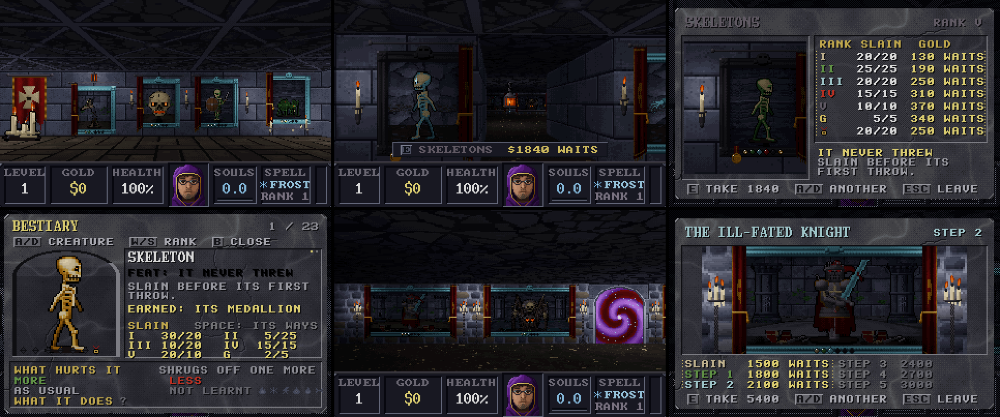

Since 1.0.0b21.2 her walls carry a portrait of every creature in the bestiary, the first two thirds in her room and the last in the
back room. Each hangs under an oxblood tapestry until one of its kind is slain; then E draws the tapestry back, to be tied at the
side for good, and behind it the creature's shadow walks on the spot. Each rank whose achievement is earned shows it there in that
rank's colours, standing on the stone of the run where it was earned, the ranks taking turns; the frame takes the colour of the highest
(bone, green, blue, red, gold for the gilded, black for rank V), and a gem in its foot lights for each. A candle lights each one, in
one of seven ways, so no two neighbours are alike. Since 1.0.0b21.3 the candles stay cold until one of its kind is slain, and burn for good
after, so a lit candle beside a tapestry still hung means there is one to draw back.

Every rank unlocked **pays its gold once a life**, at any visit to her room once a level has been cleared in that life, or on waking
after a death that costs, when every portrait's gold is owed again. A gem whose gold waits twinkles. E at a portrait opens its card:
each rank, slain against what it asks, its gold and whether it is taken, waits, or is still to come; E takes all that waits, and A and D
go through the rest. The gold runs from 100 for the commonest rank to 1,200, by the creature's place in the bestiary, its rank and its
strength: everything on her walls comes to 67,240 a life.

* **The Spectre and the Wraith**, which can't be slain, open theirs too: the Spectre laid to rest by Spirit 5, 15 and 40 times, the
  Wraith driven back 10, 40 and 100 times, and its fourth gem lit when the Wraith Unbound falls (its own portrait pays for that).
* **A feat for each creature that can be slain**, an achievement of its own and a gold medallion on a ribbon under its frame, paying as
  its rank III does: skeletons slain before they ever throw, bats shaken off, wall skulls silenced before their scream goes out,
  shield-bearers slain through a broken shield, web spiders still in their webs, shamblers as they rise, the Drowned whose burst never
  reaches you, hounds two at a time within five seconds, hunting spiders on the ceiling, ghouls at their meal, knights still in full
  plate, brood mothers before a sac hatches, two hundred spiderlings, shades as they fade back from your light, imps by Frost, deacons
  before any rises for them, gargoyles as they wake, the Whipper-In before his horn, the Sexton with his bell unrung, and the Lightless
  with your lantern shuttered. The bestiary's W and S go past a creature's ranks to its feat.
* **The bosses' four** hang in the grave plot, two faces wide, either side of the Accursed Portal: the knight and the spider to its left,
  the Deacon and the Wraith Unbound to its right, each in its own arena with a stand of candles either side, under two tapestries until
  it has fallen. Their gems are its fall and each step of its challenge, paying 1,500 for the knight's fall up to 9,000 for the Wraith's
  fifth step, a fifth more a step; with the bosses everything comes to 175,240 a life.

The screensaver draws a tapestry back now and then, but takes no gold.

### CATACOMB: the Alignment and what you were

**Six elements.** Fire, Frost, Lightning, Poison, Spirit and Physical. Each creature takes more or less from
each, and does its harm in one or two of them; the target's readout and the bestiary show it in glyphs
(below). **Spells are lines**, one an element, bought with **Alignment Points**, one a Level of Atonement,
at **the Lampstand** in the room north of hers, whose six bowls burn as lines open and grow as they rank.
Three points open a line, and every point in it after that is a rank. No line comes open to everyone (since
1.0.0b16): you begin with your class's alone, its first rank costing no spirit, and the Lampstand gives you a
second line free after level 4 and a third after level 12 (she holds the way on till you have taken it; with
every line open it comes as points). A spell's strength
follows your Level of Atonement and its rank adds to that. The spells: **Fire Bolt** (the fireball),
**Frost Shard** (slows), **the bolt** (strikes at once), **the Blight Flask** (lobbed over what is
in the way, a splash and poison after), **Soul Drain** (heals you as it hurts, the healing paid in spirit)
and **the Bone Spear** (through all in a line, a bone a spear, no spirit; with no bones it throws splinters,
eight at most, one coming back every six seconds, slower and lighter). 1 to 6 choose them, 7 the BFS9000, 8
Restoration once it is confessed (below). Any spell
now drives the wandering Wraith back three seconds, fire, spirit and a wisp five.

Each line goes: the opening; Efficiency (less spirit) and Insight (a shorter wind-up), a point at a time;
an ability (Firestarter's flames along the fireball's flight, Deep Chill's freezing third shard, Ionization's
trail behind lightning, Seep's pool of venom, Harvest's extra souls, Impale's pinned target); then one of
two paths, the other closing for good, each ending in an **ultimate**:

| Line | Path A | Path B |
|---|---|---|
| Fire | Flamewalker: Firestarter's flames lend you half your armour again | Firewall: hold to call three flame spirits that circle you, burning what they touch |
| Frost | Winter's Lance: hold to charge a lance through all in its line, freezing each and riming the floor | Shatter: a frozen creature struck breaks for double, its shards cutting what stands near |
| Lightning | Arc: the bolt leaps on, four times | Amperage: hold to charge a slow orb through all it meets, each arcing to one more, all of them dazed |
| Poison | Plague Pit: hold to charge, and the pool grows to two and a half cells, slowing | Contagion: what dies poisoned passes its poison on |
| Spirit | Soul Tether: hold to keep the beam on, draining and slowing; it leaps on when its hold dies | Wisp Host: every drain looses three wisps that hunt round corners |
| Physical | Phalanx: hold to charge a fan of three spears, five at full | Ballista: hold to charge a heavy spear that knocks back and stuns all it passes |

A **charge** builds over a second in a gathering by your hand, in the element's colour, that quickens as
it fills and lights the crypt round you; a tap casts the ordinary spell. Every spell has a **wind-up** (a
third of a second at rank 1, more as it ranks and for the ultimates), and you can walk while it gathers;
a blow that lands then may break it, less often the better your Dodge, Armour, resistance and Luck. The
Masteries of Lightning, Frost, Poison and Spirit add a share of their element to every other spell (and
Spirit's lets it harm spectres). Unbinding a
line (Back at the Lampstand, X on a controller, since 1.0.0b21) costs two Cursed Coins and gives back half its points,
and its augments go with it. Tab's fourth page shows the tree and its fifth
each element's Power, Efficiency and Insight, the line's and what you wear together. A death that costs
takes every line and the class: the next life is asked again, and the Lampstand's gifts come again. An older
page's caster keeps any line it paid for, Fire included, but no longer has the fireball for nothing.

**What you were.** At a fresh start, and after every death that costs, she asks *WHAT WERE YOU?* The
caster is set to the labour of clearing the crypts, and what it was decides how:

| Class | Line | What it gives |
|---|---|---|
| The Witchfinder | Fire | Fire a fifth cheaper and a tenth stronger; three points for Fire |
| The Anatomist | Frost | Frost a fifth cheaper; slowing and freezing a fifth longer |
| The Galvanist | Lightning | Lightning a fifth cheaper and a tenth quicker to gather |
| The Plague Doctor | Poison | Poison a fifth cheaper; poison a fifth longer and half again as hard a tick; the flask strikes a quarter harder |
| The Sin-Eater | Spirit | Spirit a fifth cheaper; twenty more souls carried |
| The Headsman | Physical | A fifth more spears spend no bone, ten more bones, a tenth more armour; not to be chosen until the Lampstand's first gift |

Each class's line is open from the start.

**What each brings** (1.0.0b19.1). A class also starts with health and stats of its own, joined to what it wears and
confesses under the same caps; its own element hurts it 15% less and one other 15% more (the Galvanist's frost a tenth,
from 1.0.0b20); and three of its caps are lifted
by three tenths (a resist's and armour's stopping at 90%, spirit cost's at 70%). Her question's second page (Space) and
the Codex's class pages show it:

| Class | Health | Brings | Hurt less, more | Caps lifted |
|---|---|---|---|---|
| The Witchfinder | 95 | Spell Haste +6%, spirit cost -6%, Spell Effect +8% | fire, frost | Resist Burn 90%, Spell Haste 65%, Spell Effect 65% |
| The Anatomist | 105 | Armour +5, Physic +15% | frost, fire | Resist Slow 90%, Physic 520% |
| The Galvanist | 90 | Dodge +6%, Movement +6%, Quiet +15% | lightning, frost | Resist Lightning 90%, Dodge 45.5%, Movement 52% |
| The Plague Doctor | 100 | Luck +1%, Treasure +5%, sprint +0.5 s, every mark on it a tenth less likely | poison, spirit | Resist Poison 90%, Luck 32.5%, Treasure 130% |
| The Sin-Eater | 95 | Restores 0.1 a second, a tenth more souls from the dead | spirit, poison | Resist Spirit 90%, spirit carried 130, spirit cost 70% |
| The Headsman | 120 | Armour +4, sprint +1 s | its armour; lightning more | armour's share of a blow 90%, sprint 9.75 s over the base, Damage 130% |

Each has a story on her question's screen. A life keeps one; from Level of Atonement 20 she hears another
past for five Cursed Coins, and the old line keeps what was bought in it. The screensaver takes one at
random, so every line shows in time. The class's mark is on the Alignment screen, the caster's page and the
grave's stone.

### CATACOMB: the spells' augments

(1.0.0b21.) Each line earns **augments**, a pair at each of its three great steps: its opening, its ability and its
ultimate, whichever path's. At the Lampstand, Space (Y on a controller) on that step's node shows the pair beside it on
a tablet; A and D choose, Enter takes one, asked twice, for good until the line is unbound. The other of the pair is gone.

They grow by use. A kill by the line's spell is a credit, a thing that wants the spell struck with it two, a boss ten.
The credits go to the line's newest augment not yet whole; its ranks come at 20, 50 and 100 of its own, so a line's
three take 300 in all, and what can't be spent yet waits in the line's bank, so a pair chosen late takes from it at once.
Rank I gives half of what an augment does whole, rank II three quarters. The slot beside each node carries the augment's
mark and three pips; the Codex has a page for each one chosen, saying what it does now and whole, and its credits. A death
that costs takes them with the lines. The screensaver's caster chooses at random.

| Line | Its opening | Its ability | Its ultimate |
|---|---|---|---|
| Fire | **Burning Intensity**: hold the bolt and it grows; tapped it is a fifth weaker, held three seconds a quarter stronger and two and a half times the size, for up to 30% more spirit (with the Firewall, a hold past three seconds calls the Firewall) / **Firecracker**: a spark of a quarter of the damage, all but sure to set its mark alight, the burning three times the spark's | **Multiply**: three bolts in an arc, each half the cast, for 30% more spirit / **Swift Flight**: twice as fast and half again as far | **Volatility**: what dies of your burning bursts, setting all near it alight for a third of its health (a boss a tenth of that), for 30% more spirit / **Pyre**: what burns passes its burning to one within a cell, once |
| Frost | **Hoarbite**: a fifth weaker, two chills a hit / **Splinterfrost**: the shard breaks into three behind its mark, each at 30% | **Rime Trail**: the floor it crosses rimed two seconds / **Glacial Weight**: slower and heavier, through the first it strikes at 70% after | **Cold Snap**: what freezes bursts, a chill on all within a cell and a half / **Brittle**: the frozen take a quarter more from everything |
| Lightning | **Forked**: a second bolt to another within three cells, at half / **Overcharge**: 30% harder and twice as likely to stun, for a quarter more spirit | **Static Build**: each hit on one creature within three seconds raises its stun, three times / **Grounding**: what stands in water or is poisoned passes it to one more, at 70% | **Thunderclap**: strike the stunned, and all within a cell and a half are stunned / **Conductor**: Ionization's trail lasts three times as long and stuns |
| Poison | **Thick Brew**: your poison lasts half as long again, and hurts as much more / **Straight Throw**: thrown flat and quick, it bursts on the first it meets | **Cluster**: the burst throws three small flasks at 40% / **Miasma**: the burst leaves a cloud that poisons what passes | **Pestilence**: the poisoned leave a pool where they die / **Rot**: the poisoned take 15% more from every other element |
| Spirit | **Siphon**: the drain heals 30% more and hurts 15% less / **Hollowing**: the drain leaves the dead Unbound twice as often | **Lingering Hunger**: the beam holds a moment after the cast, draining half the hit again / **Soul Echo**: a kill by the drain gives its spirit back | **Exorcism**: the Unbound take 30% more / **Shepherd**: the souls of what the drain kills fly to you |
| Physical | **Barbed**: what it strikes bleeds half the hit over three seconds / **Recovery**: a spear that kills leaves its bone half the time | **Twin Throw**: two spears side by side for one bone, each at 60% / **Heavy Haft**: the first it strikes staggers half a second | **Skewer**: each creature it goes through adds 15% for the next / **Bone Rain**: a spear that kills bursts into three splinters that seek the nearest |

The Fire node that used to be called Burning Intensity (burning lasts half as long again) is now **Slow Embers**.

### CATACOMB: things that want a spell, and the warded

(1.0.0b16.) **Things in the crypt want a spell**: along the way from the start to the exit, wherever it runs long
with nothing in it, three to six a level, each wanting a line you hold. Each carries a seal, a small iron disc with
its element's glyph that draws motes of that colour in towards it, shown through the dark down a long hall. The
right spell lights a pip with a flare and a chime; the wrong one rings dull and throws its sparks back, and the
first time a level you are told what it wants. Done, it goes dark and gives a little: gold, gems, a potion, bones,
souls, light, experience, now and then a short way through; on one level in five, answering every seal gives a
Cursed Coin. None of it counts in the level's treasure.

- **Levels 1 to 4**, a hit or two each, the class's own first: cold prickets and votive racks for fire, a keeper's urn
  of coals to quench, a galvanic coil to wake, a knot of roots to wither, a soul bound in a lantern to draw out, a bone
  barricade for the spear, and coffers and hanging cages in any line held.
- **From a run's fifth level** they move, time and want two things: a corpse-light that drifts and shies off, a skull
  that rolls away when it sees you, a stone seal that fire heats and frost breaks while it glows, three bells that must
  ring at once (the spear takes all three in one throw), a portcullis winch that lightning raises over a short cut for
  eight seconds, a dying hearth to keep fed while its door rises, a steam vent frost can ice for a while. Each run has
  its own besides: webbed niches in the Catacombs, ore carts and lodestones in the Hollows, prisms, geodes and an
  obsidian seal in the Deep.
- **From level 13, with three lines held**, sequences: a carved tablet that shows three glyphs and plinths down the hall
  to strike in its order; a gilt reliquary that turns between three faces, struck three right running; a ward-stone
  before a door whose glyph changes after each hit; a relay of lamps that passes fire down the line, a frozen lamp or
  a dead coil in it.
- **Things for fights**, one or two a level from 5, in the rooms: lamp oil that bursts into a burning floor, loose
  masonry that comes down on what stands by it, a font a flask fills with bile, the Order's drum that Soul Drain
  silences (and its file of the dead loses its order), standing water in the Catacombs that lightning shocks,
  stunning all that stand in it, a floor frost rimes so what crosses slides and slows, and the Hollows' firedamp.

The screensaver answers what it passes and holds the line for, but leaves the things for fights to a person.

**The lull** (1.0.0b17). When you have walked thirty seconds with nothing happening (no fight, nothing found or
struck, no creature in sight), the level offers you something, never twice in a minute: a corpse-light drifting in
from out of sight, a cold pricket further on that lights itself a moment and goes out (it wants fire; with no fire, a
galvanic coil that sparks), or a handbell rung somewhere off and something coming to see who is there. Only for a
person: the screensaver keeps no watch.

**Warded creatures.** From level 5 some creatures come warded against one of your lines: that element does only a
small share of its damage, two fifths on level 5, a tenth from level 30. About one in six on the Crypts' levels, one in
four in the Catacombs, one in three deeper; a pack shares one ward; never your class's own while you hold two lines,
never every line you hold. A warded creature wears a hard rim of the element's colour, its glyph barred over its
head as it comes near and on its health's readout; struck by that element it rings dull, and the first on a level is
named. A fifth of its health taken in that element cracks the ward, with a sound of glass, so nothing is ever locked,
only slower. Bosses, their adds, spirits and a trial's creatures are never warded. (From 1.0.0b19 a ward is one of a
rank's strengths: see *harm and the elements* below.)

**The Mirror by hand.** The Mirror rune rises only when you raise it, on the right mouse (Q turns between it and the
boss abilities, and held opens a wheel of them): what it meets in its first 0.6 s goes home to the thrower twice as hard,
and after that it is the veil as before, until its wait comes round. The shrine's first curse gives a Common one if
you have none. The screensaver's caster still raises its runes by itself.

### CATACOMB: harm and the elements

(1.0.0b19.) Harm now goes by its element, and each element leaves something behind, on you and on the dead.

**How harm is taken.** Each element is kept off by its own resist: fire by Resist Burn, frost by Resist Slow,
lightning, poison and spirit by theirs; the physical by none. Armour keeps off a share of a blow, not a set number:
armour as great as a green-rank blow of the level keeps off half of it, whatever the level, and half as much against the
elements. Since 1.0.0b19.1 armour never keeps off more than three quarters of a blow (the Headsman's nine tenths), and
a resist may go below nothing, so that its element harms more. A skeleton never throws quicker than every 0.6 s,
however deep.

**What they leave on you.** Seven marks, in a row of small stones by your portrait (by the readout when the bar is
away), each one's edge draining as it runs out:

- **On Fire**: the hit's harm again over four seconds; a second flame adds to what is left. Flames lick at the foot of
  the view.
- **Chilled**: a step slower a stack, the sprint slow to come back, and missiles a little astray; rime creeps in from
  the corners. They all fall away three seconds after the last. Four make you **Frozen**: three seconds unable to move
  or cast, and everything that strikes you a third harder, the view iced over, and the ice cracking off as it ends.
- **Stunned**: 1.2 s with no spells or runes; you can walk but not sprint, and the view swims.
- **Poisoned**: spells half again as slow to gather and come round, the view green; each dose adds, to a minute.
- **Unbound**: 1.5 s with no spells, runes or E; the hand greys and drops.
- **Knocked Down**: 1.5 s on the floor, the crypt leaning over you, no spells or runes; while you are down, every
  creature but the one that put you there does half.

They come from the dead's elemental blows and missiles, more often the higher their rank; from a hazard's stroke now and
then (a frost one chills you every time, a falling rock may knock you down); twice over from the Wraith's touch; from
bites, the Drowned's pools and bile; and a stack every second and a half you stand in the cold. None of the four that
hold you comes twice running: the same can't come again for three seconds after it ends, and nothing of the four for a
second. An element's own resist halves the chance of its mark too. Purify cures fire, cold and poison and breaks a freeze;
Blink takes you up off the floor or out of the ice. The bosses keep their own ways for now.

**The dead's elements.** Every kind is weak to one element, which does half again, and strong against one, which does
half; the bestiary says which, and the target's readout learns them. From blue rank a creature shrugs off one more of
your lines, two at black: shown only once you have seen it struck, and cracked by a fifth of its health taken in that
element (the sixteenth beta's wards, folded in). From green rank some are born to an element, one in seven at green to
nearly half at black, each run's own two more often: their eyes burn in its colour, they shrug it off, and one attack in three
carries it, a thrown bone shimmering in the colour, the eyes flaring as it comes.

**What your spells leave on them.** Fire sets them burning, the hit's harm again over four seconds; lightning stuns them,
no blow, throw or call; spirit unbinds them, no elemental attack, charge or call; frost chills them a stack a hit, and four
freeze them (three with Deep Chill); poison doubles every wind-up and wait. The chance grows with the line's rank, and is
less on what is strong against it.

**New attacks.** Skeletons from green rank up are **Bone Throwers**: a white flash about the body, then three bones lobbed
over you half a second apart. A shield-bearer two to five cells off along a clear lane **charges**: a stamp and the shield
brought up, then a rush that knocks you down 1.2 s, unless you dodge it, the Bone Ward takes all of it, or your armour is
twice its harm. The Drowned swells and **spews** foul water two cells in a narrow cone: eight tenths of its blow, and
Poisoned. A shambler's grip, now and then, **holds you fast** 1.2 s, the view up and your hand shoving at it; a spirit-born
one takes souls instead. The screensaver steps off a charge's lane and a spew's cone, dodges when it can, and waits out
what holds it.

### CATACOMB: souls

Souls are your spirit, and spells spend them by rank: about a fifth of a soul at rank 1, one at rank 10,
two and a half at rank 20, less Efficiency and Spirit Cost; a full charge two and a half casts. With too
little, a spell goes out at rank 1, free, and weak. **The vessel** holds twenty and two a Level of
Atonement, more from the Sin-Eater, the Vessel worn, Communion and Spirit Mastery; what comes in over it
slips away in a pale wisp off your hand, and the souls on the status bar turn gold, a line under them
showing how full. **Motes**: the dead leave about half the souls they used to, where they fell, a pale
flame hanging six seconds; walk through it. Urns, the visportals and her offering are as before.

* **Her offering.** Ten souls, and she gives you experience for them, more the deeper you are.
* **The Dead Bell**, a cracked bronze bell in the new room. A Cursed Coin turns it black for good; then
  souls (three times ten and the level) toll it for the **next level attempt**: two fifths more of the dead
  and of their gold, half the experience, a boss's waves a third larger and a scrip more, a green cast to
  the fog, *CORRUPTED* under the level's name. One attempt. On a level you have cleared before, half as many
  souls again **show its secrets**: a violet wisp at each cracked wall from the start, and a mark on the map.
* **The Weeping Font**, a stone face over a basin. A coin and it weeps red for good; then once a visit,
  ten souls and the level for a tenth more experience on the next level.
* **Replays.** The Accursed Portal lists the levels cleared; five souls and the level's number take you to
  her room before it, then the level (new walls, creatures and treasure: the crypt builds each visit
  afresh), then back to the room you came from. Gold, souls and experience as ever, no Cursed Coins.
* **Soul Sap.** Bats of rank II and above, on your face long enough, latch on instead of biting: across
  the lower view, wings beating, the edges of sight violet. It feeds on your health and souls and slows you;
  turn hard one way and back, or strafe left and right, again and again, and it slips and lets go. Blink
  and Swift Dodge throw it off, and it lets go by itself after ten seconds. Resist Spirit, a new stat and a
  line of points, takes its share off the feeding and off all harm of Spirit.
* **Spectres** come on every level now, by your Luck, and with Spirit Mastery your Soul Drain and wisps
  slay them for their souls.

### CATACOMB: the map, Levels of Atonement and the cornerstones

**The map.** The merchant sells one, once, for 1,000 gold: a small scroll floating at her left. It outlasts
death and her claim. **M** (up on a controller's D-pad) unrolls it across the middle of the view, and since
1.0.0b11 the crypt goes on while it is open: you walk, turn and cast with it up. The level from above, north
up, in ink on a parchment torn, stained and burnt through in places, where the ink goes on over the holes in
a ghostly violet. What lies within a cell and a half of you is drawn, through the stone, and what you see out
to sixteen cells; where you have walked is washed darker. Doors are bars, a vault's in its key's colour once
you have been near it; the exit, the keys you have seen, the Black Altar, opened secrets' doorways and a
visportal or a cooler have marks of their own, and you are the red arrow. A secret is stone on the map until
it is opened. Across its foot the level's numbers: the dead, the gold, the secrets found and the keys. The
arrow keys (the D-pad) pan it, and it drifts back to you three seconds after; Space brings it back at once;
M, Esc, Tab or the pad's B rolls it up. A pocket has a map of its own while you are in it.

**The target's health.** Look at a creature within twelve cells and its name and rank show at the top of
the view with its health as a bar and in figures, for a moment after you look away, and for longer when you
have hit it. Beside the bar, the elements as glyphs: on the left what it takes worst (with ++ or +), on the
right what it shrugs off (- or --, struck through when nothing gets through), and under it the elements of
its harm, as far as you have learnt them: an element from five of the kind slain by it or twelve hits, its
harm from three hurts. Bosses keep their own bar, and of a spirit it says only that nothing you carry
touches it. **The runes' sockets**: when a rune fires, its mark comes up in a socket at the lower right, its
edge in the rune's quality's colour, a line along its foot coming round until it is ready again.

**Experience.** Everything you do down there counts, and each gain is written at the lower left as it
comes, with what it was for: a kill, by its kind, its rank and the level (a pocket's creatures by the rank
they had before the pocket raised them, a quarter more on a chain's first link and a tenth more for each
link after, never more than 1.6 times); a secret, 25; a chain's end, 60 for each link; a boss, a great
deal; a level cleared, 30; each room first entered, 3; and all of it more the deeper the level. A line along
the top of the status bar fills towards the next Level of Atonement and turns gold when one is waiting. The
moment one is banked, a choir, a deep bell and a whisper sound and *LEVEL OF ATONEMENT 12* crosses the view.
The tally has an EXPERIENCE row.

**Ascending.** Experience becomes levels only with the merchant: her menu's **ascend** takes every level it
reaches at once, ten points each, to the fiftieth. Level *n* needs 42 x (n-1)² in all: 42 for the second,
3,402 for the tenth, 15,162 for the twentieth and 100,842 for the fiftieth. Without dying, the screensaver's
caster reaches about Level of Atonement 15 by the end of the first run of the crypt and 28 by the end of the
second, and 50 at about level 35; someone who clears every chain, at about level 29. Everyone has 2% Luck to begin
with, and each class its own health and stats (above).

**The Unholy Confessions** (1.0.0b19.1, in place of the lines the points bought before). Six, each with five ranks,
bought a point at a time: 10 points make rank I, then 20, 30, 40 and 50 more (150 to V), and every point moves all of
a Confession's numbers its share of the way to the next rank. Each class takes each Confession at a share of its own,
from half to the whole (three quarters with no past yet); the screen never names them, but its numbers are the class's.
At rank I and rank V, at the whole share:

| Confession | What it gives, at I and at V |
|---|---|
| Restoration | Restoration, a spell (below): 0.25% of your health a second for 0.7 souls a second, to 1% for 0.1; Physic +10% to +50% |
| Agility | Knocked Down, Stunned and Frozen 30% to 85% less likely and shorter; Dodge +2% to +10%, Movement +3% to +15%, Quiet +5% to +25% |
| Spirituality | 10% to 50% more souls from the dead; Unbound 30% to 85% less likely and shorter; Spell Haste +2% to +10%, spirit cost -3% to -15%, Spell Effect +4% to +20% |
| Constitution | the sprint back 10% to 50% faster, +0.5 s to +2.5 s of it; health +15 to +100; a 5% to 25% chance, once a level, to live a blow that would kill you, on one health and untouchable three seconds (*UNBROKEN*; never more than 30%, and not what you stand in) |
| Survival | On Fire, Chilled and Poisoned 15% to 60% less likely and shorter, and grabs, webs, bile and the old poison with them; Treasure +3% to +15%, Luck +0.5% to +2.5% |
| Toughness | Armour +2 to +14, and 5% to 25% of the armour you wear again; a shut secret's cracks give off motes in the run's colour, through dark and fog, from 4 cells to 8 (2 with none confessed) |

On the caster's screen W and S choose a Confession, D or Enter confesses a point (held, it goes on after a breath,
ten a second) and A takes back what was confessed since the screen opened; points not confessed wait for next time.
The pane beside the list shows every number as the caster has it in all (worn, its class's and confessed) and as the
next rank would leave it; a number at its cap has a pale blue lid over it, as has the list's numeral for any Confession
with something capped, *AT ITS CAP* says which at the pane's foot, and a Confession whose every number is capped asks
twice. What the caster has of its own is added to what it wears, under the same caps. An older page's lines are undone
as it is read, every step given back as the points it cost and every overlevel as one to choose again; she says so as
she greets you. **Luck**: each kill rolls it for a purse of gold, bigger by the creature's rank, and half the time a
bone, a potion or an urn besides, none of it counted in the level's treasure. Nothing you wear has Luck; only Survival
and a few classes raise it. **Treasure** is the stat Treasure Hunter raises, and makes everything picked up worth more.
The screensaver's caster confesses at each visit, its class's two best Confessions to V first, then the lowest, but
never on a run that is yours.

**Restoration** (1.0.0b19.1), once its rank I is confessed: 8 takes it up, and it is last on the mouse wheel and the
spells' wheel (an ankh). Hold the cast and after a breath it channels, souls in and health out at Restoration's rate,
while you walk at half pace and a pale glow climbs your arm; whole, it costs nothing to hold. A blow doesn't end it;
letting go, a menu, a stun, a knock-down, Unbound, the void or the souls running out do. The status bar shows the ankh
and its rank while it is in hand, and Tab's caster page lists it on 8. The screensaver's caster channels it out of a
fight, hurt under three fifths, with souls to spare.

**Cornerstones.** At each tenth Level of Atonement you choose one of five, free, on a screen of their own
that opens before the points (and is Tab's third page). A death takes them.

* **Second Wind.** A blow that would kill you leaves you at half your health instead, untouchable for two
  seconds. Once a run of ten levels; a Cursed Coin offered to the merchant (**offer a coin**) restores it
  sooner.
* **Premonition.** A dashed purple edge on the floor a second before the place does harm there: falling
  stone, fire, bile, the void, the Wraith's hands (the knight's arc keeps its own time). It also marks
  where an imp's ember will land, a drowned one about to burst, and what the Deacon's Litany can see.
* **Cartographer** (once you have the map). Each level's map comes already drawn, all but its secrets and
  keys; a vault's door takes its key's colour, and a secret's wall shows dotted, once you have passed near.
* **Lantern of the Dead.** A pale light about you, about two and a half cells, that shows the shades; the
  ordinary Wraith won't come within two cells of it. Hold L to shutter it, or light it again: the dead
  that feel light know where it is.
* **Grave Sense.** Creatures within ten cells show on the map as red marks.

**Overlevels.** Past the fiftieth, each level costs 4,074, and at 55, 60 and every fifth after you have an
overlevel to give: Space (Y on a controller) on a Confession whole at V, asked twice, takes it past V by a quarter
of what I to V gave, again, the caps of its stats rising with it, and gives an Alignment Point. An overlevelled number is drawn pale
violet, breathing and now and then slipping, with the dead's eye beside it, wherever it is shown. The
Codex has a part of its own for all of this, THE CASTER'S OWN.

### CATACOMB: death, the ledger and her claim

**The dream.** While it plays itself, the screensaver dreams: it plays on from your last page, keeps
nothing, and dies as it always has, the level beginning again and its creatures hitting a little softer
each time (by up to 45%, until it is cleared). Hold H and the run is yours, and stays yours until the
program closes, even if you sleepwalk: from then on the rules below apply.

**Death costs.** When you fall, the gold you carry, every piece you wear, the bag and what is in it,
every spell but the Fire Bolt (which goes back to the fireball), your souls and bones, your Cursed Coins,
the ware held at the merchant's, and your experience, Levels of Atonement, points, overlevels and
cornerstones all go. A stone is cut in the grave plot with what you carried and
what took you, a card says so, and you wake in the merchant's room before level 1. What stays: the
runes and the Rune Shrine, the pedestals, the map, the Totem's abilities and scrip, the Compendium, the
Repository, the Portal's runs and challenges, the record and the Codex. The death is written to your page
the moment you fall, so closing the window during the fall undoes nothing. A death in a pocket is
different: you come back whole at the entrance of the chain's first room, and its doorway is sealed for
the rest of the level, *THE DWELLER FAILED THIS TRIAL*.

**The ledger.** The merchant keeps three pages, I to III, and only she writes them. Her menu's **sign the
ledger** writes the run as it stands onto a page, the page you came from picked first; signing over
another run's page asks twice. A page signed in her room keeps her visit too: opened again, the same
wares are set out, with what was bought gone. **Open the ledger**, from Esc, loads a page anywhere, asking
twice. A page is written by a signature, a death and her claim, and by nothing else: fleeing keeps only
what was signed, and the next start opens your last page. A run never signed is kept as the unsigned run
until you sign it somewhere.

**Her claim.** While you are in danger (a hunting creature within eight cells, a missile on its way,
health under a quarter, poisoned, slowed, held in a web, a foe's fire underfoot, a hazard's warning or
harm, or inside a boss's arena while it fights), your page is marked, and the mark clears eight seconds
after the danger has passed. It is written the moment the danger begins. Open a marked page, by the
ledger or the next start, and she takes the dead's claim at once, whatever you meant by it: a quarter to a
half of your gold, and one piece you wear or a tier of one spell (lost at tier I; the Fire Bolt never
goes below the fireball), all alike likely. Then she signs the page herself. She leaves your Levels of
Atonement alone. While a page is marked a red
eye shows under your keys and in the readout, and FLEE and OPEN THE LEDGER say *THE DEAD ARE WATCHING*.
This catches a closed window, a crash or a power cut as well. Nothing in a pocket or her room counts as
danger.

### CATACOMB: hazards, puzzles and trials

**Each run's own hazards** (1.0.0b13). The Crypts, the Catacombs, the Hollows and the Deep each have six or seven
things of their own that hurt: some fixed in the walls and rooms, keeping a rhythm that can be learnt (a censer on
its chain, a burial slab breathing, a sluice gate, a lodestone seam, a fissure, a black mirror), some arising near
you (falling votive racks, silt, choking ash, glass that spikes), more of both as the run goes on, and now and then
an earlier run's. Each harms by an element, never more than a quarter of your health at a stroke, and always warns
first. From the sixth level of each run, two or three on a level drink your souls while you stand in them (a
reliquary, a weeping saint, a tithe box, the mirror). **Resist Lightning** is a new stat and a line of points.

**Puzzles.** On the even levels from the sixth, a sealed wing behind a great door, a hoard inside, and on one
puzzle level in three the way on. Only thought opens it, never a spell: skulls carried to their niches, bells rung
in order, knights' heads turned, a scale balanced, cisterns poured, stepping stones, rails switched, a fossil's
bones fitted, prisms, a glass floor, singing crystals, a magic square, twenty-seven kinds in all, a run's own and
two of any run. Everything is done with E and your feet, and read in the world; you can carry one thing at a time
and still cast. After three wrong tries a whisper gives a nudge. **The answer is written down** somewhere on the
level, hidden in one of the run's things (a candle-box, a satchel in the silt, a miner's boot, a broken geode):
E searches one, a second's work, and the right one glints when you are close, more with Treasure Hunter. A **Black
Shrine** on each puzzle level will, for souls, show where it lies through the walls and on the map. What you find,
and every clue you read, goes into a new page of Tab, **DOCUMENTS**, until the level ends.

**Trials.** On every level from the third, a door marked with the run's skull and crossed bones, two red lights by
it. A cell inside it seals, the room turns (its walls, its light, the music quickening), and an hourglass stands at the
top of the view with a minute of sand and no numbers. Seventeen trials, four or five a run: the ossuary's bones
standing up in waves, a vigil over three candles, relics carried to a bier, a knight's wager, a toll whose small
bells answer only under the great one; rising water, a brood of sacs, sluice wheels, saints' lamps in the dark; a
cave-in, a charnel feast, a rite of four deacons, firedamp; the molten rise, the dark hours, the glass court and
singing glass. Won, the hourglass breaks, you are made whole (spirit to half the vessel), and **the trial's boon**
gives a fifth more experience from what you slay for the rest of the level. Let the sand run out and its creatures
crumble, and **the trial's curse** takes a fifth from everything instead. Falling there is a death as anywhere.

**The reckoning.** Going out by the exit with anything still left on the level (creatures, secrets, the sealed
wing, gold, the trial), a slip pinned to the exit's door says what, under *THE DEAD KEEP COUNT*, and you choose
*DESCEND BELOW* to go on. It starts on *NOT YET*, so a quick E never leaves by mistake.

The record counts puzzles solved and trials won, with achievements for them, and the Codex has a page for each
hazard met, each kind of puzzle solved and each trial won. The screensaver works the puzzles out slowly, a wrong
try now and then, and takes every trial it finds.

### CATACOMB: the trial's door, and the crypt made kinder

(1.0.0b19; first planned as an update of its own, 1.0.0b18.1.)

* **The trial's door** no longer shuts on you. A trial begins only once all of you is clear of the doorway and a
  step and a half inside, so a look round the door begins nothing; no door that seals itself (a trial's, a boss's
  arch, a winch's portcullis) shuts while any part of you stands in it; and should anything ever close on you,
  you are set free in the nearest place you fit.
* **A trial's reward.** Win, and its hoard and a draught appear in the middle of the room with a chime: the run's
  own treasure, worth three times the level's chest and glowing gold, and a draught that restores you in full.
  The draught takes the place of the win's old restoring, and waits in the room until you need it. Lose, and
  there is nothing, as before. The tally and the reckoning at the exit say if the hoard was left behind.
* **The bells.** The knell's four bells and the drowned bells are told apart four ways at once: by shape, by the
  bands cast round them, by their metal, and by a numeral, I to IV, which the reading on the banner or the carving
  names too. The bells hanging in the Catacombs' halls are cracked, clapperless and still, so they can't be taken
  for bells you ring.
* **The soul-lamps.** A lamp hangs by each trial, each puzzle's sealed wing and each sequence of things that want
  a spell. E at it offers a soul for two minutes of its light, up to five; while it burns, the Wraith cannot set
  foot on that challenge's ground or the ring round it, and walks its edge instead, kept off. The time runs only
  while the Wraith is on the level. The ground is drawn faint on the floor and washed violet on the map.
* **The wheels in her rooms.** The runes', gifts' and spells' wheels open at the merchant's too, and a tap of Q
  at a ware holds it when let go.
* **Props by their size.** Things narrower than a cell take half of it, or a quarter, by how wide they are drawn,
  so you pass beside a candlestand or a brazier where the whole cell was barred, and the dead go round them too.
* **The controller laid out**: see *Playing CATACOMB yourself*.

### CATACOMB: the title screen

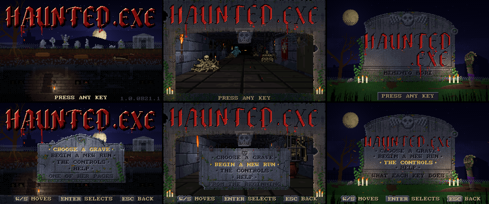

Since 1.0.0b21.1, taking over brings up a title screen first, drawn as the game draws, in mode 13h's terms. There are three
scenes, and each start of the program shows the next of them in turn. **Beneath** is a graveyard in cross-section under a
rising moon, the earth in its bands with its dead in it, and a walker with a lantern crossing the crypt buried under it.
**The Walk** is run I's hall in the first person, walked slowly into the fog through an arch whose lintel carries the name.
**The Risen** is one great headstone close up, the name cut in it, while a hand claws out of the grave beside it. In each,
the name is in a gothic, bloody hand that drips, the light moves, and lightning comes now and then. The music is the lament
ground, a passacaglia in G minor.

**PRESS ANY KEY** (or **PRESS ANY BUTTON**, when a controller is in use): any key or button does it, but a stick's movement
doesn't. A menu then comes into the middle while the scene goes on. In Beneath it is a stone rising out of the earth, in
The Walk a tablet let down on chains, and in The Risen the headstone's face cut again under a dither. It offers
**CHOOSE A GRAVE** (the ledger's three pages as graves, two built of stone and an unmarked one of timber; a page's stone
gives its class, level and date, and Enter raises it), **BEGIN A NEW RUN**, **THE CONTROLS** (the keys' whole list, or the
controller's own screen) and **HELP** (since 1.0.0b21.5, whether a new run brings the lessons again: below). Esc goes back a step. Left untouched on its prompt for a minute and
a half, the title gives the screen back to the screensaver. The run the screensaver was dreaming is not one of the choices.

### CATACOMB: the first two levels, and the lessons

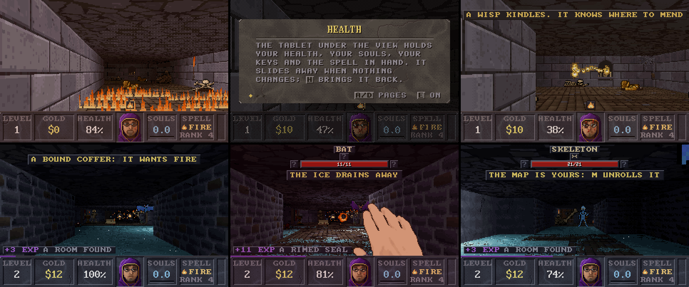

Since 1.0.0b21.5 the first two levels of the first run are laid out by hand, the same every time and for everyone, the
screensaver too. **Level 1** opens on a door with lamp oil burning across the hall behind it: walking through it hurts enough
to want mending, and a place to mend waits at the hall's end (mending is heard by the dead). Then a hall of skeletons for the
class's spell, a gold key in a side room, a vault with two gold doors and one lock, and the way out past it. **Level 2** has
more of the dead (skeletons, shamblers under turned earth, bats), ten things that want a spell, and a room at the back behind
an ice field that holds what stands on it. A rimed seal in that room's far corner takes the ice down after three strikes of any
spell, which can be thrown from the ice's edge. The map lies by the ice: it is yours for good, and as you take it the ice
comes back. The way out of that room is a gate that opens only from its side, by the seal on it. There are two keys, gold and
crimson, each spent on its door, and a secret by the gold key whose finding pays the run's first Cursed Coin.

On a person's **first run on the computer** these levels teach as they go. A page cut in stone stops the crypt at a moment
(the first door, the fire, the place to mend, the class's spell, the first soul, a key, a lock, the map, the cracks of a secret)
and says what is going on, in the keys, a controller's buttons or touch's stones, whichever is in use. A few times the view is
turned for you: towards the place to mend once you are through the fire, where a free wisp kindles to lead you; towards the hall
your spell is for; back from a door you have no key for yet; off the ice before the switch is struck; towards the ice as it
returns behind the map, then the gate. Nothing can hurt you while the lessons hold the view. There is no skip. While the lessons
run, a death costs nothing (the level starts again, nothing lost), her room keeps the map off her wares until level 2 is behind
you, and level 2's way out stays shut until the map is yours. Without the lessons the levels are the same, fire, ice, switch,
gate and secret, but nothing is turned and the way out doesn't ask for the map.

The lessons are remembered with the settings. Whoever had played here before 1.0.0b21.5 (with settings of their own or a page
in the ledger) counts as having had them; the title's **HELP** turns *THE LESSONS ON A NEW RUN* on, and the next new run has them.

### Playing CATACOMB yourself

Hold **H** for three seconds, in either scene, or any button on a game controller. A bar fills at the
bottom of the screen; let go early and nothing happens (any other key still ends the screensaver as
usual; a controller's buttons never do). When it fills, the title screen comes up (above); choose a grave or a new run, and
the crypt is yours, and the scenes stop switching until you hand it back. HAUNT.EXE cuts straight to the crypt.

| Key | What it does |
|---|---|
| W A S D, or the arrow keys | Walk and strafe (the left and right arrows turn instead) |
| Shift | Sprint forward at half again your pace while its meter lasts; run dry, it waits, then fills, sooner the more health you have past 200 |
| Mouse | Turn, Doom-style; there is no looking up or down |
| Left click, or Ctrl | Cast the spell in hand where you are looking (lightning and Soul Drain pick the nearest creature near the middle of the view). Hold it to charge a line's ultimate, or to keep Soul Tether on; a tap casts the spell |
| 1 to 8, or the wheel | Choose a line's spell: 1 Fire, 2 Frost, 3 Lightning, 4 Poison (the Blight Flask), 5 Spirit (Soul Drain), 6 Physical (the Bone Spear), 7 the BFS9000, 8 Restoration once confessed (hold the cast to channel it); the wheel skips lines not open |
| E or Space | Open the door ahead, unlock a vault with its key, press a cracked wall, step through the exit runes, drink from a boss's font, kindle a brazier, take, set down, turn, pull, light, strike or read a puzzle's or a trial's things, search a thing that may hold the hidden message, use a Black Shrine, or mend at a place in the wall (keep still while it mends you, to three quarters of your health, or all of it with Physic at its cap), or use the merchant (her menu), the Rune Shrine, the Hexed Totem, the Compendium, the Repository, a gravestone, the Accursed Portal, the Lampstand, the Dead Bell, the Weeping Font, a Black Altar or its wisp, a visportal or a water cooler. Walking into a door opens it too, and walking into a chain's doorway takes you through |
| Tab | The wardrobe: W and S choose a place, worn or in the bag, and Enter moves a piece between them. A and D turn to the caster's page: every total, what abilities add (in gold) and what is at its cap (in blue), and the lines' ranks; then the cornerstones, the Alignment's tree, the elements, and the documents found and read on the level |
| B | The bestiary and the achievements. A and D turn the pages, W and S choose a rank or scroll |
| L | The wisps: a list of what can be summoned now and at what price (see below). W and S choose, Enter casts, Space sets L to cast that one at a tap; then holding L brings the list back. With the Lantern of the Dead, holding L shutters or lights it |
| C | The Codex of Affixations. A and D turn the pages, W and S go between its parts |
| M | The map, once bought from the merchant, while you walk on. The arrow keys pan it, Space brings it back to you, M, Esc or Tab rolls it up |
| Turn or strafe hard, back and forth | Shake off a bat that has latched on to your face |
| Right mouse | Raise the Mirror, or use the boss ability readied (whichever Q readied) |
| Q | Tap: ready the next of them; hold: a wheel of them, the mouse pointing, while the crypt slows and greys. At a ware in the merchant's room, hold it |
| W, A, S or D twice | Swift Dodge, once the Totem has taught it: a dart two to five cells that way |
| H | A look at the status bar while it is tucked away |
| Esc | Asks whether you want to leave, with a different argument each time for staying; also where you open the ledger, and with a controller in, lay out its buttons |

**With a game controller.** An Xbox controller, or any pad that speaks XInput (most PC pads do, some
in an Xbox mode), plays it as well as the keys do, in the screensaver and in the window; the window
reads it only while it is in front. A PlayStation or Switch pad needs a translator such as DS4Windows
for now. When the pad was the last thing you touched, the hints in every menu name its buttons, A in
green, B in red, X in blue, Y in gold; touch a key and they go back. It rumbles when you are hurt (by how
much), when a rock lands near, a secret wall grinds, a boss falls, or the BFS9000 goes off. While you play
with it the game keeps the display awake, since Windows doesn't count a controller as activity. The
settings can turn it off.

| Controller | In the crypt and the merchant's room | In a menu |
|---|---|---|
| Left stick | Walk and strafe, slower as it leans less; click it to sprint, until it stops leaning forward | Up, down, left, right |
| Right stick | Turn, faster the further it leans | |
| RT / LT | Cast (hold to charge) / the right mouse's: the Mirror or the ability readied | |
| RB / LB | The rune readied (the Mirror) / the boss ability readied | Next / previous page |
| A | Open, use, buy (E) | Choose (Enter) |
| B | Swift Dodge, the way the left stick leans, else back | Back, close (Esc) |
| X | Ready the next ability; at a ware, hold it (Q) | |
| Y | The wisps (L) | Space |
| D-pad | Up tapped the map (then it pans the map), held a wheel of the runes and boss abilities; down tapped the status bar, held a wheel of the spells; left the bestiary, right the Codex | Up, down, left, right |
| View / Menu | The wardrobe / the question at Esc; both together, the controller's drawing | |

**Laying it out** (1.0.0b19). That is the layout as it comes. With a pad in, Esc's question has *THE
CONTROLLER*: a drawing of the pad with a line from each button to its job. Choose a button, then a job,
and the two trade, so no job is ever left without a button; *RESTORE THE DEFAULTS* is asked twice. View
and Menu stay where they are, and in every menu A chooses and B goes back. The same screen swaps the
sticks, sets the turn speed from half today's to twice, and turns the rumble off. View and Menu pressed
together show the drawing anywhere you play, with the jobs as they stand; each of the two now acts when
let go, a fifth of a second later than before. The layout is kept with the settings, not the run (in the
registry on Windows, in the browser's own storage on the page), and the hints and the controls card read it.

**The screens** (1.0.0b14). Every menu, card and the tally is cut in weathered marble, in faces of our
own at the old sizes, keeping their colours, with the crypt dimmed in a narrow margin round it; the words
and keys are as they were. The Alignment is a skill tree, each node a socket with an icon in its line's
colour and its grooves filling as you buy, with a pane beside it saying what the chosen node does and what
it waits for. The wardrobe is the seven worn places on a carved figure; the bestiary stands each creature
in an arched niche; Esc's question and the cards are headstones and the tally a memorial tablet; the
status bar and every word over the crypt are set in the run's own stone in place of black boxes.

Your defensive runes still fire on their own, as quickly (and as fallibly) as they do for the
autopilot. In the merchant's room you shop yourself. Since 1.0.0b21.3, whatever you face in her rooms
shows only as a slim line at the foot of the view, its key on a cap, what it is and a word more where
one helps (a ware's price, gold waiting on a portrait, a gift at the Lampstand), so the thing itself
stays in sight; its card or menu comes up on the key. Walk up to a pedestal and press E, Space or
click, and its **buying** opens: the ware and its price, what you wear in its place now, each of your
numbers it would change, now and after (green where it rises, red where it falls), the abilities gained
and lost, and what becomes of the old piece. E buys it, as many times as the visit allows; A and D go
round her other wares and the map. A piece is worn at once. If it takes the place of one you wear and
you have no bag, the buying warns in red that the old one will be lost, and a second E buys; if your
bag is full, you are asked which spare to let go (Esc thinks better of it). **Q** holds a ware for the
next visit, for a quarter of its price, from its buying or from the pedestal: it comes back on its
pedestal at the price it showed, and the hold ends when you leave the room the next time, bought or
not. One ware is held at a time. E at the cat herself opens her menu, where you sign the ledger,
ascend and buy pedestals. Then leave by the east door.

The Wolfenstein status bar shows the level, gold, health, your face, your spirit (the souls, to a
tenth), the spell in hand, with the bones above it when the spear is in hand, and your keys. Five seconds
after anything it has to show, it slides away to give you the whole view, and comes back when you are
hurt, choose a spell, tap H, or open the wardrobe or the bestiary. It stays up in the merchant's room.
While it is away, the small readout the autopilot uses appears when gold, a key or souls come and go.
Your hand, likewise, rises only to cast or to reach for something, stays ready a moment, and sinks out
of sight.

**Secrets.** Every level hides walls that give: three secrets on a set's first level, rising to six on
its last, counting every link of every chain. Such a wall looks like any other plain stone until you are
within a couple of steps of it, when a set of cracks shows in it. Face it and press E (or Space) and it
grinds back through a room carved behind it, one to four blocks of the plan, with a chime and "A SECRET!
1 OF 5" on screen. A secret room only ever holds treasure and, often, a potion: never a key, and its
treasure isn't counted in the level's total. The tally at the end of a level counts every secret found.
The autopilot presses every one it passes while it has time, a third of them after.

**Chains.** Some secret rooms have a doorway at the back, and through it a place of its own: walk into the
doorway and you are elsewhere, and each link of the chain is a secret found. The level waits while you
are away, its clock and its creatures with it. On the first ten levels the chains lead into **the
Backrooms**: yellow wallpaper, damp carpet, tube lights humming, some failing, some dead, things from the
crypt hung from the ceiling or sunk in the floor, and the level's own creatures glitching, a quarter
stronger and more of them. There is no music, only the hum and an echo. On levels 11 to 20 they lead into
**Severance**: white halls and corners, green carpet, offices of four desks, every panel lit, and the
creatures there lit too brightly, 30% stronger and quicker to strike, to a muzak that is slightly too
calm. Each link deeper is bigger and its creatures a rank higher. At the end of a chain the Backrooms
keep a **visportal**, a doorway onto doorways without end, and Severance a **water cooler**: E there
restores your health, or gives fifty souls if you are whole, with the chain's Cursed Coin, once. What you
take and kill in a pocket stays taken and killed; die there and you are thrown back to the chain's first
room, whole, and its creatures are back. The autopilot goes into chains while it has two thirds of its
health and the time, and turns back when it hasn't.

**Wisps.** Press L for the list of wisps. A wisp to the way out costs a soul: it kindles before you and
flies off down the halls the way you would walk, fetching the key first if the exit is in a locked
vault, and hovers at the doorstep until you come. It lights about four cells round itself as it goes,
shows the shades, and drives the Wraith back, and it leaves motes of light hanging behind it for twelve
seconds, so you can follow it round corners or after a fight. With a Keymaker piece on, the list offers
a wisp to each key still lying in the level as well, in that key's colour. Casting another sends the
first out. Choose one and press Space to have L cast it at a tap from then on; holding L brings the list
back. The choice is kept in your saves.

**Black Altars.** From level 6, a level with secrets has a Black Altar, in a corner of the exit room or
else in the room farthest from the start. Press E at it for what it offers, each with its price and a
note on why it can't be had yet:

* **Wake its wisp**, for ten spirit: a violet flame lights in its bowl and a violet wisp rises from it,
  free, and goes to the nearest secret wall you haven't opened (through the key of any vault it lies
  in). It waits at the wall while you are inside, and once you have been in and come out again, E at the
  wisp sends it home to the altar. There, **send it on** to the next secret for ten spirit and five more
  for every secret already found on the level. While it is out, the L list calls it back if you lose it.
* **Bless your exit wisps**, for twenty-five, once a level: every wisp to the way out you cast on that
  level wears a pale gold halo, and the undead within about four cells of it flee from it, as from Dread,
  for three seconds after it has gone by; the Wraith is driven back. The altar's fire burns with a white
  edge while it lasts. It ends with the level, or a death on it.
* **Anoint what you wear**, once every secret on the level is found, every link of every chain, and the
  flame has turned gold: one thing you wear, at random, one not anointed already. Then the altar is spent.

The autopilot uses them too: it wakes an altar it passes with 25 spirit or more and follows the violet
wisp while it has time, calls it home and sends it on when that leaves it 15 spirit, blesses with 40 or
more when the level has undead, and anoints. It casts an exit wisp as it sets off for the way out.

Esc offers five answers:

* **Flee to the surface** ends the screensaver. Nothing is written: the next start, autopilot or not,
  opens the page you last signed (or the unsigned run as it was last written), at the merchant's. If
  the dead are watching, she takes her claim when it opens.
* **Stay in the dark** closes the question.
* **Sleepwalk** hands the crypt back to the autopilot, which settles into its walk from where you stood
  (from a pocket, it first walks straight back out to the chain's room). The run stays yours: a death
  while it sleepwalks costs as yours would. The mouse then ends the screensaver again (after a second
  and a half).
* **Open the ledger** shows the three pages, with each one's level, gold and when it was signed, and
  opens one, asking twice, because whatever you haven't signed is lost.
* **Begin a new run** starts again from nothing, in her room before level 1, and she asks what you were
  at once. It asks twice: what you haven't signed is lost, as in fleeing. Your signed pages stay in the
  ledger, and a page the dead are watching keeps their mark. (The screensaver takes a class at random
  for a run it starts, so this is how a person chooses one from a fresh start.)

In the ledger, W and S (or 1 to 3) choose, Enter signs or opens, and Esc goes back.

If the window loses focus while you play, the game pauses on that question. The ledger's pages are
`Slot1` to `Slot3` under `HKEY_CURRENT_USER\Software\HalloweenVGASaver` (the project's name before it
became HAUNTED.EXE, kept so that settings and saves carry over), `Progress` beside them names the page to
start from or holds the unsigned run, and `Mark` is the dead's watch; `uninstall.cmd` removes them with
the settings. They are written the moment the game changes them, and never on quitting.

**1.0.0b21.4 changes nothing in the saves.** It adds two bytes to the settings kept with the controller's layout
(touch's turning and smoothing), which earlier betas ignore. **1.0.0b21.3 changes nothing in the saves.** **1.0.0b21.2 adds the portraits** (which tapestries are drawn back, where each rank was earned, the gold taken this life, and the
feats' counts) to each page; 1.0.0b21.1 steps over them, and a page it signs loses them. Achievements earned stay earned.

**1.0.0b21 adds the augments** you have chosen and their credits to each page; 1.0.0b20 steps over them, and a page it
signs loses them. It also reads a piece carrying one of 1.0.0b21's new stats (a mark's chance, Steadiness) or a class's
own ability as nothing, so going back would lose such pieces. If you might go back, back up first (below).

**1.0.0b11 changes saves one way.** It writes save version 7, which 1.0.0b10 and earlier can't read, and
the first time it opens a page from before it, that page's spells are forgotten (you are given an Alignment
Point for each Level of Atonement past the first instead, and told so as she greets you) and you are asked what you were. It
keeps everything else. **Back up before you upgrade**, from a command prompt:
`reg export HKCU\Software\HalloweenVGASaver haunted-backup.reg` (double-click the file to restore it).

1.0.0b9 adds a part to each page for the caster's own: the map, the experience, the Level of Atonement,
the points and what they bought, the overlevels and the cornerstones. 1.0.0b8 and 1.0.0b7 step over it,
so they still read its pages, without those; a page they wrote opens here at Level of Atonement 1, without
the map. 1.0.0b8 changed nothing in the save. 1.0.0b7 wrote a new kind of save, up to
16 KB a page. A 1.0.0b6 grave opens as a page, shown CARVED,
and 1.0.0b6's last fled progress becomes the unsigned run, so nothing is lost; saves from 1.0.0b5 and
earlier load as they did in 1.0.0b6 (runes by tier become qualities, an old robe, hood and ring become
Common pieces). An old save keeps its level's number, though the runs now lie differently (level 15 is
the Catacombs' fifth), and the five to seven pedestals its level gave it. But an earlier beta can't read a save made by a later one: it starts again from level 1, and
fleeing there overwrites it. If you might go back, keep a copy first:
`reg export HKCU\Software\HalloweenVGASaver haunted-backup.reg` (double-click the file to restore it).

## Install

1. Run `install.cmd` from the zip, or right-click `HAUNTED.scr` and choose **Install**. Windows asks for
   administrator rights, copies it to System32 and opens *Screen Saver Settings*.
2. Choose **HAUNTED.EXE** and press **Settings...** to adjust it.

If you installed it before 1.0.0b1, when it was called *Halloween VGA* (`HalloweenSaver.scr`), the old
entry stays in the list until you remove it; `uninstall.cmd` removes both.

Other ways to run it:

* `HAUNTED.EXE`, or `test-windowed.cmd`, runs it in a resizable window without installing anything. Esc quits (while you
  play, Esc asks first); F11 or Alt+Enter switches to borderless full screen and back.
* `capture.cmd` runs it as an ordinary borderless full-screen window for recording (see below).
* `settings.cmd` opens the settings dialog directly.
* `uninstall.cmd` (as administrator) removes it and its saved settings.

## Recording video

A real screensaver is hard to record: it quits the moment you touch the mouse, and Windows runs it
apart from your normal apps. `capture.cmd` (or `HAUNTED.scr /f`) runs it as an ordinary
window instead. The window covers the monitor without a border, ignores the mouse and keeps
running. Esc quits, and F11 switches between full screen and a window. The picture drift is off in
this mode, so the video holds steady.

* **OBS Studio**: add a *Window Capture* (or *Game Capture*) source and choose
  "HAUNTED.EXE (capture ...)". Set the canvas to your monitor's size to keep the pixels sharp.
* **Xbox Game Bar**: click the window, then press Win+Alt+R to start and stop recording.

The window is one pixel taller than the monitor on purpose. That keeps Windows compositing it rather
than switching to exclusive full screen, which some capture methods show as a black picture.

The HAUNT.EXE file manager shows your Windows user name, spelled the way DOS would (upper case,
eight characters), and today's date. Keep that in mind before you share a recording.

## Settings

* **Sound** on/off and **volume**. The default is 60%.
* **Music** and **Effects** (1.0.0b15): each under the volume, both 100% at first, so either can be turned
  down without the other.
* **Brightness** cap, 30-100%. The default is 85%.
* **Scenes**: enable either or both, and how often they switch (1-15 minutes).
* **Slowly drift the picture**: moves the whole image by up to a few source pixels along a very slow
  path (about one pixel every 8 s) so no pixel stays lit in the same place for hours.
* **Show on**: the primary monitor, or the largest monitor (the default). All other monitors stay
  black, which suits an OLED beside an ordinary screen.
* **Game controller**: hold any button to play, and play with it (on by default).
* **Sprint button** (1.0.0b14): the controller's button that toggles the sprint, the left stick's click
  unless you choose another; a choice here trades places with that button's job in the layout laid out
  at Esc (1.0.0b19).

Settings are stored in `HKEY_CURRENT_USER\Software\HalloweenVGASaver`.

## How the display works

* The scenes render into an 8-bit indexed frame with a 6-bit VGA palette, as a real VGA card does.
  The colours are quantised to the VGA DAC and fades are palette fades.
* The frame is scaled by a **whole-number factor** with nearest-neighbour filtering, so pixels
  stay square and sharp: 10x for 320x200 (3200x2000) and 5x for 720x400
  (3600x2000) on a 3840x2160 screen, centred in true black. On a 1440p screen the factors are
  7x and 3x, and on 1080p they are 5x and 2x.
* The saver uses OpenGL 1.1 for scaling and vsync, and falls back to GDI if OpenGL isn't available.
  It is DPI-aware, so it gets the real 3840x2160 and not a scaled-up 1080p.
* Backgrounds are true black, which keeps those OLED pixels off. Average picture level, measured over
  50 minutes of HAUNT.EXE and 25 of CATACOMB: **HAUNT.EXE about 9%** (25% or less 95% of the time; the
  brightest moment is a flash as the ghost scene opens, about 55% for under a second), **CATACOMB about
  13%** (26% or less 95% of the time, 38% at the brightest instants). While it plays itself, HP, gold
  and souls never sit on screen: the readout and your face slide in for a few seconds and leave, and the
  status bar shows only in the merchant's antechamber, for about 15 seconds a level (it stays up while
  you play). The brightness cap and the
  pixel drift reduce wear further, but they can't guarantee anything. If you leave it running for many
  hours, use your display's own panel-care features as well.

## Sound

Everything is generated at run time: an OPL2-style two-operator FM synth (sine, half-sine,
abs-sine and quarter-pulse waveforms, ADSR, feedback, vibrato), noise percussion, PC-speaker
square-wave beeps, a Freeverb-style reverb and a ping-pong delay.

* **HAUNT.EXE**: slow generative ambience in D harmonic minor (a drone, a tritone swell, sparse
  bells, a rare music-box lullaby, wind, and a heartbeat when the scene gets tense), plus the
  machine's own sounds: POST beep, floppy seek, hard-disk crunch, key clicks, a ghost whisper,
  creaks and thunder. The programs add a modem dialling and handshaking,
  knocks on the seance table and the souls going into DEFRAG. The art scenes add a match striking,
  wind through the pumpkin patch, a cackle, chattering teeth, zombie groans, earth breaking, crows, a
  bone xylophone for the dancing skeletons, collapsing bones, and a wail with a stab of brass for the
  ghost's boo.
* **CATACOMB's music, since 1.0.0b21.1**: her hall plays a habanera, with an alley cat's swing after a perfect level;
  run I's piece is *the ill-fated* and run II's *the descent*, each with its fight; the Lampstand and ascending play an
  estampie; the title screen and the ledger opened to choose a page play the lament ground, a passacaglia in G minor. The
  synth learnt the chip's tremolo and drums, glides, the tracker's arpeggio and twelve new instruments. Runs III and IV keep
  1.0.0b15's pieces, below.
* **CATACOMB** (since 1.0.0b15): a piece for each run of ten, each four sections of eight bars played in
  an order that takes three or four minutes to come round.
  * **The Crypts**: D minor, slow, an organ and a low choir, a bell; the old march's first phrase sung as a
    chant, on a flute or the choir, a brass chorale, and the crypt itself, a drone with E-flat leaning on D.
  * **The Catacombs**: C minor, a barcarolle in six, a harp rolling over a pad, a bell under the water,
    drips; the tune on a vibraphone, then a low flute as if from under the surface.
  * **The Hollows**: E minor with its flattened second, a work song: the bass swinging like a pick, an
    anvil, low brass held in fifths, a hammered dulcimer, and the brass calling down the seam.
  * **The Deep**: F-sharp minor, slow, a drone, glass harmonica chords, a celesta glinting, G and C major
    laid over F-sharp so that nothing settles.
  * **The merchant's hall**: a sly tango in A minor, plucked bass in a habanera, a harpsichord marking the
    beat and a flute sliding up to its notes; her back rooms keep only its bass and a music box.
  * **The menus**: the old march's opening as a lullaby in three, in the run's key and on its instrument: a
    music box, a harp under water, a dulcimer, glass. The run's piece stops where it was and takes up again
    when the menu closes; the console and the map are not menus.
  * **A fight**, when something has noticed you nearby or you are casting at something in sight, brings in
    drums, an ostinato and brass on the next beat. The longer it lasts, the more of you there are fighting,
    or the lower your health, the more of it plays and the quicker (a twentieth, then a tenth). Six quiet
    seconds and it ends on a closing chord. A trial plays its fight and quicker still.
  * **Under a fifth of your health** the music goes muffled and thin with a heartbeat on its beat, and lifts
    above a quarter. The game's own sounds stay clear.

  Under it are footsteps, grinding doors, spell casts, fireball impacts, collapsing
  bones, ghost wails, bat squeaks, drips and distant moans, all in a cave reverb. On top of those come
  the game sounds: coin chimes, the key's jingle, the vault's lock, thrown bones, the caster grunting
  when hit, a heartbeat at low HP, a potion, a death groan, the wraiths' shriek, and a brass fanfare
  for each level cleared. A secret wall grinds and thuds back with a pair of knocks and a peal of bells,
  and the wisp arrives with a rising shimmer. Each boss has its own waltz (above), which the run's piece
  gives way to and comes back after, and in the Backrooms and Severance the music fades for a mains hum and
  an echo, or a muzak of major sevenths. Until 1.0.0b15 the whole crypt had one tune, a 92 BPM AdLib-style
  march in D minor.

## Building from source

Needs `x86_64-w64-mingw32-gcc` (on Ubuntu/Debian: `apt install gcc-mingw-w64-x86-64`).

```
make scr          # -> dist/HAUNTED.scr
make zip          # -> dist/HAUNTED-<version>-win64.zip and dist/HAUNTED.EXE
make host         # Linux test harness (needs zlib): renders PNG frames and WAV audio
make smoke        # a short headless run of both scenes, a scripted player and a CPU benchmark
make cards        # the project page's five title cards, from real frames (needs Pillow)
make sheets       # CATACOMB's creatures and dressing, rank by rank, in build/sheets
make web          # the browser's build in build/web (needs Emscripten's emcc); make webzip for its zip
```

`node tools/web_smoke.js <site>` (with Playwright) boots the browser's build in Chromium and plays it a little;
`WEB=build/web sh tools/build_site.sh /tmp/site` puts it at `play/` in a local copy of the page.

Layout:

```
src/core/      core.h  gfx.[ch]  app.[ch]      shared types, drawing, scene rotation / fades / palette conversion
               snd.[ch]                        FM synth, effects, the two music programs
src/haunt/     scene_haunt.c  haunt_art.[ch]   HAUNT.EXE: text engine, script runner, acts, art pieces
src/crawl/     scene_crawl.c  crawl.h          CATACOMB: level generator, autopilot, raycaster, sprites, light map;
               game/  draw/                    scene_crawl.c lists its parts, the game's in game/ and the drawing's in draw/
               crawl_gear.[ch]                 CATACOMB's wares: spells, runes by quality, things to wear, bags, prices
               crawl_tutor.[ch]                the lessons' words and their page
src/art/       crawl_art.c  parts/             CATACOMB palette, light colormap, procedural textures and sprites;
                                               crawl_art.c lists its parts, which are in parts/
               crawl_ui.[ch]  ui_art.c         the menus' carved stone
               crawl_title.[ch]  crawl_portrait.[ch]   the title screen, the portraits of the slain
src/data/      hand_img.c  face_img.c  cat_img.c   the hand, the face and the merchant, converted once from photographs
               font_vga.c                      generated by tools/gen_font.py from third_party/font
src/platform/  win_main.c                      Win32 shell: /s /c /p /w /f, OpenGL+GDI, waveOut, settings dialog
               web_main.c                      the browser's shell, with the page in web/
tools/host.c                        host harness
tools/sheet.c                       sprite sheets: every creature in every rank, side views, the dressing
docs/                               the plans, as text
media/                              pictures: previews/ (this README's), gallery/ (the page's), sheets/ (made for approval)
site/                               the project page, published to GitHub Pages
site/cards/  site/card.txt          its link-preview cards for X and others (make cards), and which one is shown
.github/workflows/                  build.yml (build, smoke test, release on v* tags), pages.yml
```

The version lives in `VERSION`. To release, change it and push to `main`: when the build passes,
the workflow tags the commit `v<VERSION>` and publishes the files above as a GitHub release, with their
checksums. Pushing a tag `v<VERSION>` yourself does the same (the workflow checks that the two match).
A version with `a`, `b` or `rc` in it becomes a pre-release.

A scene is a `Scene` struct (video mode, sound program, `enter` / `update` / `render`), so adding a third
scene means writing one file and adding it to the list in `app.c`.

Test-harness examples:

```
build/host shot crawl 8,36,64 out/crawl 2       # PNG frames at those seconds, 2x
build/host wav haunt 120 out/haunt.wav          # 2 minutes of audio
BOTH=1 STAY=45 build/host dump crawl 200 out/run 10  # frames + audio across scene switches
build/host bench crawl 300 x                    # CPU time per frame
```

`build/host apl haunt 600` prints the average picture level of a scene.

Debug builds (`-DHAUNT_DEBUG`) also accept `HAUNT_PLAN=10,11,15` to force specific acts of HAUNT.EXE:
2-9 the prompt gags, 10 the pumpkin patch, 11 the skull, 12 the manor, 13 the spider, 14 the ghost, 15 the
zombies, 16 the skeletons, 17 the crash, and 18-25 the programs (EDIT, DEFRAG, the BBS, the virus scan, MSD,
SETUP, QBasic, the file manager). `-DCRAWL_DEBUG` prints the CATACOMB autopilot's state
once a second, logs every throw, hit, shriek, key pickup, cast, rune, purchase and exit, and takes
`CRAWL_SEED=n`, `CRAWL_LEVEL=n` to start deeper, `CRAWL_GEAR=n` to own everything at tier n,
`CRAWL_GOLD=n` and `CRAWL_SOULS=n`. `CRAWL_MAP=1` prints each level's map and plan (and checks every lane
can be reached), `CRAWL_MAPAT=t` prints it again at t seconds with what has been explored,
`CRAWL_TPSECRET=n`, `CRAWL_TPEXIT=1` and `CRAWL_TPALTAR=1` stand you in front of a secret wall, the exit
or the Black Altar, `CRAWL_WISP=1` casts a free exit wisp as each level opens (2 to 4: to the gold, silver
or crimson key), `CRAWL_BLESS=1` blesses every level, and `CRAWL_FOLLOWWISP=1` makes a person at the keys
walk the way the wisp went (a test that it really leads out). `CRAWL_RANK=r` puts every creature in rank r (0 to 5),
`CRAWL_WRAITH=s` sends the Wraith at s seconds, and `CRAWL_MEET=k` puts one creature of kind k (0 the
skeleton to 19 the gargoyle, in the order of `MOB_*` in `scene_crawl.c`) a few cells ahead five seconds
into each level. `CRAWL_TPBOSS=1` stands you in a boss level's antechamber (2: the autopilot, already
leaving), `CRAWL_BOSSHP=f` multiplies a boss's health, `CRAWL_OMEN=s` brings the level's omens on any level
every s seconds, and `CRAWL_TPCAT=1`, `CRAWL_TPTOTEM=1`, `CRAWL_TPLECTERN=1`, `CRAWL_TPREPO=1`,
`CRAWL_TPSTONE=1` and `CRAWL_TPPORTAL=1` stand you before the merchant and each of her hall's fixtures.
`CRAWL_HASMAP=1` gives you the map, `CRAWL_LEARNT=1` learns every spell on every kind for the target's
readout, `CRAWL_XP=n` banks n experience as you take over, `CRAWL_LUCK=x` sets Luck at x%, and
`CRAWL_CORNER=b` gives the cornerstones by bits (1 Second Wind, 2 Premonition, 4 Cartographer, 8 Lantern of
the Dead, 16 Grave Sense).
The harness plays a person at the keys with `HOST_INPUT`, for
example `HOST_INPUT="1:+H;4.2:-H;5:m300,0;6:+W;8:-W;9:+MOUSE1;9.2:-MOUSE1"` (press, release, mouse
counts), a controller's buttons as `+PAD_A` ... `+PAD_RT` and its sticks as `aLX0.8`, `aLY1`, `aRX-0.5`,
and `HOST_SAVE=file` / `HOST_LOAD=file` and `HOST_SLOTS=dir` stand in for the registry. It reports the
controller's motors as `RUMBLE` lines.
The Windows build honours `HVS_NOGL=1` (force the GDI path) and `HVS_DUMP=file.ppm` (write one frame and exit).

## What has been verified

**New in 1.0.0b21.5** (the tutorial: the first two levels laid out by hand from the author's drawings, the lessons that teach on
them, the ice, the switch, the one-way gate and the map lying on level 2). Tested in the harness only: not yet played by hand, run
on Windows or seen on a real screen.

* **A person, scripted, through every lesson**, each from its own place on the level: on level 1 the door, the fire walked and
  sprinted through (44% and 56% of health left; never under a quarter, standing in it), the place to mend and its wisp, the class's
  spell, the first soul, the key, both turnings back (and their shorter words a second time), the vault and the way out, then her
  room's page; on level 2 the ice crossed before the switch (walked back off it, twice), the switch struck three times from the ice's
  edge, the map taken (the ice watched coming back, then the gate, then the map's pages; no harm taken while the view was held), the
  ice crossed back with the map (walked back north), the gate's seal struck from inside and nothing from the north, the gold key
  (turned to the secret's cracks), the secret pressed and its coin, the crimson key, and the way out refused without the map. Deaths
  under the lessons cost nothing. The lessons in a controller's buttons and touch's stones are on their sheet; in play they were
  tried with the keyboard only.
* **The screensaver on the drawn levels**: level 1 cleared on every seed tried (158 to 222 seconds), level 2 on eight seeds (250 to
  334 seconds), no deaths there and no stalls. It plays them with no lessons. On level 2 it never wanders into the map's room, so it
  leaves the switch and the map alone; it found the secret on none of those eight seeds.
* **Not measured**: the screensaver's runs from level 1 against 1.0.0b21.4 over many seeds and classes, as the betas before had; the
  first two levels are new, so its early numbers will differ.
* **Memory safety** (AddressSanitizer): a person through level 1's lessons (with deaths), into her room, and through level 2's
  switch, map, ice, gate, secret and lessons; the screensaver on both levels: clean. The smoke test passes, and the Windows and
  browser builds were compiled and smoke-tested by GitHub Actions.

**New in 1.0.0b21.4** (touch: the browser's page asks how you will play, and a phone or tablet held sideways plays by headstones in the
margins; for the browser only, so Windows plays as before). Tested in headless Chromium and on the author's own phone.

* **Nothing in play moved**: the screensaver from level 1 for 2,400 seconds logged the same as 1.0.0b21.3 on the same seed, line for line.
* **On a phone by hand**: the author played the first cut on their Pixel 10a (Android, Chrome, full screen) and said it works well enough
  to publish; their report mended two faults first (the stones covered the picture beside the camera's strip, and turning didn't follow
  the finger). The page's probe there: 119 frames a second in every phase, 2.8 ms a frame in HAUNT.EXE, 5 in the crypt dreaming, 5.7
  taken over by touch, the one hitch a frozen half second as the title is first built. The stones' carved look came after that report,
  and has been tried in Chromium only.
* **In headless Chromium**, as a Pixel 7 held sideways with a camera strip faked at its left: a finger held to take over, the title,
  walking with one thumb and casting with the other, a slide turning the view, Esc's rows and TURNING raised by a slide; the stones
  clear of the picture and no errors. Frames 4.1 to 4.8 ms there. The stones' words and marks against their stone, measured on their
  sheet for each run: 5.5 to 7.7 to 1 (the aim was 4.5).
* **Not tried**: an iPhone or iPad, a tablet's wider stage, Firefox. The test harness drives no fingers yet, so AddressSanitizer has not
  reached the touch code. Nothing on Windows changed: touch is set only by the browser's page. The smoke test passes, and the Windows and
  browser builds were compiled and smoke-tested by GitHub Actions.

**New in 1.0.0b21.3** (her rooms after the author's first look at 1.0.0b21.2: a portrait's candles cold until its tapestry can be drawn
back, the room's urn moved off the skeletons' portrait, a slim prompt in place of the cards in her rooms, and a ware's buying on a screen
of its own). Tested in the harness only: not yet played by hand, run on Windows or seen on a real screen.

* **Nothing in play moved**: the screensaver from level 1 for 2,400 seconds logged the same as 1.0.0b21.1 and 1.0.0b21.2 on the same
  seed, line for line. The candles use none of the game's dice.
* **The buying**: by keys and by a scripted controller: opened at a pedestal and at the map, gone round the wares, a piece bought with a
  bag and without one (warned, then bought on the second press), a ware held, a bag bought, too little gold. The numbers it shows come
  from the caster's own totals with the piece worn in a copy of the gear, so they are the numbers Tab's pages would show after.
* **Two faults mended on the way**: the shrine's, the Totem's and the Compendium's passing words came out blank in the harness (printed
  into themselves; on Windows, unknown), and a controller's hints showed *ESC BACK* as *B X*.
* **Memory safety** (AddressSanitizer): the buying by keys and controller, and the screensaver for 1,500 seconds: clean. The smoke test
  passes, and the Windows and browser builds were compiled and smoke-tested by GitHub Actions.

**New in 1.0.0b21.2** (the portraits of the slain: a portrait a creature on her walls, their gold once a life, the Spectre's and the
Wraith's achievements, a feat for each creature, the bosses' four by the Portal; the kills each rank's achievement asks lowered). Tested
in the harness only: not yet played by hand, run on Windows or seen on a real screen.

* **Nothing in play moved**: the screensaver from level 1 for 2,400 seconds, logged line for line the same as 1.0.0b21.1 on the same seed,
  after every step of the work. It draws tapestries back but takes no gold, and the portraits' candles use none of the game's dice.
* **The gold**: all 131 of the creatures' rows and the bosses' 24 match the numbers settled with the author, counts and gold; every
  portrait's gold taken in turn by a scripted person came to 175,240, the whole. A person took the skeletons' 130 on their visit to her
  room, was struck down in the next level, and on the page the death wrote it waited again and was paid again.
* **The feats**: counted in the screensaver's play from levels 1, 11, 21 and 31: skeletons before they threw, shields broken, bats
  shaken off, wall skulls silenced, hound pairs, Drowned bursts that missed, hunting spiders overhead, shades fading, deacons before any
  rose, gargoyles as they woke, and the Wraith driven back. The knight in full plate, the brood before a sac hatched, the Sexton unrung,
  the Whipper-In before his horn, the Lightless in the dark, a ghoul at its meal, a web spider in its web, a shambler rising and a
  Spectre laid to rest weren't seen in those runs. A feat's count was written at a death and read back.
* **What it costs**: in her room with the portraits in view, 2.5 to 3 ms a frame on the test machine (2 ms without them); in the grave
  plot facing all four bosses, 3.1 ms (2.7 with them veiled).
* **The art**: the portraits, the tapestry, the candles, the card, the medallion and the knight's portrait were approved by the author as
  mock-ups first; the knight's name plate was taken off at their word.
* **Memory safety** (AddressSanitizer): a scripted person taking every portrait's gold and drawing a boss's tapestries back, and dreams
  from levels 1, 11 and 21: clean. The smoke test passes, and the Windows and browser builds were compiled and smoke-tested by GitHub
  Actions.

**New in 1.0.0b21.1** (the title screen; and the music pass: her hall's pieces, run I's and run II's, the Lampstand's).
Tested in the harness only: not yet played by hand, run on Windows or seen on a real screen.

* **The title screen**: driven by a scripted person in the harness, with the keys and with a scripted controller, down every
  path: the prompt, the menu, the controls (the keys' list, and the controller's screen with a pad), help, the graves
  (empty pages say nothing is written; a page signed at the merchant's rises, its class read from the page), a new run into
  her room and her question, the three scenes in turn from one start to the next, and the screen given back to the
  screensaver after 90 seconds untouched, which then went on. Clean under AddressSanitizer and UBSan in each scene down
  every path. The smoke test passes.
* **What it costs**: a title frame takes 8 to 14 ms to draw on the test machine (a crypt frame 1.8 ms). Its built stones are
  shaded once and kept, and the still earth and ground are drawn once, but the sky, the light and the hall are drawn each
  frame.
* **The music pass** (made separately, docs/PLAN-music-work.md) was tested in the harness only, as its own notes say.

**New in 1.0.0b21** (the spells' augments, six to a line; the merchant by what you hold, and your class's own abilities on
what you wear). Tested in the harness only: not yet played by hand, run on Windows or seen on a real screen.

* **Weighed against 1.0.0b20**: the screensaver from level 1, the first 3,000 seconds on sixteen seeds for each of the five
  classes a fresh run can be given, against 1.0.0b20 on the same runs: 485 levels cleared and **158 deaths** (504 and 117).
  **A third more deaths**, on levels 1 to 7 (on half the seeds, 34 of 75 to rank I skeletons). The augments are most of it, and of them the
  openings that take from the one spell the screensaver has early, chosen at random: on the seeds where it drew Firecracker,
  its Witchfinder died 27 times (4 on the same seeds before), and where it drew Siphon, its Sin-Eater 23 (4); with Burning
  Intensity and Hollowing it died as often as before, and the Galvanist, whose openings add to the hit, less. Kept as it is,
  at the author's word: a person chooses their own. By class: the Witchfinder 42 deaths (19), the Anatomist 18 (8), the
  Galvanist 27 (45), the Plague Doctor 39 (32), the Sin-Eater 32 (13). The merchant by class moved nothing past the noise.
  From level 31, 1,500 seconds on eight seeds a class: 117 levels cleared (119) and one death (one).
* **The augments' pace**: on four seeds a class to 7,200 seconds, every run that reached Level of Atonement 18 had the 300
  credits its class's line needs for all nine ranks, the 300 coming between Levels 13 and 19.
* **The augments**: Fire's six in the screensaver's play, and five of them in a scripted person's (the held bolt grown, and with
  the Firewall held past three seconds the Firewall); the other lines' forced on every pair in the screensaver's play; chosen
  at the Lampstand by a scripted person, asked twice; their choices and credits signed onto a page and read back in a fresh
  session; the Lampstand's tablet and the Codex's pages checked to fit. With the augments and the merchant by class both
  switched out, the screensaver played 1.0.0b20 exactly, event for event. The Lampstand's slots and Fire's six, and the other lines', approved by the author
  on sheets first.
* **Memory safety** for 1.0.0b21 (AddressSanitizer): seven dreams of 600 seconds on this build, a class each across levels 1,
  11, 21 and 31 and two with every augment forced to its third rank, and four with Fire's alone before the rest came in: clean.

**New in 1.0.0b20** (the Unholy Confessions, what each class brings and its caps, armour's cap, the killing blow lived,
Restoration, Toughness's cracks, first put out in 1.0.0b19.1 before its balance runs; now weighed against 1.0.0b19, with the
Galvanist's frost at a tenth and a stall of the screensaver's mended). Tested in the harness only: not yet played by hand, run
on Windows or seen on a real screen.

* **Weighed against 1.0.0b19**: the screensaver from level 1, the first 3,000 seconds on sixteen seeds for each of the five
  classes a fresh run can be given, against 1.0.0b19 on the same runs: 504 levels cleared and **117 deaths** (511 and 78).
  **Half again as many deaths**, on levels 3 to 6, a third of them to rank I skeletons. The Confessions are most of it: on
  half the seeds, the same build with the old lines back died 47 times where it died 69. By Level of Atonement 7 the old
  lines had given the screensaver's caster some 55 health and fifteen points more of every resist; the Confessions give health only
  through Constitution, which it seldom confesses first. The harder start is kept, at the author's word. By class: the
  Witchfinder 19 deaths (7), the Anatomist 8 (18), the Galvanist 45 (18), the Plague Doctor 32 (21), the Sin-Eater 13 (14);
  the Galvanist does worse with its own sheet in every batch, with its frost at 15% or 10%. From level 31, 1,500 seconds on
  eight seeds a class: 119 levels cleared (114) and one death (none). Restoration was channelled by the screensaver, and the
  killing blow never lived (none of the five confesses Constitution first). A person may fare otherwise in all of it.
* **A stall mended**: the screensaver could stand turning back and forth for minutes where a shambler still under the earth
  came in and out of its sight while it wanted a place to mend; one under the earth no longer counts as near.
* **Memory safety** for 1.0.0b20 (AddressSanitizer): five dreams of 600 seconds, a class each, from levels 1, 11, 21 and 31:
  clean.

**First put out in 1.0.0b19.1** (the same parts, before the runs above):

* **The Confessions**: a page signed on the old build with 490 points in lines and four overlevels, opened on this one,
  gave back 490 points and four overlevels to choose, and its Confessions were saved and read again; confessing tapped,
  held and taken back; the screensaver's caster confessing by its class at its greeting. A forced knock-down lasted 1.5 s,
  0.21 s with a Galvanist's Agility at V; six seconds of poison 2.4 s with a Plague Doctor's Survival at V. The screen,
  with the totals and the caps' lids, fits for every class on every Confession, at V with caps reached and an overlevel due.
* **The classes' own and their caps**: her question's second page and the Codex's for all six, nothing running over.
  The screensaver from level 1, its first 3,000 seconds on eight seeds for each of the five classes a fresh run can be
  given, with the Confessions, against the same build without the classes' sheets and caps: 253 levels cleared and 68
  deaths (242 and 71); from level 31, four seeds a class, the same either way. **The Galvanist does worse with its
  sheet** in every batch so far (21 deaths against 13 here; 52 against 31 over thirty-two seeds before the caps; at 100
  health, 45): its ninety health is some of it, the rest unknown, and a person may fare otherwise. Before the caps, the
  sheets alone on sixteen seeds: 503 levels cleared and 85 deaths against 1.0.0b19's 511 and 78, inside the noise.
* **The killing blow**: struck down at a set moment with Constitution at V on sixteen seeds for three classes, 15 of 48
  lived, as their shares give it; forced, it came once a level and never twice.
* **Restoration**: a person at rank V mended 10 health in 10.6 s for 1.1 souls at half pace; both wheels took it up and
  put it down; the screensaver channelled it once in 25 minutes (at rank I it needs 56 souls to begin).
* **Memory safety** (AddressSanitizer): the Confessions on three sessions (two of the screensaver's from levels 21 and 1, a
  person opening the old page and confessing), a Plague Doctor's dream from level 11, a person turning her question's
  pages and taking a vow over another, a Headsman's dream from level 21, the killing blow lived by the screensaver and by
  a person, Restoration channelled by a person and by the screensaver: all clean.
* **Found and left for the owner**: the screensaver going back and forth for about four minutes between two cells on
  one run, wanting its place to mend while a shambler still under the earth came into sight and out (older than this
  work).

**New in 1.0.0b19** (harm and the elements: one road for harm, the seven marks on you, the dead's elements and
strengths and what your spells leave on them, the new attacks). Tested in the harness only: not yet played by hand,
run on Windows or seen on a real screen. The Windows and browser builds were compiled and smoke-tested by CI on the
work branch, by a run started by hand.

* **One road for harm**: with the old harm switched back in, three five-minute autopilot runs from levels 1, 21 and 31
  logged 1.0.0b18's events line for line, so nothing was lost in gathering every attack into one table. With the new
  harm, sixteen seeds against 1.0.0b18 were inside the noise from every start.
* **Each part against its absence**: the marks on you, the dead's elements on you, the new attacks, the bestiary's
  elements, the elemental creatures, the dead's marks and your spells' were each weighed on eight or sixteen seeds
  against the same build with it switched off. None moved the autopilot's deaths beyond the noise on its own, and from
  levels 11, 21 and 31 none brought more than one death to a start. The autopilot mostly answers the dead at range, so
  their elements reach it about once a level; it steps off most charges' lanes and spews' cones it sees, and was
  knocked down by a charge 147 times in sixteen runs from level 1. Someone who fights close, or stands in the cold or
  the bile, will meet far more of all of it; untried.
* **All of it together**, with 1.0.0b18.1's parts below: the autopilot from level 1 on sixteen seeds for each of the
  five classes a fresh run can be given, its first 3,000 seconds (about eight levels), against 1.0.0b18 on the same
  runs: 511 levels cleared and 78 deaths, against 495 and 94, a level about six minutes either way. The Plague Doctor
  died 21 times (52), nearer the others at last, since poison now bites the dead as hard as any element. The
  Witchfinder died 7 times (4), the Anatomist 18 (14), the Galvanist 18 (16) and the Sin-Eater 14 (8): inside the
  noise of so few runs, which has moved a class's deaths by half between batches. From level 31, on eight seeds a
  class for 25 minutes: no deaths either way, and as far as before. Before 1.0.0b18.1's parts were merged in, half the
  seeds were run to 6,000 seconds, past the knight's level: 136 deaths against 122, 82 of them on his level (64), the
  knight beaten 15 times (19); and from levels 11, 21 and 31 for 50 minutes, two deaths in 120 runs (none) and as far
  as before, but for a twentieth fewer levels from 31, where the dead's strengths are about three times what the wards
  were. Untuned: that waits for someone to play it.
* **The trial's door, the reward, the bells, the lamps, the wheels at the merchant's, the controller laid out and the
  props' footprints** (first built as 1.0.0b18.1, and merged in without a conflict): the door's fault reproduced on
  1.0.0b18 (a step into the Vigil's room, and the caster could not move for the trial's whole minute while its dead
  struck) and gone after the mend; a peek begins nothing. Each of the rest was tried by a scripted person in the
  harness, the layout by a pretend controller scripted into it (a trade, the defaults, the look from play, the layout
  saved, an old setting read); no real controller has touched it. The lamps held the Wraith at their edge for a
  scripted person and for the autopilot, which offers its souls at them. The bells, the lamps, the controller's
  drawing and the footprints were approved by the author on sheets first. The joint checks found one fault of the
  lamps', mended: a lamp lit while the Wraith was already stepping into its ground let it finish the step and stand
  inside; it now turns back. AddressSanitizer clean on every step's sessions, and again over the merged build.
* **A fault mended on the way**: a Wraith driven back into a corridor's end with a locked door at its back stood
  there for ever, and the autopilot, blocked by it, drove it back until its souls ran out (about one run in four from
  level 11). Driven into a corner now, it goes into the stone and comes again from the far end of the level.
* **The look**: the marks and the view under each, the knock-down, the new attacks and every kind's eyes in each
  element were drawn on sheets from the game's own drawing and approved by the author.
* **Memory safety**: AddressSanitizer and UBSan clean on every part's sessions, and on five more for the whole: the
  autopilot from each start, a class each.

**New in 1.0.0b18** (the dead's ways shown). Tested in the harness only: not yet played by hand, run on Windows
or seen on a real screen. The Windows and browser builds were compiled and smoke-tested by CI on the work branch.

* **The screensaver plays as before**: a 700-second autopilot run on a fixed run id logged the same events as
  1.0.0b17's, line for line, but for the new captions and achievements, checked again after each creature's back
  went in. So 1.0.0b16's balance numbers below stand.
* **The captions, the Codex's pages, the deeds**: each of the seventeen tactics named in autopilot runs from levels 1,
  21 and 31, and every deed counted at least once (an ambush come through and a file beaten untouched from level 31).
  Every new page of the Codex and the bestiary checked to fit. The record saved, kept through a death and read back.
* **The art**: every back, the roost and the signs on sheets at each rank; the skeleton's, shield-bearer's, knight's
  and shambler's backs, the roost and the Catacombs' sign seen in frames from the game. The scree and cinders were
  drawn again in greys after the first frames, where the Hollows' and the Deep's light made them look like gold.
* **Memory safety**: AddressSanitizer and UBSan clean on six sessions, among them every kind turned away at rank IV.

**New in 1.0.0b17** (the lull's watch). Tested in the harness only: not yet played by hand, run on Windows or seen on
a real screen. The Windows and browser builds were compiled and smoke-tested by CI on the work branch.

* **The offerings**: a scripted walker following an exit wisp was offered each of the three; the bell's wanderer found
  it within two to seven seconds. The frames show them poorly, since the walker turns away from them; they are best
  seen by hand.
* **The screensaver is untouched**: the watch is a person's only, and a 700-second autopilot run on a fixed run id
  logged the same 628 events as 1.0.0b16's, line for line, so 1.0.0b16's balance numbers below stand.
* **Memory safety**: AddressSanitizer and UBSan clean on four sessions, each offering among them.

**New in 1.0.0b16** (one line to begin with, the Lampstand's gifts, things that want a spell, warded creatures, the
Mirror by hand and the controller's wheels). Tested in the harness only, by the autopilot and scripted players: not
yet played by hand, run on Windows or seen on a real screen. The Windows and browser builds were compiled and
smoke-tested by CI on the work branch.

* **The balance**, the autopilot from level 1 for 50 minutes on eight seeds for each of five classes (the Headsman's
  line is shut at a fresh start): 1.0.0b15 cleared 261 levels and died 32 times; with one line and splinters, before
  the gifts, 241 and 66; with the gifts 248 and 57; as released, 250 and 47. Fire, Lightning and Spirit are about where
  they were; the Plague Doctor is the weakest, dying 15 to 29 times in its eight runs from one batch to the next, and
  its poison and its flask were made harder for it alone. The Anatomist fares a little worse.
* **The things**: in the same runs about four in five were answered by the autopilot (1,437 placed in one batch); it
  loses most rolling skulls, and leaves the things for fights alone. From level 11 it answered the reliquary, the
  relay, the ward-stone and, once it learnt to go by the next plinth, the tablet. Each kind was set, struck rightly and
  wrongly and finished by a scripted person in the harness; the frames went to the author.
* **The wards**, sixteen seeds with and without: from level 1, 99 levels cleared and 16 deaths against 98 and 19, a
  level 13 seconds longer; from level 21, 98 against 94 and no deaths. The autopilot switches spells as a ward tells
  it, so a ward costs it only time; how a person who doesn't switch fares is untried.
* **The Mirror and the wheels**: a scripted person's parries and a scripted controller's wheels in the harness only;
  how either feels in the hand is untried.
* **Memory safety**: AddressSanitizer and UBSan clean on every step's sessions (twenty in all), among them a
  Plague Doctor's dream, every creature warded from level 31, lightning in standing water and the column coming down.

**New in 1.0.0b15** (the music). Tested in the harness only. The pieces were rendered as recordings for the
author before they went in; in the game the music has been measured, not heard, and no one has played with it
through real speakers yet. The Windows and browser builds were compiled and smoke-tested by CI on the work branch.

* **The pieces**, rendered alone through each change. Calm, they sit 1 to 3 dB under the old march (which had
  hats throughout); a fight at its height brings them 2 to 4 dB up; nothing clips. The fight's quickening,
  measured from the sound: the Hollows' bar 2.865 s calm and 2.605 s at its height (2.857 and 2.597 meant). Low
  health halves the sound above 1.5 kHz. No note was cut short for want of a voice. The synth takes 1.7 to 1.8%
  of one core in a fight, against 1.4% for the march.
* **In the game**: the autopilot at level 13 had a fight come every 20 to 50 seconds, grow, and end, through a
  trial and three deaths; a scripted person taken over at 15% health was failing at once; Tab, Esc, the
  bestiary, the Codex and the L list each brought the menu's tune, and her own screens kept hers. The music
  only listens: the autopilot's run on one seed is the old build's line for line over 500 seconds.
* **Memory safety**: AddressSanitizer and UBSan clean over six renders driven through every change, the
  autopilot at the knight's level, a person through every menu at low health, and a trial three times.
* **The sliders**: in the harness only; the Windows dialog and the browser's settings were compiled, not used.

**New in 1.0.0b14** (the first art pass, how the dead think, the sprint, Physic, the lantern and places to
mend, and the screens in stone). Tested in the harness only, by the autopilot and scripted players: not yet
played by hand, run on Windows or under Wine, or seen on a real screen. The Windows build was compiled and
smoke-tested by CI on the work branches.

* **In the browser** (added to 1.0.0b14 after its release). Run by a script in Playwright's Chromium on a machine
  with no graphics card, locally and in CI: booting, both scenes, taking over by H and by a pretend controller,
  walking, casting with Space, signing page I and finding it after a reload, Esc's question, fleeing back to the
  dream. The page's own work is 6 to 8 ms a frame there (the game 4.5 ms under Node, against 2.7 natively), and
  frames came at 30 to 60 a second, the rest of the time going to Chromium's compositing in software; a browser
  with a graphics card does that part itself. In the harness, a build with the browser's switch casts on Space and
  not Ctrl, the Windows build the other way. With a keyboard and mouse, not yet played by hand in any browser (by touch, see
  1.0.0b21.4 above, whose sound wasn't reported): the mouse's feel, the sound, Esc's two ways and the rumble are each browser's own and untried, and Firefox and Safari haven't been
  tried at all. The download is 2.2 MB, about 0.7 MB as served.
* **The art and the screens move nothing but the look.** For every creature, boss and prop redrawn, and every
  step of the screens, the autopilot (and for the screens, scripted sessions of a person) logged the same events,
  line for line, as the build before; the screens whole give the same as the build they began from, in three
  dreams and six sessions. The debug build checks every screen for words running into one another or off their
  stone; at each run's colours, with the keys and with a pretend controller, none are left. Frames take about a
  tenth of a millisecond longer.
* **How the dead think**, against the old ways of thinking (kept in the debug build for the comparison) on the
  same sixteen seeds (1-31 odd). From level 1 for 100 minutes: a median of 9 levels cleared either way; 56 deaths
  against 47 to 53 a batch of the old, 33 of them on level 10 (36 or 37) and 23 elsewhere (11 to 16); the knight
  beaten 7 times (5 or 6). From levels 11, 21 and 31 for 50 minutes: no deaths, and levels 17, 27 and 37 reached at
  the median, as before; a level takes about six minutes, as before. So the ordinary levels are harder, as was meant.
  Eight seeds turned out to carry noise of about a quarter either way, so sixteen were used, and the knight's level
  still ran from 28 to 49 deaths between builds that don't touch his fight.
* **The new ways at work** in those runs: thousands of noticings and hearings, hundreds of searches given up, of
  packs calling, taking turns and breaking; hunts let loose on 25 levels in the sixteen runs from level 1, ambushes
  on 40 (mostly found, or their bait shot from afar); from the Deep, hundreds of dodges, flanks and feints. The
  three new kinds were met from levels 21 and 31. The autopilot seldom stands still or holds a doorway, so the
  shade's stalk and the wait by a held door are a person's trial more than its own.
* **Faults the runs found, mended:** a brood mother held back laying sacs until spiderlings filled the level; a
  stope's firedamp and a censer's swing read as harm, so the autopilot waited before them until it gave the level
  up; a thrower peeping from a corner for ten minutes; the dead waiting for ever where their way was stood in
  (about ten thousand times a batch); a broken pack still calling. Two long runs still stood about four minutes in
  one place near a Wraith just driven back; whether the broken pack was the whole cause isn't known.
* **The sprint, Physic, the lantern and places to mend**, by scripted players with the keys and a pretend
  controller: the meter run dry and filling, the sprint's button chosen, a potion with Physic, the lantern
  shuttered and lit, mending broken off by a step, a turn, a cast and a blow.
* **AddressSanitizer and UBSan** clean after every creature, step and screen, and at the end over every screen at
  two runs' colours with the keys and one with a controller (113 sessions).

**New in 1.0.0b13** (each run's hazards, puzzles behind a sealed wing, the hidden message and the Black Shrine, trials,
the reckoning). Built on the work branch and tested in the harness only, by the autopilot and scripted players: not
yet played by hand or run on Windows. The Windows build was compiled without warnings and smoke-tested by CI on the
work branch.

* **Hazards:** each of the twenty-one placed and fired in the harness (`CRAWL_HZ`), the dream walking round what is
  always there and through it when it must; AddressSanitizer and UBSan clean.
* **Puzzles:** the dream works every kind; on one seed it solved twenty-three of the twenty-seven within its time
  (the slow ones are the singing crystals, the square and the letters, and the urns can outlast it). A balance it
  left undone turned out to be the dream pacing before a doorway, now fixed. Clean under ASan and UBSan, all
  twenty-seven.
* **The hidden message, Tab's documents and the Black Shrine:** found by scripted players on each run's levels,
  the page of each run drawn; the shrine's showing seen through the walls and on the map. Clean under ASan.
* **Trials:** each run by the dream on eight seeds at three levels of its run, with experience banked so it
  ascends as it would: 383 of 408 won. The plan asks for nineteen in twenty with five to fifteen seconds left;
  Rising Water, the Brood and the Sluices are there, the others are won with more time to spare and lose a few
  for reasons other than difficulty (the full table is in docs/PLAN-b13.md). Clean under ASan and UBSan.
* **The reckoning:** opened, answered both ways, by scripted players on each run. Clean under ASan.
* **Eight dream runs against 1.0.0b12** on the same seeds (1-15 odd): from level 1 for 100 minutes, and from levels
  11, 21 and 31 for 50 with every spell at tier 3, 5 and 8 and experience banked as it would have it. From level 1, a
  median of level 9 cleared (9 for 1.0.0b12), 79 levels cleared in all (77), 22 deaths (26), 19 of them on level 10
  (24), and the knight beaten three times (twice); three of the deaths came in trials, on levels 3, 4 and 10. From 11,
  21 and 31, a median of level 16.5, 25.5 and 36 cleared (16, 26, 36), no deaths in either build, and 52, 42 and 47
  levels cleared (49, 49, 48). A level takes a little longer, a median of 360 to 385 seconds against 350 to 361: the
  trials and puzzles take their time.
* **The trials in those runs:** the dream went into 163 and won 150, lost 10 to the sand and died in 3, with a median
  of 14 seconds left from level 11 and 20 to 29 from the others. It passed 74 by, nearly all because it never came
  near the door: it takes a trial only once it has seen the door or is within sixteen steps of it (a person sees the
  red lights), and from level 1 it was often hurt as well.
* **Puzzles in those runs:** 83 solved on the 95 puzzle levels reached (18 of 21 from level 1, then 25 of 28, 20 of 22
  and 20 of 24).
* **A fault the runs found:** the first trial of each run came on its first two trial levels. Fixed before the numbers
  above were taken.
* **AddressSanitizer and UBSan:** four 25-minute dream runs, one from each run of ten, clean.
* **Not tested at all:** by hand, on Windows; none of the new art has been seen on a real screen.

**New in 1.0.0b12** (a new run from Esc, and the souls' line). Tested in the harness only, by scripted
players: not yet played by hand or run on Windows. The Windows build was compiled without warnings and
smoke-tested by CI on the work branch.

* **Why.** The screensaver takes a class at random for a run it starts, the moment her room opens, so a
  person who took over a fresh run was never asked what they were. *Begin a new run* gives a person a run
  of their own from nothing, and her question at once.
* **Scripted sessions:** a fresh run taken over (the screensaver's class already chosen), then Esc, the
  new row, the red second asking, her question, a vow and walking on into level 1; the same by the
  controller (A twice, the hints in its words); and from inside a Backrooms pocket, which comes out cleanly
  to her room and a level 1 with no pocket left behind.
* **The souls' line** on the status bar sits under the figures now; seen filling (blue) and full (gold).
* **AddressSanitizer and UBSan**, clean: those sessions and a ten-minute autopilot run.
* **Not tested at all:** by hand, on Windows. Opening a ledger page from inside a pocket was not changed
  and not tested; it may leave the same pocket state behind that the new run had at first.

**New in 1.0.0b11** (the map at a walk, the target's glyphs and the runes' sockets; the Alignment, the
classes, gear's elements, souls and Soul Sap). Tested in the harness only, by the autopilot and scripted
players: none of it has been played by hand, run on Windows or under Wine, or seen on a real screen.
The Windows build was compiled without warnings (`-Wall -Wextra`) and smoke-tested by CI on the work
branch; this session had no cross-compiler, so it wasn't compiled here.

* **The art.** The glyphs, the classes' marks, the charging and the ultimates' sprites, the Lampstand, the
  Dead Bell and the Weeping Font were drawn on sheets first (`elements.png`, `spells.png`, `hall2.png` from
  `make sheets`) and then seen in frames from the game. They wait for the owner's eye; none has been
  approved yet.
* **Scripted sessions:** the map open while walking, turning and casting, panned by the keys and the
  D-pad and drifting back; the target's glyphs with every element learnt and with none; a rune's socket
  coming up as it fires; the Lampstand, a line opened, ranked, a path taken and the other closed, a line
  unbound for two coins; every ultimate charged and let go (the frames are the evidence for each one's
  look); her question, a vow taken and another past heard; the vessel filling and souls slipping; motes
  gathered; her offering; the bell cursed and tolled, with and without the secrets shown; the font; a
  level replayed through the Portal and back; a bat latched on and shaken off by the mouse, by strafing
  and by Blink; the Codex's new parts; an old page opening with its spells forgotten for points.
* **The autopilot, against 1.0.0b10** on the same eight seeds (seeds 1 to 15 odd). From level 1, over
  100 minutes: a median of 9 levels cleared (11), 21 deaths (17; 19 of them on the knight's level, against
  13), the knight beaten in 3 runs of 8 (5) in 22 tries (19). **The knight is harder for it now**: the
  fights run short of souls, and a heavy blow can break a spell as it gathers. From level 11 (gear of tier
  3, and the experience it would have by then, so that it ascends and aligns at its first greeting), over
  50 minutes: a median of level 16 reached (16.5); from level 21, 26.5 (27); from level 31, 36 (36.5); no
  deaths in any of them (one from 21 before).
* **Souls**, a level, from levels 1, 11, 21 and 31: about 27, 56, 76 and 105 come in (65, 132, 169 and 244
  for 1.0.0b10) and nearly as many go out, so it ends a level with a median of 26, 51, 71 and 96 (112, 257,
  391 and 609). A spell went out weak for want of souls in 16% of its casts from level 1, and 6%, 4% and 4%
  from 11, 21 and 31 (under 1% in 1.0.0b10). It tolled the bell once in the 32 runs and drank at the font
  24 times. A blow broke a spell's wind-up 130 times.
* **Stalls.** The first of these runs found the dream standing in one place for a minute or more 58 times
  in 32 runs (11 for 1.0.0b10): a key in a block's corner a hair past its reach, and a Wraith it kept
  firing at in a dead end. Both are fixed (the first was older than this beta); the runs above had one
  such stretch. A change that sent it after motes in the middle of fights did worse, and was taken out.
* **Each class**, a 50-minute run from level 1 on one seed: all six reached level 7 without a death. The
  Witchfinder, whose three points go into Fire so that even its fireball costs souls, cast weak in 129 of
  its 419 casts; the other five hardly ever (none to six).
* **Corrupted levels** from 10, 20 and 30 (two seeds each, 25 minutes, every level corrupted): the toll
  heard, the larger waves and a scrip more from each boss that fell. The knight, corrupted, beat the
  autopilot in both runs (two deaths each); the spider fell in both (in 154 and 247 seconds) and the Deacon
  in both (249 and 253), and those runs went on into the next levels, corrupted too.
* **A person's page.** As the program starts it opens the page the progress names, and the dream plays it
  until someone takes over. It used to choose for that run first: a class at random (so a page from
  before the classes never heard her question), its Alignment Points, the bell and the font with its
  coins, and its Levels of Atonement. Now a run read from the ledger at the start is left as it is, and
  the person who takes over is asked what they were. Seen on a save of the oldest kind: no class taken by the
  dream, her question on taking over, then *THE OLD SPELLS ARE FORGOTTEN*.
* **Not tested at all:** how a person's souls hold out against the autopilot's; charging with a real
  controller's trigger; how the eerie ink and the latched bat look on a real screen; the new sounds
  through real speakers.
* **AddressSanitizer and UBSan**, clean, after every step and once more over the finished build: the autopilot
  from level 1 for 40 minutes with everything new at work; from level 21 with every level corrupted, its
  secrets shown, bats latching and spectres coming; from level 31 with the Wraith early and driven back 29
  times; every ultimate charged by hand; the Lampstand bought from and a line unbound; and a level replayed
  through the Portal.

**New in 1.0.0b10** (a look of its own for each run). Tested in the harness only, by the autopilot and
scripted players: none of it has been played by hand, run on Windows or under Wine, or seen on a real
screen. The Windows build was compiled here without warnings, and by CI.

* **The art.** Each run's materials, blends, wall pieces, floors, ceilings, doors, keys and treasure were
  drawn on sheets first. The owner approved runs I and II on their sheets, and run I again in frames from the
  game; runs III and IV went in without a review first, at the owner's word.
* **The autopilot, against 1.0.0b9** on the same eight seeds (seeds 1 to 15 odd): from level 1, over 100
  minutes, a median of 11 levels cleared (9.5), 17 deaths (17), the knight beaten in 5 runs of 8 (4); from
  level 11, over 50 minutes with gear of tier 3, a median of level 16.5 reached (16) and no deaths in
  either; from level 21 at tier 5, level 27 (27), one death (none), the same number slain a level; from level
  31 at tier 8, level 36.5 (37), no deaths (one). **The Deep holds more:** about a tenth more creatures a
  level (39 against 35.5), since more of its rooms keep their dead. The room types decide which rooms keep
  resident dead, so the counts moved a little everywhere; the runs show no harm, but a person will meet a
  few more in the Deep.
* **Light.** The average brightness of a level in the Hollows and the Deep, as the harness measures it,
  matches 1.0.0b9's on the same seeds; run III's stone was lifted after its first frames read dark. The last two levels of the Deep are
  dark on purpose.
* **Speed.** The floor and ceiling now find their textures in fixed point along each row; the benchmark runs
  at 3.6-3.8 ms a frame on the Crypts (3.3-3.9 for 1.0.0b9) and 2.2-2.5 ms on the Hollows and the Deep, as
  1.0.0b9.
* **The splash** was checked by its loudness against a footstep, in the harness's audio.
* **Not tested at all:** any of it on a real screen at full size, the splash through speakers, and how dark
  the Deep's last levels look on an OLED.
* **AddressSanitizer and UBSan**, clean: the autopilot in every run, all four boss fights, pockets, her hall,
  a challenge from the Portal, rooms walked into, and the crossings from each run into the next (levels 9 to
  11, 19 to 21, 28 to 31, and 40 into 41, where the Crypts come round again).

**New in 1.0.0b9** (the map, the target's health, experience and Levels of Atonement, Luck, the
cornerstones and overlevels). Tested in the harness only, by the autopilot and scripted players: none of it
has been played by hand, run on Windows or under Wine. The Windows build was compiled here without warnings,
and by CI.

* **Scripted sessions:** buying the map from the merchant and unrolling it, moving it and bringing it back;
  the target's readout on a shield-bearer with every spell learnt and with none; experience shown as it
  comes and a Level of Atonement banked mid-fight, banner and all; ascending, buying and taking back steps,
  a step past a cap asked twice, an overlevel given; choosing cornerstones; Second Wind catching a killing
  blow; Premonition's marks before omens and in the Deacon's fight; Cartographer in the crypt and in a pocket;
  the Lantern and Grave Sense. A person's death writes the page with the map kept and Level of Atonement 1,
  no experience and no cornerstones.
* **The curve.** Over levels the screensaver's caster cleared without dying (eight 100-minute runs from
  level 1, and four 40-minute runs each from levels 11, 21 and 31), it earned about 250 to 1,000 experience
  a level on levels 1-9, 3,700 on level 10 with the knight, 1,000-2,200 on 11-15, 3,400-4,200 on 22-25 and
  4,200-7,500 on 31-36. At a first guess the fiftieth Level of Atonement came at about level 30; the curve
  was steepened so that it comes at about 35, as asked.
* **The autopilot, against 1.0.0b8** on the same eight seeds (100-minute runs from level 1, seeds 1 to 15
  odd): it dies less, 17 times against 27 (16 of them on the knight's level, against 21), but gets no
  further: a median of 9.5 levels cleared (9.5), the knight beaten in 4 runs of 8 (4), in 21 tries (23).
  Second Wind saved it once in each of seven runs, and Luck dropped 68 purses. With the first, gentler
  curve it had cleared a median 12.5 levels and beaten the knight in 6 runs of 8: the knight is still the
  wall, and the steeper curve gives the caster fewer levels to meet it with.
* **Not tested at all:** how a person's pace through the fifty levels compares with the autopilot's;
  overlevels in a real run (no run has reached 50); the fanfare through real speakers.
* **AddressSanitizer and UBSan**, clean: a long autopilot run with everything on, a scripted session
  through every new screen, a pocket with Cartographer, and the Deacon's fight with Premonition.

**New in 1.0.0b8** (a game controller). Tested in the harness only, with a pretend controller scripted
into it: no real controller has touched it yet, and it hasn't been run on Windows or under Wine. The
Windows build was compiled here without warnings, and by CI.

* **Taking over.** A button held three seconds takes the dweller, or cuts from HAUNT.EXE's pumpkin patch
  into the crypt, with its own plate; a shorter hold does nothing. The button that took over counts only
  once it has been let go, so a trigger held to take over doesn't cast.
* **Playing by the pad alone**, in scripted sessions: walking and turning by the sticks, running, casting
  on RT, the spellbook on the bumpers, Swift Dodge on B in four directions, a web spat on LT; the wardrobe, the
  bestiary, the Codex and the question at Esc; her menu and a page of the ledger signed; the Totem
  raising two abilities; a run started at the Portal; a piece bought from the Compendium and one put in
  the Repository; a wisp cast from the list; a death, its cost and its card. A menu opened from the D-pad
  doesn't take the press as a turn of its page (it did, at first).
* **The hints.** Every menu's hint line, every card's prompt, the controls card and the bosses' gifts in
  the Codex drawn in the pad's words, and back in the keys' when a key is touched. Played with the keys,
  the smoke test's frames are identical to 1.0.0b7's, pixel for pixel.
* **The rumble**, as the harness reports the motors starting and stopping: a hurt, a death, the BFS9000.
* **Not tested at all:** XInput itself, which only Windows has; the dead zones and how the sticks' speeds
  feel; how strong the rumble is; the display kept awake and the screensaver refused while a pad plays;
  a pad unplugged mid-game; two pads at once.
* **AddressSanitizer and UBSan**, clean, over all of those sessions.

**New in 1.0.0b7** (runs of ten and four bosses, their hazards, omens and waltzes; death that costs, the
merchant's ledger and her claim; her hall, with the Hexed Totem and the bosses' abilities, the Accursed
Portal, the Corpus Compendium, the Wretched Repository and the grave plot; the Codex). All of it has been
tested in the harness only; none of it has been played by hand yet, and this round wasn't run under
Wine. The Windows build was compiled here without warnings, and by CI.

* **The bosses**, fought by the autopilot as each was built, with every spell at tier 4 to 8: the knight
  beaten in 189 to 221 seconds, the spider in 173 to 232 (four deaths on two seeds of four), the Deacon
  in 160 to 210, and the Wraith in eight fights of eight, but in 332 to 593 seconds, about twice what was
  planned: it can be hurt only in the light, and most of the time goes between its waves. With every boss
  ability at rank III, the knight fell in 215 seconds, the spider in 175 and the Deacon in 198. A knight
  challenged from level 2 fell in 196 seconds and a spider in 292, each giving its scrip and the way back
  to the room it was begun from.
* **The dream gets less far than it did.** Eight 100-minute runs from level 1, against a build from
  before the ledger and the hall on the same seeds: they cleared up to level 9 to 13 (median 9.5, against
  11.5) and died 27 times (11), 21 of them on the knight's level (10 to the knight, 10 to its adds and one
  to its mirror). Every run reached the knight. It fell in 4 runs of 8 (6 of 8), in 141 to 217 seconds,
  after 23 tries (13); the other four were still trying when their time ran out. The cause is the
  merchant: a fresh run has two pedestals and buys one ware a visit in the first run, so it bought 78
  wares where it had bought 101. A variant that kept back half a level's gold when buying a pedestal
  bought fewer still, and wasn't kept. It never died to a hazard, though rocks struck it 33 times; the
  median level took 5.7 minutes, and it took 85% of the treasure (84% before).
* **Found and fixed on the way:** a boss's arena could not be reached at all. The room above its
  doorway could be made a vault, and making a vault walls up a room's other ways in, this one included.
  Of 800 boss levels generated before the fix (200 seeds, each boss's level), 116 had the arena cut off,
  and so did three of the eight runs above the first time they were made: the autopilot wandered level 10
  until its time ran out, or until a boss level's twenty-five minutes of patience moved it on (a person
  couldn't have reached it either). The comparison build had the fault too, in one of its runs. Now a
  vault is never made of that room, and none of 800 is cut off. Also found: the autopilot never aimed at
  a boss that doesn't strike, kept away from slow adds instead of going after them, and dithered near a
  key while leaving; a Wraithwalk could read past the map's edge (found by AddressSanitizer); and a
  scene switch during a costly death's haze brought back the level it died on.
* **Played in the harness:** a person's death (the card, the stone and its page, the page written at
  once, 1,505 bytes with one stone, waking before level 1 with the runes and the hall kept); a death in a
  pocket and its sealed doorway; signing and opening pages, signing over another run's page, a page
  keeping the merchant's visit; the sixth beta's graves and progress opening as pages; her claim (a run
  marked as it met a black skeleton, the program closed while marked, and the next start paying 740 gold
  and a tier of Rapid Sparks, then nothing on the start after); all seven pedestals; the Totem teaching
  and raising each ability and selling scrip; Swift Dodge, a web, the dead raised, Wraithwalk; the
  Portal's run starts and challenges; the Compendium's purchases, and the autopilot buying back a tier
  her claim took; the Repository's places, gold and coins kept through a death; all 24 of the Codex's
  pages with the debug gear. The four waltzes were measured: none clips, each within two decibels of the
  march.
* **Saves.** A page is up to 16 KB: 1,145 bytes of the run, then sections for the merchant's visit, the
  stones, the pedestals, the Compendium, the Repository and the Codex, which a reader steps over when it
  doesn't know them. The harness stands in for the registry; the Windows side, which writes a value the
  moment the game changes it, compiles but hasn't been run.
* **AddressSanitizer and UBSan**, clean, after each step and once more over the whole beta: the autopilot
  for 50 minutes from level 1 and 30 from level 21, each boss's level for 20 minutes, 40 minutes of scene
  switches, and scripted sessions of a death and its stone, signing, the claim, the Totem, the
  Compendium, the Portal's run start and a challenge.

**New in 1.0.0b6** (secrets in chains through the Backrooms and Severance, Cursed Coins and the Rune
Shrine, runes by quality, the altar's wisp to one secret and back, the autopilot in all of it, and the
hand that rises once to cast). All of it has been tested in the harness only; none of it has been played
by hand yet, and this round wasn't run under Wine. The Windows build was compiled here without warnings,
and by CI.

* **The autopilot does about as well as in 1.0.0b5**, run again here on the same seeds. Dying in a chain
  only sends you back to its first room, whole, so those deaths are counted apart. Eight 50-minute runs
  from level 1 died 4 times in the crypt against 5, and twice in chains; they reached levels 6 to 9
  (median 8, against 8.5), took 76% of the treasure in both, and bought 60 things against 50. Eight
  50-minute runs from level 11 with every spell at tier 1 died 7 times in the crypt against 11, and twice
  in chains. Eight 30-minute runs from level 16 at tier 2 died 30 times in the crypt against 28, and 5
  times in chains: the Deep is as deadly as it was.
* **Where it went.** From level 1 it opened 89 secret rooms (40 in 1.0.0b5, with fewer to find), went
  into chains 37 times, reached the end of one 20 times (15 times hurt enough to be healed, 5 times
  given the souls) and came away with 29 Cursed Coins: 20 from chains' ends and 9 for finding every
  secret on a level. From level 11 it went into 28 chains and reached 4 ends; from level 16, 13 chains
  and no ends. It turns back when it is hurt, and the pockets' creatures, a rank up for each link and
  stronger again in their theme, hurt it most times.
* **The shrine.** It cursed the shrine in 18 of the 24 runs, but with three or four coins a run it pulled
  three times and took three runes, all in runs from level 1, and never had the six coins to raise it. In
  1.0.0b5 it bought 20 runes from the merchant in the same runs. It died no more for want of them.
* **Exquisite runes are strong.** With every rune at Exquisite (through the debug switches) the
  autopilot didn't die at level 18, even with every creature at the top rank. In play they are a long way
  off, and they haven't been tuned.
* **Played in the harness:** each Exquisite rune's second effect (the Bone Ward's burst only in a scratch
  build with a weaker ward, since a full ward never broke); the shrine by a scripted person: the curse,
  pulls, three Mends combining into one better, a take, letting one go, both questions and leaving; going
  into a chain and out, the level waiting, dying in a pocket and waking in the chain's room, sleepwalking
  out; a test player following the altar's wisp to a secret, in and out, home, and sent on to the next;
  the Backrooms and Severance at every link of their chains, their sound (the silence, the echo and hum,
  the muzak), the visportal's and the cooler's gift once a chain, the things out of place, the glitch,
  and creatures killed in a chain staying dead until you die in it (spectres, which can't be killed, come
  back); the hand rising once to cast while the bar is away; the coins on the status bar, the
  readout and the caster's page; the menus inside a pocket.
* **Saves.** The new save (975 bytes) fled from inside a chain and loaded with the shrine and its coins
  kept, and a chain's coin, once taken, wasn't given again at its end after loading; a save in 1.0.0b5's
  format loaded with its runes turned to qualities and a held rune's fee paid back.
* **Found and fixed on the way:** in Severance a desk could stand across the autopilot's lane and leave
  the cooler out of its reach; and the autopilot, once in a chain, came straight back out, taken for a
  sleepwalker.
* **AddressSanitizer and UBSan**, clean, after each step and once more over the whole beta:
  nine sessions, about 75 minutes of game time: the autopilot from levels 1, 11 and 16 through chains of
  both themes; the shrine with forty coins (cursed, raised twice, pulled, attuned, taken from); a person
  in the Backrooms (the visportal, casting, walking) and in Severance (dying in a chain, and in the crypt);
  the things out of place; the wardrobe, the bestiary and the wisps list inside a pocket, then
  sleepwalking out; and fleeing from inside a chain and loading the save.

**New in 1.0.0b5** (the status bar that steps aside, wisps in the crypt and the L list, the Black Altar's
menu and blessing, the autopilot's wisps and altars, the hand that rises only to cast, and a few secrets).
All of it has been tested in the harness only; none of it has been played by hand yet, and this round
wasn't run under Wine. The Windows build was compiled here without warnings, and by CI.

* **The autopilot does about as well as in 1.0.0b4**, on the same seeds. Eight 50-minute runs from level 1
  died 4 times against 3 (five runs never died), reached levels 7 to 9 (median 8.5, against 8), took about
  77% of the treasure (75% before) and found 43 secrets (34). Eight 50-minute runs from level 11 with every
  spell at tier 1 died 11 times against 12. Eight 30-minute runs from level 16 at tier 2 died 28 times
  against 25.
* **The Wraith now comes once a level, as it was meant to.** Since 1.0.0b3 it had come only once a session.
  In the runs from level 11 it came 56 times (8 before) and from level 16, 33 times (8): most of the Deep's
  extra deaths came late in a level, when it is about (7 after four minutes, against 5). The share of the
  treasure taken fell in the Hollows (67%, from 71%) and the Deep (63%, from 68%), where the autopilot also
  spends time at the altars.
* **What the autopilot did with the new things.** In those 24 runs it cast 146 exit wisps, woke 39 altars,
  bought 54 blessings, whose wisps turned the undead 72 times, and was anointed once: it seldom finds every
  secret on a level before it is time to go. It lost the light of the hand's wisp, and no more of its deaths
  came early in a level than before.
* **Played in the harness:** the status bar sliding away and coming back for a hurt, a spell, H, Tab and B,
  and the small readout meanwhile; the L list with and without Keymaker, a hold of L, the setting for a tap,
  a cast with too few souls; wisps to the way out and to each key, with a test player following them to
  the keys and out (18 of 18 levels); the altar's menu, waking, the blessing and its gold halo and white
  edge; a test player that only follows a blessed exit wisp through level 9 took 2 blows on four seeds,
  against 11 without the blessing.
* **Saves.** The new save (943 bytes) fled and loaded with the L setting kept, and a save in 1.0.0b4's
  format loaded in this beta and in 1.0.0b4.
* **Found and fixed on the way:** the Wraith (above); a level's wisps could leave their motes drawn in the
  merchant's room; a click that closed a menu cast a spell as well; and the first try at holding the game's
  sounds for a pause also held the music's drums, which then all played at once.
* **AddressSanitizer and UBSan**, clean, after each step: the menus, the altar, the autopilot at the altars,
  long scripted sessions and autopilot runs.

**New in 1.0.0b4** (things to wear rolled like loot, spirit and bones, the abilities, the merchant's
wider room and the Black Altars). All of it has been tested in the harness only. None of it had been
played by hand when this beta went out, and this round wasn't run under Wine; the Windows build is
compiled and smoke-tested by CI.

* **The first ten levels are a little kinder to the autopilot.** Eight 50-minute runs from level 1, on
  the same seeds as 1.0.0b3: 3 deaths against 7, six runs that never died in both, levels 8 and 9
  reached (median 8, against 8.5), levels a median of about 5.6 minutes as before, about 75% of the
  treasure taken (79% before), four to nine purchases and two to seven secrets a run.
* **The Hollows are easier and the Deep a little harder.** Eight 50-minute runs from level 11 with every
  spell at tier 1 died 12 times, against 18 at 1.0.0b3. Eight 30-minute runs from level 16 with everything
  at tier 2 died 25 times, against 22. These runs begin with seven Uncommon pieces where 1.0.0b3's began
  with a robe, a hood and rings, so they compare only roughly. In the Deep the autopilot can seldom afford
  much: seven of those eight runs bought one thing or nothing.
* **Spirit is enough for the autopilot.** In all those runs it cast about 10,700 spells, and 51 of them
  went out weak for want of spirit.
* **Its shopping was mended twice on the way.** Runs that skipped attack spells were the ones that died,
  so it now takes three before anything else. And in the Deep it would fix on a rare spell costing four or
  five levels' gold and save for it for half an hour, buying nothing; now it saves only for a spell that
  two levels' gold might bring (deaths from level 16 went from 28 to 25).
* **Played in the harness:** buying a piece for a worn place with no bag (the red warning, then a second
  E) and with a full bag (letting a spare go); holding a ware and finding it back on the next visit at
  the price it showed; moving pieces between the wardrobe and the bag; the caster's page; Keymaker's L
  sending the wisp to each key in turn, with a test player following it to the keys and out; Commune's
  red shapes; Mirrored sending missiles home; Treasure Hunter's whisper; waking a Black Altar, with a test
  player following its violet wisp to all three secrets on a level, through two vault keys. The gold flame
  and the anointing were seen in a scratch build that marks the secrets found, since finding every one by
  script takes a while. Anointing was checked on 72,000 rolled pieces: no stat ever passes its cap.
* **Saves.** Fleeing and loading the new save (939 bytes) with what was worn and abilities intact, and
  loading a 1.0.0b3 save, whose robe, hood and ring came across as Common pieces, with no bag.
* **Found and fixed on the way:** taking control in the merchant's room cast a stray Fire Bolt (in
  1.0.0b3 too, where it cost nothing); clicking a ware bought it and cast a Fire Bolt as well; a long name
  ran under the price on the merchant's card, and a number could be parted from its unit at the end of a
  line; the altar's wisp stalled at a vault door when the secret it sought lay inside the vault.
* **AddressSanitizer and UBSan**, clean: about 40 minutes of scripted sessions (the shop, the wardrobe
  and the caster's page, holding and the next visit, the altar and its wisp, Keymaker and Mirrored,
  fleeing and loading new and old saves), on top of rounds after each step of the work.

**In 1.0.0b3** (the creatures, their ranks, the sets, achievements and the bestiary):

* **The owner ran a build of this beta on their own Windows PC**, from just before the two bestiary fixes
  below, and found it looks and runs well. Not every creature, achievement and bestiary page has been gone
  through by hand, and this round wasn't run under Wine.
* **The first ten levels play about as before.** Eight 50-minute autopilot runs from level 1, on the same
  seeds as 1.0.0b2: 7 deaths against 9, six runs that never died against four, levels 6 to 9 reached in
  both (median 8.5), levels a median of about 5.6 minutes, about 80% of the treasure taken (77% before),
  five to eight purchases and one to six secrets a run.
* **The Hollows and the Deep are a good deal harder.** Eight 50-minute runs from level 11 with every spell
  at tier 1 died 18 times, against 9 before the Hollows' newcomers came (the first try died 33 times,
  nearly all from the hunting spider poisoning on every leap, so now only one leap in three does). Eight
  30-minute runs from level 16 with everything at tier 2 died 22 times, against 25 before the Deep's
  newcomers: the old creatures in the Deep's high ranks were already that deadly. These levels will be
  tuned as they are played by hand.
* **Each newcomer was seen doing its work** in the harness, in those runs: hunting spiders and ghouls
  leaping (over 300 times), knights' blows, sacs laid and hatched, the Wraith driven back by fire and the
  wisp, imps throwing 162 embers (56 hit), deacons raising 21 skeletons, 9 gargoyles waking, shades
  touching the caster 6 times. Each was also rendered in the crypt for the previews above.
* **The record and the bestiary.** Saving and loading the new save, loading an old one (with an empty
  record), carving a grave and rising from it with its own counts, the pop-up on a first secret, and
  every bestiary page drawn from a full record. Drawing every page that way found two bugs before release,
  both fixed: the shade's page called it a spirit that can't be killed, and the achievements' count ran
  into the page number.
* **AddressSanitizer and UBSan**, clean: about an hour and a half more of the autopilot on levels 11 to
  19, with every newcomer in play (drawing two frames a second), on top of the earlier rounds below.

**From the earlier betas:**

* The synth output was analysed offline: no clipping (peak 0.85 across the new programs and art scenes),
  no DC offset, and every new effect's level measured against the existing ones.
* The CATACOMB autopilot was simulated for 50 minutes on each of eight seeds, merchant visits included,
  in the wider crypt with its secrets. Runs reached level 6 to 9 (the earlier, narrower crypt reached 9 on
  every seed under the same test). Levels took a median of about 5.6 minutes, every one ended through its
  exit, the median level ended with 83% of its treasure (87% before), and the caster bought four to eight
  things per run and found two to six secrets. The wider halls make it a little harder: four runs never
  died, two died once, one twice and one five times (the earlier crypt: none or once). That is after
  bones thrown from far across a hall were made to fly wider, and the crypt was made to ease off after each
  death on a level, which ended runs that died again and again on the same level.
* Every generated level was checked for reach: each walkable lane connected, on 15 seeds and levels. A
  test player that does nothing but walk where the wisp leans cleared 24 of 24 levels (levels 1 to 9,
  six seeds) in 25 to 115 seconds, fetching vault keys on the way where the exit needed them, including
  a key locked inside another vault.
* The core was run under AddressSanitizer and UBSan: earlier rounds for about an hour (every HAUNT.EXE
  act and art scene, scene switches and CATACOMB, with the merchant, levels 1 to 7, every spell, rune,
  robe, hood and ring, and the BFS9000), and this round for about 30 more minutes of the new crypt with
  every frame drawn: the autopilot (finding and opening secrets, with the wisp lit), a person following
  the wisp out, and pressing a secret wall, walking into its closet and taking the loot. All clean. The per-frame CPU cost (simulation plus drawing, without the synth) is about
  0.8 ms for HAUNT.EXE and about 2 ms for CATACOMB, deep levels with every spell included (2.3 ms while
  you play it).
* Playing it was tested two ways. The harness played scripted sessions: taking control from either
  scene, shopping, walking, every spell, the inventory, the Esc question, sleepwalking and taking over
  again, dying, the exit, and saving and loading, including 170 seconds under AddressSanitizer and UBSan
  (clean). The Windows build was driven under Wine with real key presses and mouse movement: holding H,
  turning with the raw mouse, the inventory, fleeing (the progress landed in the registry), the next run
  starting from it, and the mouse ending the saver again after sleepwalking. The autopilot's simulated
  runs came out exactly as before. With the wider crypt, the Windows build went under Wine again: taking
  over, the merchant, walking and turning, and the Esc question.
* The Windows build was run under Wine on a virtual 3840x2160 display (the OpenGL path was checked by
  reading back the frame: 10x scale, centred, pixel drift applied), in a window, with the GDI fallback,
  the settings dialog, and the `/p` preview. The `/f` capture window came up borderless at 3840x2161.
  Whether it really ignores the mouse is untested, because nothing here could send mouse input.
* **Played by hand on real Windows.** The author has run it on their own Windows PC in a few different
  configurations. The sound plays as intended, the mouse speed (0.0015 radians per count) feels right,
  and holding H, the keys and the mouse capture all work. Other PCs and graphics cards haven't been
  tried yet; if you get no sound or something misbehaves, please open an issue.

## Credits and licences

HAUNTED.EXE is licensed under the GNU General Public License v3.0 (see `LICENSE`).

The VGA glyph bitmaps come from the Px437 IBM VGA 8x16 and IBM BIOS fonts in *The Ultimate Oldschool
PC Font Pack* by VileR, licensed CC BY-SA 4.0. See `third_party/font/`. The caster's hand, the
caster's face and the merchant were traced from the owner's photographs of their hand, their face and
their cat; the package holds only the converted sprites, not the photos. Everything else (code, art,
music and effects) is original and procedural.
