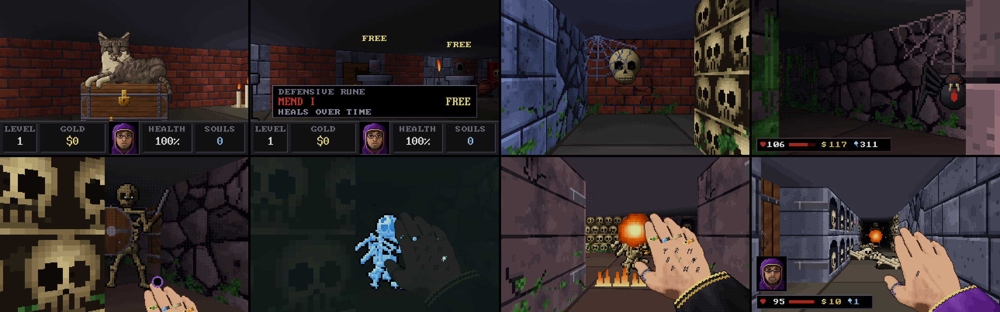
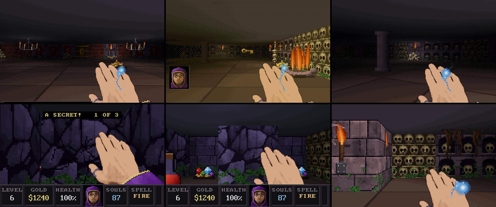
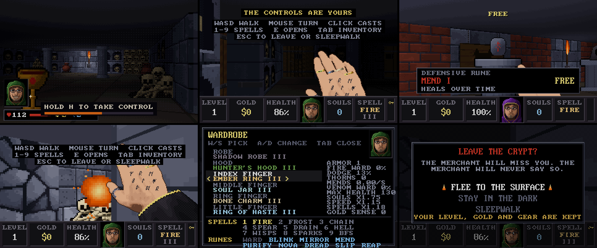
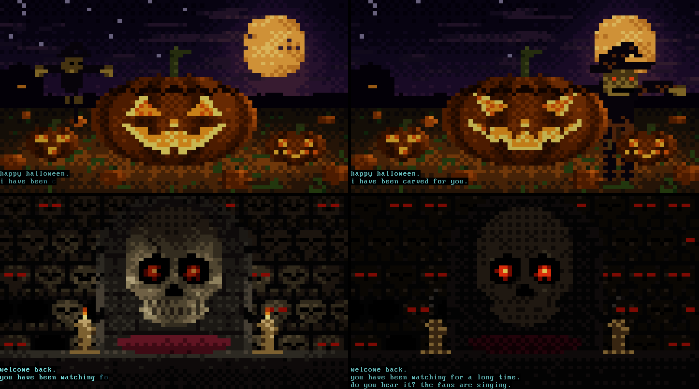
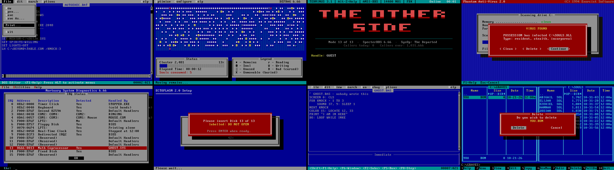
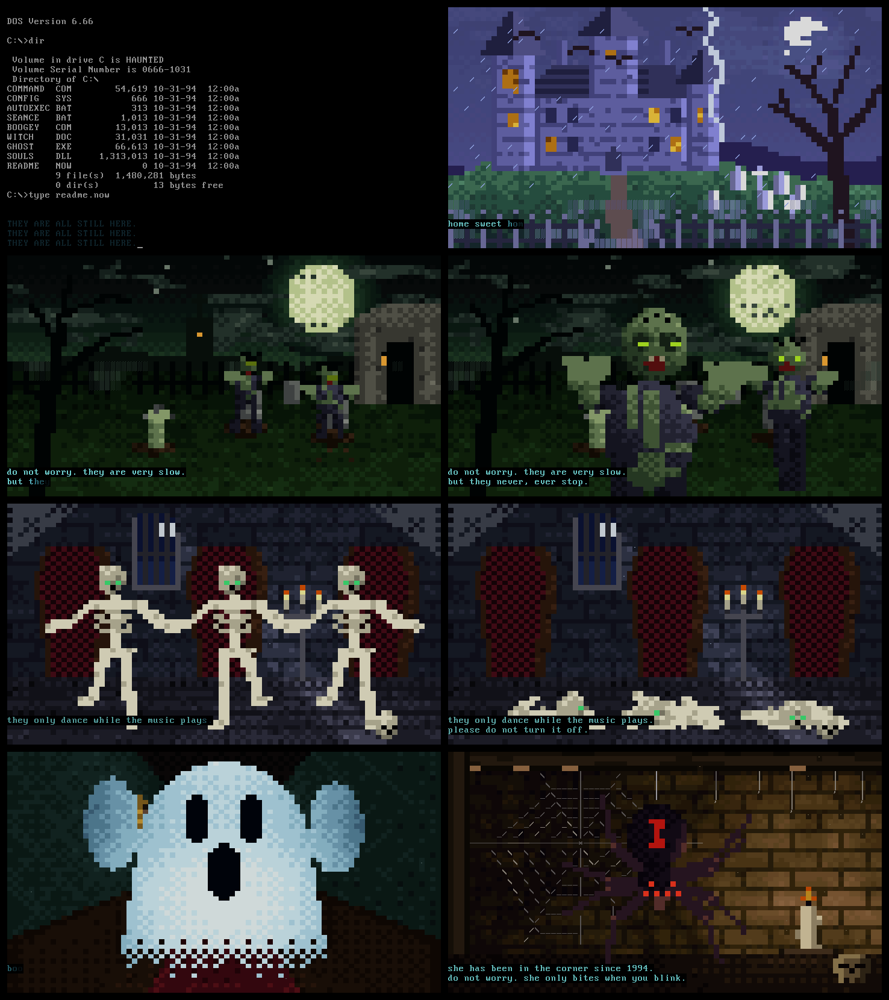

# HAUNTED.EXE

[](https://github.com/ASPDesignLabs/HAUNTED.EXE/actions/workflows/build.yml)
[](https://github.com/ASPDesignLabs/HAUNTED.EXE/releases)

A retro Halloween screensaver for Windows, built for OLED screens, with a crypt you can take over
and play. It renders in genuine VGA modes, scales them by a whole number to fit a 4K display, and
makes its own sound with an FM synthesiser, so there are no audio files. It's one 600 KB program
with no installer and no runtime to install.

**[The project page](https://aspdesignlabs.github.io/HAUNTED.EXE/)** &middot;
**[Download the latest release](https://github.com/ASPDesignLabs/HAUNTED.EXE/releases)**

## Download

Every release on the [Releases page](https://github.com/ASPDesignLabs/HAUNTED.EXE/releases) is built
from this repository by GitHub Actions and carries three files:

| File | What it is |
|---|---|
| `HAUNTED.EXE` | The program on its own. Double-click it and it opens in a window: hold H for three seconds to play, F11 for full screen, Esc to quit. |
| `HAUNTED.scr` | The same program named as a screensaver. Right-click it and choose **Install**. |
| `HAUNTED-<version>-win64.zip` | Both of the above with the helper scripts below, this README, the previews and the full source. |

`SHA256SUMS.txt` beside them lists their checksums. The files aren't code-signed, so Windows may show a
SmartScreen warning the first time; choose *More info -> Run anyway*.

## The scenes

Two scenes are included. They alternate every few minutes (configurable) with a fade to black and a fade of the sound.

| Scene | VGA mode | What it is |
|---|---|---|
| **HAUNT.EXE** | 80x25 text mode, 720x400 | A possessed 486 PC: BIOS POST, a DOS prompt, and a ghost that types back. Between the gags it runs DOS programs that have been got at: EDIT rewriting AUTOEXEC.BAT for a seance, DEFRAG consuming souls and moving the remains to the front of the disk, a modem call to a BBS on the other side, a virus scan that cannot clean a dead host, MSD finding GHOST.SYS on IRQ 13, a thirteen-disk SETUP, a QBasic program that writes itself, and a file manager moving the dead from GRAVES to SOULS, until a file with your name turns up. Art materialises in between, seven full-screen half-block ANSI scenes with their own stories: the jack-o'-lantern in the pumpkin patch, the talking skull in the ossuary, the manor in a thunderstorm, the spider in the candle-lit corner, zombies digging out of a graveyard, skeletons dancing out of their coffins, and a ghost that rushes down a hallway to say boo. It ends in a fatal error and a CRT power-off, then reboots. |
| **CATACOMB** | mode 13h, 320x200, 256 colours | A Catacomb 3-D / Wolfenstein 3-D style crypt crawl on autopilot. Before each level the caster visits the merchant, the owner's cat, draped over a treasure chest, purring, and buys one of three wares with the gold it carries (see below). Each level is generated anew: skull walls, niches, banners, moss, torch-lit halls, bone piles and sliding doors, walked with quick 90-degree turns. Locked vaults are colour-coded (gold from level 1, silver from 3, crimson from 5), each with its own key and a richer hoard, and the deeper ones are guarded. The autopilot remembers treasure it has seen and goes back for it, and leaves through a rune-sealed exit for a Wolfenstein-style tally. Skeletons throw bones; from level 2 skulls set in the walls you walk towards scream and gather a fireball for three seconds; from level 3 shield-bearing skeletons close in with swords; from level 4 spiders wait in corner webs, only their red eyes showing, and their bite poisons and slows. Bats bite, and wraiths loom and flee. Every level is older and harder than the one before. Your face, Wolfenstein-style, pops up when you are hurt. Hold H for three seconds to play it yourself (see below). |








### CATACOMB: the merchant, the spellbook and the wardrobe

Each level begins in a small antechamber. The caster greets the merchant (a slow blink back), looks
over the three pedestals, and buys at most one: an **attack spell**, a **defensive rune** or something
to **wear**. The first visit is free. Prices and strength rise with depth; an offer is usually a tier
near the level, and now and then (about 1 in 12) a rare one well ahead of its time. Armor costs about
one level's gold and spells about two, so the caster sometimes saves up instead, and sometimes
splurges. Everything bought is kept, even through death. The cat trills when you buy, and a rest
while it purrs mends some of your wounds.

* **Attack spells** (the caster chooses per target): Fire Bolt (the fireball, splashing from tier II),
  Frost Shard (slows), Chain Lightning (arcs to others, around shields), Bone Spear (pierces a whole
  line and shields), Soul Drain (heals you), Hellfire (a big blast that leaves the floor burning),
  Seeker Wisps (home in around corners), Rapid Sparks (quick and light), and the **BFS9000**:
  incredibly rare and very dear, it burns 100 souls (fewer at higher tiers) to collapse everything in
  sight into a point of light. Souls come one per kill, more with a Soul Jar ring or Soul Reaping.
* **Defensive runes**, tattooed on the back of the hand and glowing when they fire, each on its own
  cooldown and triggered by the situation, with a human's reaction time (sometimes slow, sometimes
  missed, now and then wasted): Bone Ward (soaks blows), Blink (steps out of trouble), Mirror Veil
  (sends missiles back), Mend, Purify (cures poison and slow), Frost Nova (freezes what is close),
  Dread (the dead flee), Time Slip (slows everything near) and Soul Reaping (triple souls).
* **To wear**: robes (padded to archmage's, spider-silk against poison, shadow for dodging, thorned
  to hurt what hurts you, blessed vestments that mend), hoods (warded against fire, hunter's to spot
  lurkers, Death's cowl for bonus souls) and up to four rings (Bone Charm, Soul Jar, Haste, Ember,
  Seeker's). A ring of a kind you already wear makes that one stronger. The robe colours the sleeve,
  the rings sit on the fingers and the hood frames the portrait.

### Playing CATACOMB yourself

Hold **H** for three seconds, in either scene. A bar fills at the bottom of the screen; let go early
and nothing happens (any other key still ends the screensaver as usual). When it fills, the crypt is
yours, and the scenes stop switching until you hand it back. HAUNT.EXE cuts straight to the crypt.

| Key | What it does |
|---|---|
| W A S D, or the arrow keys | Walk and strafe (the left and right arrows turn instead). Shift runs |
| Mouse | Turn, Doom-style; there is no looking up or down |
| Left click, or Ctrl | Cast the spell in hand where you are looking (lightning and Soul Drain pick the nearest creature near the middle of the view) |
| 1 to 9, or the wheel | Choose an attack spell from your book: 1 Fire Bolt, 2 Frost Shard, 3 Chain Lightning, 4 Bone Spear, 5 Soul Drain, 6 Hellfire, 7 Seeker Wisps, 8 Rapid Sparks, 9 BFS9000 |
| E or Space | Open the door ahead, unlock a vault with its key, or step through the exit runes. Walking into a door opens it too |
| Tab | The inventory: your wardrobe and spellbook. W and S choose a slot, A and D change what is worn there, with your numbers shown changing |
| Esc | Asks whether you want to leave, with a different argument each time for staying |

Your defensive runes still fire on their own, as quickly (and as fallibly) as they do for the
autopilot. In the merchant's room you shop yourself: walk up to a pedestal to see its card, and press
E, Space or click to buy it; one ware per visit. Then leave by the east door.

Everything you buy stays in your wardrobe, so you can swap robes, hoods and the four rings in the
inventory. The Wolfenstein status bar stays up while you play: level, gold, health, your face,
souls, the spell in hand and your keys.

Esc offers three answers:

* **Flee to the surface** ends the screensaver and saves your progress: the level you were on, your
  health, gold, souls and gear. Not where you stood: next time you start at the beginning of that level
  (or at the merchant, if you hadn't bought anything yet), and the gold and souls picked up on the
  unfinished level are taken back out. The next screensaver session, autopilot or not, starts from it.
* **Stay in the dark** closes the question.
* **Sleepwalk** hands the crypt back to the autopilot, which settles into its walk from where you stood.
  The mouse then ends the screensaver again (after a second and a half).

If the window loses focus while you play, the game pauses on that question. The saved progress is a
`Progress` value under `HKEY_CURRENT_USER\Software\HalloweenVGASaver` (the project's name before it
became HAUNTED.EXE, kept so that settings and progress carry over); `uninstall.cmd` removes it with the
settings.

## Install

1. Run `install.cmd` from the zip, or right-click `HAUNTED.scr` and choose **Install**. Windows asks for
   administrator rights, copies it to System32 and opens *Screen Saver Settings*.
2. Choose **HAUNTED.EXE** and press **Settings...** to adjust it.

If you installed it before 1.0.0b1, when it was called *Halloween VGA* (`HalloweenSaver.scr`), the old
entry stays in the list until you remove it; `uninstall.cmd` removes both.

Other ways to run it:

* `HAUNTED.EXE`, or `test-windowed.cmd`, runs it in a resizable window without installing anything. Esc quits (while you
  play, Esc asks first); F11 or Alt+Enter switches to borderless full screen and back.
* `capture.cmd` runs it as an ordinary borderless full-screen window for recording (see below).
* `settings.cmd` opens the settings dialog directly.
* `uninstall.cmd` (as administrator) removes it and its saved settings.

## Recording video

A real screensaver is hard to record: it quits the moment you touch the mouse, and Windows runs it
apart from your normal apps. `capture.cmd` (or `HAUNTED.scr /f`) runs it as an ordinary
window instead. The window covers the monitor without a border, ignores the mouse and keeps
running. Esc quits, and F11 switches between full screen and a window. The picture drift is off in
this mode, so the video holds steady.

* **OBS Studio**: add a *Window Capture* (or *Game Capture*) source and choose
  "HAUNTED.EXE (capture ...)". Set the canvas to your monitor's size to keep the pixels sharp.
* **Xbox Game Bar**: click the window, then press Win+Alt+R to start and stop recording.

The window is one pixel taller than the monitor on purpose. That keeps Windows compositing it rather
than switching to exclusive full screen, which some capture methods show as a black picture.

The HAUNT.EXE file manager shows your Windows user name, spelled the way DOS would (upper case,
eight characters), and today's date. Keep that in mind before you share a recording.

## Settings

* **Sound** on/off and **volume**. The default is 60%.
* **Brightness** cap, 30-100%. The default is 85%.
* **Scenes**: enable either or both, and how often they switch (1-15 minutes).
* **Slowly drift the picture**: moves the whole image by up to a few source pixels along a very slow
  path (about one pixel every 8 s) so no pixel stays lit in the same place for hours.
* **Show on**: the primary monitor, or the largest monitor (the default). All other monitors stay
  black, which suits an OLED beside an ordinary screen.

Settings are stored in `HKEY_CURRENT_USER\Software\HalloweenVGASaver`.

## How the display works

* The scenes render into an 8-bit indexed frame with a 6-bit VGA palette, as a real VGA card does.
  The colours are quantised to the VGA DAC and fades are palette fades.
* The frame is scaled by a **whole-number factor** with nearest-neighbour filtering, so pixels
  stay square and sharp: 10x for 320x200 (3200x2000) and 5x for 720x400
  (3600x2000) on a 3840x2160 screen, centred in true black. On a 1440p screen the factors are
  7x and 3x, and on 1080p they are 5x and 2x.
* The saver uses OpenGL 1.1 for scaling and vsync, and falls back to GDI if OpenGL isn't available.
  It is DPI-aware, so it gets the real 3840x2160 and not a scaled-up 1080p.
* Backgrounds are true black, which keeps those OLED pixels off. Average picture level, measured over
  50 minutes of HAUNT.EXE and 25 of CATACOMB: **HAUNT.EXE about 9%** (25% or less 95% of the time; the
  brightest moment is a flash as the ghost scene opens, about 55% for under a second), **CATACOMB about
  13%** (26% or less 95% of the time, 38% at the brightest instants). While it plays itself, HP, gold
  and souls never sit on screen: the readout and your face slide in for a few seconds and leave, and the
  status bar shows only in the merchant's antechamber, for about 15 seconds a level (it stays up while
  you play). The brightness cap and the
  pixel drift reduce wear further, but they can't guarantee anything. If you leave it running for many
  hours, use your display's own panel-care features as well.

## Sound

Everything is generated at run time: an OPL2-style two-operator FM synth (sine, half-sine,
abs-sine and quarter-pulse waveforms, ADSR, feedback, vibrato), noise percussion, PC-speaker
square-wave beeps, a Freeverb-style reverb and a ping-pong delay.

* **HAUNT.EXE**: slow generative ambience in D harmonic minor (a drone, a tritone swell, sparse
  bells, a rare music-box lullaby, wind, and a heartbeat when the scene gets tense), plus the
  machine's own sounds: POST beep, floppy seek, hard-disk crunch, key clicks, a ghost whisper,
  creaks and thunder. The programs add a modem dialling and handshaking,
  knocks on the seance table and the souls going into DEFRAG. The art scenes add a match striking,
  wind through the pumpkin patch, a cackle, chattering teeth, zombie groans, earth breaking, crows, a
  bone xylophone for the dancing skeletons, collapsing bones, and a wail with a stab of brass for the
  ghost's boo.
* **CATACOMB**: an early-90s AdLib-style adventure tune: a slow 92 BPM, 32-bar march in D minor with
  bass, arpeggios, a flute and then a brass melody, a timpani-only crypt section and a snare roll back
  into the loop. Under it are footsteps, grinding doors, spell casts, fireball impacts, collapsing
  bones, ghost wails, bat squeaks, drips and distant moans, all in a cave reverb. On top of those come
  the game sounds: coin chimes, the key's jingle, the vault's lock, thrown bones, the caster grunting
  when hit, a heartbeat at low HP, a potion, a death groan, the wraiths' shriek, and a brass fanfare
  for each level cleared.

## Building from source

Needs `x86_64-w64-mingw32-gcc` (on Ubuntu/Debian: `apt install gcc-mingw-w64-x86-64`).

```
make scr          # -> dist/HAUNTED.scr
make zip          # -> dist/HAUNTED-<version>-win64.zip and dist/HAUNTED.EXE
make host         # Linux test harness (needs zlib): renders PNG frames and WAV audio
make smoke        # a short headless run of both scenes, a scripted player and a CPU benchmark
```

Layout:

```
src/core.h  gfx.[ch]  app.[ch]      shared types, drawing, scene rotation / fades / palette conversion
src/snd.[ch]                        FM synth, effects, the two music programs
src/scene_haunt.c  haunt_art.[ch]   HAUNT.EXE: text engine, script runner, acts, art pieces
src/scene_crawl.c                   CATACOMB: level generator, autopilot, raycaster, sprites, light map
src/crawl_art.c  crawl.h            CATACOMB palette, light colormap, procedural textures and sprites
src/crawl_gear.[ch]                 CATACOMB's wares: spells, runes, robes, hoods, rings, prices and worth
src/hand_img.c  face_img.c  cat_img.c   the hand, the face and the merchant, converted once from photographs
src/win_main.c                      Win32 shell: /s /c /p /w /f, OpenGL+GDI, waveOut, settings dialog
src/font_vga.c                      generated by tools/gen_font.py from third_party/font
tools/host.c                        host harness
site/                               the project page, published to GitHub Pages
.github/workflows/                  build.yml (build, smoke test, release on v* tags), pages.yml
```

The version lives in `VERSION`. To release, change it and push to `main`: when the build passes,
the workflow tags the commit `v<VERSION>` and publishes the files above as a GitHub release, with their
checksums. Pushing a tag `v<VERSION>` yourself does the same (the workflow checks that the two match).
A version with `a`, `b` or `rc` in it becomes a pre-release.

A scene is a `Scene` struct (video mode, sound program, `enter` / `update` / `render`), so adding a third
scene means writing one file and adding it to the list in `app.c`.

Test-harness examples:

```
build/host shot crawl 8,36,64 out/crawl 2       # PNG frames at those seconds, 2x
build/host wav haunt 120 out/haunt.wav          # 2 minutes of audio
BOTH=1 STAY=45 build/host dump crawl 200 out/run 10  # frames + audio across scene switches
build/host bench crawl 300 x                    # CPU time per frame
```

`build/host apl haunt 600` prints the average picture level of a scene.

Debug builds (`-DHAUNT_DEBUG`) also accept `HAUNT_PLAN=10,11,15` to force specific acts of HAUNT.EXE:
2-9 the prompt gags, 10 the pumpkin patch, 11 the skull, 12 the manor, 13 the spider, 14 the ghost, 15 the
zombies, 16 the skeletons, 17 the crash, and 18-25 the programs (EDIT, DEFRAG, the BBS, the virus scan, MSD,
SETUP, QBasic, the file manager). `-DCRAWL_DEBUG` prints the CATACOMB autopilot's state
once a second, logs every throw, hit, shriek, key pickup, cast, rune, purchase and exit, and takes
`CRAWL_SEED=n`, `CRAWL_LEVEL=n` to start deeper, `CRAWL_GEAR=n` to own everything at tier n,
`CRAWL_GOLD=n` and `CRAWL_SOULS=n`. The harness plays a person at the keys with `HOST_INPUT`, for
example `HOST_INPUT="1:+H;4.2:-H;5:m300,0;6:+W;8:-W;9:+MOUSE1;9.2:-MOUSE1"` (press, release, mouse
counts), and `HOST_SAVE=file` / `HOST_LOAD=file` stand in for the registry.
The Windows build honours `HVS_NOGL=1` (force the GDI path) and `HVS_DUMP=file.ppm` (write one frame and exit).

## What has been verified

* The synth output was analysed offline: no clipping (peak 0.85 across the new programs and art scenes),
  no DC offset, and every new effect's level measured against the existing ones.
* The CATACOMB autopilot was simulated for 50 minutes on each of six seeds, merchant visits included.
  Every seed reached level 8 to 10. Levels took about 5 to 6.5 minutes (up to 13 with deaths), every one
  ended through its exit, and each run died 0 to 2 times. The median level ended with about 85% of its
  treasure, and the caster bought five to nine things per run: spells from level 3 or 4 on, and armour,
  hoods and rings in between, saving up now and then. Wall skulls woke 6-15 times a run, spiders dropped
  10-30 times and shield-bearers landed 2-33 sword blows.
* The core was run under AddressSanitizer and UBSan: earlier rounds for about an hour (every HAUNT.EXE
  act and art scene, scene switches and CATACOMB), and this round for 27 more minutes of CATACOMB with
  every frame drawn, covering the merchant, levels 1 to 7, every spell, rune, robe, hood and ring, and
  the BFS9000. All clean. The per-frame CPU cost (simulation plus drawing, without the synth) is about
  0.8 ms for HAUNT.EXE and about 2 ms for CATACOMB, deep levels with every spell included (2.3 ms while
  you play it).
* Playing it was tested two ways. The harness played scripted sessions: taking control from either
  scene, shopping, walking, every spell, the inventory, the Esc question, sleepwalking and taking over
  again, dying, the exit, and saving and loading, including 170 seconds under AddressSanitizer and UBSan
  (clean). The Windows build was driven under Wine with real key presses and mouse movement: holding H,
  turning with the raw mouse, the inventory, fleeing (the progress landed in the registry), the next run
  starting from it, and the mouse ending the saver again after sleepwalking. The autopilot's simulated
  runs came out exactly as before.
* The Windows build was run under Wine on a virtual 3840x2160 display (the OpenGL path was checked by
  reading back the frame: 10x scale, centred, pixel drift applied), in a window, with the GDI fallback,
  the settings dialog, and the `/p` preview. The `/f` capture window came up borderless at 3840x2161.
  Whether it really ignores the mouse is untested, because nothing here could send mouse input.
* **Not tested here: real Windows hardware, and real audio output.** That includes how the mouse feels
  (it turns 0.0015 radians per count) and how Windows' own screensaver desktop treats a game being
  played on it. There was no sound device in the
  build environment, so the waveOut path (a small double-buffered thread) has been compiled and read
  through but not heard. If you get no sound, the saver still runs silently; please open an issue.

## Credits and licences

HAUNTED.EXE is licensed under the GNU General Public License v3.0 (see `LICENSE`).

The VGA glyph bitmaps come from the Px437 IBM VGA 8x16 and IBM BIOS fonts in *The Ultimate Oldschool
PC Font Pack* by VileR, licensed CC BY-SA 4.0. See `third_party/font/`. The caster's hand, the
caster's face and the merchant were traced from the owner's photographs of their hand, their face and
their cat; the package holds only the converted sprites, not the photos. Everything else (code, art,
music and effects) is original and procedural.
