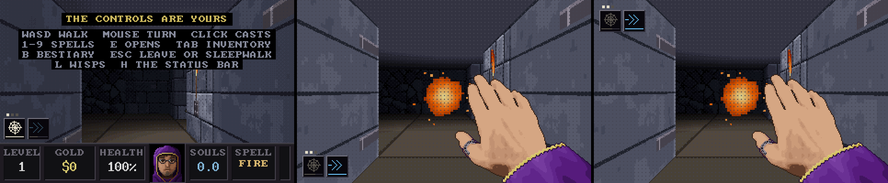

# 1.0.0b7: death that costs, runs of ten, four bosses, and the merchant's hall

**Status: planned and settled (26 October 2026). The owner answered two rounds of questions the same
day, chose the four bosses, asked for everything in one release, approved the bosses' hazards (section
6) and said to start building; the questions they left alone take the defaults marked *default*.
Building has begun on the work branch; the steps at the end say how far it has got.**

A mock-up of the ability socket is in [`plan-b7/ability_socket.png`](plan-b7/ability_socket.png).

## What the owner asked for

1. **Death costs.** Dying takes every item, the gold, the spells, the Cursed Coins carried and the
   souls, and sends you back to the merchant's before level 1. Kept, with the save: what the merchant's
   room has been upgraded with, what the Corpus Compendium has indexed, the runes, the Hexed Totem's
   abilities and the gold in the Wretched Repository. Each death raises a gravestone in a new grave plot
   by the merchant's: the last ten, each with the date and time, what killed you, the level reached and
   what you carried.
2. **Saving only with the merchant.** Loading works anywhere, as now. No save scumming: if a load is used
   to cheat death, she takes up to half your gold and one thing you have equipped (a spell drops a rank
   instead; never a rune or a boss ability), signs the save, and tells you that you were caught trying
   to cheat the dead of their bounty, so they took their claim, whatever you meant by it.
3. **Runs of ten.** A run is ten levels, not twenty, and ends with a boss on its tenth. The four sets'
   looks stretch across a whole run each; the decay creeps across the run.
4. **Bosses.** A much stronger version of one of the run's creatures, or of one still to come. Far more
   health; at each quarter of it lost, and again at a tenth, it turns untouchable and calls a wave of
   adds, and moves again once they are dead. Each boss sets its own adds. A planned arena for each boss,
   the same every time: open, with cover that breaks sight and some ways round. AdLib-style boss music,
   eerie, that changes while the adds are out. A few healing points, placed with care. Bosses drop only
   their own Named Odious Scrip.
   - **Level 10: the Ill-Fated Skeleton Knight.** Bigger, faster, a little shiny. A Rare Mirror Rune that
     turns back some of your missiles, with a sign you can see and hear. **Swift Dodge**: half a second
     untouchable while it darts two to five cells, with three cooldowns: to close on you (shortest), to
     dodge a hit (longest), to flee (between). Adds: skeleton kinds, one ranged or caster a wave and two in
     the last, at the highest rank you have met.
   - **Level 20: the Wandering Hunting Spider.** Its size, a little faster, often hopping between floor
     and ceiling. A Rare Mend Rune. **Tangled Web** roots you until you have done a third of your health in
     damage to it; one web at a time; its cooldown starts when you are free. Adds: smaller hunting spiders
     without the web, and one more every fifteen seconds that comes straight for you.
5. **The merchant's room grows.** More pedestals, two to seven (500 gold for the third, each next 2.5
   times the last), bought from her. The **Corpus Compendium**: every piece worn and spell learned, by
   slot and quality, to buy again at the shop's price x1.2, 5% less for each run completed, down to half.
   The **Wretched Repository**: pieces (10% tax), Cursed Coins (free in, 2,500 gold each out) and gold (25%
   tax), kept through death; two places free, one of them untaxed; more from 2,500 gold, x1.5 each, to
   twelve. The **Accursed Portal**: once a run is completed, start there again (levels 1, 11, 21, 31), and
   challenge beaten bosses again for scrip. The **Hexed Totem**: each boss's ability, unlocked with one of
   its scrip and raised with more, each to its own cap; only known once that boss has fallen.
6. **Boss abilities for the caster.** **Swift Dodge** (three ranks): tap a direction twice and dart two
   to five cells, not a teleport; cooldown 15, 7 and 3 s. **Tangled Web** (three ranks): webbing at what
   is in front of you; it holds the creature, halves its attacks and makes it claw at the web instead of
   you, does no damage, and holds a third, two thirds or all of your health in damage. A rank holds that
   many webs at once; a kill or a break frees a place; a miss costs only 2 s of cooldown; your own spells
   don't touch your webs.
7. **The Codex of Affixations** on C: what every ability does, from gear, runes and bosses; only the ones
   known; kept through death. **A bosses section in the bestiary.** **A place on screen for abilities
   on the right mouse button**, with a suggestion where.
8. **Ideas wanted** for more bosses and their abilities (answered in round one: the Deacon and the
   Wraith join the knight and the spider).
9. **The bosses' hazards** (round one): casts that endanger you in a boss fight and test where you
   stand and what you watch, more so as you come back to challenge a boss for scrip. Some environmental,
   always with a clear warning before harm:
   - **the knight**: falling rocks that hurt once on striking you, don't block the way, and are gone
     after a moment;
   - **the Deacon**: hellfire erupting from the floor where cracks have spread first;
   - **the spider**: toxic sludge from fixed places, turned on and off to set the difficulty;
   - **the Wraith**: Void Energies, purple zones shown on the floor and as a shaded volume before they
     come, that sap health, slow you and silence you (no spells, no abilities, no runes) while inside.
   - Each is shown in the last three levels before its boss, more often each level nearer.

## Decided (26 October 2026, first round)

- **Q1, runs and sets (a):** each run is one set stretched over its ten levels: I the Crypts (1-10), II
  the Catacombs (11-20), III the Hollows (21-30), IV the Deep (31-40).
- **Q5, the screensaver (a):** the dream (section 3).
- **Q6, a death in a pocket:** the mercy stays, changed: you are put back in the level at the secret's
  entrance, the chain's doorway is shut for the rest of the level with a sign you can see, and the game
  notes that the dweller failed that trial (section 1).
- **Q10, the boss level:** on the way down it is a regular level with the arena at its end. Challenged
  again from the Accursed Portal, you start in the arena's own antechamber.
- **Q12, the waves (c):** four, at 75%, 50%, 25% and 10%, each mark holding however hard the blow.
- **Q19, the spider's web (a):** every spell cast while held strikes the web, fire twice as hard.
- **Q22, the bosses:** the knight (10), the spider (20), the **Black Deacon** (30) and the **Wraith
  Unbound** (40). The Gorging Ghoul, the Stone Matriarch, the Cinder Tyrant and the Hollow King are kept
  for later.
- **Q24, the Portal's run starts (b):** at any visit to the merchant.
- **Q30, the Repository:** two free places, one untaxed; twelve in all.
- **Q37, releases (c):** all of it in one release, 1.0.0b7.
- **Everything else** in the first round (Q2-Q4, Q7-Q9, Q11, Q13-Q18, Q20, Q21, Q23, Q25-Q29, Q31-Q36)
  takes its default as written below.

## Decided (26 October 2026, second round)

- **Q38 (a):** challenges grow a step with each win, to five.
- **Q39, no:** the hazards hurt only the dweller, never the adds or the boss.
- **Q40, yes:** E still works in the void.
- **Q41:** all four second casts are kept, and come from the first fight on, growing with the steps.
- **Q42, yes:** the omens as proposed.
- **Q43, yes:** the game calls the caster **the dweller** wherever it names them.
- **Q44, yes:** every Totem ability stops at rank III, and **extra scrip sells for 20,000 gold** a piece
  at the Totem. *Extra* is read as scrip beyond what that boss's ability still needs to reach III.
- **Q45, yes:** the hazards' damage as starting points, tuned in the runs.

## How it has been read (please correct anything wrong)

- **Completing a run** is beating its boss on the way down. You then go on, everything still yours, to
  the merchant's before the next run's first level. A run completed counts towards the Compendium's
  discount and opens the next run's start in the Accursed Portal.
- **"Shop slots"** are the merchant's pedestals: two at first, up to seven, bought from her menu.
- **"Equipped"**, for her claim, means the seven worn pieces and the spells known; the bag, the runes and
  the Totem's abilities are never taken.
- **Scrip** is a currency of its own per boss, kept through death.
- **Two kinds of "trial"**: the owner calls a secret chain a trial (and failing it in a pocket is noted
  as such). To keep the words apart, fighting a beaten boss again is a **challenge** everywhere in the game.
- **The Portal at any visit** takes you as you are, and may take you back to an earlier run's start as
  well as on to a later one *(default)*.

## 1. Death

### What goes and what stays

| Lost on death | Kept with the save |
|---|---|
| Gold carried | The Repository: its pieces, gold and Cursed Coins, and its places bought |
| The seven worn pieces, the bag and what is in it | The pedestals bought |
| Every spell but the Fire Bolt, which goes back to the fireball | The Rune Shrine: its rank, its nine slots, its attunements |
| Souls (spirit) and bones | Every rune held, at its quality |
| Cursed Coins carried | The Corpus Compendium's index |
| The ware held at the merchant's | The Hexed Totem: abilities, ranks and unspent scrip |
| | The Accursed Portal's runs opened; the runs completed; each boss's challenge step |
| | The record: the bestiary, the achievements |
| | The Codex's entries; the grave plot; the L menu's choice |

- You wake at full health in the merchant's room before level 1, and may go on to a later run's start
  at the Accursed Portal once it is open. Level 1's free first ware is there as always.
- The fall and the red haze stay; then a card: *YOU DIED ON LEVEL 7, TAKEN BY A COLD SHIELD-BEARER*, what
  was lost in a line, and *A NEW STONE IN THE PLOT*.
- The death is written to the save the moment you fall, not when the haze clears, so closing the window
  during the fall does not undo it.
- The easing after a death on a level (15% softer blows a death, up to 45%) has nothing left to do and
  goes, except in the screensaver's dream (section 3).

### A death in a pocket (decided)

- You are not killed for it: you come back at full health *(default, as now)* in the level, at the
  secret's entrance: the hall cell in front of the wall you pushed, facing into the secret's room.
- The chain's doorway is **shut for the rest of the level**: its frames go dark under a dull red seal
  cracked across it (a new texture), and walking into it or pressing E does nothing but a knock.
- A caption: **THE DWELLER FAILED THIS TRIAL** (decided), and the tally's secrets row notes *1
  TRIAL FAILED*.
- The links behind the seal can't be found this level, so that chain's coin, the coin for every secret,
  and the Black Altar's gold are gone with it. The chain's carved room and anything already taken stay
  as they are.
- The same for the autopilot, in the dream or not.

### The grave plot

- A walled yard south of the merchant's room (the map in section 7): ten stones in two rows, the newest
  nearest the arch. An eleventh death takes the oldest stone away.
- **E at a stone** opens its page, laid out like the bestiary's: the epitaph (*HERE LIES A DWELLER OF THE
  THIRD RUN, TAKEN BY A BLOODY SHIELD-BEARER ON LEVEL 24, THE BROKEN SEAM*), the date and time (*26
  OCTOBER 2026, 21:14*), and what was carried: the worn pieces (W/S over them shows each card), the bag,
  the spells and their tiers, the runes, the gold, souls and coins. A/D goes to the next stone.
- **What killed you** is kept as it lands: the creature by its caption name and rank (*A COLD
  SKELETON*), a boss by its title, the Wraith, a boss's hazard (*THE KNIGHT'S ROCKFALL*, *THE VOID*), or
  the thing a creature left behind (*A SPIDER'S POISON*, *AN EMBER IMP'S FIRE*, *A DROWNED ONE'S POOL*,
  *THE KNIGHT'S MIRROR*: your own bolt, turned back).
- The stones belong to the save, so each save has its own plot.

## 2. Saving with the merchant, and her claim

### Signing and opening

- **The save slots become the merchant's ledger**, three pages, I to III, since gravestones now mean
  deaths. *SIGN THE LEDGER* saves; *OPEN THE LEDGER* loads.
- **E at the merchant** opens her menu:
  - **SIGN THE LEDGER**: choose a page; the page you came from is picked first; signing over another
    run's page asks twice, as carving over a grave does now. Each page shows its level, gold and when it
    was signed.
  - **ANOTHER PEDESTAL**: the next one and its price (section 7).
  - **PAT HER**: as now. The cat stays exactly where she is.
  - **LEAVE**.
- **The Esc menu**: *FLEE*, *STAY*, *SLEEPWALK*, *OPEN THE LEDGER*. Carving goes; the merchant's
  ledger is the only place to sign.
- **Fleeing** keeps nothing since the last signature: the next start opens your last page. Fleeing in
  danger brings the claim, below.
- **Three things write a page**: signing it, a death, and the merchant's claim. Nothing else.
- With a console code used, nothing is written, as today: no signing, no deaths, no claims.

### Her claim: what counts as cheating death

The rule has to work the same whatever a person meant, so it is mechanical:

- **A page is marked while you are in danger** in the run it holds, and the mark clears 8 s after the
  danger has passed. Danger is any of:
  - a creature hunting you within eight cells, or a missile coming at you (the game's own `in_combat`);
  - health under a quarter;
  - poisoned, burning, held in a web, grabbed, or inside a hazard's warning or harm;
  - inside a boss arena, from the doors shutting until the boss falls.
- **The mark is written the moment danger begins**, as a small value beside the pages, and cleared when
  it ends. So a load from the Esc menu, a flee, a closed window, Alt-F4, a crash or a power cut while
  marked all count, as the brief says: regardless of intention.
- **The next time a marked page is opened** (by a load, or the next start), she takes her claim before
  you can move:
  - **gold:** a quarter to a half of what you carry, rolled;
  - **one thing equipped, at random:** a worn piece is taken; a spell drops one tier (one at tier 1 is
    lost; the Fire Bolt never goes below the fireball). Each worn piece and each spell has the same
    chance. Never a rune, the bag, a Totem ability, or anything in the Repository or Compendium.
  - She signs the page herself, and says so, on a card at her room *(wording, still to approve)*:

    > **CAUGHT CHEATING THE DEAD**
    >
    > YOU TRIED TO CHEAT THE DEAD OF THEIR BOUNTY. WHATEVER YOU MEANT BY IT, SHE HAS TAKEN THEIR CLAIM:
    > 1,240 GOLD, AND THE RARE BOOTS OF THE LIGHTFOOT. THE LEDGER IS SIGNED.

- **Fair warning**: while a page is marked, a small red eye shows beside the keys on the status bar and
  in the readout, and *OPEN THE LEDGER* and *FLEE* in the Esc menu carry the line *THE DEAD ARE
  WATCHING*. Nobody should trip the claim without knowing the rule exists; the Codex explains it too.
- Loading outside danger costs nothing; going back on a bad purchase is allowed.
- Someone with the registry editor can always copy a page; the claim guards the game's own doors.

## 3. The screensaver and your ledger (decided: the dream)

- The screensaver plays on from your last page, and nothing it does is kept: its deaths use today's
  mercy (the level starts again, with the easing), and it never signs or dies on your page.
- **Holding H takes over where it stands**, and from that moment until the program closes the run is
  yours: the new rules apply, deaths are written, the mark watches. Whatever the dream gained is yours
  only if you sign the ledger.
- Sleepwalking after taking over leaves the run under the new rules; otherwise handing over mid-fight
  would dodge a death.

## 4. Runs of ten (decided)

- `crawl_set(level) = ((level - 1) / 10) % 4`, `crawl_step` 0 to 9, decay `step / 9`: slowly across the
  whole run, at its worst on the boss level. Depth climbs run by run and stays at its deepest from run IV.
  Each set's two tints spread over ten levels.
- **After level 40** the four runs come round again (41 to 80), deeper, with the loop moods the descent
  plan proposed (not yet built) and the bosses back stronger; the numerals on the names go on as now.
- **Creatures keep their first levels** (2 to 19), so every kind is met in runs I and II; runs III and
  IV bring no new kinds until they are planned. The knight at level 10 is "a future encounter", as the
  brief allows: ordinary knights first come at 13.
- **The rank and quality mixes follow the sets**, so they now climb over ten levels: levels 6 to 10 get
  the Crypts' gentle mix where they had the Catacombs', and the Deep's comes at 31 to 40. Levels 6 to
  20 grow gentler; the bosses and their omens become the step up.
- **Secrets**: levels 1 to 10 of a run hold 3, 3, 4, 4, 4, 5, 5, 5, 6 and 6 links (the boss level is a
  regular level now). Pockets are the Backrooms in runs I and II and Severance in III and IV. Black
  Altars from level 6 as now. The Wraith from level 9 as now, but never on a boss level: the run's last
  level belongs to its boss, and on level 40 the Wraith is waiting in the arena.
- **The record and achievements**: each of levels 1 to 40 cleared (from 1 to 20); *RUN I COMPLETE* and
  on, in place of the descents at 40, 60 ...; a slayer's line for each boss; and each boss challenged at
  each step.
- **Level names**: forty, ten a run; the twenty we have stay where they fit.
  - **I, the Crypts:** The Ossuary, Hall of Torches, Crypt of the Nameless, The Bone Gallery, The
    Warden's Hall, The Chapter House, The Pilgrims' Stair, The Reliquary, The Knights' Vault, *The
    Ill-Fated Lists*.
  - **II, the Catacombs:** The Drowned Vault, Catacomb of Saints, The Weeping Stair, Cistern of Bones,
    The Abbess Below, The Silted Nave, The Black Canal, The Spinners' Gallery, The Hanging Dark, *The
    Wanderer's Web*.
  - **III, the Hollows:** The Charnel Mine, Warrens of the Dead, The Fossil Road, The Broken Seam, The
    Colossus Deep, The Timbered Dark, The Gnawing Caves, The Lampless Shaft, The Flooded Chapel, *The
    Deacon's Pulpit*.
  - **IV, the Deep:** The Glittering Dark, Veins of the Earth, The Ember Root, The Black Glass, Throne of
    the Hollow King, The Singing Geode, The Cinder Fields, The Molten Stair, The Last Light, *The Bottom
    of Everything*.

## 5. Bosses

### The boss level, and challenges (decided)

- **On the way down** the boss level is a regular level: the merchant's first (the last chance to sign),
  then halls, rooms, treasure, keys, secrets and the altar as any level has, generated as usual, with the
  boss's planned antechamber and arena set into the map's far end in place of the exit room. The level's
  omens come at their most often (section 6).
- **The antechamber**: a small room before the arena's arch, the same every time, with a candle and a
  bench. Challenges from the Portal begin here, before the arch.
- **Crossing the arch**: the doors grind shut behind you, the boss's name card shows with a line of
  lore, the boss music starts, and its health bar appears along the top of the view with the four wave
  marks as notches. No leaving, no wisps (L casts nothing: *THE WAY IS SHUT*) until it falls.
- **When it falls**: its scrip drops where it fell (walk over it), the exit opens in the arena's far
  wall, and the tally gains a BOSS row with the time. On the way down the run is counted complete and you
  go on to the next run's merchant's room; a challenge takes you back to the merchant's room you left.
- **Dying in the arena** is a death like any other, on the way down or in a challenge.

### Waves (decided: four)

- At 75%, 50%, 25% and 10% of its health, any damage past the mark is lost; the boss stops there.
- It turns untouchable at once: an animation of its own (the knight kneels on its sword, the spider
  cocoons itself on the ceiling, the Deacon stands in his pulpit and chants, the Wraith sinks into the
  dark), a pale shell over it, and spells pass through with a dull ring.
- It calls, and two seconds later (dust falling, a horn, so you can see where they will come from) the
  adds come in at set places: gates in the walls, burrows, heaps of bone, the dark.
- It stays still and untouchable while any add of the wave lives, then rises with a sound, and the music
  goes back to the fight.
- The bar greys while it is untouchable and shows the adds left: *3 REMAIN*.
- Adds give souls and bones, never potions or treasure, so the arena's healing stays as placed.

### Health, healing, music, scrip

- **Health**: set by runs in the harness so that a fight with gear right for the level takes three to five
  minutes, waves included. A starting point: about twenty times a rank-I skeleton knight of the level.
- **Bosses are slowed but never frozen or frightened**; Time Slip slows them by half as much as it slows
  a creature. Your Tangled Web can't hold them (it falls away with a tearing sound).
- **Healing**: three fonts set into the arena's walls behind cover, away from where the adds come in.
  Each holds one draught of a third of your health. One is full when the fight begins; one more fills as
  the first wave is cleared and one as the third is. At most three draughts a fight. The autopilot drinks
  under 40%.
- **Music**: a theme for each boss, OPL2 voices like the rest: a slow off-kilter waltz in a minor key
  over an ostinato, a tritone in the tune, a bell on the first beat. While the adds are out, the same
  theme turned up: drums come in, the bass doubles, the key rises a semitone, the pace lifts a little;
  when the last add falls it settles back. The knight's in D minor with a brassy lead; the spider's in
  B-flat minor, plucked, with a skittering hi-hat; the Deacon's on an organ-like voice with a choir pad;
  the Wraith's almost without a tune: a low drone, the bell, and a voice that comes and goes.
- **Scrip**: Named Odious Scrip, e.g. *THE ILL-FATED KNIGHT'S ODIOUS SCRIP*, a curl of parchment with a
  black seal. It goes to the Totem's account the moment it is taken, so it is kept through death. How
  many a win gives: section 6, *challenges grow harder*.

### The Ill-Fated Skeleton Knight (level 10)

- **Look**: the skeleton knight half again as big, quicker on its feet, its plate polished bright with a
  slow glint sliding across it. It sheds plate at each wave, as knights do by health now.
- **Lore** (draft): *HE RODE DOWN TO FETCH THE ORDER'S DEAD, AND NEVER RODE BACK UP.*
- **Blows**: the knight's wind-up and heavy strike, at the boss's strength.
- **The Rare Mirror Rune**: about one missile in seven that strikes it is turned back at you, never
  twice within two seconds. The instant it happens its plate flashes silver in a ring and a struck bell
  rings, a sound of its own, unlike your Mirror Veil. The turned shot comes back at half its damage and
  can be dodged. Only missiles: Fire Bolt, Frost Shard, Bone Spear, Hellfire, Seeker Wisps and Rapid
  Sparks. Chain Lightning, Soul Drain and the BFS9000 are not missiles and are never turned.
- **Swift Dodge**: half a second untouchable while it darts two to five cells in a straight line, as far
  as the floor is clear, leaving two or three fading after-images and a whoosh with a clank of plate.
  Three reasons, three cooldowns:
  - **closing in**, every **5 s** at most: you are four cells off or more and in its sight; it dashes to
    a cell short of you, ready to strike;
  - **fleeing**, every **9 s**: you have taken a tenth of its health within three seconds, or it stands
    in burning floor; it dashes away from you;
  - **dodging**, every **16 s**: a shot of yours would hit it; it dashes aside.
  - No dodging while a wave holds it.
- **Its hazard**: Rockfall (section 6).
- **Adds**, skeleton kinds only, one ranged a wave and two in the last:
  - **wave 1**: a skeleton (the thrower) and two shield-bearers;
  - **wave 2**: a skeleton, two shield-bearers and a bone hound;
  - **wave 3**: a skeleton, two shield-bearers and two hounds;
  - **wave 4**: two skeletons, two shield-bearers, a hound and an ordinary skeleton knight.
  - They come through two gates in the north wall and two in the south, at the highest rank of each kind
    met since your last death or Portal start.
- **The arena, THE LISTS** (draft; frames to the owner before it goes in):

  ```
  ###########G###G###########     @  from the antechamber (shut behind you)   E  the exit, shut till it falls
  #B.......................B#     O  great pillars: they break sight
  #...OO.......=.......OO...#     =  a low tilt rail: walked round, seen and cast over
  F...OO.......=.......OO...F     G  gates the adds come through
  #.........................#     F  fonts, set into the walls
  @.....===....K....===.....E     B  braziers
  #.........................#     K  where the knight stands at first
  #...OO.......=.......OO...#
  #...OO.......=.......OO...#
  #B.......................B#
  ###########G#F#G###########
  ```

### The Wandering Hunting Spider (level 20)

- **Look**: a hunting spider of the usual size, a little quicker, with a pale skull marked on its back
  so it can be told from its brood at a glance.
- **Floor and ceiling**: it hops between them every four to seven seconds, along the ceiling as hunters
  do and down again in a leap.
- **The Rare Mend Rune**: when it has lost a fifth of its health since it last mended, it mends an eighth
  over four seconds, at most every twenty, never above the last wave mark it has passed; a green glow and
  the Mend sound, so it can be seen and burst through.
- **Tangled Web**: it rears up for 0.6 s with a hiss, then spits a glob of web, slower than a bone, that
  can be sidestepped. If it lands you are held: you can turn and cast but not walk, and the view's edges
  fill with webbing that tears as it weakens. To get free you do a third of your health in damage to the
  web: every spell you cast while held strikes the web, fire twice as hard. One web out at a time; its
  next comes **12 s** after you are free.
- **Its hazard**: the cistern's bile (section 6).
- **Adds**: smaller hunting spiders, without the web: three, four, five and six in the four waves, out of
  burrows in the walls. **Every fifteen seconds**, wave or no wave, one more comes out of a burrow
  already hunting you, with at most four of those alive at once, so there is always something coming.
- **The arena, THE WEB** (draft): a round cistern hall with a high ceiling.

  ```
        ####h#####h####           h  burrows the small spiders come from
      ###v.....w.....v###         v  outlets the bile pours from, in the walls
     ##...O.........O...##        O  pillars wrapped in web: they break sight
    ##.....w.......w.....##       w  sheets of web hung from the ceiling (to look at, not to stop sight)
    h.....................h       :  the cistern's well, low: walked round, seen and cast over; an outlet too
    #.....O....:....O.....#       S  where it hangs at first, over the well
    @.........:S:.........E       F  fonts
    #.....O....:....O.....#
    h.....................h
    ##.....w.......w.....##
     ##...O.........O...##
      ###v..F.....F..v###
        ####h##F##h####
  ```

### The Black Deacon (level 30)

- **Look**: the deacons' master, twice their size; black robes, a censer swinging green smoke, a crozier
  of bone.
- **Lore** (draft): *HE KEPT THE ORDER'S RITES LONG AFTER THE ORDER WAS DUST.*
- **The Rare Bone Ward**: a ring of shards turns round him and takes the first blows; it grows back on
  the rune's cooldown, so it has to be broken before he can be hurt. It shows as bone wheeling about him,
  and breaks with the shatter you know from your own.
- **Grave Call**: while he is open, he chants over a bone heap by the walls and a skeleton gets up from
  it, one at a time, at most three about him. A tenth of his health in damage mid-chant breaks it off.
- **Its hazard**: Hellrent (section 6).
- **Adds**, one deacon a wave and two in the last:
  - **wave 1**: a deacon and three shamblers;
  - **wave 2**: a deacon, two shamblers and a ghoul;
  - **wave 3**: a deacon, two shield-bearers and two ghouls;
  - **wave 4**: two deacons, two shield-bearers, a ghoul and a skeleton knight.
- **The arena, THE PULPIT** (draft): a chapel cut in the mine.

  ```
  ###########################     %  bone heaps, where his skeletons and the adds get up
  #%......%.......%......%..#     O  timber props: they break sight
  #..O.........O.........U..#     =  pews: walked round, seen and cast over
  #..===.===..===..===.===..#     U  the pulpit, where he stands at first
  F.........................#     F  fonts
  @.........................E
  F.........................#
  #..===.===..===..===.===..#
  #..O.........O............#
  #%......%.......%......%..#
  ###########################
  ```

### The Wraith Unbound (level 40)

- **What it is**: the Wraith that has walked the halls since level 9, waiting at the bottom of
  everything. Here at last it can be hurt, but only in light: braziers ring the arena and it gutters them
  as it passes; relight one with E (a second's work) or bring your wisp close; in the dark, spells go
  through it.
- **Lore** (draft): *IT HAS WALKED BEHIND YOU SINCE THE NINTH LEVEL. HERE, AT THE BOTTOM, IT STOPS.*
- **The Rare Time Slip Rune**: your missiles slow to a crawl near it for a moment, with a grey ripple in
  the air and a deep chime, and it steps out of their way.
- **Wraithwalk**: through walls and creatures, gone from sight, out of a wall near you.
- **Its hazard**: Void Energies (section 6).
- **Adds**: shades (seen only in light) and the Drowned: two shades and a Drowned; two and two; three and
  two; four shades and two Drowned.
- **The arena, THE BOTTOM** (draft): a round hall of black glass.

  ```
       ########E########          B  braziers: its light, and what it puts out
     ###B.............B###        O  columns of black glass: they break sight
    ##.......O...O.......##       F  fonts
   ##.....................##
   #B...O.............O...B#
   @.......................F
   #B...O.............O...B#
   ##.....................##
    ##.......O...O.......##
     ###B.............B###
       ######F###F######
  ```

### Kept for later bosses

The Gorging Ghoul (Ravenous Leap), the Stone Matriarch (Stoneskin), the Cinder Tyrant (Ember Rain) and the
Hollow King, as proposed in the first round, for the runs after 40 or a later beta.

## 6. The bosses' hazards (proposed; round two)

What the owner asked for: casts that put you in danger in a boss fight and make you watch the floor, the
ceiling and the boss as well as the adds; some of them environmental, every one with a clear warning
before it hurts; harder each time you come back to challenge the boss for scrip; and shown in the three
levels before the boss, more often the nearer you get.

### Rules every hazard keeps (*default*)

- **A warning before any harm**, the same every time, that can be seen, heard and told by its shape and
  movement as well as its colour: never shorter than 0.9 s, however hard the challenge.
- **Never under you without a warning**, never shutting every way out, never more than about a third of
  the arena's floor at once.
- **No harsh flashing**: glows rise and fall; nothing blinks faster than three times a second.
- **Harm is a share of your health**, so it means the same at level 10 as at level 40 and with any gear;
  the numbers below are starting points for the runs.
- **Swift Dodge's dash is untouchable**, so a dash at the last moment gets through any of them.
- **They hurt only the dweller** (decided): never the adds, never the boss.
- **Once seen, each has a page** in the Codex (section 9) and a line in the bestiary's boss page.

### Rockfall: the Ill-Fated Skeleton Knight

- **The cast**: it plants its sword with a shout (a half-second pose of its own), and three to five
  rocks come down round you, one of them on your cell. Every 10 to 14 s while it fights; half as often
  while a wave holds it.
- **The warning** (1.2 s): grit trickles from the ceiling in a thin column, a shadow grows on the floor
  from a soft blur to a hard dark disc, and stone creaks overhead.
- **The harm**: the rock lands with a thud and a puff of dust, and strikes you once if you stand within
  half a cell of it: **12% of your health**. It is a blow: armour and the Bone Ward count; Dodge doesn't.
- **After**: the rock lies as rubble for 3 s, sinking into dust. It blocks nothing and hurts no more.

### The cistern's bile: the Wandering Hunting Spider

- **Where it comes from**: fixed outlets, the four pipes in the walls and the well in the middle. Each
  floods its own patch, drawn with the arena.
- **On and off**: two outlets open as the fight begins; every 20 s one closes and another opens, so the
  safe ground moves; each wave opens one more until the wave is cleared. How many may be open at once is
  the difficulty's own setting, raised by challenges (below), as the owner asked.
- **The warning** (2 s): the outlet gurgles and drips first, then a dark wet sheen creeps out from it a
  cell at a time, so you see its edge coming; only when it has settled does it turn foul: a green surface
  with bubbles rising and bursting, readable by its bubbling as well as its colour.
- **The harm**, while you stand in it: poisoned, as by a spider's bite at the level (poison resistance
  counts), and slowed by a fifth.
- **Closing**: it drains back towards its outlet a cell at a time over 3 s, harmless once the bubbles
  stop.
- Creatures walk it unharmed.

### Hellrent: the Black Deacon

- **The cast**: he lifts the crozier and speaks a word; every 9 to 12 s while he is open, not while a
  wave holds him (he is calling up the dead then).
- **The warning** (1.5 s): cracks run across the floor along the way the fire will take, glowing from dull
  red to bright orange as they widen, with a grinding rumble that rises to the burst.
- **The harm**: fire bursts from every cracked cell for 1.2 s: burning, **8% of your health a second**;
  burn resistance counts. Then the cracks cool to embers over 2 s, harmless.
- **Its shapes**: a line from him towards you; a ring round him, to keep you off; a cross through the
  aisle. One shape a cast at first.

### Void Energies: the Wraith Unbound

- **The cast**: it reaches out (a pose) and one to three zones open: one where you stand, the rest across
  your ways out; every 8 to 12 s.
- **The warning** (1.5 s): a purple ring drawn on the floor where the zone will be, and a faint shaded
  column rising from it, thin as mist, with a low swelling hum.
- **The harm** (6 to 8 s): the column deepens to a purple volume with motes drifting up through it.
  Inside it you lose **4% of your health a second** (nothing resists it), walk at 60%, and are
  **silenced**: no spells, no Swift Dodge, no Tangled Web or other abilities, and no rune fires.
  E still works, so you can drink from a font or light a brazier *(Q40)*.
- **Silence shows plainly**: the hand drops and greys, the ability sockets and the spell box grey with a
  line through them, and the game's sounds go muffled, as if heard through cloth, until you step out.
- A zone over a brazier puts it out: the dark and the void work together.
- Creatures go through it untouched.

### Second casts (decided: from the first fight)

One more for each boss, in every fight from the first, coming more often as the steps climb. Each is a
check of a different kind.

- **The knight, Sundering Arc** (where you stand): it raises its sword and a pale arc marks the floor
  before it, three cells deep and a quarter-circle wide, for 0.8 s; then it sweeps through it. Step behind
  it or aside.
- **The spider, Egg Shot** (what you look at): it fires an egg sac onto a wall in sight of you, which
  hatches four small spiders in 5 s unless burned or broken. A target to choose over the boss.
- **The Deacon, Litany** (what can see you): he raises his censer and a green light grows on him for 2 s;
  if he can see you when it ends, it strikes you for a fifth of your health. The pews are low and don't
  hide you; the timber props do.
- **The Wraith, Grasping Dark** (where the light is): away from any lit brazier, a ring of black opens
  under you and hands rise from it 1 s later. Stay in the light, and keep it lit.

### Challenges grow harder (decided)

- Each challenge won raises that boss's next challenge by a **step**, up to five. The fight on the way
  down is always step 0.
- Each step: its hazard and its second cast come a fifth more often, with one more rock, crack line,
  open outlet or zone at a time (the warning never shorter than 0.9 s); the adds rise a rank at steps 2
  and 4 (to black at most).
- **Scrip**: one a win at steps 0 to 2, two at steps 3 to 5.
- The Portal shows each boss's step and what it brings before you choose it.

### Omens: the three levels before

- In the last three levels before a boss (7 to 9 for the knight, 17 to 19, 27 to 29, 37 to 39), its
  hazard comes into the halls by itself, near you (within eight cells, in sight), with the same warning,
  at **half the harm** *(default; Q42)*.
- **How often** *(default)*: three levels before, about once every 90 s; two before, every 60 s; the
  level before, every 40 s; and in the boss level's own halls, every 30 s. Never in the merchant's room,
  a vault, a secret's room or a pocket.
- **Their form in the halls**: in the Crypts the ceiling drops a stone; in the Catacombs bile spills
  from grates low in the walls onto the lanes; in the Hollows the floor cracks and spits fire; in the
  Deep rings of void open.
- The first omen of each kind comes with a caption (*THE CEILING GROANS ABOVE YOU*, *BILE RISES FROM THE
  DRAINS*, *THE FLOOR SPLITS AND BURNS*, *THE VOID OPENS*) and opens its page in the Codex.
- Creatures walk round warned cells when they can. The autopilot sees the same warnings: it waits, or
  steps off its lane and back.
- They come on the levels before a boss on every run round, in the dream too, so the screensaver shows
  them.

### What they need

- **Art**, as a sheet for the owner first: the falling grit and the rock (falling, landed, sinking into
  dust), the shadow; the cracks in their stages and the burst of fire (a taller column than Hellfire's
  floor); the outlets (a wall pipe, a grate low in a wall), the sheen and the bubbling bile; the void's
  ring, its column and motes; the greyed hand; the Deacon's and the Wraith's poses; the sealed doorway.
- **Drawing**: a layer of marks on floor cells drawn with the floor (shadows, cracks, sheen, rings), and
  sprites with see-through for the grit, the fire, the column and the motes.
- **Sound**: the creak and the landing, the rumble and the burst, the gurgle, the hum, and the muffling
  in the void (the game's sounds dulled while you are inside, the music too).

## 7. The merchant's hall

### The room, grown (draft)

The shop stays as it is, the cat where she lies. A west arch, beside her, opens on a back room; a south
arch, past the shrine, on the grave plot.

```
#############S########      M  the merchant on her chest     p  pedestals (four of seven shown)
##T....#...........###      S  her sign                      $  the Rune Shrine
#R.....A..p.p.p.p..###      D  the door on, into the level   A  arches
#R..L..#...........###      L  the Corpus Compendium, on a lectern
#R.....#M..........D>>      R  the Wretched Repository: iron doors in the wall's niches
#R.....#...........###      T  the Hexed Totem
##.....#.....$.....###      +  gravestones, ten
#################A####      P  the Accursed Portal, in the plot's far wall
#################.####
#########...........##
#########...........##
#########.+.+.+.+.+.##
#########...........##
#########.+.+.+.+.+.##
#########...........##
#########...........##
##############P#######
```

New art, as sheets for the owner first: the lectern and its tome; the Repository's iron niche doors (a
wall texture); the Totem (a pole of skulls hung with the bosses' scrip, a fresh one for each kind
unlocked); the Portal (an arch filled with a slow red-violet swirl, animated like the visportal); the
plot (stones from the graveyard sprites we have, a new one for the freshest, turned earth, a lantern).

### Pedestals

- **Two at first**, the first a spell and the second a thing to wear. More from her menu: the third
  **500** gold, then **1,250**, **3,125**, **7,815**, **19,530** for the seventh. Kept through death.
- Wares a visit: one in run I, two in run II, three after.
- Old saves keep the pedestals their level gave them (five to seven), so nobody loses wares by updating.

### The Corpus Compendium

- **E at the lectern.** A page for each slot (left and right wrist together, boots, neck, hood, robes,
  ring, bag) and one for the spells; A/D turns the pages, W/S runs down the list, sorted by quality,
  Common to Exquisite, each quality in its colour. The card is the shop's card, with its price.
- **What it keeps**: each piece exactly as it was when you first put it on (its level, stats and
  ability; never anointed: anointing stays the altar's gift). Copies alike in kind, quality, ability and
  stats are kept once. Up to twelve on each slot-and-quality page; when a thirteenth comes, the weakest
  goes. Spells at the highest tier you have learnt each.
- **Price**: what the shop would ask for it, x1.2, less 0.05 for each run completed, never under x0.5
  (14 runs). Buying puts it on as a pedestal's ware does, with the same warnings for what it replaces.
  It doesn't count against the merchant's wares a visit.
- An old save's worn pieces and spells go into it as it loads.

### The Wretched Repository

- **E at the niches.** Its places down one side, your gold and coins on the other.

| | Going in | Coming out |
|---|---|---|
| A piece (worn or from the bag; an empty bag too) | 10% of its shop price in gold; nothing in the untaxed place | free |
| Gold | a quarter is taken: put in 1,000, 750 is kept | free |
| Cursed Coins | free | 2,500 gold each |

- **Places**: two from the start, one of them untaxed. Ten more to buy, to twelve in all: **2,500**,
  3,750, 5,625, 8,440, 12,655, 18,985, 28,475, 42,715, 64,070 and **96,110** (283,325 for all ten).
- No limit on gold or coins. Nothing in it is lost to death or the claim. Spells don't go in; the
  Compendium has them.

### The Accursed Portal (decided: at any visit)

- **E at the portal** opens its menu:
  - **The runs**: run I (level 1) always; run II (level 11) once run I's boss has fallen; and so on. At
    any visit, as you are, forward or back. Going through puts you in the merchant's room before that
    level, free.
  - **The challenges**: each boss you have beaten, with its step and what that step brings; you start in
    its antechamber, as you are; a win gives its scrip and brings you back to the merchant's room you
    left; a death is a death. A challenge won is not a run completed.

### The Hexed Totem

- **E at the totem.** A row for each boss beaten; bosses not yet beaten don't show at all. Each row: the
  ability, its rank and cap, the scrip of that boss you hold, and *RAISE: 1 SCRIP*. A card under it
  describes the rank you would get.
- One scrip unlocks rank I; each rank after costs one more. All four stop at III (decided).
- **Extra scrip** (more of a boss's than its ability still needs to reach III) can be sold at the row
  for **20,000 gold** a piece, asked twice.

## 8. The caster's boss abilities

### Swift Dodge (the knight's)

- **Tap W, A, S or D twice** within a quarter of a second, the second a fresh press: you dart that way as
  far as the floor is clear up to five cells, stopping before walls, doors, props and creatures, over
  about a quarter of a second; you pass through the cells between and can be seen doing it. With less
  than two cells clear nothing happens and no cooldown is spent.
- **Cooldown** 15, 7 and 3 s by rank. **Untouchable while it moves.**
- A double tap can go off by accident while walking. If it does in play, a setting can turn it to a
  one-press form instead.

### Tangled Web (the spider's)

- **Right mouse** spits a glob of web straight ahead, at the creature your spells would aim at, eight
  cells a second, eight cells' reach.
- **On a creature**: it is held where it stands and must claw at the web. Its blows land on the web at
  half its usual rate and at its usual strength; the web holds a third of your health (rank I), two
  thirds (II) or all of it (III). Held, it cannot strike or throw at you. Your spells pass through your
  own webs and hit the creature. Once free it hunts you at once.
- **What can be held**: anything that walks or flies and is solid; not spectres, shades, wall skulls or
  egg sacs; not bosses.
- **Webs at once**: one, two or three by rank. **Cooldown** 12, 9 or 6 s after a hit; 2 s after a miss.

### Grave Call (the Deacon's)

- **Right mouse** at the remains of something you slew, within four cells and in sight: it rises and
  fights for you for 12, 16 or 20 s by rank, one, two or three at once. Creatures turn on it as they do
  on Blink's double; it strikes whatever is near. Cooldown 20 s *(default)*.

### Wraithwalk (the Wraith's)

- **Right mouse** (no aim): for 1.5, 2 or 2.5 s by rank you pass through creatures and their missiles,
  and they lose you and must find you again. Cooldown 25, 18 or 12 s. It doesn't carry you through walls
  *(default)*.

### The ability socket



From the left: **A** with the bar up, **A** with the bar away, **B** in the top corner. **A is taken**.

- **Bottom left.** With the status bar up, the sockets sit on its top edge over LEVEL and GOLD; when the
  bar slides away they go down to the corner, and the readout pops up beside them. The hand comes up on
  the right, the toasts on the upper right and the captions in the middle, so the lower left is clear,
  and the eye is near it already for the health.
- **Each socket** shows its ability's mark, a line along its foot that fills as it recovers and brightens
  when ready (with a soft tick), and, for Tangled Web and Grave Call, a pip for each one it may have out,
  lit while one is out. Swift Dodge has a socket too, for its cooldown, though it has no button.
- **Silenced** in the void, every socket greys with a line through it.
- **Only abilities unlocked** have a socket; none show before the first boss falls.
- **More than one right-mouse ability**: the right mouse uses the readied one, outlined; a tap of Q (free
  in the crypt) readies the next.

## 9. The Codex of Affixations (C)

- A book like the bestiary, opened with **C** in the crypt and at the merchant's; the crypt waits while
  it is open.
- **Pages**: the gear's abilities (Swiftness, Arcane Knowledge, Treasure Hunter, Keymaker, Commune,
  Thorns, Mirrored); the runes, and each one's Exquisite effect; the bosses' abilities; the sixteen stats
  a piece can roll, with their caps; the omens and hazards, once met; and a page on the merchant's claim.
- **Each entry**: what it does in plain words, its numbers at each quality or rank, where it comes from
  (*ON HOODS*, *FROM THE RUNE SHRINE*, *THE HEXED TOTEM, FOR THE ILL-FATED KNIGHT'S SCRIP*), and what you
  have of it now.
- **Known** once you have worn, held, unlocked or met it: an ability once you have worn a piece with it;
  a rune once held, and its Exquisite effect once held at Exquisite; a boss ability once its boss has
  fallen; a hazard once its omen or its boss has shown it. Unknown entries don't show at all. Kept
  through death, with the save.
- C is a new key for the game, the Windows shell and the harness.

## 10. The bestiary's bosses

After the creatures and before the achievements, a page for each boss met: its name and lore, its
pictures (from the front, and from the side, turned about as the creatures are), its rune, ability and
hazards, what its waves bring, times slain, tries, its best time, its challenge step, scrip won. Bosses
not yet met don't show.

## 11. Saves: version 6

- A page grows from about 1 KB to about 12 KB (`SLOT_MAX` from 2,048): the run as now, the pedestals,
  the Compendium, the Repository, the Totem and scrip, the runs opened and completed, each boss's
  challenge step, the Codex, the ten stones, and a count of signatures for the mark.
- Beside the pages: `Mark` (the page and the signature it belongs to) and `Progress`, which now names the
  page to start from.
- Versions 1 to 5 still load. 1.0.0b6's graves become ledger pages as they are; its last fled progress
  stays as the unsigned run the game starts from, until it is signed onto a page of your choice. An old
  save's hall comes empty but for its pedestals and what it wears and knows, which go into the
  Compendium.

## 12. The autopilot

- **Bosses**: it keeps three to five cells off, moves between the pillars, turns on the adds while the
  boss is untouchable, drinks at a font under 40%, sidesteps the web's glob and burns the web off with
  fire, and against the knight prefers Chain Lightning when it has it, since that is never turned back.
  Against the Wraith it keeps near lit braziers and relights the nearest one out. It can't win every
  time; in the dream the easing after deaths still applies, so it gets through in the end.
- **Hazards and omens**: it reads the warnings from the cells' marks, waits or steps off its lane and back,
  never stops in a warned cell, and leaves the void at once.
- **Its abilities**: if the page has them, Swift Dodge out of a missile's or a rock's way, Tangled Web on
  the nearest creature that comes to blows, Grave Call on fresh remains in a fight, Wraithwalk when
  cornered.
- **The hall**: it buys pedestals when it can afford one and keep a level's haul after; it buys from the
  Compendium when a page there beats the pedestals; it leaves the Repository, the Portal and the Totem to
  people.

## Building it (the tasks)

**Where things stand (for whoever picks this up).** Steps 1 to 8 are built and pushed on
`claude/magical-cori-s471gj`, each in its own commit (step 7 in two); step 9 and on continue on
`claude/trusting-pasteur-ceyxan`, which carries all of that branch; the step list below says what each
did and how it was tested (in the harness only; nothing of 1.0.0b7 has been played by hand). Work paused
here at the owner's word, to be handed on, and was picked up again at step 9. The steps below say how far
it has got; all of it goes out together. Loose ends from the bosses: the Wraith's fight runs
about twice as long as planned (step 8 says where the time goes); the bestiary's boss pages are still to
do; no boss has new art beyond what step 5 and 6 added (the knight's pose, the spider's skull, the cold
brazier), and no art sheets or frames have gone to the owner; samples of the four boss waltzes went to
the owner for listening, with no answer yet. The debug build's `BOSS fight` and `BOSS adds left` lines are
the quickest way to see why a fight drags. Test a fight with `CRAWL_LEVEL=10|20|30|40
CRAWL_TPBOSS=2 CRAWL_GEAR=4 CRAWL_SOULS=200` (and `CRAWL_BOSSHP=0.35` to reach the waves sooner) on
`build/host_debug apl crawl 600`, and read the `EVENT boss_*` lines.

All of it goes out together as 1.0.0b7 (decided). It is built in this order on the work branch so that
each part can be tried as it comes: the fights first, while death still only restarts the level, then
the costs on top. Each step is tested in the harness before the next; art goes to the owner as sheets
first.

1. **Runs of ten** (built): sets, steps, decay and tints over ten levels; forty names; secrets by step;
   the rank and quality mixes; the themes by run; no Wraith on boss levels; the record's levels and runs.
2. **Boss machinery** (built, but for the bestiary's pages, which come with each boss's art): arenas and
   antechambers from planned maps, set into a generated level; doors shut, name card, top bar; the four
   waves (marks, untouchable, adds at set places, rising again); fonts; scrip; the run completed; the
   tally's BOSS row; the autopilot's way of fighting one. In the harness the autopilot beat the knight in
   two runs of two (237 and 288 s, all four waves) with every spell at tier 4. Found on the way: the
   autopilot dithered near a key fewer than eight steps off while leaving (an old fault, now fixed).
3. **Hazard machinery** (built): the floor's mark layer, warnings and harm, the see-through sprites, the
   muffling, the omens in the levels before (ahead of the dweller where they can be, so they are seen),
   the autopilot's reading of them, the steps; and each boss's own hazard working in its arena, with the
   knight's arc and the Wraith's hands. In the harness the autopilot met 59 rocks and 16 arcs beating the
   knight and was struck 3 times; ASan clean over two boss fights and two levels of omens.
4. **Boss music** (built): four waltzes, each with its section for the adds, on a clock of their own;
   the march gives way to them and comes back after. The Deacon's is in G minor and the Wraith's in A
   minor (the plan named no key for them). Two-minute samples of each went to the owner; in the harness
   none clips and each sits within two decibels of the march.
5. **The Ill-Fated Skeleton Knight** (built): polished plate with a glint going by, shed at the first and
   third waves; the planted-sword pose for Rockfall and the raised sword for the Sundering Arc; the Mirror
   Rune (one missile in seven back at half damage, capped at a fifth of your health, a silver ring and a
   struck bell); Swift Dodge's three reasons with after-images; the autopilot values missiles less
   against it. In the harness, with every spell at tier 4, the autopilot won four fights of four (237,
   243, 245 and 280 s); about 25 dashes a fight (half to close in) and two to seven spells turned. ASan
   clean. No art sheet went to the owner yet: the knight's sprites are the skeleton knight's with a new
   pose, and frames of the fight are the next thing to show them.
6. **The Wandering Hunting Spider** (built): the hunter's sprites with a pale skull stamped on the back;
   floor and ceiling (out of reach overhead); the Mend Rune, glowing green; the Tangled Web (rearing, a
   glob that can be sidestepped, held until your spells tear a third of your health out of it, strands
   over the view); Egg Shot (four small spiders in 5 s); the small spiders by wave and the fifteen-second
   spiders. Its health went from 16 to 22 knights, and the BFS9000 now takes 8% of a boss's health, not a
   quarter (with souls to spare the autopilot was skipping from mark to mark). In the harness, every spell
   at tier 5, it won in 173, 199 and 209 s; one seed of four died four times without a win in 700 s. The
   knight's times didn't change. ASan clean.
7. **The Black Deacon** (built): black robes at twice a deacon's size (no new art yet: no censer or
   crozier); the Bone Ward wheeling about him; Grave Call, one skeleton at a time, three at most, broken
   off by a tenth of his health; Litany; five chandeliers in the chapel. His health went from 18 to 15
   knights. Two faults found: the autopilot never aimed at a boss that doesn't strike (it took only what
   was ahead of it or attacking it), and in a wave it kept away from slow adds instead of going after
   them; both fixed, which also shortened the knight's fights. With the same seeds, every spell at tier
   4, 5 and 7: the knight in 189-221 s, the spider in 189-232 s (four deaths on two seeds of four), the
   Deacon in 160-210 s, none dying. ASan clean.
8. **The Wraith Unbound** (built, but long): the braziers it gutters, kindled again with E or a wisp;
   hurt only in their light (faint in the dark, spells through it); Time Slip with its grey ripple and deep
   chime; Wraithwalk through the stone and out of a wall near you; its touch. The voids, Grasping Dark and
   its adds were already in from steps 2 and 3. No new art (the ordinary Wraith's sprite; a cold brazier
   made from the lit one), and no frame of the fight has been looked at yet. Its health went from 20 to 9
   knights. In the harness, every spell at tier 8, eight fights of eight won in 332-593 s with three
   deaths: still about twice the plan's three to five minutes. Its waves take only 25-50 s; the time goes
   between them (90-230 s for each quarter of its health), because it is open only while lit. Ways to
   shorten it, for whoever tunes it: a wider light, the autopilot drawing it into the light rather than
   only standing in it, fewer Time Slips, or less health still. ASan clean over fights with all four
   bosses (after the `in_arena` fix).
9. **The Hexed Totem and the caster's abilities** (built): the Totem in a back room west of the merchant's,
   through an arch beside her (the room the hall plan draws; its other fixtures come in steps 14 to 16): E opens
   its screen, a row a boss beaten, a rank for its number in that boss's scrip, spare scrip sold for 20,000 gold,
   asked twice; each boss's scrip hangs on a hook once its ability is known. Swift Dodge on a double tap of W, A,
   S or D; Tangled Web, Grave Call and Wraithwalk on the right mouse, Q readying the next; the sockets at the
   bottom left as in the mock-up, on the bar's top edge while it is up, in the corner when it is away, with the
   readout beside them. The autopilot uses whatever the page has (it never raises them: the Totem is left to
   people). In the harness, with every ability at rank III and the same seed, the autopilot beat the knight in
   215 s (189 without), the spider in 175 (132) and the Deacon in 198 (234), no deaths, dodging 9 to 32 times a
   fight and webbing and raising 8 to 16; it never felt cornered enough to wraithwalk. A person's use was tried
   with scripted keys: a hound webbed, slain, raised; a five-cell dodge; Wraithwalk's grey. ASan clean. The
   Totem's sprite is on `make sheets` (b7) for the owner; the ability marks are small pixel glyphs in the code.
10. **The Accursed Portal** (built): the grave plot south of the merchant's room through an arch past the
    shrine (empty until step 12 brings its stones), the Portal in its far wall, a red-violet swirl turning in
    a stone arch. Its screen lists the runs opened (run II once run I's boss has fallen on the way down, and
    so on), forward or back, and the challenges, each boss slain at its step with what the step brings. A run
    start takes you to the merchant's room before that run's first level, as you are. A challenge puts you in
    the boss's antechamber on its level this time down, the way back up fallen in so that the fight is all
    there is; a win gives its scrip and the tally, then the merchant's room you left; a death (until step 12)
    begins it again; a save or a scene switch mid-challenge comes back to that room too. In the harness: a
    knight challenge from level 2 (won in 196 s, scrip 1 to 2, back to level 2's room), a spider challenge
    (won in 292 s), and run II's start from level 2. ASan clean.
11. **Saves version 6 and the ledger** (built): pages of up to 16 KB, written as sections after the fixed part
    so that the hall's parts can come as sections of their own; the progress names the page to start from,
    or holds a run never signed; a third value, the mark, has its place beside them for step 13. The
    platform writes any of them the moment the game changes it, and nothing on quitting. E at the
    merchant opens her menu (sign, pat, leave); signing picks the page you came from and asks twice over
    another run's page; a page signed in her room keeps her visit, so opening it sets out the same wares,
    with what was bought gone. Esc offers flee, stay, sleepwalk and open the ledger; carving and rising
    are gone. Taking over marks the run as yours until the program closes (deaths and the mark use it
    from steps 12 and 13). 1.0.0b6's graves open as pages (marked CARVED) and its last fled progress is
    the unsigned run. In the harness: signing, opening, starting again from the progress, an old grave
    and progress from a 1.0.0b6 build, signing over another run's page, the visit kept. ASan clean; the
    Windows build compiles (not run under Wine).
12. **Death's cost** (built): only for a run a person has taken over, with no code used; the dream keeps
    the old mercy. At the fall a stone is cut with what was carried and what took it, everything but the
    runes and the hall's keeping goes, and the page (or the unsigned run) is written at once; a card says
    what took you and what went, and holds the haze until E; you wake in the merchant's room before level
    1. What took you is kept as it lands: a creature by its caption and rank, a boss by its title, a
    hazard by name, a creature's poison or fire, a drowned one's pool, the knight's mirror. The plot holds
    the last ten stones, the newest clean-cut with its earth turned (new art, on the b7 sheet); E at one
    opens its page: the epitaph, the date, the spellbook and runes, each piece's card. A death in a pocket
    puts you at the secret's entrance facing in, and its chain's doorway is sealed for the level under a
    cracked red seal (new art, on the b7walls sheet), with the caption and the tally's note. In the
    harness: a scripted death (the card, the wake at level 1, the page written, 1,505 bytes with one
    stone), a shield-bearer's kill named on its stone, the stone's page, a pocket death and its seal, the
    dream's death unchanged. ASan clean.
13. **The claim** (built): danger as section 2 lists it (and, read for "held fast", any slowing), never in a
    pocket; the mark keeps an entry for each page, so opening another page leaves the marked one
    marked; written the moment danger begins, cleared 8 s after it ends. A marked page opened, at the
    start or from Esc, pays at once: a quarter to a half of the gold and one worn piece or a tier of a
    spell, chosen alike; she signs the page, and her card (the wording as drafted) waits for E. The
    red eye sits under the keys on the status bar and after them in the readout; FLEE and OPEN THE
    LEDGER say THE DEAD ARE WATCHING. In the harness: a sleepwalking run marked as it met a black
    skeleton, the window closed while marked, and the next start paying (740 gold and a tier of Rapid
    Sparks), then nothing on the start after. ASan clean.
14. **The hall** (built): the room's shape as the draft map has it came with steps 9, 10 and 12 (the back
    room, the plot, its stones); the lectern and the niches come with their steps. Pedestals: two for a
    fresh run, a spell and a thing to wear; more from her menu's ANOTHER PEDESTAL, at the plan's prices,
    each set out at once with a ware on it, kept through death; an old save keeps what its level gave it.
    The autopilot buys one at its greeting when a level's haul is left after. In the harness: all seven
    bought by a person, the autopilot's third at level 1, five kept on a page and set out again. ASan
    clean.
15. **The Corpus Compendium** (built): the lectern and its tome in the back room (new art, on the b7
    sheet); each piece as first worn, kept once, twelve to a kind and quality, the cheapest going for a
    better thirteenth; each spell at its highest tier; eight pages, Common first, the card under the
    list; bought back and worn at once at the plan's price, outside the wares a visit, asking twice when
    the worn piece has nowhere to go. The autopilot looks once a visit, after the wares, and buys the
    best thing it finds worth a tenth of its weighing (a lost tier of the Fire Bolt just passes); never
    a bag. In the harness: a person's purchase, a claim's lost tier bought back by the autopilot, an old
    save's pieces indexed as it loads. ASan clean.
16. **The Wretched Repository** (built): three iron doors in niches, four lengths of the back room's west
    wall (new art, on the b7walls sheet); its places down one side, the gold and coins on the other; the
    plan's taxes and prices, the first place untaxed; gold moved all, half, a quarter or a tenth at a
    time; a piece comes out into its bare slot or the bag, a bag only when bigger than yours. Kept
    through death, which the harness showed (a death after filling it, then the page opened again).
    ASan clean.
17. **The Codex of Affixations.**
18. **Checks**: frames of everything new; ASan; autopilot runs (boss wins and times by step, how far the
    dream gets, deaths to hazards and omens); the README's "What has been verified", the page and the
    release notes, then the release.

## Risks worth naming

- **The size of one release.** Four bosses, hazards, the hall, saves and death all at once is the
  biggest change the game has had. Building it in the order above, each step tested before the next,
  keeps it in hand; the owner will see sheets and frames along the way, but nothing of it is played by
  hand until the beta.
- **The autopilot against bosses and hazards.** If it can't win, the screensaver sits on a boss level.
  The dream's easing after deaths keeps it moving; the runs will show how often it wins first time.
- **Death is now expensive for a person**, and the Repository, Compendium and Totem are what soften it.
- **Gentler levels 6 to 20**, from the stretched mixes, until the omens and the bosses.
- **The claim catches crashes too**, by the brief's rule. If that proves unkind on real Windows, a crash
  can be told from a deliberate close only roughly.
- **Writing the mark** a few times a minute: one small registry value, written from the main loop like
  the pages, so a frame never waits on it.
- **Hazards and readability.** Many things on the floor at once in a 320 by 200 picture: the warnings
  must stay clear among the adds. Frames of each at its hardest step go to the owner.

## Questions

### Round one (answered 26 October 2026)

Answered as recorded under *Decided*: Q1, Q5, Q6, Q10, Q12, Q19, Q22, Q24, Q30, Q37. The rest took the
defaults written into the sections above: what comes after level 40 (Q2), creatures' first levels (Q3),
the stretched mixes (Q4), the record and scrip kept through death (Q7), the ledger (Q8), signing as a row
in her menu (Q9), the forty names (Q11), danger, the mark and the eye (Q13), crashes counting (Q14), a
quarter to a half of the gold (Q15), her card's wording (Q16), the held ware lost (Q17), the adds' rank
(Q18), a theme a boss (Q20), the numbers (Q21), bosses never frozen or frightened (Q23), challenges
fought as you are (Q25), the hall's layout (Q26), what counts as a run completed (Q27), wares a visit
(Q28), the Compendium's pages (Q29), old saves' pedestals (Q31), Swift Dodge untouchable (Q32), the
double tap (Q33), webs not holding bosses (Q34), the socket at the bottom left (Q35), the Codex's pages
(Q36).

### Round two (answered 26 October 2026)

Answered as recorded under *Decided, second round*. Kept below for the record.

- **Q38.** How challenges grow: (a) by themselves, a step a win to five, with the second cast from step 3
  and two scrip from step 3 (recommended); (b) you choose the step at the Portal, higher steps paying
  more; (c) every challenge is like the first fight.
- **Q39.** The knight's rocks and the Deacon's fire hurt the adds too (never the boss), while the bile and
  the void spare their own kin: yes (recommended), or hazards hurt only you.
- **Q40.** In the void, E still works (fonts, braziers) so you are never left helpless: yes
  (recommended), or E is silenced too.
- **Q41.** The four second casts (Sundering Arc, Egg Shot, Litany, Grasping Dark): keep all, some or none;
  from challenge step 3 (recommended) or from the first fight.
- **Q42.** Omens at half harm, every 90, 60 and 40 s on the three levels before, and every 30 s in the
  boss level's own halls: yes, or other numbers.
- **Q43.** The pocket's caption, *THE DWELLER FAILED THIS TRIAL*: is "the dweller" what the game should
  call the caster? It would be the first time it names them. Or *YOU FAILED THIS TRIAL*.
- **Q44.** Every Totem ability stops at rank III, or should any stop sooner or go further ("each has a
  different cap")?
- **Q45.** The hazards' damage as starting points: rocks 12% of your health a hit, fire 8% a second, the
  bile as a spider's poison, the void 4% a second. Fine to tune from there in the runs?
