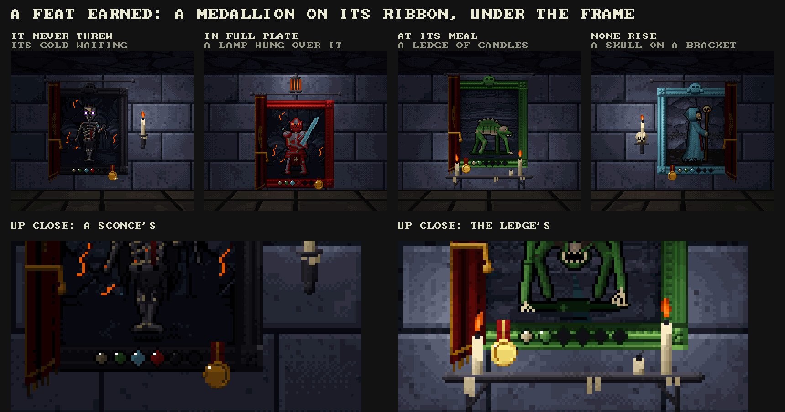
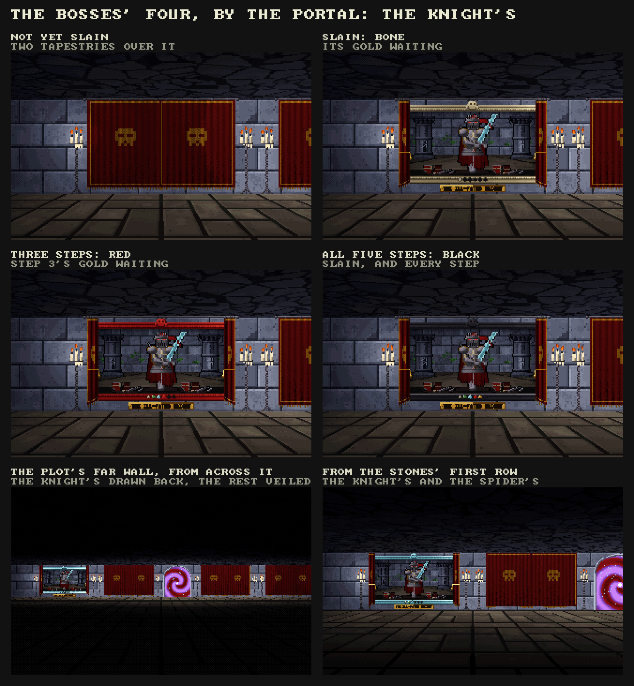

# The portraits of the slain

*Status: settled (10 November 2026), at the owner's request, built on `claude/adoring-hopper-h9ivcg` from main at 1.0.0b21.1:
steps 1 (the record), 2 (the art in the build, hung at section 7's faces), 3 (their candles dealt and lit), 4 (the tapestry drawn
back, the card, the gold), 5 (the Spectre's and the Wraith's achievements, the twenty feats and their medallions, the bosses' four in
the plot after the owner saw the knight's mock-up) and 6 (the checks), harness only, and released as **1.0.0b21.2**, "The Portraits
of the Slain", at the owner's word (10 November), a pre-release, squashed onto main as one commit. The mock-ups are drawn with the game's own textures, sprites, palette and light by `src/crawl_portrait.c` (in
the game's build since step 2) and `tools/portraitmock.c` (`make build/portraitmock`, then `build/portraitmock <dir>`). The owner answered every
question in section 9 the same day (marked there, Q15 last, which came of their own edit) and settled the numbers in a Sheet on
claude.ai, [Portraits of the Slain: Gold](https://claude.ai/artifact/2P9JkVQMBEdhAoa6zwB1N6), brought into sections 3 and 4 as it
stood at its revision 68: the starts 100, 200 and 300, every row paying but the Wraith's fourth gem, the Spectre's, the Wraith's,
the twenty feats and the bosses' with them, the shade's one rank paying as rank V, and the kills each rank asks lowered to 20, 25,
20, 15 and 10, and 5 gilded, for the game's own achievements too. `docs/portraits/ranks.csv` and `bosses.csv`
are that revision's numbers, written by `tools/portrait_sheet.py` from `KINDS` and checked against the Sheet. If the Sheet changes
again, bring it in the same way before building.*

## 1. What was asked

Her walls are bare ashlar between the torches. The owner would hang a picture of each creature there, one to a bestiary page:
covered by a dark tapestry until one of its kind is slain; then drawn back by the player to show its silhouette walking, as an
unmet rank walks in the bestiary; then, rank by rank as the slayer achievements are earned, the creature in that rank's colours,
on the stone of the run where the rank was unlocked. Each unlocked rank pays gold once a life, taken at the picture in her room
after a level is cleared, so that the record kept through death becomes something felt after it. The frame's colour tells the
highest rank unlocked (black the highest, gilded just under it); a candle in a holder lights each one, laid out differently
from its neighbours. Gold by thirds of the creatures: 250 to 1,000 a rank for the first third, 500 to 2,000 for the second, 750
to 3,000 for the last, by the rank and the creature's strength.

Asked for here: a sheet of every achievement for kills, suggestions for more, a mock-up of the frame and its background, and
the skeleton's frame with ranks I and II unlocked, each walking five seconds in turn.

## 2. How it goes, in play

- **Twenty-two portraits**, one for each bestiary page (`best_kinds`), on her four walls (section 7). Twenty of the kinds have
  slayer achievements today; the Spectre and the Wraith have none, since nothing counts as slaying them (section 5 A).
- **Veiled.** Until one of its kind is slain (any rank: `Record.kills`), an oxblood tapestry hangs over it from an iron rod,
  pleated, a border and a skull worked in gold thread, a fringe at its foot.
- **One slain.** In her room the tapestry waits for you: facing it, *E DRAW BACK THE TAPESTRY* (A on the pad). It gathers to
  the side away from the candle and is tied back there with a gold cord, and stays so, covering the frame's side and no more
  (settled, Q8). Behind it is the creature's shadow, walking on the spot and turning about exactly as the bestiary shows a rank
  not yet met, on bare old wood.
- **A rank unlocked** (its slayer achievement earned): the picture shows the creature in that rank's colours, its dressing and
  its eyes, standing on the floor of the run where the rank was unlocked, that run's stone behind it. With more than one rank
  unlocked it shows each in turn, five seconds each, dissolving between (`skeleton.gif`).
- **The frame** takes the colour of the highest rank unlocked: bare wood, then bone (I), green (II), blue (III), red (IV), gold
  (gilded) and black (V). Set in its foot is a gem for each rank the kind comes in, in the order the bestiary lists them, dark
  until that rank is unlocked and then in its colour. A gem whose gold is waiting twinkles, so a wall can be read from across
  the room: which have gold for you this visit.
- **The candle.** Seven layouts (section 6), dealt so that no two neighbours share one. Each candle is a real light in her room
  and lights the frame and the stone about it.
- **E at a portrait** opens its card (`card.png`): the picture up close, each rank's slain and needed, its gold and whether it
  was taken this life, waits, or isn't yet earned. E takes all that waits on that portrait at once; A/D go to the next
  portrait without walking to it (settled, Q13); Esc leaves.
- **Paid once a life** (settled). Every rank unlocked pays its gold once a life, at any visit to her room: the visit after a
  level cleared in that life, and the one on waking after a death too. A life runs from waking after a death that costs
  (`death_fall`), or a new run, to the next such death. A rank unlocked in the middle of a level is ready on the next visit.
  Her claim takes no portrait's gold and doesn't start a life.
- **The dream** (settled) draws back a tapestry now and then, so the screensaver's runs show the wall opening over time. It takes
  no gold (my assumption, as before: the owner's answer spoke of the tapestries only), so its balance runs stay comparable with
  the builds before. A person who takes over a dream's run finds its kills counted and some tapestries already down.

## 3. The sheet: every achievement for kills (settled)

**The portraits' rows.** One achievement for each rank of each kind (`slayer_need`), 104 of them in the game today, each named
by its rank's word and the kind (*ROTTEN SKELETONS*, *COLD*, *BLOODY*, *BLACK*, *GILDED*; chitin's rank V is *PALE*). The game
asks 60 slain of a kind's lowest rank, then 40, 25, 15 and 8, and 3 gilded; the owner lowered them to **20, 25, 20, 15 and 10, and
5 gilded** (Q15), for the game's own achievements as well as the portraits (section 8). The Sheet's rank rows read them from its
Formula tab. The Deep's kinds start at rank II and take rank I's count for it, the next rank II's, and so on, as the game does; the
shade's one rank asks rank I's; bats stop at IV. Rank II asking more than rank I is as the owner set it.
To them the owner added, from section 5, the Spectre's three (laid to rest), the Wraith's four (driven back, and the Wraith
Unbound's fall) and a feat for each of the twenty kinds that can be slain: 27 new achievements, 131 rows in all, every one paying.
Each cell is *needed: gold*, the gold by the formula in section 4; a feat's needed count is of its own deed (section 5 B). The shade's
one rank pays as its third's rank V (Q9), and the Wraith's fourth gem lights but pays nothing (Q14).

| # | Kind | Third | Strength | I | II | III | IV | V | Gilded | Feat | All |
|---|---|---|---|---|---|---|---|---|---|---|---|
| 1 | Skeleton | 1 | 0.43 | 20: 130 | 25: 190 | 20: 250 | 15: 310 | 10: 370 | 5: 340 | 20: 250 | 1,840 |
| 2 | Spectre | 1 | 0.00 | 5: 100 | 15: 160 | 40: 220 | - | - | - | - | 480 |
| 3 | Bat | 1 | 0.00 | 20: 100 | 25: 160 | 20: 220 | 15: 280 | - | - | 20: 220 | 980 |
| 4 | Shambler | 1 | 1.00 | 20: 160 | 25: 220 | 20: 280 | 15: 340 | 10: 400 | 5: 370 | 20: 280 | 2,050 |
| 5 | Wall Skull | 1 | 0.14 | 20: 110 | 25: 170 | 20: 230 | 15: 290 | 10: 350 | - | 20: 230 | 1,380 |
| 6 | Shield-Bearer | 1 | 1.00 | 20: 160 | 25: 220 | 20: 280 | 15: 340 | 10: 400 | 5: 370 | 20: 280 | 2,050 |
| 7 | Spider | 1 | 0.29 | 20: 120 | 25: 180 | 20: 240 | 15: 300 | 10: 360 | - | 20: 240 | 1,440 |
| 8 | Drowned | 2 | 0.60 | 20: 270 | 25: 390 | 20: 510 | 15: 630 | 10: 750 | 5: 690 | 10: 510 | 3,750 |
| 9 | Bone Hound | 2 | 0.28 | 20: 230 | 25: 350 | 20: 470 | 15: 590 | 10: 710 | - | 10: 470 | 2,820 |
| 10 | Wraith | 2 | 1.00 | 10: 320 | 40: 440 | 100: 560 | 1: gem only | - | - | - | 1,320 |
| 11 | Hunting Spider | 2 | 0.44 | 20: 250 | 25: 370 | 20: 490 | 15: 610 | 10: 730 | - | 20: 490 | 2,940 |
| 12 | Ghoul | 2 | 0.52 | 20: 260 | 25: 380 | 20: 500 | 15: 620 | 10: 740 | 5: 680 | 20: 500 | 3,680 |
| 13 | Skeleton Knight | 2 | 0.92 | 20: 310 | 25: 430 | 20: 550 | 15: 670 | 10: 790 | 5: 730 | 10: 550 | 4,030 |
| 14 | Brood Mother | 2 | 1.00 | 20: 320 | 25: 440 | 20: 560 | 15: 680 | 10: 800 | - | 5: 560 | 3,360 |
| 15 | Spiderling | 2 | 0.00 | 20: 200 | 25: 320 | 20: 440 | 15: 560 | 10: 680 | - | 200: 440 | 2,640 |
| 16 | Shade | 3 | 0.29 | 20: 1,070 | - | - | - | - | - | 10: 710 | 1,780 |
| 17 | Ember Imp | 3 | 0.00 | 20: 300 | 25: 480 | 20: 660 | 15: 840 | 10: 1,020 | - | 25: 660 | 3,960 |
| 18 | Deacon | 3 | 0.57 | 20: 400 | 25: 580 | 20: 760 | 15: 940 | 10: 1,120 | 5: 1,030 | 10: 760 | 5,590 |
| 19 | Gargoyle | 3 | 0.43 | 20: 380 | 25: 560 | 20: 740 | 15: 920 | 10: 1,100 | - | 10: 740 | 4,440 |
| 20 | Whipper-In | 3 | 0.71 | 20: 430 | 25: 610 | 20: 790 | 15: 970 | 10: 1,150 | 5: 1,060 | 5: 790 | 5,800 |
| 21 | Sexton | 3 | 0.29 | 20: 350 | 25: 530 | 20: 710 | 15: 890 | 10: 1,070 | 5: 980 | 10: 710 | 5,240 |
| 22 | Lightless | 3 | 1.00 | - | 20: 660 | 25: 840 | 20: 1,020 | 15: 1,200 | 5: 1,110 | 10: 840 | 5,670 |

Once a life, all of it: **67,240** gold (the first third 10,220, the second 24,540, the last 32,480).

**The bosses' portraits** (section 5 F, taken), each boss's achievements as its gems, every one paying:

| Boss | Slain | Step 1 | Step 2 | Step 3 | Step 4 | Step 5 | All |
|---|---|---|---|---|---|---|---|
| The Ill-Fated Knight | 1,500 | 1,800 | 2,100 | 2,400 | 2,700 | 3,000 | 13,500 |
| The Wandering Spider | 2,500 | 3,000 | 3,500 | 4,000 | 4,500 | 5,000 | 22,500 |
| The Black Deacon | 3,500 | 4,200 | 4,900 | 5,600 | 6,300 | 7,000 | 31,500 |
| The Wraith Unbound | 4,500 | 5,400 | 6,300 | 7,200 | 8,100 | 9,000 | 40,500 |

*Slain* is the boss's achievement on the way down (`ACH_BOSS0 + 6b`); a step is its fall at that challenge step at the Accursed
Portal (`ACH_BOSS0 + 6b + step`), a fifth more a step. Once a life, all of it: **108,000**. Everything together: **175,240**.

**Not the portraits'**: *CUT OFF THE HEAD*, *SHEPHERD OF NONE* and *THE LEADERLESS DEAD* (a pack's leader slain first, 1, 10, 50)
and *BEFORE THE CRY* and *A HOUSE OF SILENCE* (a caller slain before it calls, 1, 10) stay achievements and pay nothing.

**One fall, one payment** (Q14). The Wraith's fourth gem is *THE WRAITH UNBOUND* slain, which is also the Wraith Unbound's own
portrait's first gem. Only the boss's portrait pays for it (4,500); on the Wraith's portrait the gem lights and pays nothing.

## 4. The gold, and what it weighs (settled)

**The formula.** Gold = the third's start x (1 + 0.6 x (rank step + strength)), to the nearest 10. The owner set the starts.

- *The third*: the bestiary's pages in the order met, in three, the spiderling with its mother: 7, 8 and 7, Skeleton to Spider
  (levels 1-6), Drowned to Spiderling (7-14), Shade to Lightless (16-32). Starts **100, 200 and 300** (the plan had begun at 250,
  500 and 750). So the weakest kind's rank I pays 100, 200 or 300 and the strongest's rank V four times that.
- *Rank step*: I 0, II 1, III 2, IV 3, V 4; gilded 3.5, between IV and V as its frame is; a feat 2, as rank III. A rank II is
  worth the same step whatever kind it is (the Lightless, which starts at II, begins at step 1).
- *Strength*: the kind's worth in experience (`KIND_XP`) against the others in its third, from 0 for the weakest to 1 for the
  strongest; the Spectre counts as 0 in the first third, the Wraith as 1 in the second.
- *The bosses* are set by hand, not by the formula: 1,500, 2,500, 3,500 and 4,500 slain, and a fifth more for each challenge step.

**What it weighs.** A level's haul is `gear_haul`: about 700 gold on level 2, 5,500 on 10, 19,600 on 20, 42,700 on 30 and 74,800
on 40, and wares are priced against it. A death that costs leaves a person with nothing; the portraits pay at once on waking and
again after each level cleared, everything unlocked, once a life. With the first third whole and half the second, about 22,500:
a level-20 haul in the hand before level 1. With every creature's row, 67,240, nine tenths of a level-40 haul; with the bosses'
too, 175,240, more than two. The bosses' rows are three fifths of it, and their challenge steps most of those: a first descent's
four falls pay 12,000. The lower counts (Q15) change none of these sums, only how soon in a career they are reached: a
kind's first portrait opens after 20 of it, not 60, and its five ranks after 90 kills in all, not 148. Her wares are limited to one to three a visit, but the Corpus Compendium sells back every piece worn
before at 1.2 times its price, as many as can be paid for: a person who dies deep will buy much of their kit back at once. If
that proves too much, the levers, in the order I would reach for them: a portrait pays only its highest rank's gold each life;
or one portrait's gold a visit; or the bosses' steps lowered. The dream takes no gold, so nothing in its runs measures this;
only playing does.

**The shade** has one rank, so it pays as its third's rank V (settled, Q9): 1,070 for its 20 slain, beside its feat's 710.

## 5. Suggestions for more

**A. The two that cannot be slain** (*taken*), so that all twenty-two portraits can open. *The Spectre*, laid to rest: only Spirit
Mastery's Spirit reaches it, and it is uncounted (`KF_UNCOUNTED`); count it apart, 5, 15 and 40 laid to rest, three gems, paid as
a first-third kind of strength 0 (100, 160, 220 at the settled starts). *The Wraith*, driven back: 10, 40 and 100 times
(`wraith_back` already knows), and the Wraith Unbound's fall as a fourth gem; paid as a second-third kind of strength 1 (320 to 680). Its tapestry would come
down the first time it is driven back.

**B. A feat for each kind** (*taken*): one deed particular to it, a gold medallion on a ribbon hung from the frame's foot when earned,
paid once a life as its rank III is. Those marked * are counted already in some form.

| Kind | Feat | Kind | Feat |
|---|---|---|---|
| Skeleton | *IT NEVER THREW*: 20 slain before their first throw | Ghoul | *AT ITS MEAL*: 20 slain feeding * |
| Bat | *SHAKEN OFF*: 20 latched bats shaken off * | Skeleton knight | *IN FULL PLATE*: 10 slain before shedding any |
| Wall skull | *BEFORE THE SCREAM*: 20 silenced before they scream * | Brood mother | *NONE HATCHED*: 5 slain before a sac hatches |
| Shield-bearer | *THROUGH THE SHIELD*: 20 slain after breaking the shield | Spiderling | *THE WHOLE BROOD*: 200 slain * |
| Spider | *STILL IN ITS WEB*: 20 slain before they drop | Shade | *FACED DOWN*: 10 slain while fading from your light |
| Shambler | *BACK IN THE GROUND*: 20 slain before they stand | Ember imp | *QUENCHED*: 25 slain by Frost * |
| Drowned | *NOT A DROP*: 10 slain without their burst reaching you | Deacon | *NONE RISE*: 10 slain before any rises for him |
| Bone hound | *BOTH OF THEM*: 10 pairs slain within five seconds | Gargoyle | *STILL STONE*: 10 slain within two seconds of waking |
| Hunting spider | *OFF THE CEILING*: 20 slain overhead | Whipper-In | *NO HORN*: 5 slain before his horn * |
| | | Sexton | *UNRUNG*: 10 slain with his bell never rung * |
| | | Lightless | *IN THE DARK*: 10 slain with the lantern shuttered |

**C. The whole line.** Every rank of a kind unlocked, gilded too: the frame's rosettes take gold leaf and it pays once (not a
life) twice its rank V. **D. A wall whole.** Every portrait in a third showing rank I or better: a candle in her chandelier for
each third, and a Cursed Coin each, once. **E. Born to an element.** 25 slain of the dead born to each element, six achievements
over all kinds (`Mob.elem`): the cartouche's skull takes that element's colour in its eyes, one at a time. **F. The bosses' own
portraits** (*taken*), two faces wide, on the grave plot's far wall either side of the Accursed Portal where they are challenged
(section 7): the existing boss achievements as their gems, the gold in section 3. **G. The pockets.** 50 slain in the Backrooms, 50 in Severance: a portrait may then be hung
with that pocket's look behind it, chosen at its card, for the joke of it.

The owner took A, B and F (10 November, in the Sheet); C, D, E and G are not taken up.

## 6. The art

- **The frame**, 42 by 48 texels of a wall face, the picture inside 32 by 38. A moulding five texels wide, shaded across its
  profile (lip, flat, cove, bead, the step down to the picture) by where the candle is, its bead worked into pearls; a block at
  each corner with a four-petalled rosette; a cartouche standing over its head with a skull in it; the gems in its foot. Bare
  wood is grained and wormed; black is lacquer, grey where the light catches it; gilded throws a spark now and then.
- **The picture**: the run's stone a step behind the creature, its floor going away under it, a pool of painted light about it
  and the frame's shadow at its edge. The creature is drawn as the crypt draws it: its rank's recolouring (`crawl_rank_lut`), its
  rank's dressing (`crawl_dress`), and its eyes put back after in the rank's colour and form, as `render_eyes` does. It walks on
  the spot and turns about as in the bestiary (towards you, its right, towards you, its left, 1.6 s each), and blinks.
- **The run behind it** is that run's main stone (dressed ashlar, bedded slate, rough granite, obsidian with its glowing seams)
  and first floor, made once as the game starts and kept. Her room is always drawn in level 1's palette, so the Catacombs', the
  Mine's and the Glass's stone keep their shapes but take the Crypts' tint there; the mock-ups show it so.
- **The tapestry**: oxblood with a gold border, the skull worked in it, a fringe, on an iron rod over the frame and its cartouche;
  drawn aside to the side away from the candle and tied there with a gold cord, where it stays, over the frame's side moulding.
  `tapestry.gif` is the moment; every revealed portrait in the sheets wears its drape.

- **The candles**: a sconce to its right, one to its left, a pair, a pierced iron lamp hung on a chain over it, a ledge of
  church candles under it (one gone out and smoking), a skull on an iron bracket with a candle on its crown, a stand of three on
  the floor. Flames flicker each their own way. In the game (step 3) each flame is a static light and a glow on the wall about it,
  as the mock-ups light them: the light a ninth of a torch's, shared between a layout's flames, the glow strong (a third of a
  torch's made her room half again as bright).
- **Resolution.** A wall face is 64 texels across. At 64 the creature is drawn at half its size, which reads from across the
  room and is blocky up close; at 128 (one branch in `render_walls` for these faces alone) it is drawn at its own size, as the
  bestiary's niche shows it. `runs.png` puts the two side by side from a cell and two thirds and from three cells. I would take
  128.

The animation asked for, the skeleton's frame with ranks I and II unlocked, I on the Crypts' ashlar and II on the Catacombs'
slate, each walking five seconds, the frame green for II, II's gold waiting: `portraits/skeleton.gif`.

- **A feat's medallion** (step 5): gold, a skull struck in it, on an oxblood ribbon with a gold stripe hung over the frame's
  foot at the side away from the tapestry (on the ledge, away from its candles); it twinkles while its gold waits, as a gem does.

- **The bosses' four** (step 5; the knight's mock-up seen by the owner, and the name plate it had taken off at their word, since it
  could not be read: the name is the band's at the wall and the card's). Two faces wide: a broad frame whose gems are its
  achievements (slain, then each challenge step) and whose colour is the highest of them, bone for slain, then green, blue, red,
  gold and black for the steps, as a kind's frame takes its ranks'; a candle stand of three either side; two tapestries over it till
  it falls, parted to either side once drawn back. In the picture it stands in its arena on its run's stone, a little over its own
  size, what stands in its arena behind it (the knight's and the spider's pillars, the Deacon's timbers, the Wraith's braziers
  burning) and what lies before it (broken arms, still water, broken tombs, black glass), and walks, raises its blow, strikes and
  holds a pose of its own (the knight plants its sword, the spider rears, the Deacon chants, the Wraith reaches), eight seconds
  round. `knight.gif` is the knight's tapestries parting, then the knight with two steps beaten and the second's gold waiting.

## 7. Where they hang (settled, Q7)

The first two thirds in her room, the last in the back room with the Totem, the Compendium and the Repository.

- **Her room's south wall** (faces looking north, the first thing seen on turning from the wares): x 10, 11, 12, 13, 17, 18, 20.
  The shrine and its candles stand before 14-16, the arch to the plot is 19, the urn stands before 20. *The first third*, the
  Skeleton to the Spider.
- **Her room's north wall**, behind the pedestals' arc: x 10, 11, 13, 14, 16, 17, 19 (12 and 18 the torches, 15 her sign, 20 the
  arch to the Lampstand). *The second third*, the Drowned to the Brood Mother; **the spiderling** beside its mother round the corner
  on the east wall at y 12. The rest of the east wall and all of the west, where she sits, stay bare.
- **The back room** (x 4-8, y 12-17, through the arch beside her): its east wall, the back of her west wall, at y 12, 14, 15, 16
  and 17 (13 is the arch), facing the Repository across the Compendium's lectern; and its north wall at x 7 and 8 (the Totem
  stands in the corner before 4, its candles before 5, and 6 is kept clear beside them). *The last third*, the Shade to the
  Lightless.

What stands in front: the pedestals hide the north wall's lower half from the middle of her room, and the urn one of the south's.
Walking up to a portrait to read it is the way, and the card's A/D makes walking to each needless. Their candles (thirty-six
flames as dealt) light her rooms at a ninth of a torch each, with a pool of light on the wall about each flame, so the rooms look
much as they did; the back room, darker, gains the most.

**The bosses' four** hang in the grave plot, through the arch past the shrine, on its far wall (y 27, faces looking north) either
side of the Accursed Portal at x 16, read from the left as you face it, as the mock-up had them: the knight at x 20-19, the spider at
18-17, the Portal, the Deacon at 15-14 and the Wraith Unbound at 13-12, each two faces wide (256 by 128 at the settled 128 texels a
face). The plot's stones stand in rows 22 and 24, so nothing stands before them.

## 8. What it touches

- **The record.** `Record.kills` and the slayer bits are there already, kept through death and with the page. New: for each
  kind and rank, the run it was unlocked in (a byte: set in `rec_kill` beside `ach_earn`, from `crawl_set(G.level)`); for each
  kind, its tapestry drawn back; for each kind and rank, its gold taken this life; and whether a level has been cleared this life.
  A ledger section of its own (`LG_PORTRAIT`, about 200 bytes), so no save version. An older page reads with each unlocked rank's
  run as the first run that rank is common in (I the kind's own, II the Catacombs, III the Mine, IV and V the Glass), its
  tapestries down where kills are counted, and every rank's gold waiting.
- **The new achievements.** 27 more bits (the Spectre's 3, the Wraith's 4, the feats' 20), after the ways' (`ACH_WAY0 + 11`
  is bit 345 of `ACH_BITS` 512), shown in `ach_lines` and the bestiary. Each needs counting: spectres laid to rest (kept apart from
  the kills, since they are `KF_UNCOUNTED`); the Wraith driven back (`wraith_back`); and each feat's deed, of which the bats shaken
  off, the callers silenced, the ghouls slain feeding, the spiderlings and the imps slain by Frost are counted already in some form
  and the rest are new (a skeleton slain before its first throw, a shield broken first, a spider still in its web, the buried
  before they stand, a Drowned whose burst missed, a pair of hounds within five seconds, a hunter overhead, a knight in full
  plate, a brood mother before a sac hatches, a shade fading, a deacon before any rises, a gargoyle within two seconds of waking,
  a Lightless slain with the lantern shuttered). A feat hangs as a gold medallion under its frame.
- **The counts** (Q15). `slayer_need`'s `NEED` becomes 20, 25, 20, 15, 10, the gilded 5 and a kind off the ladder (the shade)
  20; `ach_lines`, the bestiary's ranks and their toasts read it, so they follow. A bit earned stays earned. `rec_kill` tests the
  count only at a kill, so a record already past a new count would earn it on its next kill of that kind and rank; a sweep as a run
  or page is read (and at the first `crawl_enter`) earns them at once, in one toast (*THE DEAD RECKONED AGAIN: n ACHIEVEMENTS*)
  rather than a queue of them. The halfway note (`need >= 8`) comes at 10, 12, 10, 7 and 5 of them; none for the gilded's 5, as
  none came for 3. Nothing in play reads the slayer bits but the bestiary, the achievements' list and the portraits, so the dream's
  runs keep step with 1.0.0b21.1's.
- **A life.** `death_fall` (a death that costs) and `run_new` clear the gold taken; every visit to her room pays what waits.
- **The art.** `src/crawl_portrait.c` into the build; the runs' stone and floor kept at start; an overlay a portrait (22 x 64 x 64,
  or 128 x 128 each at 128: 360 KB), drawn again only while its face is in view, its creature's frame changing four times a second
  and its flames twenty; `render_walls` takes them as overlays (`fover`), or at 128 by their own branch.
- **Her rooms and the plot.** `gen_shop` hangs them (the faces in section 7: her room, the back room, layouts dealt so no
  neighbours match) and lights their candles; the bosses' four in the plot, two faces each.
- **The card.** `UI_PORTRAIT`: the prompt through `pk`, E and the pad's A, A/D, the gold through `RUN.treasure` with
  `SFX_COIN`, a caption (*THE PORTRAIT PAYS 440*).
- **The Codex** could gain a part, *THE PORTRAITS*, with the rule written down; the bestiary's ranks could show their gold.
- **Debug**: `CRAWL_TPPORTRAIT=k` (before portrait k), `CRAWL_PORTRAITS=r` (every kind unlocked to rank r), `EVENT portrait_drawn`,
  `portrait_paid`.

## 9. Questions for the owner

1. **The thirds.** *Settled: (a).* (a) The bestiary's order, the spiderling with its mother: 7, 8, 7 (as the sheet). (b) Straight thirds, 7, 7, 8,
   the spiderling in the last.
2. **The formula.** *Settled in the Sheet: (a), the starts 100, 200 and 300.* (a) Start x (1 + 0.6 x (rank + strength)), strength by `KIND_XP`
   within the third. (b) By rank alone, start x (1 + 0.75 x rank). (c) Yours: the Sheet takes any.
3. **What a portrait pays.** *Settled: (a).* (a) Every rank unlocked, once a life each. (b) Only its highest rank's, once a life.
4. **When.** *Settled: both, so (b).* (a) On a visit to her room after a level cleared in that life; not on waking after a
   death. (b) At any visit, waking too.
5. **The dream.** *Settled: it draws back a tapestry now and then* (its gold not said; taken as none). (a) Leaves them alone:
   no tapestries, no gold. (b) Draws back tapestries but takes no gold. (c) Both.
6. **Resolution.** *Settled: (a).* (a) 128 texels a face, the creature at its own size. (b) The walls' own 64.
7. **Where.** *Settled: (b).* (a) All twenty-two on her four walls, as section 7. (b) The last third in the back room with the Totem.
   (c) A long gallery of their own off her room.
8. **The tapestry, drawn back.** *Settled: (b).* (a) Gone. (b) Left gathered and tied at the side.
9. **The shade's one rank.** *Settled: (a).* (a) Pays as its third's rank V (1,070), since it is all there is. (b) As the formula (350, as the Sheet
   stands).
10. **The Spectre and the Wraith** (5 A). *Settled: (a).* (a) Achievements of their own, so their portraits open. (b) Their portraits stay
    veiled; a joke in itself. (c) Twenty portraits, not twenty-two.
11. **Feats** (5 B). *Settled: yes, all twenty, paying.* (a) Yes, a step after the portraits. (b) Not now.
12. **The bosses' portraits** (5 F). *Settled: with these, paying.* (a) Later, with the boss pages the bestiary still lacks.
    (b) With these.
13. **The card's A/D through every portrait.** *Settled: (a).* (a) Yes. (b) Only E at each, walked to.
14. **The Wraith Unbound's fall, twice** (section 3). *Settled: (a).* (a) Only the boss's portrait pays for it: the Wraith's fourth gem lights
    but pays nothing. (b) Both pay. (c) The Wraith's fourth gem becomes another deed.
15. **The kills each rank asks.** *Settled: (a).* The owner changed the Formula tab's *Slain, as the game asks* to I 20, II 25,
    III 20, IV 15, V 10, gilded 5 (the game asks 60, 40, 25, 15, 8 and 3), and nothing read it. (a) The new counts for every kind's ranks, the Ranks rows made to read them from
    the Formula tab (the Deep's kinds, which start at II, taking I's count for their first rank, as the game does now), and
    `slayer_need` changed to match. (b) Leave the game's counts; the column was a trial.

## 10. Steps, once it is settled

1. The record's new section, a life, older pages read, and the counts lowered with their sweep (section 8). *Built (harness
   only), 10 November.* (harness: pages from 1.0.0b21.1 opened, a death, a new run).
2. The art in the build: the overlays, `render_walls`, the runs' stone kept; frame time in her room (it is 1.8 ms in the crypt).
   *Built (harness only), 10 November; hung at section 7's faces for it, their layouts not yet dealt nor their candles lit.*
3. Her room: the faces, the layouts dealt, the candles' light. *Built (harness only), 10 November.*
4. The tapestry and the card, the gold, the prompt in the pad's words. *Built (harness only), 10 November.*
5. The Spectre's and the Wraith's achievements and the feats (section 5 A and B), and the bosses' four portraits in the plot
   (5 F), after a mock-up of one. *Built (harness only), 10 November: the achievements and feats, then the bosses' four once the
   owner had seen the knight's mock-up (its name plate taken off at their word: it couldn't be read).*
6. The checks: the dream's runs line for line against 1.0.0b21.1 on the same seeds (it leaves the portraits, so nothing may move);
   ASan; a person's run in the harness taking gold at the right visits; the README's preview strip and the page's table. *Done,
   10 November, and released as 1.0.0b21.2.*

## 11. Hand-off log

- **10 November.** Drafted. Read the achievements (`slayer_need`, `ach_lines`), the bestiary's drawing, the eyes, the ranks'
  colours and dressing, her room (`gen_shop`) and the runs' looks. `src/crawl_portrait.c` draws a portrait at any scale;
  `tools/portraitmock.c` sets them in her north wall straight on with the crypt's projection (`FOCAL`, `PLANE_LEN`), textures,
  palette, colourmap and light formula (`light_static`'s), and writes `skeleton.gif`, `tapestry.gif`, `states.png`,
  `candles.png`, `runs.png`, `room.png` and `card.png` into `docs/portraits/` (`PM_SCALE=2`; `all` or one of `skeleton`,
  `veil`, `room`, `sheets`, `card`). `tools/portrait_sheet.py` writes the workbook (LibreOffice can fill its formulas'
  values: `soffice --headless --calc --convert-to xlsx`). Not looked at in the game, nor by the owner: the next step is theirs.
- **10 November, later.** The owner answered Q1 (the spiderling with its mother), Q3 (every rank), Q4 (after a level cleared and on
  waking), Q5 (the dream draws back a tapestry now and then) and Q6 (128 texels), and asked for the workbook as something to work
  the numbers out in: the Sheet named in the status, three tabs (Ranks, Formula, Bosses), with the suggested rows (the Spectre,
  the Wraith, a feat for each kind) in it unticked. They were already tuning it as it was built: the thirds' starts at 100, 200
  and 300, and every boss row ticked. Read the Sheet, not the workbook in the repo, before building anything from its numbers.
- **10 November, later still.** The owner settled the Sheet (revision 60) and asked for it in the plan: the starts 100, 200 and 300,
  the rest of the formula as it was, no gold typed over it, and every row paying, the suggested ones too (the Spectre, the Wraith,
  the feats) and all of the bosses'. Sections 3, 4, 5, 7, 8, 9 and 10 now say so. `tools/portrait_sheet.py` reproduces the
  Sheet (the starts, the suggested rows) and writes `docs/portraits/ranks.csv` and `bosses.csv`, checked against the Sheet's 131
  golds and its totals; the workbook it wrote before is gone. Two things found in the numbers went to section 9: the Wraith
  Unbound's fall pays twice (Q14), and the shade's one rank pays half its feat (Q9).
- **10 November, last.** The owner answered Q7 (b), Q8 (b), Q9 (a), Q13 (a) and Q14 (a). The Sheet was brought in step (its
  revision 67): the Wraith's fourth row unticked, with a note, and the shade's one rank paying as rank V through an override that
  follows the inputs (`N92`). `tools/portrait_sheet.py` does the same (`PAYS_AS`, `GEM_ONLY`); the CSVs and section 3 match the
  Sheet, 67,240 and 108,000. The tapestry now stays drawn back and tied (`crawl_portrait.c`'s `tapestry`: no fade; the rod raised
  over the cartouche, the lamp and the ledge moved to make room), and every mock-up was drawn again; the room's view shows the
  second third on her north wall. Section 7 places the last third in the back room. Found in the Sheet and asked as Q15: the
  Formula tab's kill counts were changed, but nothing reads them.
- **10 November, Q15.** The owner answered (a): the kills each rank asks are 20, 25, 20, 15 and 10, and 5 gilded, for the game's
  own achievements too. The Sheet (revision 68): every rank row's *Slain* reads the Formula tab (`VLOOKUP` on its rank; the
  Lightless's five by hand, a rank down, with a note), its *Condition* is built from it, and a line under the Formula tab's
  settled notes says so; the feats, the Spectre's and the Wraith's keep their own counts. No gold moved: 67,240 and 108,000.
  `tools/portrait_sheet.py` (`NEED`, `GILD`) and `ranks.csv` match it. Section 8 has what the build changes in `slayer_need`, and
  the sweep a record already past a new count wants. Every question is now answered; nothing is built.
- **10 November, step 1 built** (harness only), at the owner's word. `slayer_need` asks 20, 25, 20, 15, 10 and 5 gilded (the shade's
  one rank 20). `RUN.por_run[kind][gem]` (1 + the run's set, `POR_GEMS` 8 a kind: the six ranks, `POR_FEAT`, a spare), `por_drawn`
  (a bit a kind), `por_taken` and `por_btaken` (this life's, a bit a gem or a boss's deed) and `por_open` (`POR_CLEARED` from
  `rec_cleared`, `POR_WOKEN` from `por_life`, which `death_fall` calls for a death that costs), saved as `LG_PORTRAIT`
  (`LG_PORTRAIT_BYTES` 229; `PAGE_BYTES` now counts the Confessions' and the augments' sections too, 16,153 at the most, and is
  checked against `SLOT_MAX` as it compiles). `rec_kill` sets a rank's run as it is earned; an older page's ranks take `por_guess`
  (`por_fill`), its tapestries are down where it has slain, and it pays as if woken. `slayer_sweep`, at the end of `run_unpack`,
  earns what a record read already reaches, under one pop-up (*THE DEAD RECKONED AGAIN*, or the one achievement's own).
  `por_waiting` and `boss_waiting` are the card's, for step 4. Debug: `PORTRAITS read|read, older|her room: ...` (how it pays, the
  tapestries, the ranks unlocked and waiting, each kind's ranks and their runs), `EVENT achievement n ...: swept`, `EVENT reckoned n`.
  Tested: a page written by 1.0.0b21.1 (seed 3, a person taking over at 1,500 s and struck down on level 4: 38 rank I skeletons, no
  slayer achievement) read here earns *SKELETONS* on reading, on the Crypts, five tapestries down, open as woken; the dream clearing
  a level makes it 3; a person's death in this build makes it 2 again and writes a page of 3,056 bytes that this build reads back
  as it was and 1.0.0b21.1 reads without complaint; a fresh run is 0 till its first level is cleared; a run from level 11 earned the
  Drowned's and the skeletons' rank I on levels 15 and 18, both shown on run II's stone. The dream from level 1 for 2,400 s (seed 5,
  `CRAWL_RUNID=4242` for both) is line for line 1.0.0b21.1's: nothing in play reads the slayer bits. ASan clean on two sessions (the
  old page read, a death and its page written; the new page read and played 700 s). `README.md` and the page still give the old
  counts: they describe the released build, so they change with the release. Next: step 2, the art in the build.
- **10 November, step 2 built** (harness only), at the owner's word. `src/crawl_portrait.c` is in the game's build (`SRC`, so the
  Windows and browser builds too; neither was built here). `por_hang` (the end of `gen_shop`, after `lay_faces`) hangs the
  twenty-two, a bestiary page each in its order, at section 7's faces (the south wall read from the left as you face it, x 20 to
  10; the north wall x 10 to 19 and the spiderling at (21, 12); the back room's north wall x 7, 8 and its east wall y 12 to 17):
  `POR.at[i]` (cell, face, kind, layout, the walk's phase), `Cell.por` 1 + its index, the face's own overlay taken off. The
  layouts go by turn (`i % NPLAYOUT`) till step 3 deals them, and the candles light nothing yet. `por_view` builds a `PortraitView`
  from the record (the frame's colour the highest rank unlocked, black over gilded; the unlocked ranks in turn, five seconds each,
  the next dithered in over the last two thirds of a second; each on the stone of the run its rank was unlocked in; the eyes as
  `render_eyes` colours them; the gems by `kind_ranks`, twinkling by `por_waiting`; the tapestry down unless drawn back). `por_frame`
  (in `crawl_render`, before the walls) draws a portrait into its overlay, `POR_OV[i]`, 128 texels a side, again only when it was
  in view the frame before and twenty times a second (its flames; its creature steps and turns with them), their turns spread
  across the frames; kept by columns and mirrored, as the walls keep a texture's first column on the right as seen. `render_walls`
  takes a portrait's face's stone and lays the overlay's column over it at 128 texels (`POR.seen` marks it in view). The runs'
  stone: `portrait_keep_runs` (in `begin_shop`, before her level 1 art) keeps each run's at its fifth level through
  `crawl_art_stone` (`crawl_art.c`), which makes only a run's main stone and first floor: byte for byte what the whole art makes
  (`build/portraitmock <dir> check`), in 10 ms where four whole levels' art took 420. The drawing was made cheaper without
  changing a pixel (the mock-ups' sheets and card the same, file for file): a tapestry all the way down hides the picture and the
  frame, so they aren't drawn under it, and its pleats are worked out a column at a time; at 128 texels a portrait costs 0.20 ms
  as a shadow, 0.22 ms with a rank, 0.12 ms veiled (`build/portraitmock <dir> bench`; 0.26, 0.24 and 0.47 before). Her room's frame
  (the harness's `bench`, 20 s, each case twice; these wander by about 0.2 ms): the dream's first visit, every portrait veiled,
  2.29 and 2.33 ms against 1.0.0b21.1's 2.04 and 2.27; a person before a portrait with two ranks of every kind drawn back, 2.16 to
  2.63 ms against 1.95 to 2.22 with none hung (`CRAWL_PORTRAITS=-1`), the back room's three in view the dearest. Elsewhere the walls
  are as they were (frames from levels 1 and 2 the same as 1.0.0b21.1's, file for file), and the dream from level 1 for 2,400 s is
  line for line 1.0.0b21.1's again. ASan clean on a person walking her room among them. Debug: `CRAWL_PORTRAITS=n` (every portrait
  drawn back and n of each kind's ranks unlocked from its lowest, 0 its shadow; below 0 none hung), `CRAWL_TPPORTRAIT=k[,d]` (before
  portrait k, 1 the first, d cells from its cell's middle, 2.1 if not given), `PORTRAITS the runs' stone kept in n ms`. Seen in the
  harness: her north and south walls veiled and drawn back, each kind in its rank's colours on its run's stone, the sconces and
  tapestries on the sides their layouts give them. Next: step 3, the layouts dealt and the candles' light.
- **10 November, step 3 built** (harness only), at the owner's word. The layouts are dealt in `por_hang`, the same every visit (a hash of
  the face, not the dice, nor `hash2`, which has the level in it): never as a neighbour's (faces side by side, 1 cell apart, or
  meeting at a corner), and where it can be as none 2 cells off either; and two tapestries never tied back against each other:
  side by side on a wall a portrait's tapestry goes to its left (`portrait_drape_side`), but the last's of the run, which may go
  either way. (A first rule, that a tapestry mustn't go towards a neighbour's, chained down the wall: once one went right all after
  it did, and the south wall came out as two layouts by turns.) As dealt: the south wall SCONCE_L, PAIR, LEDGE, LAMP, PAIR,
  SCONCE_R, LEDGE from x 20 to 10; the north wall STAND, SKULL, LAMP, SCONCE_R, LEDGE, PAIR, SCONCE_R from x 10 to 19 and the
  spiderling's STAND; the back room SCONCE_R, SKULL, PAIR, LAMP, LEDGE, STAND, SKULL (`PORTRAITS hung ...` in the debug build).
  Each flame (`portrait_layout_flames`: a layout's flames at rest, without a portrait) is a static light in front of its face
  (`light_static_ph`: `light_static` with its flicker's phase given, so the dice aren't touched and the dream keeps step) and a
  `PorFlame` in `POR.wf` (its face, the face's line, where along it, how far down): `render_walls` gathers, for any wall column, the
  flames on the same face line within 0.8 cells and adds their glow row by row (the mock-ups' round glow, flickering with the
  flame's own light, worked out only within its reach and every other row on a portrait's face), so it runs on onto the stone and
  the next face. The plan's third of a torch (0.45) made her room half again as bright (the views' mean brightness 66, 41 and 64
  against 38, 27 and 53 with no candles); a ninth (`POR_LIGHT` 0.15, `POR_REACH` 2.0) with a strong glow (`POR_GLOW` 0.8) gives
  55, 33 and 61 with a pool of light about each candle, and lights the back room, near black without them (`CRAWL_PORLIGHT=light,
  reach,glow` to try others). Thirty-six flames as dealt, 55 lights in her rooms (`MAXLIGHTS` 160). Her room's frame (the harness's
  `bench`, 20 s): the dream's first visit 2.45 and 2.64 ms against 1.0.0b21.1's 2.13 and 2.56; a person before a portrait with two
  ranks of every kind drawn back 2.50 to 2.61 ms against 1.99 to 2.28 with none hung (the glow was 0.4 ms dearer before it was kept
  to its reach). The dream from level 1 for 2,400 s is line for line 1.0.0b21.1's still; the mock-ups the same, file for file; ASan
  clean on a person walking the back room among them. Next: step 4, the tapestry drawn back and the card, the gold and the prompt.
- **10 November, step 4 built** (harness only), at the owner's word. Facing a portrait within 2.8 cells, on its room's side and in
  sight (`por_facing`, `G.pt_look`: 1 + which; `G.por_look` was already the Portal's), a band at the view's foot says what it is (*A
  TAPESTRY*, *ONE OF ITS KIND IS SLAIN* or *NONE ...*; drawn back, the kind in its frame's colour and *2 OF 6 RANKS, $380 WAITS*) and
  what E does, in the pad's words through `hint8`. E at a veiled one whose kind has a kill draws it back (`por_draw_back`: `RUN.por_drawn`,
  `POR.veil_t` for the moment it takes, `POR_DRAW_T` 1.3 s, a rustle); otherwise it opens its card (`UI_PORTRAIT`, `G.pt_sel`;
  `update_portrait`, `render_portraitcard` after the mock-up's card.png: the portrait up close on its own face's stone in its candles'
  light, each rank with an achievement (`por_ranks`) slain against asked, its gold and TAKEN, WAITS or LATER; A/D and the pad's bumpers
  and D-pad through all twenty-two, E or the pad's A draws a veiled one back or takes all that waits (`por_take`: `RUN.treasure`, a bit
  in `RUN.por_taken`, *THE PORTRAIT PAYS 380*), Esc or B leaves; her music plays on under it, `her_screen`). The gold (`por_gold`,
  `por_third`, `por_strength`) is section 4's formula over `KIND_XP`, the shade as rank V, in doubles rounded half up: all 104 ranks
  match `docs/portraits/ranks.csv`, counts and gold (`CRAWL_PORGOLD=1` prints them). The dream draws one back a visit at most, one visit
  in two by a hash of its run and the level, a few seconds into the visit, never on a page read from the ledger and never with the dice
  (`por_dream`, from `begin_shop`); it takes no gold. Until step 5 the Spectre and the Wraith have no rows (*NOTHING SLAYS IT*) and their
  tapestries stay down. Tested in the harness: a dream's run taken over on its second visit to her room (seed 3), the skeletons'
  tapestry drawn back at the wall (16 of 20 slain: its shadow, no gold), A/D to the Spectre's card and back; with `CRAWL_PORTRAITS=2` the
  shambler's ranks I and II paid 380 and the wall skull's 280, then TAKEN, *ITS GOLD IS TAKEN THIS LIFE* on a second E; with the pad,
  A's prompt and card, the bone hound's 230 taken, the D-pad to the next, B away; the drowned's 660 taken and the page signed with her,
  read back with its two gems taken and 37 waiting. The facing test first found a portrait through the corner of a wall (the back
  room's imp from her room) and now asks for a line of sight. The dream from level 1 for 2,400 s is line for line 1.0.0b21.1's (it drew
  back two tapestries); ASan clean on both rounds; the smoke test passes. Debug: `CRAWL_PORTRAITS=n` now opens her room's gold too,
  `PORTRAITS ...` counts the gems taken, `EVENT portrait_drawn <kind> by player|dream`, `portrait_paid <kind> gold n ranks x`.
  Next: step 5, the Spectre's and the Wraith's achievements and the feats, and the bosses' portraits in the plot after a mock-up.
- **10 November, step 5's first half built** (harness only), at the owner's word, and the knight's mock-up drawn. 26 achievements
  from bit 345 (`ACH_POR0`: the Spectre's three, the Wraith's three; `ACH_FEAT0`: the twenty feats, `FEATS`, `NPFEAT`, in the order
  of `por_ach`), each kind's own count in `RUN.por_feat` (u16, kept through death; saved at the end of `LG_PORTRAIT`, which a step-4
  section, `LG_PORTRAIT_B4`, still reads without them), but the spiderling's (its kills in the record) and the imp's (its kills by
  Frost, `el_kills`). `por_reckon` earns what a count reaches (a pop-up, the run it was earned in, a note of progress halfway), or
  quietly in `slayer_sweep`'s one pop-up; `por_bump` counts a deed; `por_feat_kill` (from `kill_mob`, after `rec_kill`) judges a
  kill. The deeds: `Mob.feat` (`FT_*`: a skeleton's bone thrown in `throw_to`, a web spider's drop, a sac of hers hatched (the
  nearest mother's, in `update_sac`), the huntsman's horn (his own, his pack's, a hunt's), the Sexton's bell rung hard, the knight's
  plate shed while it stands (`knight_shed`, after `damage_mob`'s and `hz_harm`'s harm), the shield's splinters, and `FT_NOW`, a
  ghoul at its meal or a hunting spider overhead or dropping as the last blow fell, taken before `damage_mob` changes either);
  `Mob.feat_t` a gargoyle's waking (`garg_wake`); a wall skull not yet `called`; a shambler still rising (`sub` 2); a shade's `shy`; a
  deacon who has `raised` none; a Lightless slain with the lantern held and shuttered; two hounds within five seconds (`G.t`); a
  Drowned's pool that never reached you (`Pool.feat`, counted as it dries in `update_pools`); a bat shaken or thrown off, not fed
  (`latch_release`); a spectre laid to rest (`kill_mob`); a Wraith newly driven back (`wraith_back_for`, not the boss). The portraits:
  `por_ranks` gives the Spectre ranks I to III and the Wraith I to IV, `por_unlocked` their bits and the Wraith Unbound's fall, and
  the feat as `POR_FEAT` (`PORTRAIT_FEAT` in the art); `por_waiting` never the Wraith's fourth (Q14); `por_gold` a feat as rank III, the
  shade's rule now for the slayable only (the Spectre and the Wraith are off the ladder too); `por_drawable` the Spectre once laid, the
  Wraith once driven. All 131 rows match `ranks.csv`, counts and gold (`CRAWL_PORGOLD=1`). The card's seventh row is the feat's (a
  medallion glyph, `medal_glyph`; the rows close up to 12 pixels), the Spectre's *LAID* and the Wraith's *DRIVEN* columns, its words the
  feat's name and rule, the band at the wall *6 OF 6 AND A FEAT*; the bestiary's W/S goes past the ranks to the feat (`G.best_feat`: its rule and count, a medallion after the
  lozenges), the Spectre's and the Wraith's rows in place of *IT CANNOT BE*; `ach_lines` lists each kind's own after its ranks
  (26 more lines). The art: `medallion` in `src/crawl_portrait.c`. Tested in the harness: the dream from level 1 for 2,400 s is
  line for line 1.0.0b21.1's and earned IT NEVER THREW at 1,975 s (22 skeletons, 12 shields, 2 bats); deep starts at 11, 21 and 31
  counted hound pairs, Drowned bursts missed, deacons before any rose, gargoyles as they woke, hunting spiders overhead, shades fading,
  wall skulls silenced and the Wraith driven back; with `CRAWL_PORTRAITS=7` (the feats too) the skeletons' card paid 1,840 (ranks 0x7f)
  and the Spectre's 480, and every portrait's gold taken in turn came to 67,240, the sheet's once a life; a feat's count written at
  a death that costs and read back; ASan clean on that and on the dream from 11 and 21; the smoke test passes. Not seen yet in a run: the knight in full plate,
  the brood before a sac hatched, the Sexton unrung, the huntsman before his horn, the Lightless in the dark, a ghoul at its meal, a
  web spider in its web, a shambler still rising, a spectre laid to rest (the dream's runs were short, and it seldom has Spirit's
  mastery); the spiderlings' and the imps' are the record's counts, earned by the sweep where a record already reaches them. The bosses: `portrait_boss_face` (`BossPortraitView`, two faces at any scale: `boss_picture`, `boss_plate` with
  a three-by-five face of letters, `frame` with the steps as ranks, two `tapestry` halves, two `stand`s), driven only by
  `tools/portraitmock.c`'s `bosses` (`bosses.png`, `knight.gif`) and `medals` (`medals.png`); not in the game till the owner has seen it.
  Debug: `CRAWL_PORTRAITS=n` from 7 the feats too, `EVENT feat <kind> <count>`, `EVENT achievement <bit> ...: swept`, `PORTRAITS ...
  counts k:n`. Next: the owner's eye on the knight's mock-up and the medallion; then the four hung in the plot, their card and gold.
- **10 November, step 5's second half built** (harness only). The owner found everything golden but the knight's name plate, which
  couldn't be read: it is gone, and a boss's name is the band's when you face it and its card's, in the game's own letters
  (`POR_BOSS_NAME`, as the settled sheet names them: `BossDef.short_name` has the Wraith as *THE WRAITH*). The other three drawn
  as the knight was (`por_boss_view`: each one's sprites, what stands behind it and what lies before it, `BossPortraitView.prop_n` for
  the Wraith's braziers' three frames burning), and the four hung in the plot by `por_hang` as `PorAt.boss` (1 + which) and `half` (0
  its left as seen), two entries a boss (`NPOR` 30), `por_head` the left half that stands for it; `por_frame` draws both faces at once
  from the left half (`portrait_boss_face` into 256 by 128, halved into `POR_OV`), while either is in view. Their candles: a light a
  stand at its middle candle (`POR_LIGHT` x 1.5) and a glow a flame on the wall (`portrait_boss_flames`, the stands' six at rest; the
  art keeps eight flames now, the kinds' call still four). The tapestries are `RUN.por_drawn`'s bits from 24 (`POR_BOSSBIT`,
  `por_bit`; a page's reading keeps them), down till its boss has fallen (`por_can_draw`, `boss_unlocked`), E drawing both back
  (`por_draw_back` gives both halves the moment); the dream draws them back now and then as it does the kinds'. The gold:
  `boss_gold` (1,500, 2,500, 3,500 and 4,500 for the fall, a fifth more a step), `boss_wait_gold`, `por_take` into
  `RUN.por_btaken`. The band: *A TAPESTRY* and *WHAT HANGS HERE HAS FALLEN* or *IS NOT YET SLAIN*; drawn back, its name in the
  highest deed's colour (`BOSS_GEM`) and *SLAIN, $1500 WAITS* or *2 OF 5 STEPS, $5400 WAITS*. Its card (`render_bosscard`, from
  `render_portraitcard` for a boss): the portrait across the well on its two faces' stone in its stands' light, its six deeds in two
  columns with their gold and TAKEN, WAITS or LATER; A/D passes a boss's right half over. Tested in the harness: every portrait's gold
  taken in turn came to 175,240, the sheet's whole (the bosses 13,500, 22,500, 31,500 and 40,500); the spider's tapestries drawn back
  at E and its 2,500 taken; the band and card for each. Facing the four from the plot, 3.1 ms a frame (2.7 with them veiled, 2.1 with
  no portraits hung). The dream from level 1 for 2,400 s is still line for line 1.0.0b21.1's; ASan clean on a person taking all 26
  portraits' gold, a boss's tapestries and card, and the dream from 11; the smoke test passes. Debug: `CRAWL_PORTRAITS=n` gives each
  boss its fall and n - 1 steps and draws theirs back (`CRAWL_PORVEIL=1`
  leaves them down), `CRAWL_TPPORTRAIT=k` before a boss's middle (23, 25, 27, 29 the knight, the spider, the Deacon, the Wraith),
  `CRAWL_TPHALL=x,y,deg` (at a place in her hall), `EVENT portrait_drawn` and `portrait_paid ... steps x` with a boss's name.
- **10 November, step 6 done and released as 1.0.0b21.2** at the owner's word. The dream from level 1 for 2,400 s was line for line
  1.0.0b21.1's after every step (the last on the build released). A person's run in the harness (seed 5, `CRAWL_RUNID=4242`): taken over in
  her room after level 2, the skeletons' rank I paid 130; walked out into level 3 and struck down (`CRAWL_KILLAT`), the death wrote the
  page with its gold owed again (`PORTRAITS read: open 2 ... waiting 1 taken 0`); read back, her question answered, it paid 130 again.
  After a death that costs she asks what you were before anything else, so a script must answer her first. The Windows and browser builds
  were compiled and smoke-tested by CI on the branch (a run started by hand). The README has a section and *What has been verified*, the
  page a paragraph in her hall's section, a row in its table and the upgrade's note; the strip is `docs/preview_catacomb_portraits.png`
  (her south wall, the skeletons' portrait and card, the bestiary's feat, the plot's far wall, the knight's card). Debug added for the
  frames: `CRAWL_TPHALL=x,y,deg` (`CRAWL_TPAT` works only on a level).
- **10 November, after the release: the candles cold till asked.** The owner, on their first look: the candles should stay unlit until a
  tapestry may be drawn back, so a lit one says there is something to see (they could not find the skeletons'; it hangs at the left of
  her south wall as you face it, by the arch to the plot, and her room's urn stood before it, hiding its sconce: the urn stands by the
  way on now, under the east wall's torch). `por_lit` (`por_can_draw` or `por_is_drawn`): cold, `por_hang` gives a portrait no light
  and no glow on the wall, and the art no flame (`PortraitView.unlit` and the boss's; the wicks bare, the hung lamp's glass dark, the
  ledge's smoke gone). Once drawn back it stays lit. The layouts are dealt as before, so nothing else moves. The dream from level 1 for
  2,400 s is still line for line 1.0.0b21.1's. In the same round her rooms' cards became a slim prompt and a ware's buying a screen of
  its own (CLAUDE.md, *After 1.0.0b21.2*), and the portraits' band with them: *E DRAW BACK THE TAPESTRY*, *A TAPESTRY: NONE OF ITS
  KIND SLAIN*, or its name in its highest rank's colour with *$300 WAITS*.
