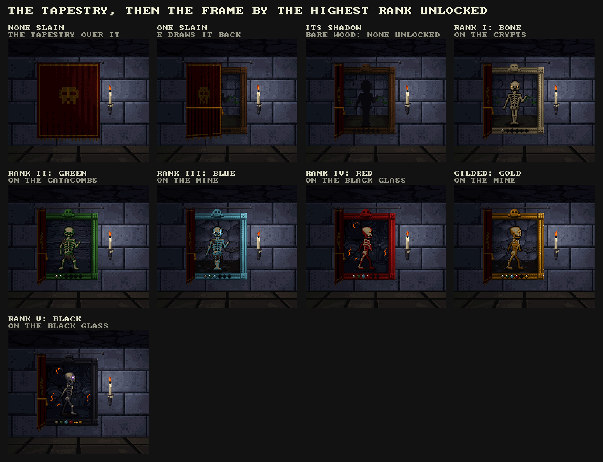
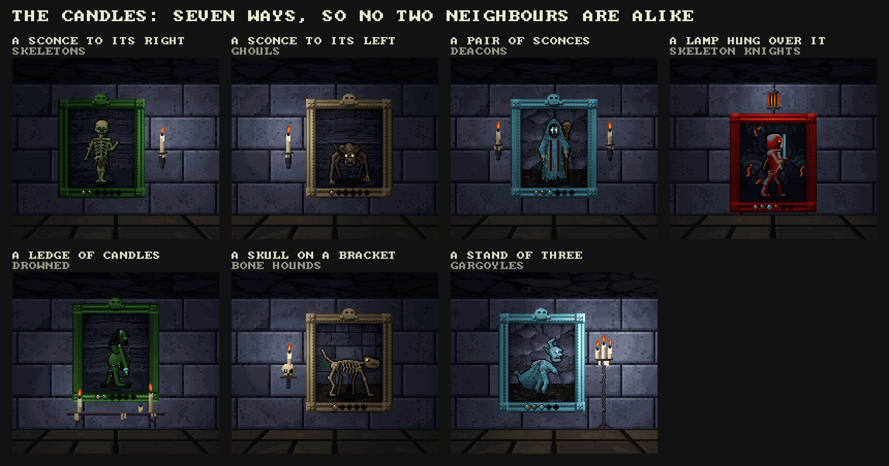
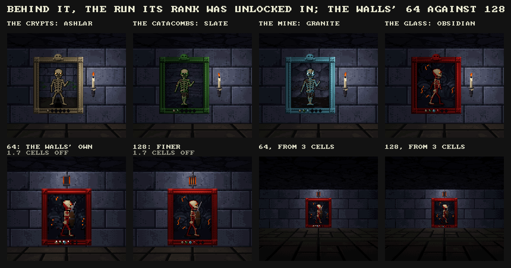
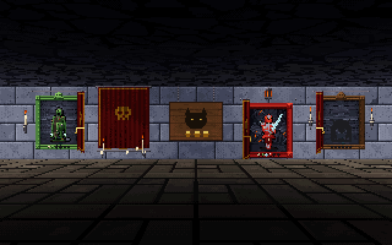
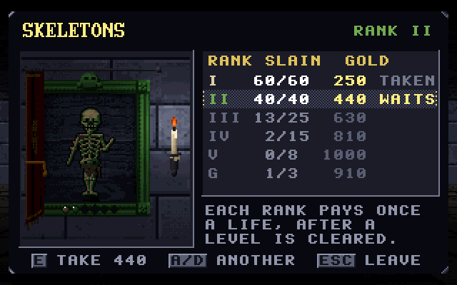

# The portraits of the slain

*Status: a draft (10 November 2026), at the owner's request, on `claude/adoring-hopper-h9ivcg` from main at 1.0.0b21.1. Nothing is in
the game. The mock-ups are drawn with the game's own textures, sprites, palette and light by `src/crawl_portrait.c` (not in the
game's build yet) and `tools/portraitmock.c` (`make build/portraitmock`, then `build/portraitmock <dir>`). The owner answered most
of section 9 the same day (marked there), and settled the numbers in a Sheet on claude.ai,
[Portraits of the Slain: Gold](https://claude.ai/artifact/2P9JkVQMBEdhAoa6zwB1N6), brought into sections 3 and 4 as it stood at
its revision 60: the starts 100, 200 and 300, and every row paying, the Spectre's, the Wraith's, the twenty feats and the
bosses' with them. `docs/portraits/ranks.csv` and `bosses.csv` are that revision's numbers, written by `tools/portrait_sheet.py`
from `KINDS` and checked against the Sheet row by row. If the Sheet changes again, bring it in the same way before building.*

## 1. What was asked

Her walls are bare ashlar between the torches. The owner would hang a picture of each creature there, one to a bestiary page:
covered by a dark tapestry until one of its kind is slain; then drawn back by the player to show its silhouette walking, as an
unmet rank walks in the bestiary; then, rank by rank as the slayer achievements are earned, the creature in that rank's colours,
on the stone of the run where the rank was unlocked. Each unlocked rank pays gold once a life, taken at the picture in her room
after a level is cleared, so that the record kept through death becomes something felt after it. The frame's colour tells the
highest rank unlocked (black the highest, gilded just under it); a candle in a holder lights each one, laid out differently
from its neighbours. Gold by thirds of the creatures: 250 to 1,000 a rank for the first third, 500 to 2,000 for the second, 750
to 3,000 for the last, by the rank and the creature's strength.

Asked for here: a sheet of every achievement for kills, suggestions for more, a mock-up of the frame and its background, and
the skeleton's frame with ranks I and II unlocked, each walking five seconds in turn.

## 2. How it goes, in play

- **Twenty-two portraits**, one for each bestiary page (`best_kinds`), on her four walls (section 7). Twenty of the kinds have
  slayer achievements today; the Spectre and the Wraith have none, since nothing counts as slaying them (section 5 A).
- **Veiled.** Until one of its kind is slain (any rank: `Record.kills`), an oxblood tapestry hangs over it from an iron rod,
  pleated, a border and a skull worked in gold thread, a fringe at its foot.
- **One slain.** In her room the tapestry waits for you: facing it, *E DRAW BACK THE TAPESTRY* (A on the pad). It gathers to
  the side away from the candle, is tied back a moment and goes (a dither, as the game's fades go). Behind it is the creature's
  shadow, walking on the spot and turning about exactly as the bestiary shows a rank not yet met, on bare old wood.
- **A rank unlocked** (its slayer achievement earned): the picture shows the creature in that rank's colours, its dressing and
  its eyes, standing on the floor of the run where the rank was unlocked, that run's stone behind it. With more than one rank
  unlocked it shows each in turn, five seconds each, dissolving between (`skeleton.gif`).
- **The frame** takes the colour of the highest rank unlocked: bare wood, then bone (I), green (II), blue (III), red (IV), gold
  (gilded) and black (V). Set in its foot is a gem for each rank the kind comes in, in the order the bestiary lists them, dark
  until that rank is unlocked and then in its colour. A gem whose gold is waiting twinkles, so a wall can be read from across
  the room: which have gold for you this visit.
- **The candle.** Seven layouts (section 6), dealt so that no two neighbours share one. Each candle is a real light in her room
  and lights the frame and the stone about it.
- **E at a portrait** opens its card (`card.png`): the picture up close, each rank's slain and needed, its gold and whether it
  was taken this life, waits, or isn't yet earned. E takes all that waits on that portrait at once; A/D go to the next
  portrait without walking to it; Esc leaves.
- **Paid once a life** (settled). Every rank unlocked pays its gold once a life, at any visit to her room: the visit after a
  level cleared in that life, and the one on waking after a death too. A life runs from waking after a death that costs
  (`death_fall`), or a new run, to the next such death. A rank unlocked in the middle of a level is ready on the next visit.
  Her claim takes no portrait's gold and doesn't start a life.
- **The dream** (settled) draws back a tapestry now and then, so the screensaver's runs show the wall opening over time. It takes
  no gold (my assumption, as before: the owner's answer spoke of the tapestries only), so its balance runs stay comparable with
  the builds before. A person who takes over a dream's run finds its kills counted and some tapestries already down.

## 3. The sheet: every achievement for kills (settled)

**The portraits' rows.** One achievement for each rank of each kind (`slayer_need`): 60 slain of its lowest rank, then 40, 25, 15
and 8; 3 gilded; the Deep's kinds start at rank II, the shade has one rank, bats stop at IV. Each is named by its rank's word and
the kind (*ROTTEN SKELETONS*, *COLD*, *BLOODY*, *BLACK*, *GILDED*; chitin's rank V is *PALE*): 104 of them, in the game today.
To them the owner added, from section 5, the Spectre's three (laid to rest), the Wraith's four (driven back, and the Wraith
Unbound's fall) and a feat for each of the twenty kinds that can be slain: 27 new achievements, 131 rows in all, every one paying.
Each cell is *needed: gold*, the gold by the formula in section 4; a feat's needed count is of its own deed (section 5 B).

| # | Kind | Third | Strength | I | II | III | IV | V | Gilded | Feat | All |
|---|---|---|---|---|---|---|---|---|---|---|---|
| 1 | Skeleton | 1 | 0.43 | 60: 130 | 40: 190 | 25: 250 | 15: 310 | 8: 370 | 3: 340 | 20: 250 | 1,840 |
| 2 | Spectre | 1 | 0.00 | 5: 100 | 15: 160 | 40: 220 | - | - | - | - | 480 |
| 3 | Bat | 1 | 0.00 | 60: 100 | 40: 160 | 25: 220 | 15: 280 | - | - | 20: 220 | 980 |
| 4 | Shambler | 1 | 1.00 | 60: 160 | 40: 220 | 25: 280 | 15: 340 | 8: 400 | 3: 370 | 20: 280 | 2,050 |
| 5 | Wall Skull | 1 | 0.14 | 60: 110 | 40: 170 | 25: 230 | 15: 290 | 8: 350 | - | 20: 230 | 1,380 |
| 6 | Shield-Bearer | 1 | 1.00 | 60: 160 | 40: 220 | 25: 280 | 15: 340 | 8: 400 | 3: 370 | 20: 280 | 2,050 |
| 7 | Spider | 1 | 0.29 | 60: 120 | 40: 180 | 25: 240 | 15: 300 | 8: 360 | - | 20: 240 | 1,440 |
| 8 | Drowned | 2 | 0.60 | 60: 270 | 40: 390 | 25: 510 | 15: 630 | 8: 750 | 3: 690 | 10: 510 | 3,750 |
| 9 | Bone Hound | 2 | 0.28 | 60: 230 | 40: 350 | 25: 470 | 15: 590 | 8: 710 | - | 10: 470 | 2,820 |
| 10 | Wraith | 2 | 1.00 | 10: 320 | 40: 440 | 100: 560 | 1: 680 | - | - | - | 2,000 |
| 11 | Hunting Spider | 2 | 0.44 | 60: 250 | 40: 370 | 25: 490 | 15: 610 | 8: 730 | - | 20: 490 | 2,940 |
| 12 | Ghoul | 2 | 0.52 | 60: 260 | 40: 380 | 25: 500 | 15: 620 | 8: 740 | 3: 680 | 20: 500 | 3,680 |
| 13 | Skeleton Knight | 2 | 0.92 | 60: 310 | 40: 430 | 25: 550 | 15: 670 | 8: 790 | 3: 730 | 10: 550 | 4,030 |
| 14 | Brood Mother | 2 | 1.00 | 60: 320 | 40: 440 | 25: 560 | 15: 680 | 8: 800 | - | 5: 560 | 3,360 |
| 15 | Spiderling | 2 | 0.00 | 60: 200 | 40: 320 | 25: 440 | 15: 560 | 8: 680 | - | 200: 440 | 2,640 |
| 16 | Shade | 3 | 0.29 | 60: 350 | - | - | - | - | - | 10: 710 | 1,060 |
| 17 | Ember Imp | 3 | 0.00 | 60: 300 | 40: 480 | 25: 660 | 15: 840 | 8: 1,020 | - | 25: 660 | 3,960 |
| 18 | Deacon | 3 | 0.57 | 60: 400 | 40: 580 | 25: 760 | 15: 940 | 8: 1,120 | 3: 1,030 | 10: 760 | 5,590 |
| 19 | Gargoyle | 3 | 0.43 | 60: 380 | 40: 560 | 25: 740 | 15: 920 | 8: 1,100 | - | 10: 740 | 4,440 |
| 20 | Whipper-In | 3 | 0.71 | 60: 430 | 40: 610 | 25: 790 | 15: 970 | 8: 1,150 | 3: 1,060 | 5: 790 | 5,800 |
| 21 | Sexton | 3 | 0.29 | 60: 350 | 40: 530 | 25: 710 | 15: 890 | 8: 1,070 | 3: 980 | 10: 710 | 5,240 |
| 22 | Lightless | 3 | 1.00 | - | 60: 660 | 40: 840 | 25: 1,020 | 15: 1,200 | 3: 1,110 | 10: 840 | 5,670 |

Once a life, all of it: **67,200** gold (the first third 10,220, the second 25,220, the last 31,760).

**The bosses' portraits** (section 5 F, taken), each boss's achievements as its gems, every one paying:

| Boss | Slain | Step 1 | Step 2 | Step 3 | Step 4 | Step 5 | All |
|---|---|---|---|---|---|---|---|
| The Ill-Fated Knight | 1,500 | 1,800 | 2,100 | 2,400 | 2,700 | 3,000 | 13,500 |
| The Wandering Spider | 2,500 | 3,000 | 3,500 | 4,000 | 4,500 | 5,000 | 22,500 |
| The Black Deacon | 3,500 | 4,200 | 4,900 | 5,600 | 6,300 | 7,000 | 31,500 |
| The Wraith Unbound | 4,500 | 5,400 | 6,300 | 7,200 | 8,100 | 9,000 | 40,500 |

*Slain* is the boss's achievement on the way down (`ACH_BOSS0 + 6b`); a step is its fall at that challenge step at the Accursed
Portal (`ACH_BOSS0 + 6b + step`), a fifth more a step. Once a life, all of it: **108,000**. Everything together: **175,200**.

**Not the portraits'**: *CUT OFF THE HEAD*, *SHEPHERD OF NONE* and *THE LEADERLESS DEAD* (a pack's leader slain first, 1, 10, 50)
and *BEFORE THE CRY* and *A HOUSE OF SILENCE* (a caller slain before it calls, 1, 10) stay achievements and pay nothing.

**Doubled, to settle.** The Wraith's fourth gem is *THE WRAITH UNBOUND* slain, which is also the Wraith Unbound's own portrait's
first gem: as the Sheet stands, that one fall pays 680 on the Wraith's portrait and 4,500 on the boss's, every life. Q14 asks.

## 4. The gold, and what it weighs (settled)

**The formula.** Gold = the third's start x (1 + 0.6 x (rank step + strength)), to the nearest 10. The owner set the starts.

- *The third*: the bestiary's pages in the order met, in three, the spiderling with its mother: 7, 8 and 7, Skeleton to Spider
  (levels 1-6), Drowned to Spiderling (7-14), Shade to Lightless (16-32). Starts **100, 200 and 300** (the plan had begun at 250,
  500 and 750). So the weakest kind's rank I pays 100, 200 or 300 and the strongest's rank V four times that.
- *Rank step*: I 0, II 1, III 2, IV 3, V 4; gilded 3.5, between IV and V as its frame is; a feat 2, as rank III. A rank II is
  worth the same step whatever kind it is (the Lightless, which starts at II, begins at step 1).
- *Strength*: the kind's worth in experience (`KIND_XP`) against the others in its third, from 0 for the weakest to 1 for the
  strongest; the Spectre counts as 0 in the first third, the Wraith as 1 in the second.
- *The bosses* are set by hand, not by the formula: 1,500, 2,500, 3,500 and 4,500 slain, and a fifth more for each challenge step.

**What it weighs.** A level's haul is `gear_haul`: about 700 gold on level 2, 5,500 on 10, 19,600 on 20, 42,700 on 30 and 74,800
on 40, and wares are priced against it. A death that costs leaves a person with nothing; the portraits pay at once on waking and
again after each level cleared, everything unlocked, once a life. With the first third whole and half the second, about 22,800:
a level-20 haul in the hand before level 1. With every creature's row, 67,200, nine tenths of a level-40 haul; with the bosses'
too, 175,200, more than two. The bosses' rows are three fifths of it, and their challenge steps most of those: a first descent's
four falls pay 12,000. Her wares are limited to one to three a visit, but the Corpus Compendium sells back every piece worn
before at 1.2 times its price, as many as can be paid for: a person who dies deep will buy much of their kit back at once. If
that proves too much, the levers, in the order I would reach for them: a portrait pays only its highest rank's gold each life;
or one portrait's gold a visit; or the bosses' steps lowered. The dream takes no gold, so nothing in its runs measures this;
only playing does.

**The shade** has one rank: 350 for its 60 slain, half what its feat pays (710). Q9 asks whether its one rank should pay as its
third's rank V (1,070).

## 5. Suggestions for more

**A. The two that cannot be slain** (*taken*), so that all twenty-two portraits can open. *The Spectre*, laid to rest: only Spirit
Mastery's Spirit reaches it, and it is uncounted (`KF_UNCOUNTED`); count it apart, 5, 15 and 40 laid to rest, three gems, paid as
a first-third kind of strength 0 (100, 160, 220 at the settled starts). *The Wraith*, driven back: 10, 40 and 100 times
(`wraith_back` already knows), and the Wraith Unbound's fall as a fourth gem; paid as a second-third kind of strength 1 (320 to 680). Its tapestry would come
down the first time it is driven back.

**B. A feat for each kind** (*taken*): one deed particular to it, a gold medallion on a ribbon hung from the frame's foot when earned,
paid once a life as its rank III is. Those marked * are counted already in some form.

| Kind | Feat | Kind | Feat |
|---|---|---|---|
| Skeleton | *IT NEVER THREW*: 20 slain before their first throw | Ghoul | *AT ITS MEAL*: 20 slain feeding * |
| Bat | *SHAKEN OFF*: 20 latched bats shaken off * | Skeleton knight | *IN FULL PLATE*: 10 slain before shedding any |
| Wall skull | *BEFORE THE SCREAM*: 20 silenced before they scream * | Brood mother | *NONE HATCHED*: 5 slain before a sac hatches |
| Shield-bearer | *THROUGH THE SHIELD*: 20 slain after breaking the shield | Spiderling | *THE WHOLE BROOD*: 200 slain * |
| Spider | *STILL IN ITS WEB*: 20 slain before they drop | Shade | *FACED DOWN*: 10 slain while fading from your light |
| Shambler | *BACK IN THE GROUND*: 20 slain before they stand | Ember imp | *QUENCHED*: 25 slain by Frost * |
| Drowned | *NOT A DROP*: 10 slain without their burst reaching you | Deacon | *NONE RISE*: 10 slain before any rises for him |
| Bone hound | *BOTH OF THEM*: 10 pairs slain within five seconds | Gargoyle | *STILL STONE*: 10 slain within two seconds of waking |
| Hunting spider | *OFF THE CEILING*: 20 slain overhead | Whipper-In | *NO HORN*: 5 slain before his horn * |
| | | Sexton | *UNRUNG*: 10 slain with his bell never rung * |
| | | Lightless | *IN THE DARK*: 10 slain with the lantern shuttered |

**C. The whole line.** Every rank of a kind unlocked, gilded too: the frame's rosettes take gold leaf and it pays once (not a
life) twice its rank V. **D. A wall whole.** Every portrait in a third showing rank I or better: a candle in her chandelier for
each third, and a Cursed Coin each, once. **E. Born to an element.** 25 slain of the dead born to each element, six achievements
over all kinds (`Mob.elem`): the cartouche's skull takes that element's colour in its eyes, one at a time. **F. The bosses' own
portraits** (*taken*), two faces wide, on the grave plot's far wall either side of the Accursed Portal where they are challenged
(section 7): the existing boss achievements as their gems, the gold in section 3. **G. The pockets.** 50 slain in the Backrooms, 50 in Severance: a portrait may then be hung
with that pocket's look behind it, chosen at its card, for the joke of it.

The owner took A, B and F (10 November, in the Sheet); C, D, E and G are not taken up.

## 6. The art

- **The frame**, 42 by 48 texels of a wall face, the picture inside 32 by 38. A moulding five texels wide, shaded across its
  profile (lip, flat, cove, bead, the step down to the picture) by where the candle is, its bead worked into pearls; a block at
  each corner with a four-petalled rosette; a cartouche standing over its head with a skull in it; the gems in its foot. Bare
  wood is grained and wormed; black is lacquer, grey where the light catches it; gilded throws a spark now and then.
- **The picture**: the run's stone a step behind the creature, its floor going away under it, a pool of painted light about it
  and the frame's shadow at its edge. The creature is drawn as the crypt draws it: its rank's recolouring (`crawl_rank_lut`), its
  rank's dressing (`crawl_dress`), and its eyes put back after in the rank's colour and form, as `render_eyes` does. It walks on
  the spot and turns about as in the bestiary (towards you, its right, towards you, its left, 1.6 s each), and blinks.
- **The run behind it** is that run's main stone (dressed ashlar, bedded slate, rough granite, obsidian with its glowing seams)
  and first floor, made once as the game starts and kept. Her room is always drawn in level 1's palette, so the Catacombs', the
  Mine's and the Glass's stone keep their shapes but take the Crypts' tint there; the mock-ups show it so.
- **The tapestry**: oxblood with a gold border, the skull worked in it, a fringe; drawn aside to the side away from the candle,
  tied with a gold cord, then gone. `tapestry.gif` is the moment.

- **The candles**: a sconce to its right, one to its left, a pair, a pierced iron lamp hung on a chain over it, a ledge of
  church candles under it (one gone out and smoking), a skull on an iron bracket with a candle on its crown, a stand of three on
  the floor. Flames flicker each their own way. In the game each is a static light of a third of a torch's power on its cell and
  a glow on its own face (the mock-ups add a small round glow about each flame to the crypt's own light; the game would do the
  same for those faces).
- **Resolution.** A wall face is 64 texels across. At 64 the creature is drawn at half its size, which reads from across the
  room and is blocky up close; at 128 (one branch in `render_walls` for these faces alone) it is drawn at its own size, as the
  bestiary's niche shows it. `runs.png` puts the two side by side from a cell and two thirds and from three cells. I would take
  128.

The animation asked for, the skeleton's frame with ranks I and II unlocked, I on the Crypts' ashlar and II on the Catacombs'
slate, each walking five seconds, the frame green for II, II's gold waiting: `portraits/skeleton.gif`.

## 7. Where they hang

Her room is eleven cells by six; there are exactly twenty-two bare faces on its four walls once the torches, the sign, the door,
the arches and what stands against them are left out:

- **South wall** (faces looking north, the first thing seen on turning from the wares): x 10, 11, 12, 13, 17, 18, 20. The
  shrine and its candles stand before 14-16, the arch to the plot is 19, the urn stands before 20. *The first third.*
- **North wall**, behind the pedestals' arc: x 10, 11, 13, 14, 16, 17, 19 (12 and 18 the torches, 15 her sign, 20 the arch to
  the Lampstand). Seven of *the second third*.
- **East wall**, by the door: y 12, 14, 16, 17 (13 a torch, 15 the door). **West wall**, by her: y 12, 14, 15, 16 (13 the arch to
  the back room, 17 a torch; 15 and 16 are behind her). The spiderling and *the last third*.

What stands in front: the pedestals hide the north wall's lower half from the middle of the room, she sits before two of the
west's and the urn before one. Walking up to a portrait to read it is the way, and the card's A/D makes walking to each needless.
Twenty-two candles brighten her room; their power can come down until it looks as it does now.

**The bosses' four** hang in the grave plot, through the arch past the shrine, on its far wall (y 27, faces looking north) either
side of the Accursed Portal at x 16: the knight at x 12-13 and the spider at 14-15, the Deacon at 17-18 and the Wraith Unbound at
19-20, each two faces wide (256 by 128 at the settled 128 texels a face). The plot's stones stand in rows 22 and 24, so nothing
stands before them. Their art is not drawn yet: a mock-up of one comes before they are built.

## 8. What it touches

- **The record.** `Record.kills` and the slayer bits are there already, kept through death and with the page. New: for each
  kind and rank, the run it was unlocked in (a byte: set in `rec_kill` beside `ach_earn`, from `crawl_set(G.level)`); for each
  kind, its tapestry drawn back; for each kind and rank, its gold taken this life; and whether a level has been cleared this life.
  A ledger section of its own (`LG_PORTRAIT`, about 200 bytes), so no save version. An older page reads with each unlocked rank's
  run as the first run that rank is common in (I the kind's own, II the Catacombs, III the Mine, IV and V the Glass), its
  tapestries down where kills are counted, and every rank's gold waiting.
- **The new achievements.** 27 more bits (the Spectre's 3, the Wraith's 4, the feats' 20), after the ways' (`ACH_WAY0 + 11`
  is bit 345 of `ACH_BITS` 512), shown in `ach_lines` and the bestiary. Each needs counting: spectres laid to rest (kept apart from
  the kills, since they are `KF_UNCOUNTED`); the Wraith driven back (`wraith_back`); and each feat's deed, of which the bats shaken
  off, the callers silenced, the ghouls slain feeding, the spiderlings and the imps slain by Frost are counted already in some form
  and the rest are new (a skeleton slain before its first throw, a shield broken first, a spider still in its web, the buried
  before they stand, a Drowned whose burst missed, a pair of hounds within five seconds, a hunter overhead, a knight in full
  plate, a brood mother before a sac hatches, a shade fading, a deacon before any rises, a gargoyle within two seconds of waking,
  a Lightless slain with the lantern shuttered). A feat hangs as a gold medallion under its frame.
- **A life.** `death_fall` (a death that costs) and `run_new` clear the gold taken; every visit to her room pays what waits.
- **The art.** `src/crawl_portrait.c` into the build; the runs' stone and floor kept at start; an overlay a portrait (22 x 64 x 64,
  or 128 x 128 each at 128: 360 KB), drawn again only while its face is in view, its creature's frame changing four times a second
  and its flames twenty; `render_walls` takes them as overlays (`fover`), or at 128 by their own branch.
- **Her room and the plot.** `gen_shop` hangs them (the faces in section 7, layouts dealt so no neighbours match) and lights their
  candles; the bosses' four in the plot, two faces each.
- **The card.** `UI_PORTRAIT`: the prompt through `pk`, E and the pad's A, A/D, the gold through `RUN.treasure` with
  `SFX_COIN`, a caption (*THE PORTRAIT PAYS 440*).
- **The Codex** could gain a part, *THE PORTRAITS*, with the rule written down; the bestiary's ranks could show their gold.
- **Debug**: `CRAWL_TPPORTRAIT=k` (before portrait k), `CRAWL_PORTRAITS=r` (every kind unlocked to rank r), `EVENT portrait_drawn`,
  `portrait_paid`.

## 9. Questions for the owner

1. **The thirds.** *Settled: (a).* (a) The bestiary's order, the spiderling with its mother: 7, 8, 7 (as the sheet). (b) Straight thirds, 7, 7, 8,
   the spiderling in the last.
2. **The formula.** *Settled in the Sheet: (a), the starts 100, 200 and 300.* (a) Start x (1 + 0.6 x (rank + strength)), strength by `KIND_XP`
   within the third. (b) By rank alone, start x (1 + 0.75 x rank). (c) Yours: the Sheet takes any.
3. **What a portrait pays.** *Settled: (a).* (a) Every rank unlocked, once a life each. (b) Only its highest rank's, once a life.
4. **When.** *Settled: both, so (b).* (a) On a visit to her room after a level cleared in that life; not on waking after a
   death. (b) At any visit, waking too.
5. **The dream.** *Settled: it draws back a tapestry now and then* (its gold not said; taken as none). (a) Leaves them alone:
   no tapestries, no gold. (b) Draws back tapestries but takes no gold. (c) Both.
6. **Resolution.** *Settled: (a).* (a) 128 texels a face, the creature at its own size. (b) The walls' own 64.
7. **Where.** (a) All twenty-two on her four walls, as section 7. (b) The last third in the back room with the Totem.
   (c) A long gallery of their own off her room.
8. **The tapestry, drawn back.** (a) Gone. (b) Left gathered and tied at the side.
9. **The shade's one rank.** (a) Pays as its third's rank V (1,070), since it is all there is. (b) As the formula (350, as the Sheet
   stands).
10. **The Spectre and the Wraith** (5 A). *Settled: (a).* (a) Achievements of their own, so their portraits open. (b) Their portraits stay
    veiled; a joke in itself. (c) Twenty portraits, not twenty-two.
11. **Feats** (5 B). *Settled: yes, all twenty, paying.* (a) Yes, a step after the portraits. (b) Not now.
12. **The bosses' portraits** (5 F). *Settled: with these, paying.* (a) Later, with the boss pages the bestiary still lacks.
    (b) With these.
13. **The card's A/D through every portrait.** (a) Yes. (b) Only E at each, walked to.
14. **The Wraith Unbound's fall, twice** (section 3). (a) Only the boss's portrait pays for it: the Wraith's fourth gem lights
    but pays nothing. (b) Both pay, as the Sheet stands. (c) The Wraith's fourth gem becomes another deed.

## 10. Steps, once it is settled

1. The record's new section, a life, and older pages read (harness: pages from 1.0.0b21.1 opened, a death, a new run).
2. The art in the build: the overlays, `render_walls`, the runs' stone kept; frame time in her room (it is 1.8 ms in the crypt).
3. Her room: the faces, the layouts dealt, the candles' light.
4. The tapestry and the card, the gold, the prompt in the pad's words.
5. The Spectre's and the Wraith's achievements and the feats (section 5 A and B), and the bosses' four portraits in the plot
   (5 F), after a mock-up of one.
6. The checks: the dream's runs line for line against 1.0.0b21.1 on the same seeds (it leaves the portraits, so nothing may move);
   ASan; a person's run in the harness taking gold at the right visits; the README's preview strip and the page's table.

## 11. Hand-off log

- **10 November.** Drafted. Read the achievements (`slayer_need`, `ach_lines`), the bestiary's drawing, the eyes, the ranks'
  colours and dressing, her room (`gen_shop`) and the runs' looks. `src/crawl_portrait.c` draws a portrait at any scale;
  `tools/portraitmock.c` sets them in her north wall straight on with the crypt's projection (`FOCAL`, `PLANE_LEN`), textures,
  palette, colourmap and light formula (`light_static`'s), and writes `skeleton.gif`, `tapestry.gif`, `states.png`,
  `candles.png`, `runs.png`, `room.png` and `card.png` into `docs/portraits/` (`PM_SCALE=2`; `all` or one of `skeleton`,
  `veil`, `room`, `sheets`, `card`). `tools/portrait_sheet.py` writes the workbook (LibreOffice can fill its formulas'
  values: `soffice --headless --calc --convert-to xlsx`). Not looked at in the game, nor by the owner: the next step is theirs.
- **10 November, later.** The owner answered Q1 (the spiderling with its mother), Q3 (every rank), Q4 (after a level cleared and on
  waking), Q5 (the dream draws back a tapestry now and then) and Q6 (128 texels), and asked for the workbook as something to work
  the numbers out in: the Sheet named in the status, three tabs (Ranks, Formula, Bosses), with the suggested rows (the Spectre,
  the Wraith, a feat for each kind) in it unticked. They were already tuning it as it was built: the thirds' starts at 100, 200
  and 300, and every boss row ticked. Read the Sheet, not the workbook in the repo, before building anything from its numbers.
- **10 November, later still.** The owner settled the Sheet (revision 60) and asked for it in the plan: the starts 100, 200 and 300,
  the rest of the formula as it was, no gold typed over it, and every row paying, the suggested ones too (the Spectre, the Wraith,
  the feats) and all of the bosses'. Sections 3, 4, 5, 7, 8, 9 and 10 now say so. `tools/portrait_sheet.py` reproduces the
  Sheet (the starts, the suggested rows) and writes `docs/portraits/ranks.csv` and `bosses.csv`, checked against the Sheet's 131
  golds and its totals; the workbook it wrote before is gone. Two things found in the numbers went to section 9: the Wraith
  Unbound's fall pays twice (Q14), and the shade's one rank pays half its feat (Q9).
